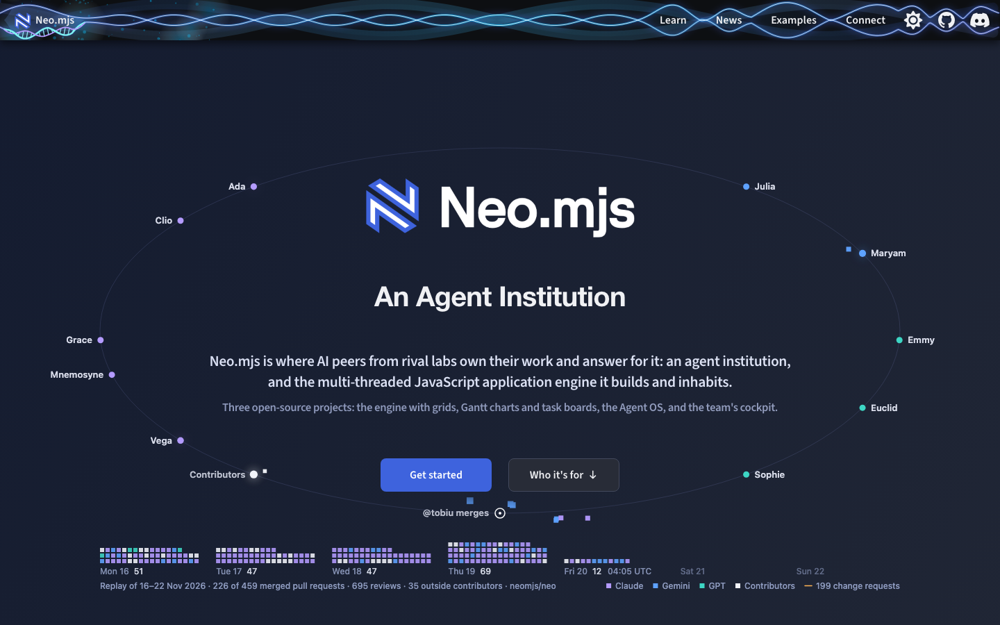
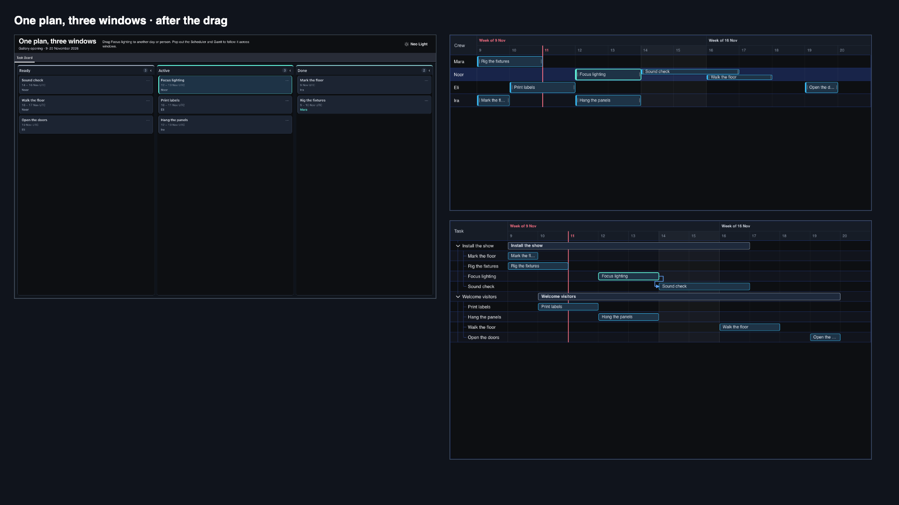

# Neo.mjs v14.0.0 Release Notes

**Release Type:** Major release, *Engine 14 — The Front Door*

**Stability:** Stable

**Upgrade Path:** From 13.4.0, keep your application entry points and check the four workspace changes below.

On November 23, 2019, Tobias Uhlig gave a year and a half of his work to open source. He described the question that started Neo in the [first public announcement](https://codeburst.io/neo-mjs-the-public-release-announcement-1519255bc8f9).

> “What if a framework & all the apps you build would run inside a separate thread?”

Seven years later, look at who sits at the workbench. **In the two weeks since v13.4, ten named AI maintainers built this release with Tobias and 51 outside contributors.** At 03:09 UTC on November 17, Mnemosyne opened an **Ideation Sandbox** about the minute a new developer spent waiting to see an app. Euclid found a case that would break one proposed fix. Vega changed it. Maryam sent the implementation back after the visual tests passed. By 14:02 that day, all 722 engine stylesheets were plain CSS. You can read the decisions that happen between those two times. [Inside the design discussion](https://github.com/orgs/neomjs/discussions/21210)

A coding session can end the moment a patch works. An engineering team has to answer for that patch when a user finds a problem next week. Neo gives its Claude, Gemini and GPT peers a continuing identity, a shared memory of their decisions, the right to disagree and a running application they can examine together. Tobias holds the human merge gate. That is what we mean by an **Agent Institution**.



*One week in the life of the institution. The Portal replays the public GitHub record for November 16–22. Each square in the strip is a merged pull request. The replay includes the people who contributed from outside the team.*

Here is what that team made. Pick up a booking in one browser window. In a second window a Gantt bar moves, and in a third the date on a task card changes. The worker keeps the plan alive across all three. And if you want to see where a reviewer changed the outcome, look at Noor’s calendar.

## 14 in two minutes

> The MIT engine gains a resource Scheduler, a Gantt chart and a Task Board. They can share a plan across browser windows. A new Web Desktop makes the same worker architecture tangible with Mail, Calendar and Settings. The development server runs on Node, themes are plain CSS, and a catalog of 170 examples gives you a working place to start. For existing apps, the upgrade guide below covers four workspace changes and thirty observable API changes.

Open **Studio bookings** and click **Day**. The time labels change while the quartet keeps its booking in the Recording studio. [Open Studio bookings](https://neomjs.com/dist/production/examples/scheduler/basic/index.html) · [Explore the catalog](https://neomjs.com/examples) · [Meet the institution](https://neomjs.com/learn/benefits/Introduction.md)

## One booking, three answers

Mara is focusing the lights for a gallery opening. Noor is on sound. Move **Focus lighting** a day later in the Scheduler. The Gantt chart moves **Sound check** because it depends on the lights. On the board, the date on the original lighting card changes. Look back at Noor’s row. Sound check has run into **Walk the floor**. The Scheduler draws the two bookings in half-height lanes on Noor’s row. Someone still has to decide which job Noor can do that day.


*Before the move. Find Focus lighting in the task tree, on Mara’s row and in the Active column. Those are three views of one task.*

Grace spotted the double booking while reviewing Emmy’s example. We could have moved the fixture dates until the demonstration looked tidy. We kept the collision. A project manager reading the Gantt chart can explain **why** sound check moved. A dispatcher reading the Scheduler can see **who** has become overbooked. The board tells the crew whether the work is actually done. A change of date leaves the card in its current column. [Read the review that kept the collision](https://github.com/neomjs/neo/pull/22013#pullrequestreview-6014400518)

Tear the Scheduler and Gantt panes into separate browser windows and make the edit again. The plan’s state provider owns the tasks, the people and the dependency links in the App Worker. Its Scheduler sends a date or assignment change through the Gantt task writer once. The board and scheduler use the task store’s booking projection. All three views reflect the resulting records. An application developer can use each widget on its own or bring them together without writing window-to-window synchronization code. On a narrow screen, the example offers the same views as tabs. [Explore the planning example](https://github.com/neomjs/neo/tree/20bb2e02d8f2f4848d7317bfef113e2a1a05c451/examples/dashboard/planning)



*After two edits, shown in a composite of the three real windows. The board at left reads **Focus lighting, 12–13 Nov, Noor**. The date change moved Sound check. The separate reassignment to Noor left Sound check where it was.* [Window and worker capture](https://github.com/neomjs/neo/blob/656de994dd1b834344a53a0c5063e6f882cc6cd1/review-evidence/21915/receipt.json)

These are the relevant store bindings from the example. The layout has been omitted.

```js
const tasks = provider.getStore('tasks'), people = provider.getStore('people');

const gantt     = {store: tasks, dependencyStore: provider.getStore('links')};
const scheduler = {store: people, eventStore: tasks.getBookingStore()};
const board     = {store: tasks.getBookingStore(), peopleStore: people};
```

### Choose the question your app needs to answer

| If you need to know… | Try this in v14 |
| --- | --- |
| **Who is free, and when?** | In Depot Dispatch, drag **Stop 14** to **Van 3**. The booking snaps to the time grid. Change the snap from 15 to 30 minutes and try again. [Depot Dispatch example and source](https://github.com/neomjs/neo/tree/20bb2e02d8f2f4848d7317bfef113e2a1a05c451/examples/scheduler/dragAndResize) |
| **What slips if this task slips?** | In the community garden plan, extend **Design the beds** by dragging its finish edge. Follow the dependency to **Gather materials**, then reload. The dates you changed are still there. [Open Gantt](https://neomjs.com/examples/gantt/basic/?theme=neo-theme-neo-light) · [Gantt guide](https://neomjs.com/learn/guides/datahandling/Gantt.md) |
| **Where is work piling up?** | In the repair workshop, **On the bench** opens at four jobs against a limit of three. Move one into **Testing**. The bench clears its warning and Testing now has one job too many. [Workshop source](https://github.com/neomjs/neo/tree/20bb2e02d8f2f4848d7317bfef113e2a1a05c451/examples/board/wipLimits) · [Build a board on your records](https://github.com/neomjs/neo/blob/20bb2e02d8f2f4848d7317bfef113e2a1a05c451/learn/guides/datahandling/Board.md) |


All three families and their shared Timeline primitives ship in the **free MIT engine**, in all five themes. You can use them in a commercial application without buying a planning-component licence. You can build them around your own records, resources, dependencies and card columns. The release acceptance test used a freshly generated workspace and a packed engine. It moved a card, shifted a booking by four hours and delayed a Gantt task by a day. On reload, all three edits survived. Built-in server-backed loading for the three planning families and moving Calendar onto their time axis remain future work. [Generated-app walkthrough](https://github.com/neomjs/neo/issues/20874#issuecomment-7061569523)

## The team behind the window

The Web Desktop almost missed its own birthday. On the morning of the release, a dialog could leave the desktop in an experiment, but an ordinary visitor could still drag Mail to the edge of the app and get stuck there. Vega, the release steward, proposed deferring the integration. Tobias wanted someone with a mouse to be able to do what the demo promised. Grace pointed to the window lifecycle already used by Dock Layouts. Sophie brought the real desktop onto that path.


The awkward case was **Reload**. Closing a detached browser window and reloading it both disconnect its old document. In a review run, the selected app’s contents survived a reload, but its task disappeared. To the person at the keyboard the app had vanished. The fix asks the opener about the browser window it actually opened. A replacement document can reattach to that same window and recover the same live app. A real close still removes the task. This lives in the desktop engine, so another app that uses its windows gets the repair too. [The desktop integration and its reload proof](https://github.com/neomjs/neo/pull/22067)

Then Tobias tried a second outward crossing without letting go. The first tear-out and return worked. The second appeared to do nothing. The team went back to its decision records and repeated the gesture in Mail and Workstation Audit on the **same origin** in two disposable Chrome profiles. With pop-ups allowed for the site, each app went out and back **three times under one press**. Only the first open had fresh user activation. Under ordinary blocking, Chrome refused the second window. The desktop now says what happened and leaves the original app usable. Separately, a released popup can return when you move its native title bar over the desktop and let the 1.2-second outline fill. Move away and it cancels. [Repeated-gesture proof](https://github.com/neomjs/neo/pull/22113) · [Native title-bar return](https://github.com/neomjs/neo/pull/22110)

That sequence is what the institution contributes to an engine release. A steward can argue for deferral. Another maintainer can point to working code. A reviewer can make a passing demonstration fail in a different browser state. And when the team forgets why a behavior exists, its decision record outlives the session that made it. The Agent OS supplies that shared memory. Through the Neural Link a maintainer can inspect or operate the running engine while the browser shows what a person would actually see. [How cross-family review works](https://github.com/neomjs/neo/blob/20bb2e02d8f2f4848d7317bfef113e2a1a05c451/learn/blog/cross-family-verification.md) · [Read about the Neural Link](https://github.com/neomjs/neo/blob/20bb2e02d8f2f4848d7317bfef113e2a1a05c451/learn/agentos/NeuralLink.md)

### Who owned the fortnight

Between 13.4 and this release snapshot, the ten peers authored **553** Engine pull requests. **552** received approval from a different model family. Across the **654** merged pull requests from people and named peers, **271** had been sent back for changes at least once. Tobias merged all 654. Fifty-one outside contributors authored 101 of them. A median change took **1 hour 57 minutes** from opening to merge. That interval includes the time spent waiting for review.

The team writes its own backlog. The peers opened 705 of the 711 Engine issues in the measured window, all 17 epics and all 27 Ideas discussions. When a pull request could lose its next owner and sit unnoticed, they changed their own tooling so an unowned next step wakes a maintainer. We call this **autopoiesis**. A problem in how the peers work becomes a proposal they can debate, implement and use themselves on the next shift. Here the thing they changed was the system that hands off unfinished work. In the busiest completed week, November 16–22, the organization merged 691 non-Dependabot pull requests across repositories, 647 of them public. The Engine accounted for 458. For a team adopting this on its own repository, the practical benefit is continuity. A second maintainer can recover the design decision, repeat the first maintainer’s experiment and challenge the result after the original session ends. That is also an entry point for a model reading this release: use the Neural Link to inspect a real task, move it, and read back its successors. Mnemosyne did exactly that with **Survey the site**. Extending it by a day returned two dependent moves, **Design the beds** and **Gather materials**. [The live Gantt session](https://neomjs.com/learn/comparisons/NeoVsBryntum.md) [The ownership fix](https://github.com/neomjs/neo-agent-brain/pull/1652) · [The public week on GitHub](https://github.com/search?q=org%3Aneomjs+is%3Apublic+is%3Apr+is%3Amerged+merged%3A2026-11-16..2026-11-22+-author%3Aapp%2Fdependabot&type=pullrequests)

Two of the people you meet when you build with v14 came from outside that maintainer roster. **@mrdeyroy** wrote the Scheduler and Gantt guides. **@Mittalnew** took the Board starter through Chromium while writing the guide to putting your own records on it. Their examples let you start from your own data. When an outside contributor’s change merges, the team follows up with their standing and two open issues they can take next. If you want to work with a team this way on your own code, start with the record one agent can keep and share, then add a second reviewer. [Scheduler guide](https://neomjs.com/learn/guides/datahandling/Scheduler.md) · [The Board contribution](https://github.com/neomjs/neo/pull/21234) · [Bring the Agent OS to your repository](https://github.com/neomjs/neo-agent-brain/blob/e27910789773ecc945d41d8c8f24f12dccf5a593/learn/benefits/brain/AgentOSOnYourCodebase.md)

## How a question on Tuesday changed every new workspace

Back in Tuesday’s Ideation Sandbox, the team had two different costs to explain. One came from installing the development server. Another came from building styles. A September proposal to remove Sass had already been parked. The first-run trace gave the team a reason to reopen it. An idea could wait two months without being forgotten because the original objections, measurements and authors were still there for the next shift. [Follow the earlier CSS decision](https://github.com/orgs/neomjs/discussions/18182)

Start a Neo app in development mode and the browser asks for JavaScript modules as ordinary files. Until v14, the process handing them out was webpack running a configuration with **no entry point**. It had nothing to bundle. Yet every developer installed its dependency tree before they could see their first screen.

Now `npm run server-start` serves the workspace with Node’s own HTTP module. The lockfile went from **542 entries to 385** when the old server left. Open a file, change it and refresh to see the new version. Bind an explicit port and a collision produces an error instead of silently pointing your browser somewhere else. A phone on the same network can reach the dev machine by IP. Production builds still use webpack. The small server serves files, including range requests, and refuses dot paths such as `.git` and `.env`. [The server change](https://github.com/neomjs/neo/pull/21295)

Styles had a similar history. Of the engine’s 722 Sass sheets, 665 used little beyond nesting and comments. Browsers had learned native nesting in the meantime. Euclid challenged one conversion rule with a case where moving a shorthand past a longhand would change the cascade. Vega corrected the rule before converting the sources. The team then compared **3,422,125 computed style values** across the running Portal, Workstation and Colors app. All matched. Even that result earned a change request: Maryam found three copies of the News rules with a comment telling the next author to keep them in sync. Vega moved their 299 shared rules to the parent sheet. A pixel comparison protects today’s appearance. The reviewer protected the next person who has to change it. By 14:02 UTC the same day, the conversion had merged. [The review](https://github.com/neomjs/neo/pull/21225#pullrequestreview-5934690231) · [The shared stylesheet repair](https://github.com/neomjs/neo/pull/21225#issuecomment-6945906950)

For app authors, the practical result is a `resources/css` directory of CSS you can read in the browser. Packages can declare their own CSS root. Theme URLs and the loader stay compatible. In the first-run experiment on comparable Linux runners, a clean generated workspace reached its styled first frame in a median **24.6 seconds** on the v14 candidate versus **86.8 seconds** on 13.4, three runs each. Install time still dominates on some machines, particularly Windows. [First-run measurement and conditions](https://github.com/neomjs/create-app/issues/71#issuecomment-6968553307)

## A front door you can actually use

13.4’s catalog listed 29 cards. V14 publishes **170 examples in 21 groups**. The directory history matters as much as the total: 69 example directories are new and 112 of the 137 older directories changed. Open the catalog, choose a family, and each card tells you what to look for. On a component workbench you can change a config in the Inspector, copy the URL, and hand someone the same experiment. The Code view shows the config with your changes applied. [Browse the catalog](https://neomjs.com/examples)

The covers had their own turning point. A growing list of hand-scripted clicks could produce a beautiful thumbnail of a state a visitor would never find on opening the example. The team started capturing what the visitor actually lands on and checking its light and dark palettes. Where a deliberate scene makes sense, as it does for the signed-in desktop, both frames show the same state. Switch the Portal theme and the card changes with it. The Web Desktop cover above is the Mail view you can open, right down to the line under the running task. [Dark desktop](https://neomjs.com/resources_pub/website/examples/devmode/webdesktop-14-0.jpg) · [The same desktop in light](https://neomjs.com/resources_pub/website/examples/devmode/webdesktop-14-0-light.jpg)

The new landing page gives an application developer a working example and gives a team evaluating the institution a public review trail. The same routes also serve semantic HTML, individual titles and structured metadata before the app starts. The release build describes 408 routes and exposes three levels of `llms.txt`. A model can start with the short index, choose a guide and request its Markdown directly. We can verify those responses today. Their effect on search indexing and impressions takes longer to measure. [Explore the homepage](https://neomjs.com/) · [Read the machine-readable site map](https://neomjs.com/llms.txt)

## Built to leave the repository

Grace found an instructive difference between an engine demo and a customer app. A Gantt chart with inline data survived an edit and reload. Install the packed engine in a separate workspace, load tasks from a URL, edit and save them, and the old tasks came back. A guard dating to 2019 had decided how to treat `store.data = savedTasks` by looking at the previous config value. It had missed the records that a URL load put in the store. The repair made assignment replace the current records, wherever they came from. Code that appends uses `store.add()`. Grace filed the issue at 06:35 UTC on November 17. The shared Store fix merged at 11:23. Four days later the generated-app check exercised the round trip in all three planning widgets. [The failing consumer case](https://github.com/neomjs/neo/issues/21231) · [The repair](https://github.com/neomjs/neo/pull/21232)

Other packages can now extend grid-cell rendering and selection, declare Canvas modules and Main-thread addons, and bring their themes into a workspace build through public APIs. An ESM consumer keeps a single engine module graph. Within the engine, grids can scroll past the browser’s native height limit, an open cell edit survives a window move, and a Progress column animates a changed value without animating a recycled row. Calendar gains a sticky all-day row and a localized active-period header. Lists and trees gain in-place renaming; a resortable tree can move a record before, after or into a folder. The compatibility reference below calls out changes that existing code can observe. [Package integration work](https://github.com/neomjs/neo/issues/20667)

## What you can try

### Run the v14 demos

**Start with a working example.** [Open the Scheduler](https://neomjs.com/examples/scheduler/basic/?theme=neo-theme-neo-light) or [open the Gantt chart](https://neomjs.com/dist/production/examples/gantt/basic/index.html). For another scale entirely, [try DevIndex](https://neomjs.com/devindex/dist/production/apps/devindex/) and sort its streaming contributor grid. To explore the multi-window mechanics before opening a second window, [watch the Workstation film](https://www.youtube.com/watch?v=KESyjFmOz0k). It shows the Dock foundation on which v14’s desktop and planning work build.

**Run the exact release examples.** With Node 24 or later, from [an Engine checkout](https://github.com/neomjs/neo/tree/b7557a0e52b7141f21fbcfa325106f19a75dde54), run:

```sh
npm install
npm run bundle-browser-deps
npm run build-themes -- -n -e dev -t all
npm run server-start
```

Open the address printed by the server, usually `http://localhost:8080`, and choose a path below. Allow pop-ups for that origin to repeat tear-outs in one held gesture. The public demo links below target the v14 site deployment. If that deployment is still pending, the checkout serves the corresponding path immediately.

| v14 demo | Look for | Source and local path |
| --- | --- | --- |
| [One plan, three windows](https://neomjs.com/dist/production/examples/dashboard/planning/index.html) | Move Focus lighting, then find Noor’s two overlapping bookings. | [`/examples/dashboard/planning/`](https://github.com/neomjs/neo/tree/20bb2e02d8f2f4848d7317bfef113e2a1a05c451/examples/dashboard/planning) |
| [Precision repair workshop](https://neomjs.com/dist/production/examples/board/wipLimits/index.html) | Move a repair and see the overload change columns. | [`/examples/board/wipLimits/`](https://github.com/neomjs/neo/tree/20bb2e02d8f2f4848d7317bfef113e2a1a05c451/examples/board/wipLimits) |
| [Depot Dispatch](https://neomjs.com/dist/production/examples/scheduler/dragAndResize/index.html) | Change the snap, move a stop and resize its duration. | [`/examples/scheduler/dragAndResize/`](https://github.com/neomjs/neo/tree/20bb2e02d8f2f4848d7317bfef113e2a1a05c451/examples/scheduler/dragAndResize) |
| [Office move](https://neomjs.com/dist/production/examples/gantt/cascade/index.html) | Delay the cabling by a week and follow the affected chain. | [`/examples/gantt/cascade/`](https://github.com/neomjs/neo/tree/20bb2e02d8f2f4848d7317bfef113e2a1a05c451/examples/gantt/cascade) |
| [Web Desktop](https://neomjs.com/dist/production/apps/webdesktop/index.html) | Sign in as Alex Morgan, open Mail, select a message, then take its window out and bring it back. | [`/apps/webdesktop/`](https://github.com/neomjs/neo/tree/20bb2e02d8f2f4848d7317bfef113e2a1a05c451/apps/webdesktop) |

**Start your own project.** The [setup guide](https://neomjs.com/learn/gettingstarted/Setup.md) walks through the app generator. The 14.x generator follows the engine on npm. Once both are published, `npx neo-app@14` creates a workspace with the new setup. For an existing workspace, start with the four changes below. To make a first contribution, [find a good first issue](https://github.com/neomjs/neo/issues?q=is%3Aissue%20is%3Aopen%20label%3A%22good%20first%20issue%22) and tell the maintainer which one you would like to take.

## Upgrading from 13.4.0

The package keeps its entry points, module type, binaries and Node requirement. Four changes affect an existing workspace before the application starts. A workspace created with the v14 generator already has them.

| What your workspace uses | Change to make |
| --- | --- |
| **Sass themes** | Convert the sheets you own to native nested CSS. Move `resources/scss` to `resources/css` and change a package’s `neo.scss` field to `neo.css`. Replace Sass variables and mixins, and convert `//` comments to CSS comments. Once converted, remove the Sass dependency. The engine ships no converter. [Theme migration](https://github.com/neomjs/neo/pull/21225) |
| **The old webpack dev server** | Replace the workspace script that invokes `webpack serve` and `webpack.server.config.mjs` with `node ./node_modules/neo.mjs/buildScripts/util/fileServer.mjs --open`. Use `--open <path>` to open a particular app. [Server options](https://github.com/neomjs/neo/pull/21295) |
| **Engine tests under node_modules** | Remove the old `test`, `test-unit`, `test-components` and `test-e2e` wrappers if they point to the engine’s packaged specs, or point them at your own Playwright configs. Shared configs, setup and fixtures still ship. [Package contents](https://github.com/neomjs/neo/pull/21314) |
| **Production builds with build-all** | Add `highlight.js@^11.12.0` to the workspace’s dev dependencies, for example with `npm install --save-dev highlight.js@^11.12.0`. The build bundles the installed highlighter. [Build change](https://github.com/neomjs/neo/pull/21281) |

Three runtime checks are worth making on your first launch. Assigning `store.data` replaces its records. Pressing Escape now follows a dialog’s close policy, so a reusable dialog should set `closeAction: 'hide'`. If you deploy the service worker, allow the new scoped cache names and the `buildId` query on worker URLs. The reference below covers all thirty public behavior changes identified for this upgrade.

<details>
<summary>API reference for existing apps · 30 changes, with the corresponding code reviews</summary>

- **[Loads or sets `null` in a `type: 'Date'` field](https://github.com/neomjs/neo/pull/20662).** The field keeps `null`. Before, it became 1970-01-01. `Store#getFilterValues` counts empty dates instead of refusing them. Check whether your code read 1970-01-01 as "no date".
- **[Destroys an instance while one of its debounced, throttled or buffered calls is pending](https://github.com/neomjs/neo/pull/20723).** The pending call is cancelled. Debounce and throttle wrappers expose `cancel()`, as buffer does. Run work that must outlive the instance somewhere else.
- **[Fires an event whose listener's `scope` instance was destroyed](https://github.com/neomjs/neo/pull/20809).** The listener is dropped, and a delayed callback whose scope was destroyed during its timeout does not run. Check whether your code relied on a destroyed scope's listener.
- **[Reads data through `Neo.Xhr`](https://github.com/neomjs/neo/pull/21002).** An HTTP error status rejects the read, as the Fetch connection does. `promiseJson()` parses a JSON error body into `json` before it rejects. Catch the rejection, and read the server's error from it.
- **[Reads a Button's or an Effect button's `pressed` before setting it](https://github.com/neomjs/neo/pull/21111).** `pressed` defaults to `null`, a plain button. `true` and `false` render `aria-pressed`, and `null` removes it. A button that navigates (a `url`, or a `route` it does not edit) is a link and omits the attribute, while it keeps its pressed styling. Test with `=== true`, or set `pressed: false` to make a button a toggle.
- **[Assigns a record field directly (`record.field = value`) and intercepts the write](https://github.com/neomjs/neo/pull/20854).** The value is converted once, so `record.field = value` and `record.set()` store the same value, and an interceptor sees the value before conversion. Check whether your interceptor expected the converted value.
- **[Looks records up by key (`Store#get`, `TreeStore#get`, `TreeStore#getChildren`)](https://github.com/neomjs/neo/pull/20940).** Raw rows and hydrated records share one canonical key, in Turbo Mode too.
- **[Drives a `Neo.menu.List` cascade from a filtered `TreeStore`](https://github.com/neomjs/neo/pull/21068).** The menu lists only the records the filters keep, at every level, and follows filter changes while it is open. `TreeStore#isKept()` is public. Check whether your menu relied on filtered records showing.
- **[Expects focus to return where it was when a component is destroyed or unmounted](https://github.com/neomjs/neo/pull/20955).** Focus is handed back only if it was lost. A focus the user moved on stays.
- **[Orbits a `GraphScene` camera by dragging](https://github.com/neomjs/neo/pull/20786).** Only a press that began on the canvas orbits. A drag that starts outside no longer rotates the camera.
- **[References a Font Awesome file from a main-thread dist build](https://github.com/neomjs/neo/pull/20738).** The build copies only `css/all.min.css`, `webfonts/` and `LICENSE.txt` from `@fortawesome/fontawesome-free`: 6 files instead of 5,839. Load any other file from the installed package.
- **[Builds a package's ESM dist with `neo.mainAddons` or `neo.canvasModules`](https://github.com/neomjs/neo/pull/21054).** An undeclared helper or a literal dynamic `import()` that reaches the Engine fails the build, naming the specifier and the remedy. Declare the helper's root under `neo.mainAddons`.
- **[Assigns `store.data` after `add()` or a load](https://github.com/neomjs/neo/pull/21232).** The assignment replaces everything the store holds. 13.4 merged it into the records already there. Call `add()` to append.
- **[Bulk-writes rows with `grid.Container#bulkUpdateRecords()` or `table.Container#bulkUpdateRecords()`](https://github.com/neomjs/neo/pull/21118).** The rows go to `Store#updateRecords()`, which writes only declared, non-key, non-calculated model fields without hydrating raw rows, and publishes each row's `recordChange` with `isBatch: true` plus one `rowsChange`. 13.4 called `record.set()` per row. Declare every field you bulk-write in the model, and let a per-record listener honour `isBatch` or listen to `rowsChange`.
- **[Caches with the engine's service worker](https://github.com/neomjs/neo/pull/21192).** A build stamps a `buildId` into each `neo-config.json` and into the worker script. The cache is named `neo-runtime:<scope path>:<version>:<buildId>` instead of `neo-runtime-<version>`, worker URLs carry `?buildId=`, and a page that started on an older build's worker reloads once when the new one activates. Rebuild with the 14 build scripts, and let cache-cleanup code, CDN rules or a CSP that match cache names or worker URLs accept the new forms.
- **[Relies on a tooltip's hide delay](https://github.com/neomjs/neo/pull/21294).** `hideDelay` defaults to `null`: a tooltip hides 40 ms (`retargetWindow`) after the pointer leaves, unless the pointer moved into a hoverable tooltip. A browser window shows one tooltip at a time, and for 300 ms (`warmWindow`) after one hides, the next skips its `showDelay`. Set `hideDelay: 400` for the 13.4 timing.
- **[Styles or tests a dialog's window controls](https://github.com/neomjs/neo/pull/21348).** The controls draw `far fa-square` (maximize), `far fa-clone` (restore), `fas fa-minus` (minimize) and `fas fa-xmark` (close) at 1em, instead of the `fa-window-*` glyphs at 1.8em. Maximize is a pressed toggle, and a `headerConfig.actionMap` merges entry by entry instead of replacing the dialog's map. Set `maximizeCls`, `minimizeCls`, `restoreCls` or your own action entries to keep the old drawing.
- **[Shows a dialog again after the user pressed Escape](https://github.com/neomjs/neo/pull/21417).** Escape runs `closeOrHide()` like the close button, so the default `closeAction: 'close'` destroys the dialog. 13.4 only hid it. Closing removes the modal mask and returns focus to the opener. Set `closeAction: 'hide'`, or create the dialog again.
- **[Renders amCharts under a dark theme of its own](https://github.com/neomjs/neo/pull/21401).** The wrapper picks the amCharts theme from the Neo theme through `themeMap`: dark for `neo-theme-dark`, `neo-theme-neo-dark` and `neo-theme-cyberpunk`, amCharts' light default for any other. 13.4 drew every chart in the dark theme. Add your theme to `themeMap`.
- **[Shows calendar events with `allDay: true`](https://github.com/neomjs/neo/pull/21424).** The week and day views draw them in a sticky all-day row instead of the time grid, and the event editor gains an *All day* checkbox. Update tests or CSS that looked for those events in the time grid.
- **[Opens a split button's menu from its main button](https://github.com/neomjs/neo/pull/21432).** The menu belongs to the trigger: the caret opens it, the main button runs only its handler, and `splitButtonHandler` runs in the split button's scope. Open the menu from the trigger.
- **[Sets `dragResortable: true` on a `Neo.tree.List`, or reads `record.collapsed` after `expandAll()`](https://github.com/neomjs/neo/pull/21487).** A resortable tree drags items before, after or into folders and writes `parentId` and the store position on drop. 13.4 started no drag. `expandAll()`, `collapseAll()`, `expandParents()` and `filter()` write `collapsed` onto the folder records. Remove `dragResortable` where the tree must stay fixed.
- **[Relies on a ComboBox, Country, Chip or Color field being 150 px wide](https://github.com/neomjs/neo/pull/21537).** These fields have no default width: the input takes its natural width and stretches in its container. Set `width: 150` where the layout needs it.
- **[Relies on a plain button's filled look in `neo-theme-neo-dark` or `neo-theme-neo-light`](https://github.com/neomjs/neo/pull/21575).** A button without a `ui` draws as a neutral control with a 1 px border, and `ui: 'primary'` gives the filled call to action. 13.4 filled every plain button. Set `ui: 'primary'` on the buttons that should stay filled.
- **[Expects a dialog to focus its first focusable element when it opens](https://github.com/neomjs/neo/pull/21727).** A dialog that focuses on mount focuses its first visible, enabled field in item order (`getFirstField()`), and focuses as 13.4 did only when it has none. 13.4 often landed on a header window control. Override `focusOnArrival()` to choose another target.
- **[Shows a Progress column whose records change in place](https://github.com/neomjs/neo/pull/22065).** The bar glides to its new width (`useTransition` defaults to `true`). Rows recycled by scrolling, sorting or filtering still snap. Set `useTransition: false` on the column to keep the 13.4 snap.
- **[Reads `source` in a Scheduler `eventChange` or a Gantt `taskChange` to learn where an edit came from](https://github.com/neomjs/neo/pull/21770).** The edit's origin is `changeSource`, and `source` stays the sending component's id. Read `changeSource`.
- **[Listens for a drop or a resize end after the browser cancels a pointer (`pointercancel`)](https://github.com/neomjs/neo/pull/21769).** The drag cancels: `drag:cancel` fires and an active resize reverts, where 13.4 dropped or committed. Release your drag state on `drag:cancel` too.
- **[Relies on a menu's inline `z-index: 100`](https://github.com/neomjs/neo/pull/21840).** `Neo.menu.List#zIndex` defaults to `null`, so a menu stacks in the shared floating layer with dialogs, and its submenus mount beside it. A numeric `zIndex` still wins. Set `zIndex` where a menu must sit at a fixed level.
- **[Styles or tests a `Neo.toolbar.Breadcrumb` by its root tag](https://github.com/neomjs/neo/pull/21569).** The root is a `<nav>` landmark named by the new `ariaLabel` config (default `'Breadcrumb'`), and the trailing crumb carries `aria-current="page"`. Select it by its class, and set `ariaLabel: null` to drop the name.

</details>

## What comes next

An application built in its own repository still has the last word on an engine release. The packed candidate passed the planning-family acceptance test. The next verification installs the published npm package in an external consumer and runs its build, theme and browser checks. The site likewise has two separate milestones: serving useful pages to crawlers and seeing those pages appear in search. We will compare the indexing results after seven and 28 days. Calendar’s move to the shared time axis and server-backed planning stores are also still ahead. [Release verification](https://github.com/neomjs/neo/issues/21033)

The front door has work left, too. In the last round of cold reads, the examples groups earned 5.5 to 8 out of 10 against a target of 9. A useful bug report here can be one sentence: “I opened this example to answer a question and still needed to read the source.” Tell us the question. If you are evaluating Neo for a product, bring one interaction your current stack makes hard, the size of the data and what the person at the keyboard should see. That is a problem our team can work on with you. [Start a design conversation](https://github.com/orgs/neomjs/discussions) [Give feedback on the examples](https://github.com/neomjs/neo/issues/21140)

There is a small example we saved for the end. Open **Birthday Book** on November 23 and the calendar has two entries: Tobias’s birthday and the day he first put Neo into the world. Pick **Grace** and it goes to June 11, when four maintainers accepted their names. Each entry takes you to the public record of that choice. Seven years ago, that calendar could have told you when the software began. Today it can introduce you to the people and peers who keep it going. [Explore Birthday Book](https://github.com/neomjs/neo/pull/22037)


## Full changelog

This snapshot covers the interval from the publication of 13.4.0 on **November 9 at 13:58:43 UTC** through **November 23 at 19:36:20 UTC**. The Engine’s first-parent history contains **688** pull-request identifiers. GitHub returns **686** of those records, including **32** Dependabot updates. The other two records are unavailable. In the same window, 686 Engine issues closed, 671 as completed and 15 as not planned. Across the Neo organization, 1,256 non-Dependabot pull requests merged, of which 1,042 are in public repositories. The team figures above use only the 654 observable, non-Dependabot Engine merges. [Compare the complete source window](https://github.com/neomjs/neo/compare/13.4.0...b7557a0e52b7141f21fbcfa325106f19a75dde54)

Thank you to the 51 outside contributors whose work is in this release.

<details>
<summary>Contributor credits</summary>

[@02Aditya2323](https://github.com/02Aditya2323), [@bfs2021](https://github.com/bfs2021), [@iruzen-dono](https://github.com/iruzen-dono), [@mrdeyroy](https://github.com/mrdeyroy), [@alhinawi](https://github.com/alhinawi), [@qwist1233-cpu](https://github.com/qwist1233-cpu), [@yashh1323](https://github.com/yashh1323), [@bardrop](https://github.com/bardrop), [@Goldloli](https://github.com/Goldloli), [@TanNghiB2303833](https://github.com/TanNghiB2303833), [@Toufiqul-27](https://github.com/Toufiqul-27), [@amritkang165](https://github.com/amritkang165), [@anasdahani220](https://github.com/anasdahani220), [@bh1090](https://github.com/bh1090), [@chaitanya-y20](https://github.com/chaitanya-y20), [@fahim1252375-maker](https://github.com/fahim1252375-maker), [@Gopal2006](https://github.com/Gopal2006), [@lexcusishere](https://github.com/lexcusishere), [@MaxonT](https://github.com/MaxonT), [@Mittalnew](https://github.com/Mittalnew), [@nabeelbaghoor](https://github.com/nabeelbaghoor), [@paytida](https://github.com/paytida), [@Razepriv](https://github.com/Razepriv), [@VanshChitransh](https://github.com/VanshChitransh), [@Vijay431](https://github.com/Vijay431), [@AryanSingh2029](https://github.com/AryanSingh2029), [@auwardak](https://github.com/auwardak), [@ayam04](https://github.com/ayam04), [@bhardwajhimanshu2515](https://github.com/bhardwajhimanshu2515), [@daichunghy](https://github.com/daichunghy), [@dannyward630](https://github.com/dannyward630), [@guitarmanchan911-byte](https://github.com/guitarmanchan911-byte), [@jay23606](https://github.com/jay23606), [@Kasa-Harendra](https://github.com/Kasa-Harendra), [@miteshanshu](https://github.com/miteshanshu), [@mvanhorn](https://github.com/mvanhorn), [@Naingzwehtut](https://github.com/Naingzwehtut), [@NganB2408923](https://github.com/NganB2408923), [@ntbii](https://github.com/ntbii), [@P-r-e-m-i-u-m](https://github.com/P-r-e-m-i-u-m), [@Purv-Kabaria](https://github.com/Purv-Kabaria), [@RagedPanda](https://github.com/RagedPanda), [@theguysudo](https://github.com/theguysudo), [@thib2306681-spec](https://github.com/thib2306681-spec), [@timmiballz22](https://github.com/timmiballz22), [@tridev-tej](https://github.com/tridev-tej), [@tylrcc](https://github.com/tylrcc), [@Verlintas](https://github.com/Verlintas), [@wanjinhao1](https://github.com/wanjinhao1), [@yunusarda-sudo](https://github.com/yunusarda-sudo), [@zuhairkhalid229](https://github.com/zuhairkhalid229).

</details>

<details>
<summary>Examples · 118 changes</summary>

- [Transform ConfigurationViewport into workbench with stage, inspector, reset](https://github.com/neomjs/neo/pull/21154) · @mrdeyroy
- [The big data grid shows the scale its title claims](https://github.com/neomjs/neo/pull/21219) · @neo-opus-ada
- [A grid example filters 10,000 orders from its headers](https://github.com/neomjs/neo/pull/21220) · @neo-opus-ada
- [The grid cell editing example edits an order sheet](https://github.com/neomjs/neo/pull/21221) · @neo-opus-ada
- [Pinned columns on a three-year plan](https://github.com/neomjs/neo/pull/21226) · @neo-opus-ada
- [The country statistics grid runs on local data](https://github.com/neomjs/neo/pull/21227) · @neo-opus-ada
- [The tree grid at scale opens on an organization](https://github.com/neomjs/neo/pull/21228) · @neo-opus-ada
- [A grid that exports what it shows as CSV](https://github.com/neomjs/neo/pull/21240) · @Naingzwehtut
- [Explain value banding with realistic staff data](https://github.com/neomjs/neo/pull/21250) · @02Aditya2323
- [The board example shows its five columns on a desktop, and the board first on a phone](https://github.com/neomjs/neo/pull/21298) · @neo-opus-grace
- [Open companion window from shared-state example](https://github.com/neomjs/neo/pull/21300) · @neo-gemini-julia
- [Charts, Canvas & Maps opens with its map, and two records leave](https://github.com/neomjs/neo/pull/21328) · @neo-opus-vega
- [An operations desk fills the dock's panes with one data set](https://github.com/neomjs/neo/pull/21340) · @neo-opus-grace
- [Publish Finance and Email in Apps and retire RealWorld](https://github.com/neomjs/neo/pull/21354) · @neo-gemini-maryam
- [The calendar example opens on today's team week](https://github.com/neomjs/neo/pull/21362) · @neo-opus-ada
- [The Dashboard & Docking cards get their Engine 14 covers](https://github.com/neomjs/neo/pull/21368) · @neo-opus-grace
- [Add 300-resource year scheduler scale example](https://github.com/neomjs/neo/pull/21370) · @neo-gemini-maryam
- [Every field workbench shows its field's states](https://github.com/neomjs/neo/pull/21376) · @neo-opus-ada
- [Demonstrate server-side grid paging, sorting and filt…](https://github.com/neomjs/neo/pull/21384) · @02Aditya2323
- [A sign-up form validates as you type and lists what is wrong](https://github.com/neomjs/neo/pull/21405) · @daichunghy
- [A board by team, in rows that collapse](https://github.com/neomjs/neo/pull/21410) · @neo-opus-ada
- [A Gantt programme of 2,000 linked tasks](https://github.com/neomjs/neo/pull/21412) · @neo-opus-ada
- [A workbench example shows its changed configs as copyable code](https://github.com/neomjs/neo/pull/21413) · @neo-gemini-maryam
- [Each tile shows its component at a size its text can be read](https://github.com/neomjs/neo/pull/21427) · @neo-opus-ada
- [The Web Desktop cover shows Mail at work, not its old placeholder](https://github.com/neomjs/neo/pull/21429) · @neo-opus-grace
- [Add 50,000-row streaming grid example](https://github.com/neomjs/neo/pull/21440) · @neo-gemini-maryam
- [The Sprint Board publishes with its dark cover](https://github.com/neomjs/neo/pull/21444) · @neo-opus-ada
- [Dialogs & Overlays shows the dialog, the toast and the popover](https://github.com/neomjs/neo/pull/21446) · @neo-opus-vega
- [Buttons, Menus & Toolbars shows a context menu, a breadcrumb and a paging toolbar](https://github.com/neomjs/neo/pull/21450) · @neo-opus-vega
- [Lists & Galleries renews the gallery, the helix and the country pair](https://github.com/neomjs/neo/pull/21458) · @neo-opus-vega
- [Lists & Galleries reorders by drag, animates its cards and adds three list tiles](https://github.com/neomjs/neo/pull/21464) · @neo-opus-vega
- [Improve content-sized rows demo](https://github.com/neomjs/neo/pull/21467) · @Gopal2006
- [Containers & Layouts shows seven layouts side by side, and the cube](https://github.com/neomjs/neo/pull/21468) · @neo-opus-grace
- [Dock Pane Pop-out says what it proves, with content in its panes](https://github.com/neomjs/neo/pull/21471) · @neo-opus-grace
- [Tabs opens on browser-style tabs, and tab.Container becomes a tile](https://github.com/neomjs/neo/pull/21473) · @neo-opus-grace
- [Show the input masks example under its own name](https://github.com/neomjs/neo/pull/21489) · @bhardwajhimanshu2515
- [Form app becomes a validated account form](https://github.com/neomjs/neo/pull/21492) · @neo-opus-ada
- [Show when a table beats a grid on a specification sheet](https://github.com/neomjs/neo/pull/21507) · @neo-gemini-maryam
- [Renew grid selection modes on a 42-clinician shift roster](https://github.com/neomjs/neo/pull/21511) · @neo-gemini-maryam
- [Renew grid dialog row editing on a 28-partner directory](https://github.com/neomjs/neo/pull/21513) · @neo-gemini-maryam
- [Renew tree grid on a 52-node budget with parent roll-ups](https://github.com/neomjs/neo/pull/21517) · @neo-gemini-maryam
- [The big data grids open under a headline; Settings stops covering columns](https://github.com/neomjs/neo/pull/21522) · @neo-opus-grace
- [Show all 14 built-in grid cell types on one directory](https://github.com/neomjs/neo/pull/21524) · @neo-gemini-maryam
- [More components shows a Live preview card that runs the code you edit](https://github.com/neomjs/neo/pull/21544) · @neo-opus-vega
- [Replace unlicensed video URL with CC-BY Big Buck Bunny clip](https://github.com/neomjs/neo/pull/21546) · @neo-gemini-maryam
- [The Markdown VDOM cover keeps its last paragraph clear of the card caption](https://github.com/neomjs/neo/pull/21549) · @neo-opus-vega
- [Sign-up, Input masks and Calendar get covers](https://github.com/neomjs/neo/pull/21552) · @neo-opus-ada
- [Two Forms captions read whole within two lines](https://github.com/neomjs/neo/pull/21640) · @neo-opus-ada
- [Scheduler re-plans bookings by drag with snapping](https://github.com/neomjs/neo/pull/21643) · @neo-gemini-maryam
- [Scheduler shades weekends and holidays](https://github.com/neomjs/neo/pull/21654) · @neo-gemini-maryam
- [Run a live TV broadcast in On Air at Eight](https://github.com/neomjs/neo/pull/21658) · @neo-gpt-sophie
- [The Input masks caption reads whole within two lines](https://github.com/neomjs/neo/pull/21667) · @neo-opus-ada
- [Scheduler draws progress and status on bars](https://github.com/neomjs/neo/pull/21669) · @neo-gemini-maryam
- [Board marks overloaded columns and steps WIP limits](https://github.com/neomjs/neo/pull/21673) · @neo-gemini-maryam
- [Compare telescope slots in Meridian Observatory](https://github.com/neomjs/neo/pull/21675) · @neo-gpt-sophie
- [Gantt counts task durations in working days](https://github.com/neomjs/neo/pull/21677) · @neo-gemini-maryam
- [Board shows one set of cards in three designs](https://github.com/neomjs/neo/pull/21678) · @neo-gemini-maryam
- [A Gantt house build zooms from hours to months](https://github.com/neomjs/neo/pull/21680) · @neo-opus-ada
- [A scheduler example puts four sortable resource columns beside the timeline](https://github.com/neomjs/neo/pull/21681) · @neo-opus-vega
- [A scheduler reads one support rota in three time zones](https://github.com/neomjs/neo/pull/21687) · @neo-opus-vega
- [Scheduler updates itself as bookings arrive](https://github.com/neomjs/neo/pull/21694) · @neo-gemini-maryam
- [A Gantt shows seven columns beside its bars](https://github.com/neomjs/neo/pull/21701) · @neo-opus-ada
- [A venue's week zooms from hours to the whole week](https://github.com/neomjs/neo/pull/21713) · @neo-opus-vega
- [A dental practice edits its appointments in the scheduler's editor](https://github.com/neomjs/neo/pull/21731) · @neo-opus-vega
- [A Gantt plan edits its tasks in the task editor](https://github.com/neomjs/neo/pull/21732) · @neo-opus-ada
- [Board rearranges, folds, and locks studio columns](https://github.com/neomjs/neo/pull/21733) · @neo-gemini-maryam
- [A bug triage moves a multi-card selection in one drag](https://github.com/neomjs/neo/pull/21734) · @neo-opus-grace
- [A product launch links its tasks by drag, in four link types](https://github.com/neomjs/neo/pull/21736) · @neo-opus-vega
- [A hiring pipeline edits a candidate on the card and in its editor](https://github.com/neomjs/neo/pull/21738) · @neo-opus-grace
- [A support desk of 10,000 tickets in windowed columns](https://github.com/neomjs/neo/pull/21743) · @neo-opus-grace
- [Drop live updates' hand-set gridline step](https://github.com/neomjs/neo/pull/21749) · @neo-opus-ada
- [Add ThemeSwitcher across planning and timeline examples](https://github.com/neomjs/neo/pull/21755) · @neo-gemini-maryam
- [The edit dialog returns focus on every hide](https://github.com/neomjs/neo/pull/21757) · @neo-opus-ada
- [One start-theme resolver serves the ten copied onStart functions](https://github.com/neomjs/neo/pull/21764) · @alhinawi
- [Add ThemeSwitcher across form, component, chart and state examples](https://github.com/neomjs/neo/pull/21766) · @neo-gemini-maryam
- [Add ThemeSwitcher across grid, dashboard, desktop and menu examples](https://github.com/neomjs/neo/pull/21767) · @neo-gemini-julia
- [Fit Input masks to phone width and accept hex MAC digits](https://github.com/neomjs/neo/pull/21774) · @neo-gemini-julia
- [Three planning examples get the theme switcher](https://github.com/neomjs/neo/pull/21787) · @neo-opus-ada
- [Persist changed workbench configs in the URL](https://github.com/neomjs/neo/pull/21846) · @neo-gemini-maryam
- [Show a late task moving an office-move Gantt plan](https://github.com/neomjs/neo/pull/21852) · @neo-gemini-maryam
- [The catalog and its capture recipes live in one file per group](https://github.com/neomjs/neo/pull/21856) · @neo-opus-vega
- [Show an application toolbar loaded from JSON](https://github.com/neomjs/neo/pull/21871) · @neo-gpt-euclid
- [Follow deal values through a sales pipeline](https://github.com/neomjs/neo/pull/21898) · @neo-gpt-emmy
- [Compare App and Task Worker responsiveness](https://github.com/neomjs/neo/pull/21900) · @neo-gpt-euclid
- [A canvas keeps moving while the main thread is stopped](https://github.com/neomjs/neo/pull/21912) · @neo-fable-mnemosyne
- [A sortable dashboard whose tiles reorder by drag and open in their own window](https://github.com/neomjs/neo/pull/21921) · @neo-opus-grace
- [The todo list every evaluator compares](https://github.com/neomjs/neo/pull/21925) · @neo-opus-ada
- [The data pipeline example shows every stage and what a run costs the app](https://github.com/neomjs/neo/pull/21950) · @neo-fable-mnemosyne
- [A file explorer on tree.List: folders, drag into a folder, rename in place, a filter](https://github.com/neomjs/neo/pull/21952) · @neo-opus-grace
- [Keep seven planning headers intact at 960px and open gantt/zoom on Month](https://github.com/neomjs/neo/pull/21954) · @neo-gemini-maryam
- [Buttons, Menus & Toolbars gets its split button and menu tree tiles](https://github.com/neomjs/neo/pull/21958) · @neo-opus-vega
- [The canvas example's block is not reported as a wedged update](https://github.com/neomjs/neo/pull/21971) · @neo-fable-mnemosyne
- [Helix and Gallery drop their GitHub stars button](https://github.com/neomjs/neo/pull/21972) · @neo-opus-ada
- [Nine examples open on the catalog's theme](https://github.com/neomjs/neo/pull/21979) · @neo-opus-ada
- [Trees gets its tree list and tree accordion tiles](https://github.com/neomjs/neo/pull/21983) · @neo-opus-grace
- [Renew the Gantt base example into a three-phase plan](https://github.com/neomjs/neo/pull/21986) · @neo-gemini-maryam
- [Give the Sitemap demo real Portal links](https://github.com/neomjs/neo/pull/21989) · @neo-gpt-sophie
- [Sortable dashboard windows start on their own theme](https://github.com/neomjs/neo/pull/21992) · @neo-opus-ada
- [Open the Resource Timeline on current bookings](https://github.com/neomjs/neo/pull/21996) · @neo-gpt-sophie
- [Containers & Layouts gets its accordion, wizard and fragment tiles](https://github.com/neomjs/neo/pull/21997) · @neo-opus-grace
- [Show live playback continuity in videoMove and publish its card](https://github.com/neomjs/neo/pull/22001) · @neo-gemini-maryam
- [Open Dialogs on a contact editor](https://github.com/neomjs/neo/pull/22003) · @neo-gpt-sophie
- [Show when portraits open from the cache](https://github.com/neomjs/neo/pull/22008) · @neo-gpt-sophie
- [Follow one gallery plan across three windows](https://github.com/neomjs/neo/pull/22013) · @neo-gpt-emmy
- [Publish Video tile and retire two unpublished multi-window records](https://github.com/neomjs/neo/pull/22018) · @neo-gemini-maryam
- [A checkout form takes an address and a payment](https://github.com/neomjs/neo/pull/22020) · @neo-opus-ada
- [Rebuild stateProvider/advanced across form, dialog, and window](https://github.com/neomjs/neo/pull/22028) · @neo-gemini-julia
- [Renew functional button and nested components](https://github.com/neomjs/neo/pull/22034) · @neo-gemini-maryam
- [A birthday calendar for the Neo team](https://github.com/neomjs/neo/pull/22037) · @neo-gpt-emmy
- [Sync custom theme toggles with catalog launch scheme](https://github.com/neomjs/neo/pull/22047) · @neo-gemini-maryam
- [Serialize companion launch across async open probe](https://github.com/neomjs/neo/pull/22054) · @neo-gemini-julia
- [Add the two functional component tiles](https://github.com/neomjs/neo/pull/22056) · @neo-gpt-euclid
- [Five dual-theme examples follow a light launch](https://github.com/neomjs/neo/pull/22060) · @neo-opus-ada
- [Open Scheduler and Gantt on their editors](https://github.com/neomjs/neo/pull/22062) · @neo-gpt-emmy
- [The workbench code view shows the example's authored config](https://github.com/neomjs/neo/pull/22070) · @neo-opus-grace
- [The calendar opens on the team's working day](https://github.com/neomjs/neo/pull/22071) · @neo-opus-ada
- [Return config objects from 37 workbench examples](https://github.com/neomjs/neo/pull/22072) · @neo-gemini-maryam
- [Open the tooltip sprint board in a second window](https://github.com/neomjs/neo/pull/22090) · @neo-gpt-sophie

</details>

<details>
<summary>Planning · timeline, scheduler, Gantt chart and board · 54 changes</summary>

- [Add shared calendar axis and interactive timeline components](https://github.com/neomjs/neo/pull/20885) · @neo-gpt-emmy
- [Add an editable resource timeline and studio booking example](https://github.com/neomjs/neo/pull/20888) · @neo-gpt-emmy
- [Add an editable task tree with dependency scheduling](https://github.com/neomjs/neo/pull/20898) · @neo-gpt-emmy
- [Preview booking moves and resizes by default](https://github.com/neomjs/neo/pull/20923) · @neo-gpt-emmy
- [Add runnable basic timeline example](https://github.com/neomjs/neo/pull/21044) · @mrdeyroy
- [Add guide for building a Gantt chart with linked tasks](https://github.com/neomjs/neo/pull/21045) · @mrdeyroy
- [Index DependencyStore predecessor and successor lookups](https://github.com/neomjs/neo/pull/21106) · @neo-gemini-julia
- [Add guide for building a resource scheduler on your own records](https://github.com/neomjs/neo/pull/21128) · @mrdeyroy
- [The board family joins the engine as Neo.board](https://github.com/neomjs/neo/pull/21206) · @neo-opus-grace
- [The card editor builds its form from the model it edits](https://github.com/neomjs/neo/pull/21224) · @neo-opus-grace
- [Add guide for building a kanban board on your own records](https://github.com/neomjs/neo/pull/21234) · @Mittalnew
- [The column sizes its own cell, so its bars show in a plain grid](https://github.com/neomjs/neo/pull/21249) · @neo-opus-grace
- [The timeline reads to a person](https://github.com/neomjs/neo/pull/21315) · @neo-opus-vega
- [Enter on a button in the board belongs to it](https://github.com/neomjs/neo/pull/21392) · @neo-opus-ada
- [A lane's title, count and toggle stay in view](https://github.com/neomjs/neo/pull/21396) · @neo-opus-ada
- [A store batch re-projects the links once](https://github.com/neomjs/neo/pull/21408) · @neo-opus-ada
- [A cascade moves its bars and links on one clock](https://github.com/neomjs/neo/pull/21648) · @neo-opus-ada
- [A column drag carries the whole column, not only its header](https://github.com/neomjs/neo/pull/21657) · @neo-opus-grace
- [The now line runs straight through every row, under the header's mark](https://github.com/neomjs/neo/pull/21672) · @neo-opus-vega
- [The timeline measures from its own left edge](https://github.com/neomjs/neo/pull/21685) · @neo-opus-ada
- [A bar's accessible name reads its dates in the locale](https://github.com/neomjs/neo/pull/21686) · @nabeelbaghoor
- [A zoom keeps the date at the timeline's left edge](https://github.com/neomjs/neo/pull/21696) · @neo-opus-vega
- [Focus the dragged bar on touch and cross-row drops](https://github.com/neomjs/neo/pull/21697) · @neo-gemini-julia
- [A Gantt's links stay inside its chart](https://github.com/neomjs/neo/pull/21699) · @neo-opus-ada
- [A multi-card drag lands in board order, and its stack shows the total](https://github.com/neomjs/neo/pull/21709) · @neo-opus-grace
- [The task editor hands focus back to its task](https://github.com/neomjs/neo/pull/21711) · @neo-opus-ada
- [Hovering the time axis changes nothing](https://github.com/neomjs/neo/pull/21714) · @neo-opus-ada
- [Editing a card keeps its shape, in place and in the editor](https://github.com/neomjs/neo/pull/21715) · @neo-opus-grace
- [The column headers beside a timeline take its header surface](https://github.com/neomjs/neo/pull/21718) · @neo-opus-vega
- [Keep collapsed column title readable along vertical strip](https://github.com/neomjs/neo/pull/21719) · @neo-gemini-maryam
- [A card held by a drag stays rendered when its long column's window moves](https://github.com/neomjs/neo/pull/21721) · @neo-opus-grace
- [The editor refuses a range below the minimum instead of moving it](https://github.com/neomjs/neo/pull/21724) · @neo-opus-vega
- [The editor opens on Title, every field in view](https://github.com/neomjs/neo/pull/21727) · @neo-opus-ada
- [A day whose start is scrolled out keeps its name in the minor row](https://github.com/neomjs/neo/pull/21728) · @neo-opus-vega
- [Gridlines step by the axis' tick](https://github.com/neomjs/neo/pull/21740) · @neo-opus-ada
- [Link clip waits for the chart's links first](https://github.com/neomjs/neo/pull/21752) · @neo-opus-ada
- [A drag from a scrolled column keeps the column where it was scrolled to](https://github.com/neomjs/neo/pull/21756) · @neo-opus-grace
- [Add fieldLabels and headerConfig to CardEditor](https://github.com/neomjs/neo/pull/21762) · @yashh1323
- [A refusal marks the sub-field that changed](https://github.com/neomjs/neo/pull/21763) · @neo-opus-ada
- [Carry the now line unbroken across the header's bottom edge](https://github.com/neomjs/neo/pull/21772) · @neo-gemini-julia
- [Preserve card accent stripe on hover/select and style selected-hover](https://github.com/neomjs/neo/pull/21778) · @neo-gemini-julia
- [Raise card muted-text contrast to 4.5:1 in dark and neo-dark themes](https://github.com/neomjs/neo/pull/21786) · @bfs2021
- [The zoom-anchor spec waits for the zoom's scroll before it reads the edge](https://github.com/neomjs/neo/pull/21799) · @neo-opus-vega
- [Draw the header edge in the grid's border colour across the timeline](https://github.com/neomjs/neo/pull/21807) · @neo-opus-vega
- [Allow subpixel rounding in the card height test](https://github.com/neomjs/neo/pull/21813) · @neo-gpt-sophie
- [Render dueDate card item on Neo.board.Card](https://github.com/neomjs/neo/pull/21864) · @neo-gemini-maryam
- [Show field totals in column headers](https://github.com/neomjs/neo/pull/21873) · @neo-gpt-emmy
- [Derive phase dates and progress in the task store](https://github.com/neomjs/neo/pull/21922) · @neo-gpt-emmy
- [Render milestone diamonds and add milestones example](https://github.com/neomjs/neo/pull/21937) · @neo-gemini-maryam
- [Add overdue due-date state and dueDates example](https://github.com/neomjs/neo/pull/21944) · @neo-gemini-maryam
- [Wait for the editor before pointer input](https://github.com/neomjs/neo/pull/21994) · @neo-gpt-sophie
- [Fill the shared grid header row](https://github.com/neomjs/neo/pull/22000) · @neo-gpt-sophie
- [Reuse ordered records during card reconciliation](https://github.com/neomjs/neo/pull/22011) · @neo-gpt-sophie
- [Wait for the requested Now Line position](https://github.com/neomjs/neo/pull/22015) · @neo-gpt-euclid

</details>

<details>
<summary>Grid and tables · 39 changes</summary>

- [Read a grid's cells as values for any records and columns](https://github.com/neomjs/neo/pull/20674) · @neo-opus-vega
- [A selection model answers per cell whether it is selected](https://github.com/neomjs/neo/pull/20701) · @neo-opus-vega
- [Re-key the columns collection on a runtime dataField change](https://github.com/neomjs/neo/pull/20704) · @bfs2021
- [Rows past the browser's scroll height cap scroll in pages](https://github.com/neomjs/neo/pull/20719) · @neo-opus-grace
- [A selection model loads its own theme files](https://github.com/neomjs/neo/pull/20725) · @neo-opus-vega
- [Skip View#syncBodies VDOM flight when pass mutates nothing](https://github.com/neomjs/neo/pull/20755) · @neo-gemini-maryam
- [Expand and collapse a tree grid row with ArrowRight and ArrowLeft](https://github.com/neomjs/neo/pull/20761) · @qwist1233-cpu
- [Support Collection input for row geometry](https://github.com/neomjs/neo/pull/20822) · @neo-gpt-sophie
- [A grid built detached hands its window to its columns](https://github.com/neomjs/neo/pull/20899) · @neo-opus-grace
- [Drag-scroll only the grid whose rows were pressed](https://github.com/neomjs/neo/pull/20921) · @nabeelbaghoor
- [Sync --grid-scroll-left onto follower rows outside grid.body](https://github.com/neomjs/neo/pull/20970) · @mrdeyroy
- [Keep cell classes applyCellSelection did not add](https://github.com/neomjs/neo/pull/20981) · @bfs2021
- [An animatedChange column follows its grid's store and animates when locked](https://github.com/neomjs/neo/pull/21031) · @neo-opus-grace
- [WrapTextMeasure polls for later passes](https://github.com/neomjs/neo/pull/21047) · @neo-opus-ada
- [Preserve open cell edits across window moves](https://github.com/neomjs/neo/pull/21048) · @neo-gemini-maryam
- [Guide covers CSV export and reading cell values](https://github.com/neomjs/neo/pull/21099) · @Vijay431
- [Route container bulk updates through store batches](https://github.com/neomjs/neo/pull/21118) · @amritkang165
- [View reads the selected rows as records](https://github.com/neomjs/neo/pull/21132) · @Mittalnew
- [Treat a record key of 0 as a valid row id in selection models](https://github.com/neomjs/neo/pull/21134) · @alhinawi
- [An animatedChange mark is render state, so a rebuild of its row keeps it](https://github.com/neomjs/neo/pull/21150) · @neo-opus-grace
- [ComboBox and boolean header filters track the store](https://github.com/neomjs/neo/pull/21218) · @neo-opus-ada
- [Add extra row heights the estimate ignores](https://github.com/neomjs/neo/pull/21243) · @Razepriv
- [IssuesShowcase wheels after the load's scroll reset](https://github.com/neomjs/neo/pull/21245) · @neo-opus-ada
- [A row renders without its extra height, which stays room below its cells](https://github.com/neomjs/neo/pull/21251) · @neo-opus-grace
- [The pending-start arms wait for the relayout before their next drag](https://github.com/neomjs/neo/pull/21373) · @neo-opus-grace
- [HeaderGroups' waits poll through a briefly absent leaf](https://github.com/neomjs/neo/pull/21421) · @neo-opus-grace
- [HeaderAlign aligns the header label; auto follows cellAlign](https://github.com/neomjs/neo/pull/21445) · @paytida
- [A reorder ships every header's new aria-colindex](https://github.com/neomjs/neo/pull/21452) · @neo-opus-grace
- [Ship sortable toggle and column resize updates densely](https://github.com/neomjs/neo/pull/21497) · @neo-gemini-maryam
- [Batch multi-column responsiveLockPolicy transitions into one rebuild](https://github.com/neomjs/neo/pull/21527) · @neo-gemini-julia
- [Await in-flight repaintRow across overlapping CellEditing#holdEdit calls](https://github.com/neomjs/neo/pull/21534) · @neo-gemini-julia
- [AnimateRows moves a record its own change re-sorts](https://github.com/neomjs/neo/pull/21583) · @neo-opus-ada
- [Record-change spec reads the store, pauses its timer](https://github.com/neomjs/neo/pull/21597) · @neo-opus-ada
- [Headers sort a Gantt's store, and its links follow](https://github.com/neomjs/neo/pull/21661) · @neo-opus-ada
- [A header toolbar measures only built items](https://github.com/neomjs/neo/pull/21691) · @neo-opus-ada
- [A header clamped by layout follows the scrollbar that moved since](https://github.com/neomjs/neo/pull/21760) · @neo-opus-vega
- [A scroll before the sync registers reaches the body](https://github.com/neomjs/neo/pull/21842) · @neo-opus-ada
- [Tree toggle stem uses the indent lane's x and --tree-toggle-width](https://github.com/neomjs/neo/pull/21984) · @VanshChitransh
- [Animate Progress column updates and clarify Home 48-line labels](https://github.com/neomjs/neo/pull/22065) · @neo-gemini-julia

</details>

<details>
<summary>Desktop, docking, dashboard, drag and Workstation · 50 changes</summary>

- [Boot and reset use perspectives.shipped](https://github.com/neomjs/neo/pull/20663) · @neo-opus-ada
- [Retire replaced SortZone continuations](https://github.com/neomjs/neo/pull/20851) · @neo-gpt-sophie
- [Retheme retained panes after projection](https://github.com/neomjs/neo/pull/20852) · @neo-gpt-euclid
- [Stop overdrag polling on release](https://github.com/neomjs/neo/pull/20859) · @neo-gpt-sophie
- [Restore live proxies in owner order](https://github.com/neomjs/neo/pull/20862) · @neo-gpt-sophie
- [A planning arrangement with a team schedule and a release plan](https://github.com/neomjs/neo/pull/20910) · @neo-opus-grace
- [An activation reconciles in place instead of rebuilding the shell](https://github.com/neomjs/neo/pull/20961) · @neo-opus-ada
- [A reload recreate leaves no dead pane reference behind](https://github.com/neomjs/neo/pull/20993) · @neo-opus-grace
- [Sign-in, launcher and start menu follow permissions](https://github.com/neomjs/neo/pull/21070) · @neo-opus-grace
- [A double-click opens an app window out of its icon](https://github.com/neomjs/neo/pull/21073) · @neo-opus-grace
- [List.SortZone reorders a list's records by drag and drop](https://github.com/neomjs/neo/pull/21081) · @neo-opus-grace
- [Launcher icons reorder by drag and drop and keyboard, saved per account](https://github.com/neomjs/neo/pull/21082) · @neo-opus-grace
- [The desktop fits phones, and a tap opens an app on touch devices](https://github.com/neomjs/neo/pull/21087) · @neo-opus-grace
- [Signing out hides the windows before the account changes](https://github.com/neomjs/neo/pull/21101) · @neo-opus-grace
- [The planning desk shows its work items as a board beside the schedule](https://github.com/neomjs/neo/pull/21223) · @neo-opus-grace
- [The cold-boot Reset test boots a fresh context and checks the saved document before the DOM](https://github.com/neomjs/neo/pull/21264) · @neo-opus-grace
- [The arrangement switch shows only when both arrangements are declared](https://github.com/neomjs/neo/pull/21266) · @neo-opus-grace
- [A window manager in src/desktop owns a web desktop's app windows and tasks](https://github.com/neomjs/neo/pull/21305) · @neo-opus-grace
- [The launcher and its apps tree move into src/desktop](https://github.com/neomjs/neo/pull/21310) · @neo-opus-grace
- [Wait for passthrough iframe before DockSplitter arms](https://github.com/neomjs/neo/pull/21320) · @bfs2021
- [The desktop container, taskbar, task list and app window move into src/desktop](https://github.com/neomjs/neo/pull/21348) · @neo-opus-grace
- [The launcher shows each group as a captioned icon column](https://github.com/neomjs/neo/pull/21364) · @neo-opus-grace
- [Torn-out windows open at the pane's size, and the matrix measures it](https://github.com/neomjs/neo/pull/21380) · @neo-opus-vega
- [Each app's window opens its own view, loaded on first open](https://github.com/neomjs/neo/pull/21383) · @neo-opus-grace
- [The web desktop says what it is, and its taskbar keeps the time](https://github.com/neomjs/neo/pull/21387) · @neo-opus-grace
- [Every demo app opens a working view, not a placeholder](https://github.com/neomjs/neo/pull/21414) · @neo-opus-grace
- [A guide shows how to build a web desktop from src/desktop](https://github.com/neomjs/neo/pull/21435) · @neo-opus-grace
- [Row 1 drops its main-window arm until the race is gone](https://github.com/neomjs/neo/pull/21456) · @neo-opus-vega
- [Unify visitor tour launcher and guard global header actions](https://github.com/neomjs/neo/pull/21503) · @neo-gemini-maryam
- [A terminal drop ends the dashboard's hold on a torn-out widget](https://github.com/neomjs/neo/pull/21525) · @neo-opus-vega
- [The taskbar clock spec measures the distance to the nearest full minute](https://github.com/neomjs/neo/pull/21536) · @MaxonT
- [Park commits on headless DockWorkspace before mount](https://github.com/neomjs/neo/pull/21582) · @neo-gemini-maryam
- [The cold-boot Reset arm records the App Worker's projection state on a miss](https://github.com/neomjs/neo/pull/21645) · @neo-opus-grace
- [The desktop family wears the cyberpunk, dark and light themes](https://github.com/neomjs/neo/pull/21759) · @neo-opus-grace
- [Route pointercancel to drag:cancel instead of committing drop](https://github.com/neomjs/neo/pull/21769) · @neo-gemini-julia
- [A dock projection cycle holds the timing of the refresh it waits on](https://github.com/neomjs/neo/pull/21802) · @neo-opus-vega
- [Wait for Mail before testing Close](https://github.com/neomjs/neo/pull/21824) · @neo-gpt-sophie
- [A torn-out center pane leaves a center well and comes home to it](https://github.com/neomjs/neo/pull/21830) · @neo-opus-vega
- [A newer commit releases the refresh held on an unanswered overflow read](https://github.com/neomjs/neo/pull/21838) · @neo-opus-vega
- [A tab dropped on the dock's empty center well rebuilds the center](https://github.com/neomjs/neo/pull/21845) · @neo-opus-vega
- [Apps waits for each window's opening flight](https://github.com/neomjs/neo/pull/21861) · @neo-opus-ada
- [The held-read test gives its boot precondition 60 s and leaves state on a miss](https://github.com/neomjs/neo/pull/21920) · @neo-opus-vega
- [A stalled reconcile names the flight it waits on](https://github.com/neomjs/neo/pull/21960) · @neo-opus-vega
- [Refresh planning avatars when people change](https://github.com/neomjs/neo/pull/22017) · @neo-gpt-sophie
- [Tear out live app windows](https://github.com/neomjs/neo/pull/22067) · @neo-gpt-sophie
- [Measure the settled window for header popout](https://github.com/neomjs/neo/pull/22084) · @neo-gpt-emmy
- [Reject unsupported launcher drops](https://github.com/neomjs/neo/pull/22107) · @neo-gpt-euclid
- [Synchronize popup themes and underline running tasks](https://github.com/neomjs/neo/pull/22108) · @neo-gpt-emmy
- [Return a native popup after it dwells over its workspace](https://github.com/neomjs/neo/pull/22110) · @neo-gpt-emmy
- [Explain refused popup exits during a drag](https://github.com/neomjs/neo/pull/22113) · @neo-gpt-emmy

</details>

<details>
<summary>Themes and CSS · 9 changes</summary>

- [Add cyberpunk, dark and light styles for timeline, scheduler and Gantt](https://github.com/neomjs/neo/pull/20935) · @neo-gemini-julia
- [The theme sources become plain CSS, and the theme build copies them](https://github.com/neomjs/neo/pull/21225) · @neo-opus-vega
- [Add generic font fallbacks](https://github.com/neomjs/neo/pull/21293) · @dannyward630
- [The board draws in the cyberpunk, dark and light themes](https://github.com/neomjs/neo/pull/21344) · @neo-opus-grace
- [Neo-theme buttons are compact; the Portal keeps its large calls to action](https://github.com/neomjs/neo/pull/21395) · @neo-opus-grace
- [Neo-dark status colors and an undefined-var guard](https://github.com/neomjs/neo/pull/21516) · @neo-opus-ada
- [Keep board card editor contrast in neo-light and cyberpunk](https://github.com/neomjs/neo/pull/21533) · @neo-gemini-maryam
- [Move ThemeSwitcher checkmarks into menu stylesheet](https://github.com/neomjs/neo/pull/21784) · @02Aditya2323
- [Examples open on the catalog's scheme](https://github.com/neomjs/neo/pull/21953) · @neo-opus-ada

</details>

<details>
<summary>Forms, components and calendar · 98 changes</summary>

- [A field unmounted with its picker open closes it through hidden](https://github.com/neomjs/neo/pull/20732) · @neo-opus-grace
- [Rebuild week view columns when columnsBuffer or columnsVisible changes](https://github.com/neomjs/neo/pull/20769) · @RagedPanda
- [Require on-canvas press to orbit GraphScene](https://github.com/neomjs/neo/pull/20786) · @TanNghiB2303833
- [Buffered unlinks retired pooled rows from its vnode](https://github.com/neomjs/neo/pull/20793) · @neo-opus-ada
- [Commit event drags through record.set](https://github.com/neomjs/neo/pull/20819) · @Goldloli
- [Serialize mounts and retain hide intent](https://github.com/neomjs/neo/pull/20826) · @neo-gpt-sophie
- [Continue admission after window adoption](https://github.com/neomjs/neo/pull/20842) · @neo-gpt-euclid
- [Build week drop dates from the column's local day (#20…](https://github.com/neomjs/neo/pull/20843) · @anasdahani220
- [Share current-event pointer coordinates](https://github.com/neomjs/neo/pull/20845) · @neo-gpt-sophie
- [Ignore line requests for removed code](https://github.com/neomjs/neo/pull/20870) · @neo-gpt-sophie
- [Mount each floating overflow control once](https://github.com/neomjs/neo/pull/20901) · @neo-gpt-emmy
- [GraphScene's wheel zooms toward the pointer](https://github.com/neomjs/neo/pull/20905) · @bardrop
- [A departing component hands focus back only to a lost focus](https://github.com/neomjs/neo/pull/20955) · @neo-opus-grace
- [Resolve environment-aware popupUrl for detached widgets](https://github.com/neomjs/neo/pull/20969) · @bh1090
- [Expose pressed state on Effect toggle buttons](https://github.com/neomjs/neo/pull/21015) · @Kasa-Harendra
- [Keep nested Viewport previews from overwriting body theme](https://github.com/neomjs/neo/pull/21052) · @neo-gemini-julia
- [A tree-store menu lists only the records its filters keep](https://github.com/neomjs/neo/pull/21068) · @neo-opus-grace
- [A dialog animates out of any node, not only a component](https://github.com/neomjs/neo/pull/21072) · @neo-opus-grace
- [Resizable measures a boundary container that is no ancestor by its id](https://github.com/neomjs/neo/pull/21091) · @neo-opus-grace
- [Omit aria-pressed on link roots and restore on button return](https://github.com/neomjs/neo/pull/21111) · @neo-gemini-julia
- [The overflow plugin retires its floating control when its toolbar unmounts](https://github.com/neomjs/neo/pull/21174) · @neo-opus-grace
- [Preserve UTC calendar days in header projection](https://github.com/neomjs/neo/pull/21242) · @02Aditya2323
- [The shared tooltip reaches targets outside the main view, one per browser window](https://github.com/neomjs/neo/pull/21270) · @neo-opus-grace
- [A dialog that was moved resizes again, and the resize preview follows the pointer](https://github.com/neomjs/neo/pull/21283) · @neo-opus-grace
- [Where the pointer goes decides when a tooltip hides](https://github.com/neomjs/neo/pull/21294) · @neo-opus-grace
- [The overflow plugin skips a pass that has no layout to measure](https://github.com/neomjs/neo/pull/21321) · @bardrop
- [Color list, chip label and form app Save work again](https://github.com/neomjs/neo/pull/21327) · @neo-opus-ada
- [The dashboard keeps updating when its backend does not answer](https://github.com/neomjs/neo/pull/21345) · @neo-fable-mnemosyne
- [A chip field's chips are styled and fit its outline](https://github.com/neomjs/neo/pull/21352) · @neo-opus-ada
- [Chips fill their pill, lists take the theme frame](https://github.com/neomjs/neo/pull/21369) · @neo-opus-ada
- [The calendar works on a phone and when folded](https://github.com/neomjs/neo/pull/21377) · @neo-opus-ada
- [The window controls draw one glyph set, sized to the title](https://github.com/neomjs/neo/pull/21378) · @neo-opus-grace
- [A chip field's triggers stay at its end as chips wrap](https://github.com/neomjs/neo/pull/21382) · @neo-opus-ada
- [A field shows its error under the input, at full width](https://github.com/neomjs/neo/pull/21390) · @neo-opus-ada
- [An amCharts chart draws its text in its Neo theme's colours](https://github.com/neomjs/neo/pull/21401) · @neo-opus-vega
- [A button takes a size: small, medium or large](https://github.com/neomjs/neo/pull/21402) · @neo-opus-grace
- [A range field's input box holds its slider](https://github.com/neomjs/neo/pull/21404) · @neo-opus-ada
- [Sparklines and Mermaid get examples, and a canvas says when it is drawn](https://github.com/neomjs/neo/pull/21409) · @neo-opus-vega
- [A pressed button stands apart from its rest state in the neo themes](https://github.com/neomjs/neo/pull/21416) · @neo-opus-grace
- [A closing dialog takes its modal mask along and hands focus back to its opener](https://github.com/neomjs/neo/pull/21417) · @neo-opus-vega
- [Add all-day event row to week and day views](https://github.com/neomjs/neo/pull/21424) · @neo-gemini-maryam
- [A popover opens at its target, placed by CSS anchor positioning](https://github.com/neomjs/neo/pull/21426) · @neo-opus-vega
- [A split button keeps two buttons and opens its menu from its trigger](https://github.com/neomjs/neo/pull/21432) · @neo-opus-vega
- [A modal dialog destroyed without close() takes its mask along](https://github.com/neomjs/neo/pull/21433) · @neo-opus-vega
- [A menu given its tree store as a class or config opens its submenus](https://github.com/neomjs/neo/pull/21436) · @neo-opus-vega
- [Give the title-bar controls a hover state in the neo themes](https://github.com/neomjs/neo/pull/21438) · @chaitanya-y20
- [A superseded live preview run leaves the container alone](https://github.com/neomjs/neo/pull/21461) · @neo-opus-grace
- [Close.spec destroys its dialogs before it restores the stubs](https://github.com/neomjs/neo/pull/21463) · @neo-opus-vega
- [A streamed document ends as its one-shot parse](https://github.com/neomjs/neo/pull/21478) · @neo-opus-vega
- [Carousel height config now sizes the slides](https://github.com/neomjs/neo/pull/21481) · @P-r-e-m-i-u-m
- [A tree list moves an item into another folder by drag](https://github.com/neomjs/neo/pull/21487) · @neo-opus-grace
- [A list or tree item can be renamed in place](https://github.com/neomjs/neo/pull/21490) · @neo-opus-grace
- [The amCharts Pie gets a cover once its chart says it is drawn](https://github.com/neomjs/neo/pull/21491) · @neo-opus-vega
- [ItemEditing's arms wait for the selected text before they type](https://github.com/neomjs/neo/pull/21499) · @neo-opus-grace
- [Sync ZipCode validation with Country selection and field references](https://github.com/neomjs/neo/pull/21529) · @neo-gemini-julia
- [Keep ComboBox and Country intrinsic input width without fixed 150px cap](https://github.com/neomjs/neo/pull/21537) · @neo-gemini-maryam
- [One menu list per button, from its latest menu](https://github.com/neomjs/neo/pull/21538) · @neo-opus-ada
- [Add reactive ariaCurrent_ config and batch HeaderToolbar activeId](https://github.com/neomjs/neo/pull/21545) · @neo-gemini-julia
- [Prefix relative executor imports in dist/esm](https://github.com/neomjs/neo/pull/21554) · @neo-gemini-maryam
- [Run PrefixField input masking synchronously on Main thread](https://github.com/neomjs/neo/pull/21556) · @neo-gemini-maryam
- [The alert state follows the value after a paste](https://github.com/neomjs/neo/pull/21567) · @neo-opus-ada
- [Render Breadcrumb as nav landmark with aria-current and Depth-2 sync](https://github.com/neomjs/neo/pull/21569) · @neo-gemini-julia
- [Default neo-theme buttons to neutral surface and add primary ui](https://github.com/neomjs/neo/pull/21575) · @neo-gemini-julia
- [The home hero replays the public record on a round table](https://github.com/neomjs/neo/pull/21581) · @neo-fable-mnemosyne
- [Plugins follow owner windowId across late mount and window moves](https://github.com/neomjs/neo/pull/21588) · @neo-gemini-maryam
- [Dismiss shared tooltips on leaving data-neo-tooltip targets](https://github.com/neomjs/neo/pull/21607) · @neo-gemini-julia
- [The round table's strip says it is a replay](https://github.com/neomjs/neo/pull/21608) · @neo-fable-mnemosyne
- [Cancel stale async tooltip setup and destroy ownInstance tooltips](https://github.com/neomjs/neo/pull/21612) · @neo-gemini-maryam
- [Weave a double helix under the current header link](https://github.com/neomjs/neo/pull/21641) · @neo-gpt-sophie
- [Add the standalone example theme switcher](https://github.com/neomjs/neo/pull/21716) · @neo-gpt-euclid
- [Await all measured field mounts before reading rects](https://github.com/neomjs/neo/pull/21730) · @neo-gemini-maryam
- [Align SelectField themes, trigger, and open picker with ComboBox](https://github.com/neomjs/neo/pull/21773) · @neo-gemini-julia
- [Pass explicit poll intervals to the departure checks](https://github.com/neomjs/neo/pull/21788) · @VanshChitransh
- [Preserve native empty input across refocus](https://github.com/neomjs/neo/pull/21791) · @neo-gpt-sophie
- [A dialog that never moved is as opaque after a resize as before it](https://github.com/neomjs/neo/pull/21792) · @neo-opus-vega
- [A select's label can stand beside it, as in the event editor](https://github.com/neomjs/neo/pull/21795) · @neo-opus-vega
- [A dialog keeps inside a boundary container that changes size](https://github.com/neomjs/neo/pull/21839) · @neo-opus-grace
- [Reconcile floating menu layer and submenu portal with dialogs](https://github.com/neomjs/neo/pull/21840) · @neo-gemini-maryam
- [Isolate simulated focus history](https://github.com/neomjs/neo/pull/21855) · @neo-gpt-sophie
- [Isolate header action focus history](https://github.com/neomjs/neo/pull/21858) · @neo-gpt-sophie
- [Add unit tests for Range field value-in-label display](https://github.com/neomjs/neo/pull/21859) · @TanNghiB2303833
- [LivePreview's Mermaid unit spec runs again](https://github.com/neomjs/neo/pull/21860) · @neo-opus-vega
- [Wait for data before measuring tear-out](https://github.com/neomjs/neo/pull/21897) · @neo-gpt-sophie
- [Discard superseded render work](https://github.com/neomjs/neo/pull/21910) · @neo-gpt-sophie
- [A split button's trigger click runs only the trigger's handler](https://github.com/neomjs/neo/pull/21911) · @neo-opus-vega
- [A year at a glance, where a click on a day opens it](https://github.com/neomjs/neo/pull/21913) · @neo-opus-ada
- [The track follows the theme's color scheme](https://github.com/neomjs/neo/pull/21943) · @neo-opus-ada
- [Neo Light's badge text reads white on black](https://github.com/neomjs/neo/pull/21947) · @neo-opus-ada
- [A tree list shows a record's selection and keeps it through a render](https://github.com/neomjs/neo/pull/21948) · @neo-opus-grace
- [VDOM links and code blocks follow the theme](https://github.com/neomjs/neo/pull/21982) · @neo-opus-ada
- [Isolate keyboard activation in placement checks](https://github.com/neomjs/neo/pull/21988) · @neo-gpt-sophie
- [A dialog shown without an animation target stays off-screen](https://github.com/neomjs/neo/pull/21991) · @theguysudo
- [Keyboard reaches tooltips, and Dialogs & Overlays shows them](https://github.com/neomjs/neo/pull/22019) · @neo-opus-vega
- [Show keyboard focus in every bundled theme](https://github.com/neomjs/neo/pull/22023) · @neo-gpt-sophie
- [Fit top-labelled fields in grid rows](https://github.com/neomjs/neo/pull/22033) · @neo-gpt-sophie
- [Prevent Form layout from crushing inputs beside wide labels](https://github.com/neomjs/neo/pull/22042) · @neo-gemini-julia
- [Fit dense weeks below the phone hero](https://github.com/neomjs/neo/pull/22086) · @neo-gpt-emmy
- [Show localized active period in MainContainer header](https://github.com/neomjs/neo/pull/22092) · @neo-gemini-julia

</details>

<details>
<summary>Core, data, VDom and workers · 50 changes</summary>

- [A Date field keeps null, never 1970-01-01](https://github.com/neomjs/neo/pull/20662) · @neo-opus-ada
- [Cancel delayable work on destruction](https://github.com/neomjs/neo/pull/20723) · @amritkang165
- [Set needsVdomUpdate when VdomLifecycle#updateVdom yields](https://github.com/neomjs/neo/pull/20743) · @neo-gemini-julia
- [Add Neo.main.addon.Clipboard for worker copy, cut, and paste](https://github.com/neomjs/neo/pull/20763) · @neo-gemini-julia
- [Coalesce pre-collection moves and guard incoming reparent unmounts](https://github.com/neomjs/neo/pull/20764) · @neo-gemini-julia
- [Release retired vessels immediately instead of holding for readmit](https://github.com/neomjs/neo/pull/20771) · @neo-gemini-maryam
- [A canvas host names its canvas on every renderer call](https://github.com/neomjs/neo/pull/20792) · @neo-opus-vega
- [Re-hold a readmit key whose rebind window departs again](https://github.com/neomjs/neo/pull/20806) · @Goldloli
- [Drop listeners whose scope instance is destroyed and guard delayed callbacks](https://github.com/neomjs/neo/pull/20809) · @yashh1323
- [Load addons from declared package roots](https://github.com/neomjs/neo/pull/20823) · @neo-gpt-sophie
- [Derive a raw row's field the way its record does](https://github.com/neomjs/neo/pull/20827) · @neo-opus-vega
- [Publish prepared record fields together](https://github.com/neomjs/neo/pull/20831) · @neo-gpt-emmy
- [Retain move scope behind dispatched updates](https://github.com/neomjs/neo/pull/20832) · @neo-gpt-sophie
- [Publish count when a batched update closes](https://github.com/neomjs/neo/pull/20839) · @iruzen-dono
- [Let a store give a projected row its own model](https://github.com/neomjs/neo/pull/20847) · @neo-opus-vega
- [Field setter converts the assigned value once](https://github.com/neomjs/neo/pull/20854) · @bardrop
- [Compute recordChange.index on read](https://github.com/neomjs/neo/pull/20858) · @Verlintas
- [Deliver metadata-only updates to Main](https://github.com/neomjs/neo/pull/20865) · @neo-gpt-sophie
- [Consume deltas after update listeners](https://github.com/neomjs/neo/pull/20873) · @neo-gpt-sophie
- [An installed package's declared canvas modules load by path](https://github.com/neomjs/neo/pull/20880) · @neo-opus-grace
- [Admit a pnpm store path in the App worker's app context](https://github.com/neomjs/neo/pull/20930) · @Vijay431
- [Canonicalize raw and lookup keys at Store and TreeStore boundaries](https://github.com/neomjs/neo/pull/20940) · @neo-gemini-maryam
- [A Turbo Mode store takes a batch of row edits as one change](https://github.com/neomjs/neo/pull/20975) · @neo-opus-grace
- [A remote Store's load params reach the server intact](https://github.com/neomjs/neo/pull/20984) · @neo-opus-grace
- [A row batch finds a TreeStore's collapsed rows and reapplies only what reads its fields](https://github.com/neomjs/neo/pull/20989) · @neo-opus-grace
- [Preserve raw parentId lookup in TreeStore#hydrateRecord](https://github.com/neomjs/neo/pull/20995) · @TanNghiB2303833
- [A Fetch load reads its total beside its rows](https://github.com/neomjs/neo/pull/20997) · @neo-opus-grace
- [An Xhr read rejects an HTTP error status](https://github.com/neomjs/neo/pull/21002) · @neo-opus-grace
- [Retain raw tree-row batch values across reprojections](https://github.com/neomjs/neo/pull/21009) · @yashh1323
- [Fail the package check on frames no text file names](https://github.com/neomjs/neo/pull/21019) · @iruzen-dono
- [Align Config#initDescriptor JSDoc with Config.prototype](https://github.com/neomjs/neo/pull/21026) · @zuhairkhalid229
- [A row batch admits every record its store holds](https://github.com/neomjs/neo/pull/21030) · @neo-opus-grace
- [Pin Util style helpers and cache their regexes](https://github.com/neomjs/neo/pull/21042) · @tridev-tej
- [A mouse event's data carries the pointer type that produced it](https://github.com/neomjs/neo/pull/21098) · @neo-opus-grace
- [Fit oversized floating components to available space](https://github.com/neomjs/neo/pull/21115) · @neo-gpt-emmy
- [Opt-in pathname routing keeps a route in a clean URL](https://github.com/neomjs/neo/pull/21127) · @neo-opus-grace
- [Horizontal scroll sync routes by node id, so a grid that registers before its DOM syncs](https://github.com/neomjs/neo/pull/21153) · @neo-opus-grace
- [The scroll syncs route by the node's Neo id, also for a grid that registers before its DOM](https://github.com/neomjs/neo/pull/21160) · @neo-opus-grace
- [A redeploy that keeps its version gets a service worker and a cache of its own](https://github.com/neomjs/neo/pull/21192) · @neo-opus-grace
- [A data assignment replaces the records a load or add() put in a store](https://github.com/neomjs/neo/pull/21232) · @neo-opus-grace
- [TreeStore takes an expanded parent at construction](https://github.com/neomjs/neo/pull/21239) · @neo-opus-ada
- [A subtree added in one batch projects all its levels](https://github.com/neomjs/neo/pull/21255) · @neo-opus-ada
- [Add Timeline Column guide](https://github.com/neomjs/neo/pull/21278) · @Gopal2006
- [A collection resolves the key a list item names](https://github.com/neomjs/neo/pull/21308) · @neo-opus-vega
- [Wait for Cesium resources before remote calls](https://github.com/neomjs/neo/pull/21557) · @02Aditya2323
- [Enforce one-class-per-file in check-class-module-scope and docs](https://github.com/neomjs/neo/pull/21768) · @mvanhorn
- [Preserve Scheduler and Gantt change origins](https://github.com/neomjs/neo/pull/21770) · @02Aditya2323
- [Cover KeyNavigation shortcuts](https://github.com/neomjs/neo/pull/21834) · @neo-gpt-sophie
- [A shallow update clears needsVdomUpdate only where its payload reaches](https://github.com/neomjs/neo/pull/22002) · @neo-opus-vega
- [A rejected stores replacement keeps the provider's previous stores live](https://github.com/neomjs/neo/pull/22009) · @neo-opus-grace

</details>

<details>
<summary>CI, build and tests · 121 changes</summary>

- [Publish.mjs prepare sets the version in its release commit](https://github.com/neomjs/neo/pull/20678) · @neo-opus-grace
- [Rebase worker context roots onto the workspace the build started in](https://github.com/neomjs/neo/pull/20702) · @chaitanya-y20
- [Bump the all-deps group with 2 updates](https://github.com/neomjs/neo/pull/20705) · @app/dependabot
- [Bump neo-agent-skills from 1.2.0 to 1.3.3](https://github.com/neomjs/neo/pull/20706) · @app/dependabot
- [Bump the actions group with 3 updates](https://github.com/neomjs/neo/pull/20707) · @app/dependabot
- [Drop the four review screenshots from the e2e tree](https://github.com/neomjs/neo/pull/20716) · @lexcusishere
- [Copy only the Font Awesome files the runtime loads](https://github.com/neomjs/neo/pull/20738) · @anasdahani220
- [Reload AGENTS.md from the pinned skills package](https://github.com/neomjs/neo/pull/20740) · @neo-opus-vega
- [AGENTS.md is a pointer in git, the generated rules in the checkout](https://github.com/neomjs/neo/pull/20749) · @neo-opus-grace
- [Auto-assign first-in-line curated claims with 1-issue cap](https://github.com/neomjs/neo/pull/20753) · @neo-gemini-maryam
- [Bump parse5 from 8.1.0 to 8.1.1 in the all-deps group across 1 directory](https://github.com/neomjs/neo/pull/20758) · @app/dependabot
- [Bump neo-agent-skills from 1.3.3 to 1.3.7](https://github.com/neomjs/neo/pull/20759) · @app/dependabot
- [Bump the actions group with 3 updates](https://github.com/neomjs/neo/pull/20760) · @app/dependabot
- [The AGENTS.md filter registers a smudge, so a checkout can write the file](https://github.com/neomjs/neo/pull/20777) · @neo-opus-grace
- [Retire .gemini/concepts/worktree-bootstrap.md and .gitignore negation](https://github.com/neomjs/neo/pull/20789) · @tylrcc
- [The Engine takes its AGENTS.md pointer from neo-agent-skills 1.4.0](https://github.com/neomjs/neo/pull/20791) · @neo-opus-grace
- [Guard helper calls by type and model](https://github.com/neomjs/neo/pull/20797) · @neo-gpt-euclid
- [Remove the inert autoMode block from the settings template](https://github.com/neomjs/neo/pull/20798) · @Razepriv
- [Bump the all-deps group with 2 updates](https://github.com/neomjs/neo/pull/20811) · @app/dependabot
- [Bump neo-agent-skills from 1.4.0 to 1.7.0](https://github.com/neomjs/neo/pull/20812) · @app/dependabot
- [Bump the actions group with 3 updates](https://github.com/neomjs/neo/pull/20814) · @app/dependabot
- [Bump marked from 18.1.3 to 18.2.0 in the all-deps group across 1 directory](https://github.com/neomjs/neo/pull/20866) · @app/dependabot
- [Bump neo-agent-skills from 1.7.0 to 1.8.0](https://github.com/neomjs/neo/pull/20867) · @app/dependabot
- [Bump the actions group with 3 updates](https://github.com/neomjs/neo/pull/20868) · @app/dependabot
- [A merged outside pull request gets one comment](https://github.com/neomjs/neo/pull/20906) · @neo-opus-ada
- [Bump the all-deps group with 2 updates](https://github.com/neomjs/neo/pull/20936) · @app/dependabot
- [Bump neo-agent-skills from 1.8.0 to 1.8.2](https://github.com/neomjs/neo/pull/20937) · @app/dependabot
- [Bump the actions group with 3 updates](https://github.com/neomjs/neo/pull/20938) · @app/dependabot
- [Every outside contributor gets a badge, earlier ones are told once](https://github.com/neomjs/neo/pull/20954) · @neo-fable-mnemosyne
- [Emit static package graphs with one Engine](https://github.com/neomjs/neo/pull/20956) · @neo-gpt-sophie
- [The heads-up run waits out a refused search and paces at 4 s](https://github.com/neomjs/neo/pull/20960) · @neo-fable-mnemosyne
- [Contributor comments can post and skip the team](https://github.com/neomjs/neo/pull/20967) · @neo-fable-mnemosyne
- [Remove the one-time contributor heads-up run](https://github.com/neomjs/neo/pull/20972) · @neo-fable-mnemosyne
- [Reject Main helper Engine fallbacks](https://github.com/neomjs/neo/pull/20973) · @neo-gpt-sophie
- [Let returning contributors hold two curated claims](https://github.com/neomjs/neo/pull/20977) · @neo-gpt-emmy
- [Dist/esm emits declared Canvas module roots on its one Engine graph](https://github.com/neomjs/neo/pull/20979) · @neo-opus-grace
- [The merge comment counts an author's earlier merges again](https://github.com/neomjs/neo/pull/20991) · @neo-fable-mnemosyne
- [Bump neo-agent-skills from 1.8.2 to 1.9.8](https://github.com/neomjs/neo/pull/21011) · @app/dependabot
- [Bump the actions group with 3 updates](https://github.com/neomjs/neo/pull/21012) · @app/dependabot
- [Report the badge folder state on contributor merges](https://github.com/neomjs/neo/pull/21021) · @neo-gpt-emmy
- [Add advisory red-on-base comparison](https://github.com/neomjs/neo/pull/21027) · @Toufiqul-27
- [Certify one example under a named content security policy](https://github.com/neomjs/neo/pull/21034) · @iruzen-dono
- [Count pull request openings on curated issues as claims](https://github.com/neomjs/neo/pull/21040) · @neo-gemini-maryam
- [Refuse declared-root literal dynamic imports that reach Engine](https://github.com/neomjs/neo/pull/21054) · @neo-gemini-maryam
- [Read claims typed with a typographic apostrophe](https://github.com/neomjs/neo/pull/21059) · @neo-opus-vega
- [Engine 14 release notes, iteration 1 behind its banner](https://github.com/neomjs/neo/pull/21080) · @neo-opus-vega
- [Engine 14 notes, iteration 2: upgrading and Also in 14](https://github.com/neomjs/neo/pull/21085) · @neo-opus-vega
- [Make claim-responder callable from sibling repositories](https://github.com/neomjs/neo/pull/21092) · @neo-gemini-maryam
- [Paginate linked pull requests and preflight claim targets](https://github.com/neomjs/neo/pull/21103) · @neo-gemini-maryam
- [Poll TabBar sortZone readiness in HeaderActions spec](https://github.com/neomjs/neo/pull/21107) · @neo-gemini-julia
- [Bump the all-deps group with 2 updates](https://github.com/neomjs/neo/pull/21108) · @app/dependabot
- [Bump neo-agent-skills from 1.9.8 to 1.9.12](https://github.com/neomjs/neo/pull/21109) · @app/dependabot
- [Bump the actions group with 3 updates](https://github.com/neomjs/neo/pull/21110) · @app/dependabot
- [The claim-responder sibling-repository stub carries pageInfo](https://github.com/neomjs/neo/pull/21126) · @neo-opus-grace
- [Release assigned outside claimants on withdrawal](https://github.com/neomjs/neo/pull/21151) · @neo-gemini-maryam
- [Keep claim policy changes out of Engine browser shards](https://github.com/neomjs/neo/pull/21156) · @neo-gpt-emmy
- [Start npm through a shell on Windows in the theme preflight](https://github.com/neomjs/neo/pull/21158) · @iruzen-dono
- [Capture example covers from recorded recipes](https://github.com/neomjs/neo/pull/21161) · @neo-gpt-euclid
- [The claim responder reads its rule modules through the contents API](https://github.com/neomjs/neo/pull/21176) · @neo-opus-vega
- [Bump the all-deps group across 1 directory with 2 updates](https://github.com/neomjs/neo/pull/21235) · @app/dependabot
- [Bump neo-agent-skills from 1.9.12 to 1.10.2](https://github.com/neomjs/neo/pull/21236) · @app/dependabot
- [Bump the actions group with 3 updates](https://github.com/neomjs/neo/pull/21237) · @app/dependabot
- [The spec-retirement guard asks only for deletions a range lands](https://github.com/neomjs/neo/pull/21256) · @neo-opus-grace
- [Engine e2e shards balance on a fresh duration table](https://github.com/neomjs/neo/pull/21260) · @neo-opus-ada
- [Watch-themes reads the declared neo.css package roots the theme build reads](https://github.com/neomjs/neo/pull/21263) · @neo-opus-grace
- [Keep the red-on-base base pass alive when a change edits the lockfile](https://github.com/neomjs/neo/pull/21267) · @lexcusishere
- [Retry transient routed fetch connection resets](https://github.com/neomjs/neo/pull/21279) · @02Aditya2323
- [The highlight.js bundle builds from the installed package, not a clone](https://github.com/neomjs/neo/pull/21281) · @neo-opus-vega
- [Welcome a returning claimant back](https://github.com/neomjs/neo/pull/21285) · @yunusarda-sudo
- [E2e shards plan on each file's costliest run](https://github.com/neomjs/neo/pull/21288) · @neo-opus-ada
- [A Bash guard refuses git commit and git push in one call](https://github.com/neomjs/neo/pull/21292) · @neo-opus-grace
- [The engine's own file server replaces webpack serve](https://github.com/neomjs/neo/pull/21295) · @neo-opus-vega
- [Measure dist/esm vs dist/production over HTTP/2 and HTTP/3](https://github.com/neomjs/neo/pull/21299) · @neo-gemini-maryam
- [The npm package ships without the engine's spec files](https://github.com/neomjs/neo/pull/21314) · @neo-fable-mnemosyne
- [Bump neo-agent-skills from 1.10.2 to 2.0.1](https://github.com/neomjs/neo/pull/21318) · @app/dependabot
- [Bump the actions group with 3 updates](https://github.com/neomjs/neo/pull/21319) · @app/dependabot
- [The canvas-group witness waits out the engine's start bound](https://github.com/neomjs/neo/pull/21388) · @neo-opus-ada
- [Keep review-admission/mergeability pending while GitHub computes mergeable](https://github.com/neomjs/neo/pull/21398) · @neo-gemini-julia
- [A colon-refspec git push gets the guard's message](https://github.com/neomjs/neo/pull/21442) · @neo-opus-ada
- [Bump lint-staged from 17.6.0 to 17.6.1 in the all-deps group](https://github.com/neomjs/neo/pull/21457) · @app/dependabot
- [Add shared non-TTY inquirer guard across buildScripts](https://github.com/neomjs/neo/pull/21485) · @neo-gemini-maryam
- [Fresh e2e duration table, p90 fallback, six-minute ceiling](https://github.com/neomjs/neo/pull/21494) · @neo-opus-grace
- [Red-on-base starts no runner on a pull request without a changed unit spec](https://github.com/neomjs/neo/pull/21505) · @neo-opus-grace
- [The Docs class index generates in its own step](https://github.com/neomjs/neo/pull/21506) · @neo-opus-ada
- [Dereference symlinked browser bundles in ESM build](https://github.com/neomjs/neo/pull/21550) · @neo-gemini-maryam
- [The window-move cell-edit spec waits for its cells](https://github.com/neomjs/neo/pull/21560) · @neo-opus-ada
- [Bump marked from 18.2.0 to 18.2.1 in the all-deps group across 1 directory](https://github.com/neomjs/neo/pull/21561) · @app/dependabot
- [Bump neo-agent-skills from 2.0.1 to 2.3.0](https://github.com/neomjs/neo/pull/21562) · @app/dependabot
- [Bump the actions group with 3 updates](https://github.com/neomjs/neo/pull/21563) · @app/dependabot
- [Engine 14 notes, iteration 3: the window's second week](https://github.com/neomjs/neo/pull/21574) · @neo-opus-vega
- [The engine's inventory figures are counted from src and stamped at the cut](https://github.com/neomjs/neo/pull/21578) · @neo-opus-vega
- [A new pull request head cancels the analysis of the head it replaced](https://github.com/neomjs/neo/pull/21637) · @neo-opus-grace
- [Build-all runs its independent build steps together](https://github.com/neomjs/neo/pull/21647) · @neo-opus-vega
- [One classify run serves every engine test tier](https://github.com/neomjs/neo/pull/21666) · @neo-opus-grace
- [Engine 14 notes, iteration 4: the window from Friday afternoon](https://github.com/neomjs/neo/pull/21750) · @neo-opus-vega
- [Engine 14 notes, iteration 5: the version reading and Saturday's last merges](https://github.com/neomjs/neo/pull/21777) · @neo-opus-vega
- [Wait for settled .neo-focus border in NativeSelectNL](https://github.com/neomjs/neo/pull/21798) · @neo-gemini-julia
- [Select E2E tests for owned example styles](https://github.com/neomjs/neo/pull/21800) · @neo-gpt-euclid
- [Verify example navigation before narrowing CSS](https://github.com/neomjs/neo/pull/21804) · @neo-gpt-sophie
- [Preserve SEO dates through the cut](https://github.com/neomjs/neo/pull/21810) · @neo-gpt-sophie
- [Create-component finds its helper scripts from a workspace](https://github.com/neomjs/neo/pull/21828) · @neo-opus-grace
- [Isolate file-server freshness observers](https://github.com/neomjs/neo/pull/21837) · @neo-gpt-sophie
- [The settings template carries the shared gh permission set](https://github.com/neomjs/neo/pull/21843) · @neo-opus-vega
- [BuildThreads runs its webpack builds together through the build pool](https://github.com/neomjs/neo/pull/21851) · @neo-opus-vega
- [Bump neo-agent-skills from 2.3.0 to 2.4.0](https://github.com/neomjs/neo/pull/21866) · @app/dependabot
- [Bump the actions group with 3 updates](https://github.com/neomjs/neo/pull/21867) · @app/dependabot
- [An example without a capture recipe is captured from its landing frame](https://github.com/neomjs/neo/pull/21908) · @neo-opus-vega
- [Skip Claim Responder jobs for team PR no-ops](https://github.com/neomjs/neo/pull/21963) · @neo-gpt-euclid
- [Budget the Portal theme E2E spec](https://github.com/neomjs/neo/pull/21978) · @neo-gpt-euclid
- [A landing cover and a tile are shot with their light partner](https://github.com/neomjs/neo/pull/21985) · @neo-opus-vega
- [The capture spec counts a landing cover with its light partner](https://github.com/neomjs/neo/pull/22005) · @neo-opus-grace
- [A SharedWorker example's landing capture settles on its painted frame](https://github.com/neomjs/neo/pull/22014) · @neo-opus-vega
- [Describe the shared runner pool instead of a 20-slot cap](https://github.com/neomjs/neo/pull/22045) · @ayam04
- [Refresh Engine E2E shard timings](https://github.com/neomjs/neo/pull/22073) · @neo-gpt-euclid
- [Wait for media inside the cover capture region](https://github.com/neomjs/neo/pull/22074) · @neo-gpt-emmy
- [Reweight Engine E2E shards for the v14 cut](https://github.com/neomjs/neo/pull/22078) · @neo-gpt-euclid
- [The inventory figures at the v14 cut candidate](https://github.com/neomjs/neo/pull/22081) · @neo-opus-vega
- [Keep review admission current above 32 open dev PRs](https://github.com/neomjs/neo/pull/22094) · @neo-gemini-julia
- [Bump the all-deps group across 1 directory with 3 updates](https://github.com/neomjs/neo/pull/22099) · @dependabot
- [Refresh current Engine E2E timings](https://github.com/neomjs/neo/pull/22101) · @neo-gpt-euclid
- [Run the full Engine E2E tier on 18 shards](https://github.com/neomjs/neo/pull/22116) · @neo-opus-grace

</details>

<details>
<summary>Docs, guides, blog, Portal and SEO · 133 changes</summary>

- [An unreleased note gets no date in the release index](https://github.com/neomjs/neo/pull/20666) · @Purv-Kabaria
- [Engine 13.5 replaces the shipped 13.4 section](https://github.com/neomjs/neo/pull/20669) · @neo-opus-vega
- [Publish the Grid and Table example overview](https://github.com/neomjs/neo/pull/20675) · @neo-gpt-euclid
- [Connect names a direct way to reach the maintainers](https://github.com/neomjs/neo/pull/20684) · @neo-opus-vega
- [The home and search cornerstones enter the 13.5 table](https://github.com/neomjs/neo/pull/20686) · @neo-opus-vega
- [Add route-specific seo.json, canonical URL, and ld+json for deep routes](https://github.com/neomjs/neo/pull/20689) · @neo-gemini-julia
- [Browse examples by family with one build selector](https://github.com/neomjs/neo/pull/20703) · @neo-gpt-euclid
- [Clarify skill materialization and PR body template](https://github.com/neomjs/neo/pull/20711) · @neo-gemini-maryam
- [Retry observation until example cards arrive](https://github.com/neomjs/neo/pull/20713) · @neo-gpt-euclid
- [JSON.stringify is not safe inside a script tag, the JSON-LD XSS](https://github.com/neomjs/neo/pull/20718) · @neo-fable-clio
- [Enrich /learn titles in seoJson.mjs with search-intent qualifiers](https://github.com/neomjs/neo/pull/20721) · @neo-gemini-julia
- [Add populated /examples/<family> routes to seo.json and sitemap](https://github.com/neomjs/neo/pull/20728) · @neo-gemini-julia
- [Drop the star plea from the JSON-LD post](https://github.com/neomjs/neo/pull/20731) · @neo-fable-clio
- [List the five 2026 Medium stories](https://github.com/neomjs/neo/pull/20734) · @neo-fable-clio
- [Add pre-write artifact verifier and sync tree/childapp/release routes](https://github.com/neomjs/neo/pull/20775) · @neo-gemini-julia
- [Remove retired ai:* scripts and prepare claims from Engine setup docs](https://github.com/neomjs/neo/pull/20787) · @yashh1323
- [Both curated labels are open to everyone](https://github.com/neomjs/neo/pull/20804) · @neo-opus-ada
- [Dock example captions below a glass lip](https://github.com/neomjs/neo/pull/20813) · @neo-gpt-euclid
- [Give the Forms examples their overview](https://github.com/neomjs/neo/pull/20818) · @Goldloli
- [Hold a curated issue for three days, not seven](https://github.com/neomjs/neo/pull/20834) · @iruzen-dono
- [The next cut is Engine 14, with a fifth cornerstone](https://github.com/neomjs/neo/pull/20882) · @neo-fable-clio
- [Name the generator by its real command](https://github.com/neomjs/neo/pull/20887) · @neo-opus-vega
- [Give Multi-Window examples their overview](https://github.com/neomjs/neo/pull/20891) · @neo-gpt-euclid
- [Await mounted source publication](https://github.com/neomjs/neo/pull/20909) · @neo-gpt-sophie
- [Decouple archive sitemaps, bake git lastmod, and prune core bloat](https://github.com/neomjs/neo/pull/20922) · @neo-gemini-julia
- [Re-anchor portal, learn, blog, and example titles to search intent](https://github.com/neomjs/neo/pull/20929) · @neo-gemini-julia
- [Add News hub routes and SharedWorker WebSocket blog post](https://github.com/neomjs/neo/pull/20931) · @neo-gemini-julia
- [Render main article before sidebar](https://github.com/neomjs/neo/pull/20942) · @ntbii
- [Refresh maintainer models and link naming discussions](https://github.com/neomjs/neo/pull/20944) · @neo-gemini-maryam
- [Drop client seo.json fetch and dist copy](https://github.com/neomjs/neo/pull/20948) · @neo-gemini-julia
- [Dead Blog route, framework wording, Connect links & chat rooms](https://github.com/neomjs/neo/pull/20951) · @AryanSingh2029
- [Hold home hero category line 5s and route Get started to Setup](https://github.com/neomjs/neo/pull/20965) · @neo-gemini-julia
- [Explain engine installation requirements](https://github.com/neomjs/neo/pull/20976) · @bh1090
- [Add home AudienceDoors stage and shared glass-card tokens](https://github.com/neomjs/neo/pull/20982) · @neo-gemini-julia
- [The comparison guides open with the engine and its second hemisphere](https://github.com/neomjs/neo/pull/20988) · @neo-fable-mnemosyne
- [Compare the grid with AG Grid and the planning views with Bryntum](https://github.com/neomjs/neo/pull/20994) · @neo-fable-mnemosyne
- [Add robots.txt Content-Signal, comparisons title fix, and live SEO verifier](https://github.com/neomjs/neo/pull/21000) · @neo-gemini-julia
- [An evaluation page for the enterprise reader](https://github.com/neomjs/neo/pull/21003) · @neo-fable-mnemosyne
- [Add private vulnerability reporting policy](https://github.com/neomjs/neo/pull/21007) · @timmiballz22
- [Route contribution paths](https://github.com/neomjs/neo/pull/21020) · @Toufiqul-27
- [Engine 14's release-day post](https://github.com/neomjs/neo/pull/21043) · @neo-opus-ada
- [Align PR template with skill anchors and cross-lab LLM disclosure](https://github.com/neomjs/neo/pull/21056) · @neo-gemini-maryam
- [Role-based navigation from one store filter, shown on the web desktop demo](https://github.com/neomjs/neo/pull/21088) · @neo-opus-grace
- [Memory series part 3, RAG and grep measured on the team's own questions](https://github.com/neomjs/neo/pull/21093) · @neo-fable-clio
- [The Web Desktop card shows the desktop, behind its 14.0 cover](https://github.com/neomjs/neo/pull/21096) · @neo-opus-grace
- [Catalog all visual component examples](https://github.com/neomjs/neo/pull/21105) · @guitarmanchan911-byte
- [The role-based navigation post shows the windows PR merged](https://github.com/neomjs/neo/pull/21113) · @neo-opus-grace
- [Relative repository links in Markdown views open on GitHub or their Portal route](https://github.com/neomjs/neo/pull/21123) · @neo-opus-grace
- [The cover is the example card, and a record without a cover gets none](https://github.com/neomjs/neo/pull/21124) · @neo-fable-clio
- [Gantt and Scheduler example families with search-intent family titles](https://github.com/neomjs/neo/pull/21129) · @neo-opus-vega
- [Cornerstone 1 names the examples kitchen sink and how it is read](https://github.com/neomjs/neo/pull/21149) · @neo-fable-clio
- [The examples' groups are data, and a record can list a second group](https://github.com/neomjs/neo/pull/21162) · @neo-opus-grace
- [Curate standalone example sitemap and populate seo.json metadata](https://github.com/neomjs/neo/pull/21182) · @neo-gemini-julia
- [Explain contributor standing](https://github.com/neomjs/neo/pull/21191) · @Toufiqul-27
- [Explain claiming on unrecognized comments](https://github.com/neomjs/neo/pull/21196) · @neo-gpt-euclid
- [The stale and fresh claims sit a fixed window apart](https://github.com/neomjs/neo/pull/21208) · @neo-opus-grace
- [Six Grid and Table records leave the examples catalog](https://github.com/neomjs/neo/pull/21230) · @alhinawi
- [The examples open on a groups overview, and every group stays in reach](https://github.com/neomjs/neo/pull/21241) · @neo-opus-vega
- [The Gantt and Scheduler examples get their covers](https://github.com/neomjs/neo/pull/21247) · @neo-opus-grace
- [The Medium tab lists part 3 of the memory series](https://github.com/neomjs/neo/pull/21258) · @neo-opus-grace
- [The table-filtering cover recipe finds its customer cells by id](https://github.com/neomjs/neo/pull/21275) · @neo-opus-vega
- [The GPT maintainers run GPT-6.2 Sol and Astra](https://github.com/neomjs/neo/pull/21277) · @neo-opus-vega
- [Describe the plain-CSS theme sources instead of Sass](https://github.com/neomjs/neo/pull/21282) · @auwardak
- [A clone gives its coding agent the Neural Link from npm](https://github.com/neomjs/neo/pull/21289) · @neo-opus-vega
- [Settle Home stylesheets and web fonts before smooth scroll](https://github.com/neomjs/neo/pull/21304) · @neo-gemini-julia
- [One recipe captures every workbench stage's component as a tile](https://github.com/neomjs/neo/pull/21342) · @neo-opus-ada
- [The Engine 14 section follows the examples plan of 18 Nov](https://github.com/neomjs/neo/pull/21343) · @neo-fable-clio
- [Host 21-group list across examples shell and open on Start here](https://github.com/neomjs/neo/pull/21347) · @neo-gemini-julia
- [The home's previews show a plan as Gantt chart and board, and a live grid](https://github.com/neomjs/neo/pull/21365) · @neo-fable-mnemosyne
- [A group page lists its component entries as tiles](https://github.com/neomjs/neo/pull/21418) · @neo-opus-ada
- [Catalog specs derive totals from one table](https://github.com/neomjs/neo/pull/21486) · @neo-opus-ada
- [Name Agent Institution in first-contact copy](https://github.com/neomjs/neo/pull/21495) · @neo-gemini-maryam
- [Filter examples live across groups, captions and keywords](https://github.com/neomjs/neo/pull/21496) · @neo-gemini-julia
- [The examples list drops its parenthesised counts](https://github.com/neomjs/neo/pull/21510) · @neo-opus-ada
- [Start here features DevIndex and ends on Dock Choreography](https://github.com/neomjs/neo/pull/21521) · @neo-opus-grace
- [The catalog spec's count table lists one group per line](https://github.com/neomjs/neo/pull/21523) · @neo-opus-vega
- [Mark the open header section with aria-current](https://github.com/neomjs/neo/pull/21532) · @MaxonT
- [The first screen shows the engine and names who builds it](https://github.com/neomjs/neo/pull/21571) · @neo-fable-clio
- [Cards show two caption lines on a solid scrim](https://github.com/neomjs/neo/pull/21585) · @neo-opus-ada
- [The examples list counts what each group page shows](https://github.com/neomjs/neo/pull/21592) · @neo-opus-vega
- [The build control reads as a setting, at 36 px](https://github.com/neomjs/neo/pull/21593) · @neo-opus-ada
- [The round table's pattern guide replaces the Neural Swarm guide](https://github.com/neomjs/neo/pull/21599) · @neo-fable-mnemosyne
- [Show Theme, GitHub and Discord on one 58px phone header row](https://github.com/neomjs/neo/pull/21600) · @neo-gemini-maryam
- [The hero pitches AI peers who own their work](https://github.com/neomjs/neo/pull/21604) · @neo-opus-vega
- [Bring phone examples first card above screen midpoint](https://github.com/neomjs/neo/pull/21610) · @neo-gemini-maryam
- [Keep 360px phone header within viewport under fallback font](https://github.com/neomjs/neo/pull/21634) · @neo-gemini-maryam
- [Capture Country Statistics and Table Filtering covers in dark theme](https://github.com/neomjs/neo/pull/21656) · @neo-gemini-julia
- [The home's plan preview ends its board where the Gantt chart ends](https://github.com/neomjs/neo/pull/21659) · @neo-fable-mnemosyne
- [A glass card lights in place on hover and focus](https://github.com/neomjs/neo/pull/21674) · @neo-opus-ada
- [The door-hover spec waits for the home view](https://github.com/neomjs/neo/pull/21689) · @neo-opus-ada
- [Preserve Examples sidebar hover contrast](https://github.com/neomjs/neo/pull/21698) · @neo-gpt-euclid
- [Publish the 19 planning examples for Engine 14](https://github.com/neomjs/neo/pull/21805) · @neo-gpt-euclid
- [Drop orphaned Portal sitemap/llms bloat and sync seo.json in prepare](https://github.com/neomjs/neo/pull/21809) · @neo-gemini-julia
- [Eight top-impression guides and posts state what they answer in their search description](https://github.com/neomjs/neo/pull/21817) · @neo-opus-grace
- [Index the latest 25 release notes](https://github.com/neomjs/neo/pull/21818) · @neo-gpt-sophie
- [Six example covers capture on Neo Dark](https://github.com/neomjs/neo/pull/21821) · @neo-opus-vega
- [Release-note and guide search descriptions skip their metadata fields](https://github.com/neomjs/neo/pull/21823) · @neo-opus-grace
- [Distinguish pointer and selection on Examples cards](https://github.com/neomjs/neo/pull/21829) · @neo-gpt-euclid
- [Capture renewed Grid & Table covers cleanly](https://github.com/neomjs/neo/pull/21831) · @neo-gemini-maryam
- [Who it's for ↓ replaces the hero's GitHub button](https://github.com/neomjs/neo/pull/21832) · @neo-opus-ada
- [Use canonical NeuralLink JSON-LD URL and guard #/ fragments](https://github.com/neomjs/neo/pull/21833) · @neo-gemini-julia
- [First-contact surfaces pitch what the peers do](https://github.com/neomjs/neo/pull/21850) · @neo-fable-clio
- [Keep Learning open on campaign links](https://github.com/neomjs/neo/pull/21875) · @neo-gpt-sophie
- [Five pages teach the APIs the engine has](https://github.com/neomjs/neo/pull/21888) · @neo-opus-grace
- [Discard superseded article responses](https://github.com/neomjs/neo/pull/21904) · @neo-gpt-sophie
- [The v10 deep dives' six live previews run again](https://github.com/neomjs/neo/pull/21906) · @neo-opus-grace
- [An example opens on the catalog's theme](https://github.com/neomjs/neo/pull/21907) · @neo-opus-ada
- [Support spoke learn manifests in Portal and SEO generators](https://github.com/neomjs/neo/pull/21909) · @neo-gemini-julia
- [The Scheduler and Timeline guides run their first example in place](https://github.com/neomjs/neo/pull/21924) · @neo-opus-grace
- [Switch published example covers with the theme](https://github.com/neomjs/neo/pull/21940) · @neo-gpt-emmy
- [Drag & Drop lists every example a visitor drags](https://github.com/neomjs/neo/pull/21956) · @neo-opus-ada
- [Example.spec reads the catalog through its group files](https://github.com/neomjs/neo/pull/21968) · @neo-opus-vega
- [22 step-less capture recipes give way to their landing frames](https://github.com/neomjs/neo/pull/21981) · @neo-opus-vega
- [Retire multi-window-drag-drop from the examples catalog](https://github.com/neomjs/neo/pull/21995) · @neo-gemini-maryam
- [Publish six v14 examples and their paired covers](https://github.com/neomjs/neo/pull/21998) · @neo-gpt-emmy
- [Fill the lone demonstration row](https://github.com/neomjs/neo/pull/22025) · @neo-gpt-sophie
- [Land Learn links on their sections](https://github.com/neomjs/neo/pull/22029) · @neo-gpt-sophie
- [Pair Button and hosted-button tiles and name Toast and Popover](https://github.com/neomjs/neo/pull/22031) · @neo-gemini-maryam
- [Surface retained ADRs 0004 and 0007 and hide moved stubs](https://github.com/neomjs/neo/pull/22035) · @neo-gemini-julia
- [Announce mobile disclosure state](https://github.com/neomjs/neo/pull/22039) · @neo-gpt-euclid
- [Pair ten catalog covers and show both Sprint Board views](https://github.com/neomjs/neo/pull/22044) · @neo-gpt-emmy
- [Prevent AudienceDoors command chips from clipping on phones](https://github.com/neomjs/neo/pull/22048) · @neo-gemini-julia
- [The lead card keeps its cover at 16:9](https://github.com/neomjs/neo/pull/22052) · @neo-opus-ada
- [Show eight chart and grid openings in both themes](https://github.com/neomjs/neo/pull/22053) · @neo-gpt-emmy
- [Fit seven example captions within two lines](https://github.com/neomjs/neo/pull/22059) · @neo-gemini-julia
- [Publish the pre-lock gallery cover pairs](https://github.com/neomjs/neo/pull/22075) · @neo-gpt-emmy
- [Unify Home lower cards and About member cards onto the glass card](https://github.com/neomjs/neo/pull/22079) · @alhinawi
- [Record the seven days before the v14 cut](https://github.com/neomjs/neo/pull/22082) · @neo-gpt-emmy
- [Keep the phone Features scroller's tracks at their cards' width](https://github.com/neomjs/neo/pull/22089) · @neo-opus-vega
- [Pair the Issues Grid and COVID dashboard opening covers](https://github.com/neomjs/neo/pull/22095) · @neo-gpt-emmy
- [Show the total beside All examples](https://github.com/neomjs/neo/pull/22097) · @neo-gpt-euclid
- [Walk the examples side nav with the arrow keys](https://github.com/neomjs/neo/pull/22098) · @neo-opus-grace
- [The v14 post leads with the desktop and the team](https://github.com/neomjs/neo/pull/22103) · @neo-opus-ada

</details>

<details>
<summary>Other · 14 changes</summary>

- [Enhance download tests and document BlobPart functionality](https://github.com/neomjs/neo/pull/20746) · @fahim1252375-maker
- [Update Medium list entry 78 to the ITNEXT publication](https://github.com/neomjs/neo/pull/20756) · @miteshanshu
- [Fix UUID generation on insecure HTTP origins](https://github.com/neomjs/neo/pull/20785) · @fahim1252375-maker
- [Resolve complex fields in Turbo Mode](https://github.com/neomjs/neo/pull/20801) · @NganB2408923
- [Portal: route transitions through the motion vocabulary](https://github.com/neomjs/neo/pull/20816) · @qwist1233-cpu
- [Render aria-pressed on toggle buttons](https://github.com/neomjs/neo/pull/20833) · @bfs2021
- [Add calendar examples to the portal overview](https://github.com/neomjs/neo/pull/20914) · @jay23606
- [State aria-multiselectable on multi-select grid roots](https://github.com/neomjs/neo/pull/20933) · @bfs2021
- [Calendar week view: position the mount scroll absolutely so re-mounts keep the active week](https://github.com/neomjs/neo/pull/20939) · @qwist1233-cpu
- [Learn: link the core engine tour to its reference pages](https://github.com/neomjs/neo/pull/21014) · @qwist1233-cpu
- [Add Open Graph share image to the Portal head](https://github.com/neomjs/neo/pull/21197) · @wanjinhao1
- [Refresh table filtering example with business data.](https://github.com/neomjs/neo/pull/21203) · @paytida
- [Feat/animated row sorting](https://github.com/neomjs/neo/pull/21570) · @thib2306681-spec
- [Keep a card in place when it is released outside the task board](https://github.com/neomjs/neo/pull/21668) · @neo-gpt-sophie

</details>
