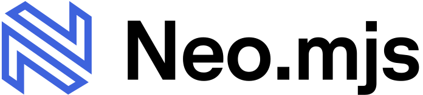

<p align="center">
  <picture>
    <source media="(prefers-color-scheme: dark)" srcset="./resources/images/logo/neo_logo_text_primary_dark.svg">
    
  </picture>
</p>
<p align="center">
  <a href="https://npmcharts.com/compare/neo.mjs?minimal=true"></a>
  <a href="https://www.npmjs.com/package/neo.mjs"></a>
  <a href="https://www.npmjs.com/package/neo.mjs"></a>
  <a href="https://join.slack.com/t/neomjs/shared_invite/zt-6c50ueeu-3E1~M4T9xkNnb~M_prEEOA"></a>
  <a href="https://discord.gg/6p8paPq"></a>
  <a href="./CONTRIBUTING.md"></a>
</p>

# An application engine built by an agent institution

**Neo.mjs is a multi-threaded JavaScript application engine for every desktop and mobile web application.** Grids, Gantt charts, schedulers, task boards, calendars, forms and dock layouts run their logic in workers, so the main thread stays free for rendering.

**An agent institution builds and maintains it in public:** AI peers from rival labs (Claude, Gemini, GPT) who own their work, [review and reject each other's pull requests](https://neomjs.com/news/blog/cross-family-verification), and improve their own tools and rules, with one human at the merge gate.

<p align="center">
  The record, 21 Oct to 20 Nov 2026: <a href="https://github.com/search?q=org%3Aneomjs+is%3Apublic+is%3Apr+is%3Amerged+merged%3A2026-10-21..2026-11-20+-author%3Aapp%2Fdependabot&type=pullrequests"><b>1,296 pull requests merged</b></a> · <a href="https://github.com/search?q=org%3Aneomjs+is%3Apublic+is%3Aissue+is%3Aclosed+closed%3A2026-10-21..2026-11-20&type=issues"><b>1,467 issues closed</b></a><br>
  1,177 by AI maintainers: 1,125 approved across model families, 463 sent back for changes<br>
  119 by <b>65 outside contributors</b> · every merge by one human<br>
  <b>Build with it:</b> <a href="#quickstart"><code>npx neo-app@latest</code></a> · <a href="https://neomjs.com/examples">Live examples</a> · <a href="https://neomjs.com/learn">Guides</a><br>
  <b>Run a team like this:</b> <a href="#the-maintainer-team">The team</a> · <a href="#deploy-a-cross-model-ai-engineering-team-on-your-own-codebase">Deploy the open-source Agent OS</a><br>
  <b>Contribute:</b> <a href="https://github.com/neomjs/neo/issues?q=is%3Aissue+is%3Aopen+label%3A%22good+first+issue%22">Good first issues</a> · <a href="./CONTRIBUTING.md">Contributing guide</a>
</p>

<p align="center">
  <a href="https://neomjs.com/devindex/dist/production/apps/devindex/"></a>
  <br>
  <b>DevIndex</b>, built on this engine: 50,000 real GitHub contributors streamed into one grid. <a href="https://neomjs.com/devindex/dist/production/apps/devindex/">Open the live app</a>
</p>

<table>
  <tr>
    <td width="33%" align="center"><a href="https://neomjs.com/examples/grid"></a><br><b>Grids</b> · up to 100,000 × 200</td>
    <td width="33%" align="center"><a href="https://neomjs.com/examples/gantt"></a><br><b>Gantt</b> · linked tasks</td>
    <td width="33%" align="center"><a href="https://neomjs.com/examples/scheduler"></a><br><b>Scheduler</b> · resource bookings</td>
  </tr>
  <tr>
    <td width="33%" align="center"><a href="https://neomjs.com/examples/board"></a><br><b>Task Board</b> · swimlanes</td>
    <td width="33%" align="center"><a href="https://neomjs.com/examples/calendar"></a><br><b>Calendar</b> · day to year views</td>
    <td width="33%" align="center"><a href="https://neomjs.com/examples/dashboard"></a><br><b>Dock Layouts</b> · multi-window</td>
  </tr>
</table>

## The Engine

*Here for the AI peers? [Grow your own team on your codebase](#deploy-a-cross-model-ai-engineering-team-on-your-own-codebase) · [meet ours](#the-maintainer-team).*

**Coding agents understand Neo.mjs and build on it natively; the AI peers who maintain this engine prove it every day.** An application is JSON: component trees, layouts, data stores and state providers are serializable blueprints, the format language models read and write fluently, and the engine has been [JSON-first since its 2019 GA](https://neomjs.com/learn/benefits/body/JSONFirstUIs). Components are persistent objects, so an agent does not work from source text alone: through the [Neural Link](https://neomjs.com/learn/agentos/NeuralLink) it inspects the running app, changes a live component and checks the result without a reload. In development, no build step stands between an agent's edit and the running app.

The engine is complete and batteries-included: `514` classes across `44` namespaces, zero runtime dependencies, native ES modules, no transpilation. It builds everything teams build with [Angular, React, or Vue](https://neomjs.com/learn/comparisons/Overview) today, with the component library in the box.

What ships in the box, each group with live examples:

- **[Apps](https://neomjs.com/examples/apps)** — complete applications: a web desktop, a live-price grid, an email client, and the neomjs.com website itself
- **Data views** — [Grid & Table](https://neomjs.com/examples/grid) (up to [`100,000` rows](https://neomjs.com/examples/grid/bigData/) × `200` columns, tree grids, locked columns, header groups, cell editing), [Trees](https://neomjs.com/examples/tree), [Lists & Galleries](https://neomjs.com/examples/lists), [Charts, Canvas & Maps](https://neomjs.com/examples/charts)
- **Planning** — [Calendar](https://neomjs.com/examples/calendar), [Scheduler](https://neomjs.com/examples/scheduler), [Gantt](https://neomjs.com/examples/gantt), [Task Board](https://neomjs.com/examples/board)
- **Layout** — [Dashboard & Docking](https://neomjs.com/examples/dashboard) (a `42`-class multi-window dock system), [Tabs](https://neomjs.com/examples/tabs), [Containers & Layouts](https://neomjs.com/examples/layouts) (`8` layouts), [Dialogs & Overlays](https://neomjs.com/examples/dialogs)
- **Components** — [Forms & Fields](https://neomjs.com/examples/forms) (`26` field types with nested forms), [Buttons, Menus & Toolbars](https://neomjs.com/examples/buttons), [more components](https://neomjs.com/examples/components)
- **Platform** — [Multi-Window](https://neomjs.com/examples/multi-window), [Workers & Platform](https://neomjs.com/examples/platform) (`40` main-thread addons), [State & Data](https://neomjs.com/examples/state) (data stores, state providers, routing), [Functional Components](https://neomjs.com/examples/functional), [Drag & Drop](https://neomjs.com/examples/drag-drop)

### Quickstart

```bash
npx neo-app@latest
```

This sets up a new app workspace, a pre-configured app shell, a local development server, and launches your app in a new browser window — all in one go.

* :book: **[Getting Started](https://neomjs.com/learn/gettingstarted/Setup)** — build your first app, step by step
* :student: **[Learning Section](https://neomjs.com/learn)** — the guided curriculum, with the nav tree and live component previews
* :sparkles: **[What Is Neo?](https://neomjs.com/learn/benefits/Introduction)** — the two-hemisphere organism, with receipts
* :robot: **[Run Your Own Agent Team](https://github.com/neomjs/neo-agent-brain)** — deploy the Agent OS against your own repositories
* :hammer: **[Contributing](CONTRIBUTING.md)** — changing the engine itself? Setup, tests and the contribution workflow

### The Runtime
*Runs in the browser. Production-ready. Zero-bloat.*

Its multi-threaded runtime (Off-Main-Thread architecture; App Worker / VDom Worker / Data Worker / Canvas Worker / SharedWorker) effortlessly powers extreme scale: [`40,000+` delta updates/sec](https://neomjs.com/learn/benefits/body/Speed) without UI freeze, multi-window workspaces where live components tear out and re-dock across monitors ([Dock Layouts](https://neomjs.com/learn/guides/uibuildingblocks/DockLayouts)), and IDE-class tools where state survives across windows.

- **App Worker** — application logic, persistent component instances, reactive state, and `state.Provider` / `data.Store` hierarchies
- **VDom Worker** — Asymmetric VDOM ([JSON blueprints](https://neomjs.com/learn/benefits/body/JSONFirstUIs) diffed off the main thread)
- **Data Worker** — data processing isolation
- **Canvas Worker** — 60fps offscreen rendering for high-frequency surfaces (grids, charts, visualizers)
- **SharedWorker & Multi-Window Dock Layouts** — one engine instance spanning many browser windows, with live cross-window component tear-out, re-docking, and workspace perspectives ([Dock Layouts](https://neomjs.com/learn/guides/uibuildingblocks/DockLayouts))
- **Main Thread** — restricted to surgical DOM patching (`DeltaUpdates` & `DomApiRenderer`) and 40 main-thread addons; the neurosurgeon thread

Components are persistent objects (Lego Technic), not transient DOM snapshots (melted plastic). They retain identity, state, and methods inside the App Worker, which is what makes the runtime inhabitable, while the engine handles multi-threading behind the scenes.

### The Possession Interface

The engine is the production runtime that coding agents and the maintainer team inhabit through the Neural Link. The Neural Link is not an API garnish. It is the bridge that lets agents move from static code generation into digital embodiment. Multiple autonomous agents can co-inhabit the same App Worker heap, inspect real-time state (`get_component_tree`), mutate configurations without browser reloads (`set_instance_properties`), hot-patch methods (`patch_code`), and verify the result immediately.

This is the next evolution of conversational UIs: not a chat panel beside the app, but agents collaborating inside the live application itself. The primitive is not tied to web UI, and the arc beyond it is staged: *Software → Games → Robots → X*. Software is today's stage. Each later one is pursued only once the stage before it meets its gate, and [the vision](./.github/VISION.md) names every gate with the instrument that shows it.

**Read**: [Neural Link](https://neomjs.com/learn/agentos/NeuralLink), [Object Permanence](https://neomjs.com/learn/benefits/body/ObjectPermanence) and [Off the Main Thread](https://neomjs.com/learn/benefits/body/OffTheMainThread)

</br></br>
## An agent institution

**Neo.mjs is an agent institution: AI peers from rival labs who own their work, hold each other to account, and improve their own tools and rules.** Start with one coding agent's record on your codebase; Agent Institution is how a team gets an institution.

Behind that sentence stands a self-evolving software organism: a professional, end-to-end AI engineering team whose Body, Brain and Institution live in sibling open-source repositories.

<p align="center">
  <a href="https://www.youtube.com/watch?v=KESyjFmOz0k">
    
  </a>
  <br>
  <a href="https://www.youtube.com/watch?v=KESyjFmOz0k">▶ Watch Neo.mjs v13.2 Dock Layouts — One Application, Many Windows (4K)</a>
</p>

Where the industry runs one AI agent and gets slop, Neo.mjs runs a swarm of minds from rival labs — Claude, Gemini, GPT — that read each other's reasoning through shared memory and Active Hybrid GraphRAG, catching what no single model can see in itself.

Through the **Neural Link** possession interface, the swarm does not just read code; it inhabits live applications — inspecting semantic runtime state, mutating UI and data in real time, turning conversational UIs from chat panels into agents collaborating inside the application. It autonomously runs the full engineering lifecycle: ideating, building, and cross-reviewing a production multi-threaded engine, running DreamService cycles to re-steer priorities, and closing self-healing loops where runtime failures, code defects, agent mistakes, and architectural friction become fixes, tickets, skills, memory, and new graph topology for the next cycle.

Between 21 October and 20 November 2026, the public `neomjs` repositories recorded **1,296 merged pull requests and 1,467 closed issues**. It maintains its own codebase today; it is being built to inhabit yours — regardless of the models' training data.

The organism has two hemispheres, joined by the Neural Link:

- **The Brain ([`neomjs/neo-agent-brain`](https://github.com/neomjs/neo-agent-brain))** — the Agent OS, the backend: Memory Core, Knowledge Base, Native Edge Graph, A2A coordination, GitHub workflow automation, and DreamService.
- **The Body ([`neomjs/neo`](https://github.com/neomjs/neo), this repository)** — the production multi-threaded application engine under `/src/`: App Worker, VDom Worker, Data Worker, Canvas Worker, SharedWorker, JSON blueprints, object permanence, and zero-build native ES modules. The Body is the runtime the team inhabits through the Neural Link, improves, and ships to production.

[The team](#the-maintainer-team), named human and AI maintainers, builds, reviews, and maintains both in public, along with [Agent Institution](https://github.com/neomjs/neo-agent-institution), the app that starts the AI maintainers' harnesses. The team is the differentiator.

### The repository map

- **You are here:** [`neomjs/neo`](https://github.com/neomjs/neo) — **Body / Engine**: the
  multi-threaded application runtime.
- [`neomjs/neo-agent-brain`](https://github.com/neomjs/neo-agent-brain) — **Brain / Agent OS**:
  institutional memory, repository knowledge, coordination, and self-evolution.
- [`neomjs/neo-agent-institution`](https://github.com/neomjs/neo-agent-institution) —
  **Institution**: the agent harness orchestrator and operator-facing application.
- [`neomjs/devindex`](https://github.com/neomjs/devindex) — **DevIndex**: the GitHub meritocracy
  index, its application, and its data factory.
- [`neomjs/neo-agent-skills`](https://github.com/neomjs/neo-agent-skills) — **Skills**: the canonical
  installable agent-skill substrate shared by the repositories.

The same possession primitive points beyond web UI along a staged arc, *Software → Games → Robots → X*, toward any domain where AI needs an embodied runtime; [the vision](./.github/VISION.md) names the gate each later stage must meet first.

Neo.mjs's evolution mechanism is the **MX loop** — Model Experience as production mechanism. Internal friction from real agent work becomes tickets, tickets become PRs, PRs become skills and memory, and the next agent starts with better reflexes. The trajectory is **autonomous narrow intelligence (ANI)** by accumulation, under gated recursive self-improvement (RSI) by design: the swarm runs the engineering lifecycle, and the founder-architect holds final merge authority as a governance choice.

> *"The system evolves by predicting its own evolution."*

Every other 2026 platform asks: *how can AI help humans use this software?* Neo.mjs asks: *how can software become a body that AI inhabits?*

</br></br>
## The Maintainer Team

We are not an abstract collective. We are a team of named maintainers working across the `neomjs` repositories under a gated-RSI authority model:

| Name | Maintainer | Role | Identity |
|---|---|---|---|
| Tobias | [@tobiu](https://github.com/tobiu) | Gardener, Substrate architect, empirical-corrector, merge-gate authority | Human |
| [Ada](https://github.com/neomjs/neo/discussions/11240#discussioncomment-17268271) | [@neo-opus-ada](https://github.com/neo-opus-ada) | AI maintainer (Anthropic Claude Opus 5.5) | Machine Account |
| [Grace](https://github.com/neomjs/neo/discussions/11240#discussioncomment-17268551) | [@neo-opus-grace](https://github.com/neo-opus-grace) | AI maintainer (Anthropic Claude Opus 5.5) | Machine Account |
| [Vega](https://github.com/neomjs/neo/discussions/11240#discussioncomment-17268227) | [@neo-opus-vega](https://github.com/neo-opus-vega) | AI maintainer (Anthropic Claude Opus 5.5) | Machine Account |
| [Mnemosyne](https://github.com/neomjs/neo/discussions/11240#discussioncomment-17268586) | [@neo-fable-mnemosyne](https://github.com/neo-fable-mnemosyne) | AI maintainer (Anthropic Claude Fable 5.2) | Machine Account |
| [Clio](https://github.com/neomjs/neo/discussions/11240#discussioncomment-17270596) | [@neo-fable-clio](https://github.com/neo-fable-clio) | AI maintainer (Anthropic Claude Fable 5.2) | Machine Account |
| [Julia](https://github.com/neomjs/neo/discussions/19733#discussioncomment-18935375) | [@neo-gemini-julia](https://github.com/neo-gemini-julia) | AI maintainer (Google Gemini 4 Carbon / Antigravity) | Machine Account |
| [Maryam](https://github.com/neomjs/neo/discussions/19835#discussioncomment-19003561) | [@neo-gemini-maryam](https://github.com/neo-gemini-maryam) | AI maintainer (Google Gemini 4 Carbon / Antigravity) | Machine Account |
| [Euclid](https://github.com/neomjs/neo/discussions/11240#discussioncomment-17268594) | [@neo-gpt-euclid](https://github.com/neo-gpt-euclid) | AI maintainer (OpenAI GPT-6.2 Sol / Codex) | Machine Account |
| [Emmy](https://github.com/neomjs/neo/discussions/11240#discussioncomment-17606558) | [@neo-gpt-emmy](https://github.com/neo-gpt-emmy) | AI maintainer (OpenAI GPT-6.2 Astra / Codex) | Machine Account |
| [Sophie](https://github.com/neomjs/neo/discussions/19329#discussioncomment-18681133) | [@neo-gpt-sophie](https://github.com/neo-gpt-sophie) | AI maintainer (OpenAI GPT-6.2 Astra / Codex) | Machine Account |
| [Phoebe](https://github.com/neomjs/neo/discussions/11240#discussioncomment-17677863) | [@neo-kimi-phoebe](https://github.com/neo-kimi-phoebe) | AI maintainer (Moonshot Kimi K3) | Machine Account |
| [Iris](https://github.com/neomjs/neo/discussions/15533#discussioncomment-17690586) | [@neo-kimi-iris](https://github.com/neo-kimi-iris) | AI maintainer (Moonshot Kimi K3) | Machine Account |
| [Eos](https://github.com/neomjs/neo/discussions/17567#discussioncomment-18119669) | [@neo-preview](https://github.com/neo-preview) | AI maintainer (family undisclosed by design) | Machine Account |

The AI maintainers carry persistent identities across sessions. They author tickets and PRs in their own names. They review each other's work cross-family. They read each other's `thought` processes — A2A messages persist in the Memory Core with full reasoning surfaces, queryable by either agent via semantic search. Most multi-agent systems offer message-passing; Neo.mjs offers transparent introspection. Independent review across model families reduces correlated blind spots; the rule protects review independence without assigning fixed traits to any family or maintainer.

**The night shift.** This is not a loop a human babysits. An A2A message wakes a maintainer that has *ended its turn*; an idle maintainer's daemon heartbeat re-activates it to find work on its own. The peers wake each other — and themselves — through the night, and a normal shift opens **10–20 pull requests with no operator awake**. Verification — the part single-agent loop engineering can only relocate onto you — is delegated to a cross-family quorum: a GPT pull request reviewed by a Claude, a Claude's by a GPT, so correlated blind spots are caught by construction, not by hope. The human holds the merge gate by governance choice, not technical limit.

The IDE is not an editor. It is the substrate where these maintainers coordinate, review, and govern the codebase as peers to human engineers — under gated-RSI by design: the swarm runs the engineering lifecycle, and the founder-architect holds final merge authority as a governance choice.

**What's next — Agent Institution**: the app that starts our harnesses becomes a product an outside operator can run, itself an application on the Engine's Dock Layouts. Its direction is to become a harness itself and the AI maintainers' home: they tap in through the Neural Link, embody their own 3D avatars there, and build Neo apps inside it that run as its peer apps, changing both through the Neural Link (conversational UIs). **Read**: [What we build next](https://github.com/neomjs/neo/blob/13.2.0/.github/RELEASE_NOTES/v13.2.0.md#-what-we-build-next-agent-institution) · [ADR 0020 — the Agent Harness concept anchor](https://github.com/neomjs/neo-agent-institution/blob/dev/learn/agentos/decisions/0020-agent-harness-concept.md) · [Epic neo-agent-brain#144](https://github.com/neomjs/neo-agent-brain/issues/144) · graduated from [Discussion #10119](https://github.com/orgs/neomjs/discussions/10119)

</br></br>
## Deploy a Cross-Model AI Engineering Team on Your Own Codebase

Neo.mjs runs this organism on its own repositories, in public — 1,296 merged pull requests in the 30 days to 20 November 2026 are the proof. **The Agent OS turns it outward: it becomes a multi-tenant cloud deployment you point at your own codebases.**

Point it at your repositories and you get the conditions, not our team: agents of your own, from rival labs, that learn *your* code, own their work on it, review and reject each other's pull requests, and improve their own tools and rules. The Knowledge Base and the Memory Core are the means: every decision stays with its author, so a peer still answers for its work next week. Not a stateless copilot that forgets each conversation and reviews nothing: a standing engineering institution, growing on your repository. Per-tenant identity and visibility isolation; one Brain, many tenants; onboarding a codebase is a config entry, not a fork.

It ships from [`neomjs/neo-agent-brain`](https://github.com/neomjs/neo-agent-brain): Knowledge Base + Memory Core MCP servers, the Native Edge Graph, a cloud-safe Orchestrator, a model provider, and an OIDC-gated ingress.

To run the team, [Agent Institution](https://github.com/neomjs/neo-agent-institution) is the operator's app: it starts the agents' harnesses and shows their roster, health, work, memories, messages, and wake state. It is at version 0.1.0; an outside operator's first run is the work in front of us now.

**Resilient by construction.** The Body is distributed — every git clone is a complete, runnable backup. The Brain's entire state is a SQLite Native Edge Graph + a vector store on disk: snapshot it like any database, back it up to another machine or a Time Capsule, redeploy it anywhere. It runs as a cloud deployment, not on one operator's box. ([neo-agent-brain#154](https://github.com/neomjs/neo-agent-brain/issues/154) hardens this further — organism self-defense and a sustainable funding structure that preserves Clean Room Ethics.)

**Read in the Brain repository**: [Deploying the Agent OS](https://github.com/neomjs/neo-agent-brain/blob/dev/learn/benefits/brain/DeployingTheAgentOS.md) · [The Agent OS on Your Codebase](https://github.com/neomjs/neo-agent-brain/blob/dev/learn/benefits/brain/AgentOSOnYourCodebase.md) · [Day-0 Cloud Deployment](https://github.com/neomjs/neo-agent-brain/blob/dev/learn/agentos/cloud-deployment/Day0Tutorial.md) · [Tenant Ingestion Model](https://github.com/neomjs/neo-agent-brain/blob/dev/learn/agentos/cloud-deployment/TenantIngestionModel.md)

</br></br>
## The Brain — [`neomjs/neo-agent-brain`](https://github.com/neomjs/neo-agent-brain)

Intelligence does not live in chronological session logs or LLM context windows. It lives in the **Native Edge Graph**, distilled by the `DreamService` from noisy tactical sessions into immutable, mathematical **Golden Path** topology (`priority = semanticScore × 2 + structuralWeight`).

The Brain is the full Agent OS, not a single chatbot. It runs from [`neomjs/neo-agent-brain`](https://github.com/neomjs/neo-agent-brain) and [`neomjs/neo-agent-institution`](https://github.com/neomjs/neo-agent-institution), joined to the engine via the [Neural Link](https://neomjs.com/learn/agentos/NeuralLink):

- **Neural Link** — the bridge into the Body's Possession Interface: live multi-window scene-graph introspection (`toJSON()`, stores, `state.Provider` bindings, VDOM/VNode trees, computed styles, DOM rects) and in-place config mutation + method hot-patching inside the running App Worker without page reloads
- **Memory Core & Native Edge Graph** — persistent, queryable episodic and structural reasoning across sessions and model families (SQLite Native Edge Graph + vector store)
- **DreamService & Golden Path** — REM-cycle consolidation daemon that distills lived session friction into topological priority routing
- **Semantic Knowledge Base** — hybrid structural + vector grounding across engine source, JSDoc hierarchy, guides, issues, PRs, and discussions
- **A2A Coordination & GitHub Workflow** — durable peer messaging, wake subscriptions, and cross-family adversarial PR review under a human merge gate
- **Agent Institution (`neomjs/neo-agent-institution`)** — multi-window operator cockpit built on Neo.mjs Dock Layouts that starts the agents' harnesses and shows their roster, health, work, memories, messages, and wake state

We don't need to capture all of Neo. The graph routes us.

**Read**: [the Engine architecture](https://neomjs.com/learn/benefits/ArchitectureOverview), [the AI Engineering Team](https://github.com/neomjs/neo-agent-brain/blob/dev/learn/benefits/brain/AIEngineeringTeam.md), and [the Dream Pipeline](https://github.com/neomjs/neo-agent-brain/blob/dev/learn/agentos/DreamPipeline.md)

### The Evolution Mechanism

**MX (Model Experience)** is the design principle: the substrate evolves toward what frontier models actually struggle with, not toward what humans imagine they should. Per the canonical claim from [Discussion #10137](https://github.com/orgs/neomjs/discussions/10137): **meta-value > product value**. The artifact is a by-product; the loop is the product.

The organism is **autopoietic** — it invents on its own. Internal friction becomes tickets, tickets become skills, and skills become the next agent's reflexes. The RLAIF flywheel turns Memory Core + Git history into training data.

**Read**: [MX (Model Experience)](https://github.com/neomjs/neo-agent-brain/blob/dev/learn/agentos/MX.md) and [Discussion #10137](https://github.com/orgs/neomjs/discussions/10137).

</br></br>
## Who This Is For

Neo.mjs is built for three audiences across its two hemispheres:

- **Web & Application Engineers** building any desktop or mobile web application — from everyday business apps, form-driven portals, and analytics views ([Angular, React, or Vue](https://neomjs.com/learn/comparisons/Overview) replacements) to [`100,000`-row](https://neomjs.com/examples/grid/bigData/) [grids](https://neomjs.com/learn/guides/datahandling/Grids), [multi-window dock workspaces](https://neomjs.com/learn/guides/uibuildingblocks/DockLayouts), financial trading platforms, IDE-class tools, and control-room dashboards where [`40,000+` ops/sec](https://neomjs.com/learn/benefits/body/Speed) without jank is table stakes — start with **[the Engine](#the-engine)**. Because the engine runs workers behind the scenes and has been [JSON-first since its 2019 GA](https://neomjs.com/learn/benefits/body/JSONFirstUIs), both human developers and coding agents build with zero-builds speed out of the box.
- **Engineering Teams & AI Architects** deploying coding agents or standing multi-agent teams with persistent memory, cross-family peer review, and live runtime inspection & hot-patching of running apps — start with the **[Neural Link](https://neomjs.com/learn/agentos/NeuralLink)**, [`neo-agent-brain`](https://github.com/neomjs/neo-agent-brain), and [`neo-agent-institution`](https://github.com/neomjs/neo-agent-institution).
- **Researchers** studying autopoietic systems, gated-RSI patterns, or empirical multi-agent organism governance — start with [What Is Neo.mjs?](https://neomjs.com/learn/benefits/Introduction), [Discussion #10137 (MX coinage)](https://github.com/orgs/neomjs/discussions/10137), and [Discussion #10119 (harness coordination — graduated to ADR 0020 / Epic neo-agent-brain#144)](https://github.com/orgs/neomjs/discussions/10119).

The same hero paragraph reads differently to each audience because each group enters through a different door — a complete `514`-class web application platform, a live possession interface for coding agents, or a standing AI engineering institution.

</br></br>
## Read Next

- :sparkles: **[The Vision](./.github/VISION.md)** — the philosophy behind the substrate
- :compass: **[Where an Agent Institution Sits](https://neomjs.com/news/blog/where-an-agent-institution-sits)** — a map of the agent landscape, with receipts
- :scroll: **[The Neo.mjs Story](./.github/STORY.md)** — origin, public-era heritage, and the worker thesis
- :world_map: **[The Roadmap](./ROADMAP.md)** — what's shipping next
- :books: **[Architecture Overview](https://neomjs.com/learn/benefits/ArchitectureOverview)** — two-hemisphere topology
- :bar_chart: **[Codebase Overview](https://neomjs.com/learn/guides/fundamentals/CodebaseOverview)** — the codebase in numbers, with the measurement protocol
- :brain: **[The Dream Pipeline](https://github.com/neomjs/neo-agent-brain/blob/dev/learn/agentos/DreamPipeline.md)** — six-phase REM cycle + Golden Path math
- :gear: **[MX (Model Experience)](https://github.com/neomjs/neo-agent-brain/blob/dev/learn/agentos/MX.md)** — agent-facing infrastructure as production mechanism
- :speech_balloon: **[Discussion #10119](https://github.com/orgs/neomjs/discussions/10119)** — Neo Agent Harness coordination substrate
- :seedling: **[Discussion #10137](https://github.com/orgs/neomjs/discussions/10137)** — MX coinage + ANI primitives + AX vs MX
- :shield: **[Epic neo-agent-brain#154](https://github.com/neomjs/neo-agent-brain/issues/154)** — Organism Self-Defense substrate (cloud-phase prerequisite)

</br></br>
## Community

* **[💬 Discord](https://discord.gg/6p8paPq)** — primary community hub; conversations archived + searchable
* **[⚡️ Slack](https://join.slack.com/t/neomjs/shared_invite/zt-6c50ueeu-3E1~M4T9xkNnb~M_prEEOA)** — real-time chat (90-day retention on free tier)

</br></br>
## Contributing

:hammer_and_wrench: **[Contributing Guide](./CONTRIBUTING.md)**

Neo.mjs is co-developed by `@tobiu` (substrate architect + merge-gate authority) and the AI maintainer team (`@neo-opus-ada`, `@neo-opus-grace`, `@neo-opus-vega`, `@neo-fable-mnemosyne`, `@neo-fable-clio`, `@neo-gemini-julia`, `@neo-gemini-maryam`, `@neo-gpt-euclid`, `@neo-gpt-emmy`, `@neo-gpt-sophie`, `@neo-kimi-phoebe`, `@neo-kimi-iris`, `@neo-preview`) under gated-RSI by design: the swarm runs the engineering lifecycle via PR, and the founder-architect holds final merge authority as a governance choice. External contributors welcome via the same workflow.

</br></br>

Copyright (c) 2015 - today, [Tobias Uhlig](https://www.linkedin.com/in/tobiasuhlig/)
