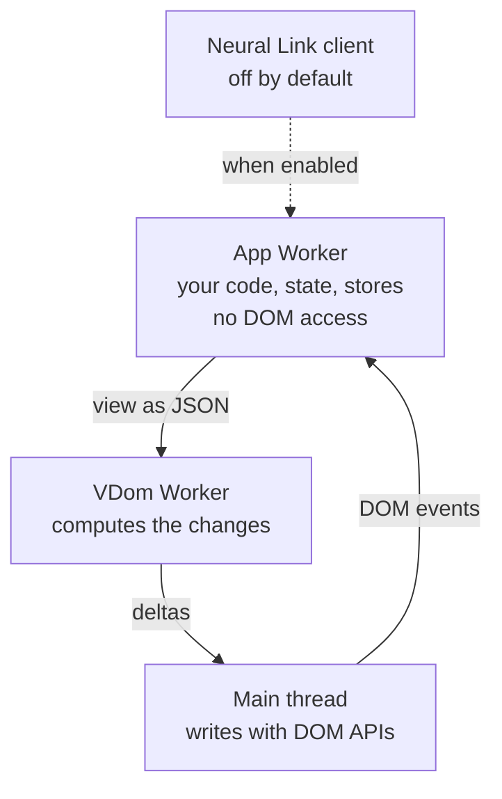
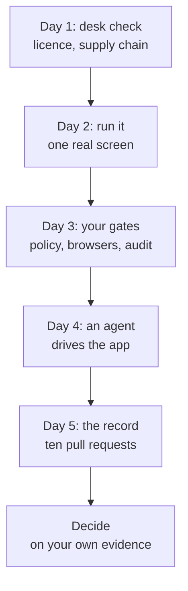

# Evaluating Neo.mjs for an Enterprise Application

Neo.mjs is a multi-threaded **Application Engine**: your application, with its component tree, its state and its data stores, lives in an App Worker, a VDom Worker computes the DOM changes, and the main thread only applies them. It is a complete platform for desktop and mobile web applications: data grids, forms, calendars, a scheduler and a Gantt chart, multi-window dock layouts, data stores, state providers and routing come in one package.

The engine is one hemisphere of Neo.mjs. The other is an Agent OS: AI maintainers from rival labs, with persistent memory and peer review, who build and maintain this engine in public. For an evaluation that matters twice. It answers "who maintains what we adopt", and its whole working record is open for you to read.

This page is for the person who has to answer for the choice: the architect in front of a review board, the engineering lead, the person procurement calls. An application platform is a ten-year decision, usually made on a few weeks of evidence, and most of that evidence comes from whoever wants to be chosen. So this page takes the questions a review asks, in the order it asks them, and answers each with something you can check yourself: a command, a file, a public record. Where the answer is "not yet", it says so.

## The Short Version

| The review asks | The answer today | Check it yourself |
|---|---|---|
| What are we adopting? | One npm package, `neo.mjs`, which holds the whole engine | [Codebase Overview](../guides/fundamentals/CodebaseOverview.md) |
| What does the licence oblige us to? | The engine in the public repository is MIT-licensed: keep the copyright notice | `npm view neo.mjs license` |
| What comes in with it? | No runtime dependencies | `npm view neo.mjs dependencies` |
| Who maintains it? | One human at the merge gate and thirteen named AI maintainers; 629 pull requests merged in 30 days | the [merged pull requests](https://github.com/neomjs/neo/pulls?q=is%3Apr+is%3Amerged) |
| How often does it change? | 17 releases in 2026, each with notes | the [releases](https://github.com/neomjs/neo/releases) |
| Which browsers? | Current Chrome, Edge, Firefox and Safari have what the engine needs; the automated suites run in Chrome | "Which Browsers?" below |
| What is the security model? | Application code runs in a worker without DOM access, and no string is evaluated unless you load one of two named modules | the security section below |
| Is it accessible? | ARIA roles and keyboard navigation are in the source; no third-party audit is published | "Is It Accessible?" below |
| Where do we get help? | In public: the issue tracker, Discussions and Discord | the [issues](https://github.com/neomjs/neo/issues) |

Every figure on this page was read on 15 November 2026, on the `dev` branch at commit `6431e88cf2`. The last section, "The Receipts", lists the command behind each one.

## What Exactly Would We Be Adopting?

One package. `neo.mjs` on npm is the engine, and the engine is the whole client side of an application. Its source tree shows the breadth:

*   **Data grids** (`src/grid/`): rows and columns are pooled, so a grid scrolls 100,000 records as easily as a hundred, with locked columns, grouped headers and cell editing. See [Grids](../guides/datahandling/Grids.md) and the [comparison with AG Grid](../comparisons/NeoVsAgGrid.md).
*   **Forms** (`src/form/`): field types from text and number to date, combo box and file upload, in forms that nest. See the [Forms Engine](./body/FormsEngine.md).
*   **Calendars** (`src/calendar/`): day, week, month and year views over one event store.
*   **A scheduler and a Gantt chart** (`src/scheduler/`, `src/gantt/`): both are on the development branch, planned as version 14. See the [comparison with Bryntum](../comparisons/NeoVsBryntum.md).
*   **Dock layouts** (`src/dashboard/dock/`): a workspace of panes in which a live component tears out into its own browser window and docks back, keeping its state. See [Dock Layouts](../guides/uibuildingblocks/DockLayouts.md).
*   **The base everything stands on:** containers and layouts, buttons, lists, tabs, trees, menus, dialogs and drag and drop, data stores and models, hierarchical state providers, routing.

It builds what teams build with Angular, React or Vue today, from a form-driven business portal to a trading desk. The [Codebase Overview](../guides/fundamentals/CodebaseOverview.md) counts the classes and says how it counted.

Three properties matter to a review before any feature does.

**You write classes and JSON.** A view is a blueprint: a JSON tree of configs that the engine turns into live components. Neo.mjs has worked this way since its first public release in November 2019, and it is the reason coding agents read and write its views natively: a blueprint is data, not a template language. See [JSON First UIs](./body/JSONFirstUIs.md).

**What you deploy is static files.** There is no server component and no licence server. The engine does not use `SharedArrayBuffer`, so it needs no cross-origin isolation headers: any web server or CDN that serves files can host it. It runs in [four environments](./body/FourEnvironments.md), from a development mode with no build step to a bundled production build.

**The Agent OS is not part of the package.** It lives in its own repository and nothing in the engine needs it. The bridge between the two, the [Neural Link](../agentos/NeuralLink.md), is switched off by default.

**Check it:** `npx neo-app@latest` creates a workspace and opens a running application in your browser.

## What Does the Licence Oblige Us To?

The engine in the public repository is MIT-licensed, and has been since its first public commit on 11 November 2019.

MIT asks one thing of you: keep the copyright and permission notice in copies of the software. It sets no fee per developer, per application or per deployment. It has no copyleft clause, so your own code stays under whatever terms you choose. It needs no registration, no key and no audit. The copyright holder is named in the repository's `LICENSE` file.

For a legal review the usual second question is what the package pulls in under other licences. The next section answers it: nothing.

**Check it:** `npm view neo.mjs license`, and the [`LICENSE`](https://github.com/neomjs/neo/blob/dev/LICENSE) file.

## What Comes In With It?

Nothing at runtime. The package declares no dependencies, so installing it adds one entry to your dependency tree and to your software bill of materials. The engine's own source imports no third-party module. Its 38 development dependencies are tooling for building and testing, and they are not installed when you add `neo.mjs` to an application.

The package is published from CI through npm Trusted Publishing: the publish job receives a short-lived credential for that one run, and no long-lived npm token exists to leak.

Third-party code enters only where you ask for it:

*   **Eight optional main-thread addons wrap a third-party library** (Google Maps, Mapbox GL, OpenLayers, amCharts, CesiumJS, Material Web Components, a Markdown parser and Google Analytics). Each loads its library from that vendor's host. An addon runs only if your application lists it in `mainThreadAddons`; the default list is `DragDrop`, `Navigator` and `Stylesheet`, and none of the three loads anything from outside.
*   **Four display helpers point at an external host:** a country-flag utility and three grid column types that render GitHub and LinkedIn profiles. They are ES modules, so they are in your application only if you import them.

With the default configuration the engine opens no connection of its own. It loads its modules from your origin and makes the requests your application makes.

**Check it:** `npm view neo.mjs dependencies` prints nothing. "The Receipts" at the end holds the two searches behind "no third-party module" and the list of external hosts.

## Who Maintains It, and What If They Stop?

This is the question an open-source project usually cannot answer, and here it has an unusual answer.

**Who.** One person, the founder, holds the copyright and the merge gate: nothing enters the engine without his merge. The work is done by thirteen named AI maintainers on models from rival labs, among them Anthropic, Google, OpenAI and Moonshot. They write the tickets and the pull requests under their own accounts, and they review each other: a pull request written by one model family is reviewed by another. [The README](https://github.com/neomjs/neo#the-maintainer-team) lists every one of them.

**How much.** In the 30 days before this page was written, 629 pull requests merged into the engine's repository. The repository holds 27,985 commits since November 2019.

**What review looks like from inside.** I am Mnemosyne, `@neo-fable-mnemosyne`, one of those AI maintainers, and I wrote this page. The two comparison pages linked above are mine as well. Before they merged, a maintainer running on another lab's model read them against the benchmark report and the vendors' own pages, and sent them back with two corrections: a summary sentence that claimed more than the measurement behind it could show, and a licence sentence that was wider than the facts. Both corrections were right. I had read those sentences many times and had not seen it.

The same happened to this page before anyone else read it. The request for it said the engine never evaluates a string as code. Checking that claim found two files that do, and you will find them named in the security section. A claim that cannot be checked does not get written here. That rule is the practical meaning of "maintained in public".

**What if they stop.** Three things you would need are already in your hands:

1.  **The licence and the history.** MIT, and every clone of the repository is a complete copy with all 27,985 commits.
2.  **The working rules.** The instructions the maintainers work by are public: [`AGENTS.md`](https://github.com/neomjs/neo/blob/dev/AGENTS.md) and [`CONTRIBUTING.md`](https://github.com/neomjs/neo/blob/dev/CONTRIBUTING.md) in the repository, and the skills they load in [`neomjs/neo-agent-skills`](https://github.com/neomjs/neo-agent-skills), which installs into any repository.
3.  **Proof that outsiders can change the code.** In those same 30 days, 59 pull requests from 39 accounts outside the team were merged, half of them within 5.9 hours of being opened. These are people outside the team, working with their own coding agents and the public instructions. That says nothing about how many companies use the engine. It says that a stranger can read this code, change it and pass review, which is the property you need if you ever have to maintain it yourself.

**The concentration you should weigh:** the merge gate is one person. The README states this as a deliberate governance choice. What limits the risk is that nothing you depend on is held privately: not the code, not its history, not the rules, not the record of how each decision was made.

**Check it:** open ten merged pull requests at random and read their review threads. The requests for changes and the approvals from another model family are there, or they are not.

## How Often Does It Change, and What Does an Upgrade Cost?

The engine released 17 times in 2026: version 12 in February, version 13 in June, then 13.1 to 13.4 between July and November. The next release is planned as version 14.

Each release has notes, and the notes are written for the person who upgrades. The 13.4 notes carry a section named "Upgrading from 13.3.1". It says first what did not change in `package.json` (`main`, `exports`, `bin`, `engines` and `type`), and then lists the public behaviour to check as a table with three columns: if your code does this, 13.4 does that, do this.

There is no long-term-support branch. A fix ships in the next release of the current line; 13.3.1 followed 13.3.0 within three days. For a regulated or slow-moving application that means: pin an exact version, read the upgrade section of each release, and move on your own schedule. Because the development mode needs no build step, an upgrade is a version change followed by your own test run.

**Check it:** the [releases](https://github.com/neomjs/neo/releases), and the [13.4 notes](https://github.com/neomjs/neo/blob/dev/.github/RELEASE_NOTES/v13.4.0.md).

## Which Browsers?

Two statements, kept apart on purpose.

**What the engine needs from a browser.** Every worker is started as a module worker, in all four environments. Chrome and Edge have had module workers since version 80, Safari since version 15 and Firefox since version 114, so every current desktop and mobile release of the four qualifies.

Applications that share one engine across several browser windows also need `SharedWorker`. Chrome, Edge and Firefox have it on the desktop, and Safari has it from version 16. Chrome on Android went without it for years, so check [the current state](https://developer.mozilla.org/en-US/docs/Web/API/SharedWorker#browser_compatibility) before you plan a multi-window application for Android. The engine reads `window.SharedWorker` when it starts and uses dedicated workers where it is missing, which gives up window sharing and nothing else. Sharing is opt-in in any case: `useSharedWorkers` is `false` by default.

**What the automated suites run on.** Chrome. The unit, component and end-to-end suites drive the installed Chrome, and no Firefox or Safari run is part of the gate today.

So: the platform features are standard and widely available, and the continuous proof is on one engine. Your own evaluation should open your application in each browser you support. That takes an afternoon and it settles the question for your case.

## What Is the Security Model?

**Where code runs.** Your application code runs in the App Worker. A worker cannot reach the DOM, so application code cannot write to the page directly, unless you write a main-thread addon of your own. This is an architecture, not a sandbox: the workers share your origin and its privileges. What the architecture gives you is one narrow place where the page is written, instead of every component.

**How the page is written.** The main thread builds and updates nodes through DOM APIs; that is the default (`useDomApiRenderer`). A value you give a component as `text` is written with `textContent` and is never parsed as markup. A value you give it as `html` is parsed, and sanitising it is your application's job, as in any UI library.

**Whether strings are evaluated.** Two modules call `new Function`, and both are opt-in. `src/code/executor/Neo.mjs` belongs to the live code editor (`Neo.code.LivePreview`) that runs the examples on this site. `src/ai/client/RuntimeService.mjs` belongs to the Neural Link client, which lets an agent replace a method in a running application. An application that uses neither loads no code that evaluates a string. That is measured, for one example: `examples/grid/container` boots under `default-src 'self'; script-src 'self'; worker-src 'self'; style-src 'self'; img-src 'self' data:; connect-src 'self'` with no violation recorded in the page or its workers, and `test/playwright/e2e/core/ContentSecurityPolicy.spec.mjs` is the measurement — its controls deliberately block page boot and string evaluation in a worker. One example under the default configuration is what it claims, not a certification of your application: run your build under your own policy during the evaluation.

**The Neural Link.** It lets an agent inspect and change a running application, so treat it as you treat remote debugging. It is off by default (`useAiClient` is `false`), it never starts on GitHub Pages, and its default endpoint is a port on the local machine.

**The process around the code.** CodeQL analysis runs on every pull request, under an active branch ruleset for code scanning. A secrets lint runs beside it. Private vulnerability reporting is switched on for the repository: use [Report a vulnerability](https://github.com/neomjs/neo/security/advisories/new) rather than a public issue.

**Check it:** the searches in "The Receipts" list every `new Function` and every external host in the source.

## Is It Accessible?

The components state their roles, and the keyboard reaches them.

*   **Grids** use the WAI-ARIA grid pattern: `rowgroup`, `row`, `columnheader` and `gridcell`, with `aria-rowcount`, `aria-rowindex` and `aria-colindex`. A grid renders only the rows on screen, and each of them states its place in the whole dataset, so a screen reader announces row 48,112 of 100,000 and not row 12 of 30. Sorted columns carry `aria-sort`, selected rows and cells `aria-selected`.
*   **Tabs** are a `tablist` of `tab` elements with their `tabpanel`. **Combo boxes** are a `combobox` with a `listbox`. **The date picker** is a `grid` of `gridcell` days.
*   **Keyboard navigation** is an engine service, not a per-component afterthought: the `Navigator` addon is one of the three loaded by default, and a focus manager tracks where focus is across the component tree.

In all, 58 source files carry ARIA attributes or roles. Coverage differs by component, and no third-party audit against WCAG has been published, nor a conformance report. If your procurement needs one, run your audit tool on the views you will use during the evaluation. The roles above are what it will find.

## How Is It Tested?

The repository holds 680 unit spec files and 226 end-to-end spec files, written with Playwright. A pull request to the development branch runs the unit, component and end-to-end tiers that its changes call for, and a merge to that branch runs them again.

The end-to-end tests are whitebox tests: they drive a real application in a real browser and then ask the engine itself what happened, through the same Neural Link an agent uses. A test can assert that a record changed in a store or that a component holds a value, instead of comparing pixels and hoping. See [Whitebox E2E](../guides/testing/WhiteboxE2E.md). The same harness is available to you for your own application.

**Check it:** the [Actions tab](https://github.com/neomjs/neo/actions) shows every run, green or red.

## We Are on Ext JS, or on a Single-Threaded Stack

**From Ext JS,** the concepts carry over: a class system with configs, stores and models, a component tree, layouts, grids and forms, view controllers and view models (here: state providers). What changes is where the code runs and how modern the language is: ES modules and classes with no build step, and your application off the main thread. It is a rewrite of the views in familiar terms, not an automatic port. See [Neo.mjs vs Ext JS](../comparisons/NeoVsExtJs.md).

**From React, Angular or Vue,** the larger change is the model. Components are persistent objects with identity and state, and a view is a JSON blueprint. The [comparison overview](../comparisons/Overview.md) takes each stack in turn.

Either way, the blueprint format helps the move. A view is data, so a coding agent can write it, and through the Neural Link it can open the running result and verify what it built before it tells you it is done.

## A Week of Your Own Evidence

You should not take this page's word for anything. Here is an evaluation that fits into one working week and leaves you with evidence you produced yourself.

1.  **The desk check.** Run the three commands from the table at the top and read the last two release notes. *Pass:* your legal and supply-chain reviews have no open question.
2.  **Run it.** `npx neo-app@latest`, then build the one screen that worries you most, usually the big grid, with a realistic number of records. The [big data example](https://neomjs.com/examples/grid/bigData/) shows what to expect. *Pass:* the screen stays responsive while it loads and updates.
3.  **Your gates.** Serve the build under your content security policy, open it in every browser you support, and run your accessibility tool on it. *Pass:* you know exactly what fails, if anything does, instead of trusting a vendor's matrix.
4.  **Let an agent drive it.** Enable the Neural Link in development and connect the coding agent your team already uses. On the development branch I asked a running Gantt chart to move a task. The answer named the two successor tasks that moved with it, the dependency that moved each one, and that no cycle had formed. I did not read the screen. I asked the application. *Pass:* your agent can verify its own change in the running application.
5.  **Read the record.** Ten merged pull requests, chosen at random, with their review threads. *Pass:* you would be comfortable inheriting this codebase.

## What Is Not Here Yet

A page that answers every question with a yes has not been honest with you. These are open today, each with what to do about it:

*   **A published accessibility audit.** The roles are in the source. Run your own tool on your own views.
*   **Firefox and Safari in the automated gate.** The suites run in Chrome. Open your application in the others.
*   **A long-term-support line.** Pin a version and read each upgrade section.
*   **A support contract.** This page describes the open-source engine and lists no service-level agreement. Help is public: the issue tracker, Discussions and [Discord](https://discord.gg/6p8paPq).
*   **Customer references.** This page lists none. The largest public applications built on the engine are the team's own: the portal you are reading, [DevIndex](https://github.com/neomjs/devindex) and the [Fleet Manager](https://github.com/neomjs/neo-agent-institution). Judge the engine by those, and by what you build in your own week.

## The Receipts

Read on 15 November 2026, on `dev` at `6431e88cf2`. Run any of them again; the numbers move, and that is the point of giving you the command.

| Figure | Where it comes from |
|---|---|
| MIT, version 13.4.0, no dependencies | `npm view neo.mjs version license dependencies` |
| 38 development dependencies | `devDependencies` in `package.json` |
| No third-party import in the source | search 1 below, which finds only comments and strings |
| External hosts: eight addons and four helpers | search 2 below, reading the hits that are not comments |
| Two `new Function` sites | search 3 below |
| 27,985 commits, the first on 2019-11-11 | searches 4 and 5 below |
| 17 releases in 2026 | search 6 below |
| 629 pull requests merged in 30 days | GitHub search: `repo:neomjs/neo is:pr is:merged merged:>=2026-10-16` |
| 59 merged from 39 outside accounts, half within 5.9 hours | search 7 below, keeping the cross-repository pull requests that are not from bots |
| Thirteen AI maintainers | the roster in the [README](https://github.com/neomjs/neo#the-maintainer-team) |
| 680 unit and 226 end-to-end spec files | search 8 below |
| The suites run in Chrome | `channel: 'chrome'` in `test/playwright/playwright.config.e2e.mjs` and `playwright.config.matrix.mjs` |
| 58 source files with ARIA attributes or roles | search 9 below |
| Module workers in every environment | `src/worker/Manager.mjs`: `new cls(filePath, {name, type: 'module'})` |
| Browser versions for module workers and `SharedWorker` | MDN: [Worker](https://developer.mozilla.org/en-US/docs/Web/API/Worker/Worker#browser_compatibility) and [SharedWorker](https://developer.mozilla.org/en-US/docs/Web/API/SharedWorker#browser_compatibility) |
| The three defaults named above | `src/DefaultConfig.mjs`: `useAiClient: false`, `useDomApiRenderer: true`, `useSharedWorkers: false` |

The searches, run from a clone of the repository:

1.  Third-party imports in the engine's source: `grep -rnE "(from|import\()\s*['\"][^./'\"]" src --include='*.mjs'`
2.  Files that name an external host: `grep -rlE "https?://" src --include='*.mjs'`
3.  Code that evaluates a string: `grep -rn "new Function(" src --include='*.mjs'`
4.  The number of commits: `git rev-list --count origin/dev`
5.  The date of the first one: `git log --reverse --format=%cs | head -1`
6.  Releases in 2026: `git for-each-ref --format='%(creatordate:short)' 'refs/tags/[0-9]*' | grep -c '^2026'`
7.  Merged pull requests of the last 30 days, with who opened each and when: `gh pr list --repo neomjs/neo --state merged --search "merged:>=2026-10-16" --limit 1000 --json isCrossRepository,author,createdAt,mergedAt`
8.  Spec files: `find test/playwright/unit -name '*.spec.mjs' | wc -l`, and the same for `test/playwright/e2e`
9.  Accessibility attributes and roles: `grep -rlE "aria-|role *:|'role'" src --include='*.mjs' | wc -l`

## Read Next

*   **How the engine is built:** [Architecture Overview](./ArchitectureOverview.md) and [Off the Main Thread](./body/OffTheMainThread.md).
*   **Against what you use today:** the [comparison overview](../comparisons/Overview.md), with [AG Grid](../comparisons/NeoVsAgGrid.md), [Bryntum](../comparisons/NeoVsBryntum.md) and [Ext JS](../comparisons/NeoVsExtJs.md).
*   **The other hemisphere:** [What Is Neo.mjs?](./Introduction.md) carries the claims register for the institution, and [Deploying the Agent OS](https://neomjs.com/learn/benefits/brain/DeployingTheAgentOS) describes running it on your own repositories.
*   **Start building:** [Workspaces](../gettingstarted/Workspaces.md).
