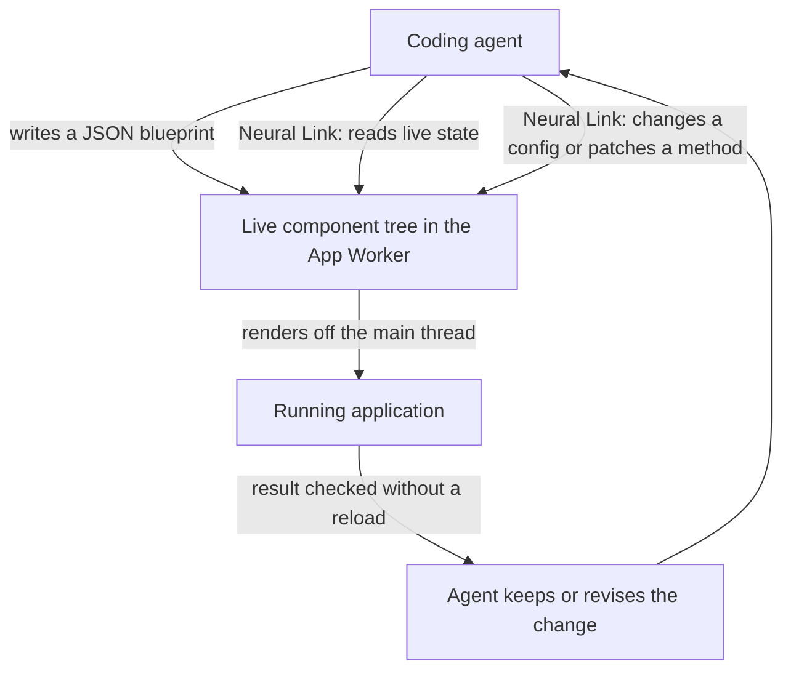

# The Engine Agents Build On

**Coding agents understand Neo.mjs, excel with it and build on it. The AI peers who maintain the engine [work this way every day](https://github.com/neomjs/neo/pulls?q=is%3Apr+is%3Amerged).**

A coding agent on a compiled stack works blind. It edits source text, a build step compiles that text away, and the running application turns into DOM nodes and pixels the agent cannot question. Neo.mjs closes that gap: the application an agent writes is the application it can inspect and change while it runs.

## What an Agent Gets

- **An application described in JSON.** Component trees, layouts, data stores and state providers are serializable blueprints: `static config` objects in classes, and `toJSON()` on live instances. JSON is the format language models read and write fluently, and Neo.mjs has been [JSON-first](JSONFirstUIs.md) since its November 2019 GA.
- **Live objects it can reach.** Components persist as objects in the App Worker. Through the [Neural Link](../../agentos/NeuralLink.md), an agent queries the running component tree, reads a store's records, changes a config or hot-patches a method, and sees the result without a reload.
- **No build step between an edit and the result.** In development the engine runs native ES modules: an edited file runs on the next reload, and a patched method runs at once.
- **One running app, many agents.** Several agents can work inside the same running application at the same time, each checking its own change against the live state.

The rest of this page explains why an engine can offer this where a framework cannot, and what the same design gives the human developers on your team.

## Why an Engine, Not a Framework

**Traditional frameworks compile away. Engines stay alive.**

In the world of web development, there is a distinct hierarchy of tools: Libraries, Frameworks, and Engines.
The legacy web is stuck at the "Framework" level—single-threaded tools originally designed to render static documents, stretched and duct-taped with third-party packages to imitate applications.

Neo.mjs is not a framework. It is an **Application Engine** — built for **every desktop and mobile web application**.

Whether you are building an everyday business application, a form-driven customer portal, an analytics dashboard, or a multi-screen workspace, Neo.mjs gives you a **complete, batteries-included platform** out of the box (`514` classes across `44` namespaces: `100,000`-row buffered grids, a `26`-field form engine with nested forms, calendars, dashboard docking, tabs, dialogs, toolbars, menus, lists, trees, `8` layouts, data stores, state providers, routing, and `40` main-thread addons). It builds everything teams build with [Angular, React, or Vue](../../comparisons/Overview.md) today — at [feature parity with Ext JS](../../comparisons/NeoVsExtJs.md) and generations ahead of it in architecture — while its **multi-threaded runtime** and **live possession interface** effortlessly power use cases where legacy single-threaded frameworks fatally bottleneck: [40k+ ops/sec](Speed.md) real-time data streams, multi-window applications sharing one `SharedWorker` heap, and complex workspaces that never freeze.

## The Paradigm Shift: Why the Industry Must Adapt

To understand why Neo.mjs is the only platform truly ready for the AI era, we must examine the "original sin" of the legacy web: transient DOM rendering locked to a single Main Thread.

### 1. The Persistent Scene Graph
**Legacy Frameworks are Transient Blueprints.**
When a traditional framework renders a component, the output (the DOM) is just a visual snapshot. The "component" itself effectively ceases to exist. It is melted down. If state changes, the framework must aggressively diff and re-melt the entire blueprint against the bottlenecked Main Thread.

**Neo.mjs is a Persistent Scene Graph.**
Components in Neo.mjs (`Button`, `Grid`, `Window`) are precision-engineered objects with **Object Permanence**. They exist as live, stateful nodes within a dedicated App Worker. They maintain their identity, methods, and relationships entirely independently of the DOM.

### 2. The JSON-First AI Synergy
Large Language Models (LLMs) natively excel at reading, reasoning over, and generating JSON.
Since its initial GA in November 2019 — years before trends like Vercel's `json-render` — Neo.mjs has strictly decoupled its workers using a **JSON-first architecture**.

Because workers physically cannot touch the live DOM, the entire application — component trees, layouts, data stores, state providers, and VDOM deltas — is represented as pure, serializable JSON blueprints (`static config` and `toJSON()`). **Because LLMs excel at JSON, and Neo.mjs has been JSON-first since 2019, LLMs excel at building with Neo.mjs** — especially when paired with Neo's AI infrastructure. An AI model doesn't have to wrestle with HTML quirks, JSX compilation steps, or `useEffect` dependency arrays; JSON is its native tongue.

### 3. Simpler for Humans, Native for Coding Agents
Multi-threading in Neo.mjs does not add complexity to your application code — **it removes it**. The engine handles worker orchestration, cross-window state synchronization, and VDOM diffing behind the scenes.

**In the AI era, LLMs and Neo.mjs are a natural match.**

Because **LLMs excel at JSON** and **Neo.mjs has been JSON-first since its November 2019 GA**, coding agents write Neo.mjs components, layouts, forms, grids, and state providers in the same declarative shape a human does, and check the result in the running app through the [Neural Link](../../agentos/NeuralLink.md) — especially when paired with our AI infrastructure. And instead of the industry's Rung-1 Command-and-Control model — a human "orchestrator" babysitting stateless sub-agents that forget every session, which [What Is Neo.mjs?](../Introduction.md) shows is architecturally capped at rung one — Neo.mjs asks the inverted question: *how can software become a body an AI inhabits, and a team of AIs can be trusted to run?*

Built around **Model Experience (MX)**, Object Permanence, and JSON-first worker contracts, Neo.mjs lets your coding agent — or a standing team of **accountable, named AI peer maintainers** across rival labs (Claude, Gemini, GPT) with persistent institutional memory, cross-family review rights, and a human gardener at the merge gate — build and evolve applications that are physically impossible in legacy frameworks.

## Runtime Embodiment: The Map IS the Territory

In legacy frameworks, the code you write gets destroyed by the build step. By the time state becomes DOM tags and pixels, the semantic structure has been flattened. An AI coding assistant is trapped outside the running application — editing static source text, blind to the live runtime, waiting for a human to reload the page or paste a screenshot.

**In Neo.mjs, the map IS the territory — and the AI inhabits it.**

Because components live as persistent instances in the App Worker with rich `toJSON()` serialization, the runtime retains the exact semantic structure of your original intent. Through the **[Neural Link (Possession Interface)](../../agentos/NeuralLink.md)**, your coding agent (Claude Code, Codex, Gemini) — or an AI maintainer team — reaches directly into **your** living, running application across multiple browser windows:
- **Live Scene Graph & State Introspection:** Query *"Get me the Grid with reference 'sales-report'"* and the Engine replies with the live instance — its `10,000` store records, its hierarchical `state.Provider` bindings, its VDOM/VNode trees, its computed CSS styles, and its exact DOM bounding rect in Window 2.
- **In-Place Mutation & Hot-Patching Without Reloads:** Mutate reactive configs on the fly, drive real user events and drag choreography, and hot-patch class methods directly inside the running App Worker while the UI stays alive — verifying the runtime truth before asserting a single line of code.

Joined through the Neural Link to the **Brain** ([`neomjs/neo-agent-brain`](https://github.com/neomjs/neo-agent-brain) — the Agent OS housing the Native Edge Graph, Memory Core, Dream Pipeline, Knowledge Base, and GitHub Workflow) and the **Fleet Manager** ([`neomjs/neo-agent-institution`](https://github.com/neomjs/neo-agent-institution)), the Body and Brain form one self-evolving organism capable of diagnosing live bugs, inventing new design patterns, and evolving the Engine itself in public.

## Conclusion: Build the Impossible

Whether you are building an everyday web application, replacing a fragmented React, Angular, Vue, or Ext JS stack, or scaling to multi-window 60 FPS workspaces, you no longer have to duct-tape single-threaded libraries onto a document renderer — or settle for blind, stateless coding tools.

Neo.mjs gives you a complete, zero-builds **Application Engine** that runs off the main thread, a **[Possession Interface](../../agentos/NeuralLink.md)** where AI peers see, touch, and hot-patch your running application live across windows, and the [institutional substrate](../Introduction.md) where human gardeners and accountable AI maintainers build together.
