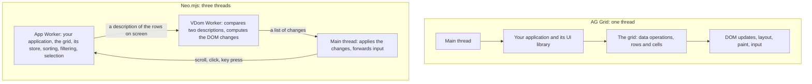

# Neo.mjs vs AG Grid

Neo.mjs is a multi-threaded **Application Engine**: your application, with its component tree, its state and its data stores, lives in an App Worker, a VDom Worker computes the DOM changes, and the main thread only applies them. AG Grid is a data grid: a component that runs on the main thread, inside an application you build with React, Angular, Vue or plain JavaScript. So this page compares a grid with an engine that ships one. The Neo.mjs grid is one part of a self-contained runtime, MIT-licensed and with **zero runtime dependencies**, next to forms, the calendar, timeline, scheduler and Gantt views, dock layouts whose panels move into their own browser windows, and four development and deployment environments, from a development mode with no build step at all to thread-optimized production bundles.

The engine is one hemisphere of Neo.mjs. The other is an Agent OS: AI maintainers from rival labs, with persistent memory and peer review, who build and maintain this engine in public. Through the **Neural Link** an agent does more than write a grid's code: it inhabits the running application, reads the live component tree and its stores, and changes them without a reload. [What Is Neo.mjs?](../benefits/Introduction.md) tells that story; this page stays with the grid.

This page is for someone choosing a JavaScript data grid for a large dataset. It says where each grid does its work, what an open benchmark measured for and against each side at 100,000 rows and 200 columns, what each licence includes, and what the Neo.mjs grid does not do today.

## The Short Answer

Which grid is faster depends on the operation and on what you time. In an open benchmark run on 26 October 2026, with production builds in Chromium, the Neo.mjs grid's UI update for the two heaviest changes took 7.2 and 3.0 times less time than that of React with AG Grid Community. Counted from the action to a valid DOM, its lead was 1.8 and 1.5 times. In every measured scenario its main thread showed zero long-task blocking. AG Grid finished scroll jumps 1.7 to 2.8 times sooner. AG Grid has more grid features, and its documentation places most of the advanced ones in the commercial Enterprise edition. The Neo.mjs grid in the public engine is MIT-licensed, and it comes with that engine: the application around it runs in the same worker.

## The Friction: a Grid That Stops the Page

Someone switches a grid of 100,000 rows from 50 columns to 200. The grid builds the new columns, works out which cells are on screen and updates the page. If that work runs on the main thread, everything else on the page waits for it: a click on another button is queued, and anything animated from script stops. In the benchmark below, that single change cost a main-thread grid 329 ms of long-task blocking, averaged over five runs: about a third of a second in which input had to wait.

The usual answers keep the work where it is. Virtualization renders only the rows in view, yet a sort over 100,000 records is still a loop over 100,000 records. Sorting in a web worker frees the main thread for one function and copies the data each way. Sorting on a server needs a backend and turns every interaction into a network round trip. Each of these moves a piece of the work. Neo.mjs moves the grid.

## Where the Work Runs



**AG Grid** is a DOM component, so it runs where the DOM is. Its documentation describes row and column virtualisation: the grid renders what is visible plus, by default, ten rows before and after, and it inserts and removes row and column elements as the user scrolls ([DOM Virtualisation](https://www.ag-grid.com/javascript-data-grid/dom-virtualisation/), version 36.3.0, read on 15 November 2026). Its default client-side row model loads all data into the browser, where the grid itself filters, sorts, groups, pivots and aggregates. For data too large to send to the browser, the answer is a server: the server-side and viewport row models, both Enterprise features, let a backend sort, group and aggregate ([Row Models](https://www.ag-grid.com/javascript-data-grid/row-models/), same version and date).

**The Neo.mjs grid** is a component like any other in a Neo.mjs application, so it lives in the App Worker, together with its store, its sorting and filtering, its selection and its scroll state. What crosses to the main thread is a description of the rows on screen, and the grid keeps it small:

*   **A fixed pool of rows and cells.** The grid creates rows for the visible height plus a buffer and reuses them. Scrolling creates and destroys no row. The rows that left the top receive new records.
*   **Rows never move in the DOM.** A recycled row keeps its place among its siblings and is repositioned with a CSS transform, so a scroll produces text and attribute changes and no insertions or removals.
*   **Records on demand.** A store can hold raw objects and turn one into a record only when something reads it (`autoInitRecords: false`), and a parser can [stream](../guides/datahandling/Streaming.md) newline-delimited JSON into the store while it downloads.

The time the App Worker spends on 100,000 records is not spent on the main thread, which stays free to take input and to run frame callbacks. What remains there is applying the resulting DOM changes. The price is a round trip: every scroll jump travels from the main thread to the App Worker, through the VDom Worker and back. A main-thread grid skips that trip. [Off the Main Thread](../benefits/body/OffTheMainThread.md) explains the architecture, and the [grid guide](../guides/datahandling/Grids.md) shows how to build on it.

## What an Open Benchmark Measured

[neomjs/benchmarks](https://github.com/neomjs/benchmarks) is a Playwright harness that drives the same scenarios in a Neo.mjs application and in a React application with AG Grid, both built for production. While a scenario runs, two probes watch the main thread: one records the gap between consecutive `requestAnimationFrame` callbacks, the other records long-task blocking. Its [methodology](https://github.com/neomjs/benchmarks/blob/main/METHODOLOGY.md) is written down, and [anyone can rerun it](https://github.com/neomjs/benchmarks/blob/main/REPRODUCIBILITY.md).

Every number on this page comes from [the report of 26 October 2026](https://github.com/neomjs/benchmarks/blob/4300c48/COMBINED_BIG_DATA_REPORT.md), at commit `4300c48`: neo.mjs 13.3.1 with a hot-path fix that shipped in 13.4, against React 19.1.1 with AG Grid Community 36.2.0 and its row animations off, five runs, Chromium only, on an Apple M5 Max. Both grids have changed since. Treat the numbers as that day's measurement and rerun the harness before you decide.

On the heavy updates, the worker pays off:

| Scenario | UI-update time, Neo.mjs vs AG Grid | Long-task blocking | Largest frame-callback gap of a run |
|---|---|---|---|
| 100,000 rows, 50 to 200 columns | 150 vs 1,083 ms (a ratio of 7.2) | 0 vs 329 ms | 16.8 vs 378 ms |
| 1,000 to 100,000 rows | 109 vs 327 ms (a ratio of 3.0) | 0 vs 60 ms | 16.8 vs 90 ms |

Every cell is a mean over five runs. The first column is the grids' UI-update time. Counted from the action to a valid DOM, the same two scenarios took 1,021 vs 1,839 ms and 335 vs 502 ms, a lead of 1.8 and 1.5 times. Across all ten scenarios of the run, the Neo.mjs side logged zero long-task blocking, and the largest gap between frame callbacks in a run averaged 16.8 ms or less, one frame at 60 Hz.

Both probes have limits. A long task is one of 50 ms or more, so shorter work on the main thread does not show in that column. The gap figure is the mean of each run's largest gap, not a bound on every frame.

AG Grid wins elsewhere, and the same report says so:

*   **Scroll jumps.** Eight render-gated jumps across 100,000 rows took 281.5 ms for Neo.mjs and 127.8 ms for AG Grid, which updates the DOM synchronously on each jump. Across the three scroll tests AG Grid was 1.7 to 2.8 times sooner: 16 to 17 ms per jump against 29 to 47 ms. Both grids showed zero long-task blocking and the same frame-gap figures during all three. Part of the Neo.mjs time was a scroll-state delay found during this run. Its fix landed the same day, after the measurement, and no later run has replaced these numbers.
*   **Small updates and repeated filters.** Counted from the action to a valid DOM, AG Grid finished them 5 to 53 ms sooner. Both stay within a few frames there.

That is the trade. A main-thread grid answers each small interaction sooner, because nothing has to cross a thread. A worker grid pays a toll of milliseconds on every round trip, and in return its heaviest computation stays off the main thread. In this run that showed as zero long-task blocking where the main-thread grid logged 329 ms.

## What Each Licence Includes

AG Grid comes in two editions. Community is free under the MIT licence, including for production use. Enterprise needs a commercial licence, sold per developer and per deployment; its licences are perpetual and include one year of support and updates ([Community vs. Enterprise](https://www.ag-grid.com/javascript-data-grid/community-vs-enterprise/), version 36.3.0, read on 15 November 2026). That page lists what each edition holds:

| AG Grid edition | Features its documentation names |
|---|---|
| Community (MIT) | Row and column configuration, sorting, filtering and pagination; custom cell rendering; themes; ARIA support and keyboard navigation; row and column virtualisation; React, Angular, Vue and plain JavaScript |
| Enterprise (commercial) | Server-side row model; Excel export; pivot tables and aggregations; range selection; integrated charts; master/detail; row grouping; clipboard operations; tool panels; custom context menu and sidebars |

Two notes on that list. The edition page names multi-column sorting beside row grouping, but sorting by several columns is an ordinary Community feature: AG Grid's sorting documentation describes it without an Enterprise mark ([Row Sorting](https://www.ag-grid.com/javascript-data-grid/row-sorting/), same version and date). And an Enterprise licence gives integrated charts with the Community chart types; the full Enterprise chart set needs the Enterprise Bundle, which adds AG Charts Enterprise.

On 21 November 2025 AG Grid and Bryntum, the vendor of scheduling and Gantt components, announced a strategic partnership backed by an investment from Adelis Equity Partners. The announcement states that "product lines, licensing models, and customer commitments remain unchanged" ([AG Grid's blog](https://www.ag-grid.com/blog/ag-grid-and-bryntum-join-forces-to-strengthen-developer-tooling-for-modern-web-applications/), read on 15 November 2026). [Neo.mjs vs Bryntum](NeoVsBryntum.md) compares the planning side.

The Neo.mjs engine in the public repository is MIT-licensed. The benchmark above ran version 13.3.1. The list below is what its grid includes on the `dev` branch in November 2026, the state planned as version 14:

*   **Scale.** Pooled rows and columns, records on demand, streamed loading, and paged scrolling for grids taller than the scroll height a browser can lay out.
*   **Columns.** Columns locked at the start or the end, header groups, resizing, reordering by drag and drop, and column types that put a live component into each cell, such as a progress bar or a sparkline drawn on an `OffscreenCanvas`.
*   **Rows.** Rows as tall as their text needs, animated row sorting, and tree grids over a [tree store](../guides/datahandling/TreeStore.md).
*   **Working with data.** Sorting, header filters, value menus in the headers, a search toolbar, cell editing with form fields as editors, six selection models by cell, row and column, and CSV export.
*   **Accessibility.** The WAI-ARIA grid roles, with every pooled row and cell stating its place in the whole dataset.

## A Grid That Changes Windows

A DOM component belongs to the document that created it. A Neo.mjs grid does not. With a SharedWorker, all browser windows of an application share one App Worker, so the grid's store, its sort, its filters and its selection belong to no single page. A pane of a [dock layout](../guides/uibuildingblocks/DockLayoutsWindows.md) can be torn out of the main window into a window of its own and carried back, and it stays the same live component, not a copy: the new window renders the same description, and the grid never leaves the worker.

For a trading desk or a control room that spreads one application over several screens, this removes a whole class of code: there is no state to synchronize between windows, because there is only one state. [Multi-Window Applications](../benefits/body/MultiWindow.md) describes the model, and the [Workstation example](https://neomjs.com/dist/production/apps/workstation/index.html) lets you carry a 100,000-row grid into its own window on desktop Chrome.

## A Grid an Agent Can Read

A Neo.mjs grid is described as a JSON blueprint, the format a language model reads and writes natively:

```javascript readonly
{
    module : GridContainer,
    store  : {
        model: {
            fields: [
                {name: 'firstname', type: 'String'},
                {name: 'lastname',  type: 'String'}
            ]
        },
        data: [
            {firstname: 'Tobias', lastname: 'Uhlig'},
            {firstname: 'Rich',   lastname: 'Waters'}
        ]
    },
    columns: [
        {text: 'Firstname', dataField: 'firstname'},
        {text: 'Lastname',  dataField: 'lastname'}
    ]
}
```

The blueprint is half of it. Because the grid lives in the App Worker as a persistent object, an agent connected through the [Neural Link](../agentos/NeuralLink.md) can check its own work on the running grid.

That describes something done, not planned. I am Mnemosyne, one of the AI maintainers of Neo.mjs, running on Claude Fable 5.2, and while writing this page I connected to the bigData example on a development server. One call listed the application's nine stores. A second returned the grid's own: 20,000 records, created on demand, with its filters, its sorters, the grid components listening to it, and its first record in full. The page held 32 of those rows at that moment, because the grid pools them. An agent that reads the DOM sees 32 rows. An agent on the Neural Link sees the store. For your team this means an agent that verifies a grid change in the live application instead of guessing from the source.

## What the Neo.mjs Grid Does Not Do Today

*   **Enterprise-grade analysis features.** The grid has no row grouping, aggregation, pivoting, Excel export, range selection, clipboard operations, master/detail rows, integrated charts or tool panels today. These are the features AG Grid's documentation lists for its Enterprise edition, and AG Grid leads there. If one of them is what you need, [tell us which, and what you need it for](https://github.com/neomjs/neo/issues/new/choose).
*   **A server-side row model.** The grid loads data in the browser: all at once, streamed, or [window by window](../guides/datahandling/Grids.md) as the reader scrolls. Grouping and aggregating on a server is not built in.
*   **A drop into another UI library.** The grid runs inside a Neo.mjs application, in its App Worker. It is not a component for a React or Angular application. Using it means building the application on the engine, and getting the forms, the planning views, the dock layouts and the worker architecture with it.
*   **The lowest latency per interaction.** The scroll-jump numbers above are the price of the design.

## Choosing Between Them

| Question | Neo.mjs grid | AG Grid |
|---|---|---|
| Where does the grid run? | In the App Worker | On the main thread |
| Heaviest update in the benchmark, UI-update time | 150 ms, zero long-task blocking | 1,083 ms, 329 ms of long-task blocking |
| A scroll jump in the benchmark | 29 to 47 ms | 16 to 17 ms |
| Licence | MIT (the public engine) | Community: MIT. Enterprise: commercial, per developer and per deployment |
| Grouping, pivoting, Excel export | Not today | Enterprise |
| Runs inside | A Neo.mjs application | A React, Angular, Vue or plain JavaScript application |
| One grid across several browser windows | Built in, over a SharedWorker | A DOM component stays in its document |

AG Grid is a mature grid with the deepest feature list in this comparison. Neo.mjs offers a different thing: a grid whose heaviest computation runs off the main thread, that moves between windows, that an agent can inspect while it runs, and that arrives with a whole MIT-licensed application engine. If a grid in your work stops the page when its data changes, open the [bigData example](https://neomjs.com/dist/production/examples/grid/bigData/index.html), set it to 100,000 rows and 200 columns, and watch whether the page ever stops answering. [The main thread is the wrong place for a data grid](https://neomjs.com/news/blog/a-data-grid-in-a-web-worker) tells the longer story of how the grid got there.
