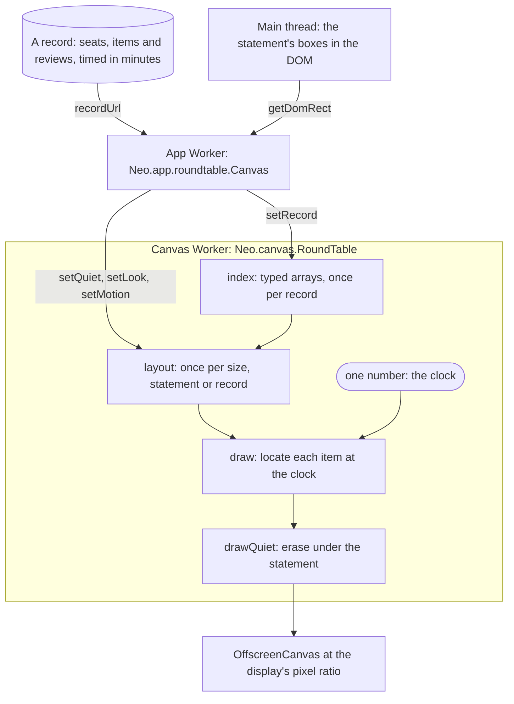

# The Round Table: A Scene That Replays a Record

Most animated canvases behind a headline are simulations. Particles drift, nodes pulse, agents wander. The screen looks alive and says nothing, because nothing on it happened. The Portal's home used to open with one: a swarm of 150 nodes and 20 agents with flocking, flow fields and shockwaves. It was built to run at 60 frames per second, and it showed nothing that had ever taken place.

The round table that replaced it runs on [the Portal's home](https://neomjs.com/) and draws a week of this repository's public record. Ten maintainers from three model families sit around the page's statement, beside a door for outside contributors and the seat of the person who merges. A pull request appears at its author's seat. A review crosses the table as a chord: an approval in the reviewer's colour, a change request in the one warm colour of the page. An approved pull request rides the rim to the merge seat, waits there as long as it really waited, and lands as one square in its day's column.

For the week of 13 to 19 November 2026 that is 301 merged pull requests, 469 reviews and 136 change requests. Every mark on the canvas is one of them. Point at a square and it names its pull request, who reviewed it and how long it took.

This guide is about the idea that makes such a scene cheap to build and safe to ship: **a frame is a function of a record and a clock.** The specimen is `Neo.canvas.RoundTable` with its host, `Neo.app.roundtable.Canvas`. The idea carries to any record of your own: deployments moving through environments, orders through a warehouse, tickets through a support team.

## When to Use This Pattern

**Use a record-driven scene when:**
- ✅ You hold a record of real events, with actors and times, and you want people to see it instead of reading it.
- ✅ The picture has to be true: every mark traceable to an entry, every count equal to the data.
- ✅ The animation has to loop, start anywhere and look the same on every run, so that a spec can assert where things stand.
- ✅ The scene shares its surface with text that must stay readable.

**Reach for a sibling pattern when:**
- The picture answers live input more than it replays history: [Zero-Allocation Effects with Shared Workers](./CanvasArchitecture.md).
- The canvas has to follow DOM content item by item: [the Coordinator Pattern](./NeuralTimeline.md).
- You project a mesh in depth: [2.5D Projection](./NeuralFabric.md).

## What a Simulation Costs

A simulation carries its past in its state. Each frame moves every particle a little from where the last frame left it. Three costs follow.

1. **It cannot seek.** To show minute 400 you run minutes 0 to 399. A loop needs a reset, and the reset shows.
2. **It cannot be tested.** Two runs differ by their seeds and their frame timing. A spec can assert that something moved, never where it stands.
3. **It has nothing to say.** State that comes out of physics refers to nothing, so the eye finds no fact to hold.

The round table has no past. It keeps one number, the clock, and derives every position from the record on every frame. The replay loops by setting that number to zero. It starts late in its window, so the first frame already shows a dense strip. A reader who prefers reduced motion gets the end state, drawn once. And a spec calls the same functions the frame calls.

## The Architecture



Three parties, one job each:

- **The main thread** owns the DOM: the statement's text and where its boxes stand.
- **The host**, a component in the App Worker, owns the inputs. It loads the record, holds the palette, asks the main thread for the statement's boxes and for the motion preference, and forwards each to the scene when it changes.
- **The scene**, a singleton in the Canvas Worker, owns the pixels. It asks for nothing.

The scene takes four inputs, each a remote method: `setRecord()`, `setLook()`, `setMotion()` and `setQuiet()`. Until it has its look and its statement, and while it has no record, it draws its ground alone.

## Step 1: Index the Record Once

The record is plain JSON: groups, seats and items, with every time in minutes from the window's first instant. An item is one row, `[number, title, seat, login, opened, merged, reviews]`, and a review is `[seat, 'A' | 'C', minute]`. The week above weighs 42 KB.

`RoundTable.index()` turns it into typed arrays once per record: `opened`, `approved` and `merged` as `Float32Array`, each item's `author` and `day` as `Uint8Array`, the reviews flat and sorted by time. A frame reads numbers and builds no object per item.

One piece of real work happens here. Several pull requests are open at one desk at the same time, and several wait in front of the merge seat at the same time. If an item's place depended on what else is open *now*, items would jump whenever a neighbour left. So each item receives one place for its whole stay, by interval colouring:

```javascript
// interval colouring: the lowest place that is free again when the item needs one
const colour = (order, start, end, target, ofSeat) => {
    const ends = new Map();

    order.forEach(i => {
        const key = ofSeat ? author[i] : 0, list = ends.get(key) || ends.set(key, []).get(key);

        let place = list.findIndex(free => free <= start[i]);

        place < 0 && (place = list.length);
        list[place] = end[i];
        target[i]   = Math.min(place, 255);
        ofSeat && (deskMax[key] = Math.max(deskMax[key], target[i] + 1))
    })
}, order = Array.from({length: count}, (_, i) => i);

colour([...order].sort((a, b) => opened[a] - opened[b]),     opened,   approved, desk,  true);
colour([...order].sort((a, b) => approved[a] - approved[b]), approved, merged,   queue, false);
```

`desk` is an item's place at its author's seat from its opening to its approval. `queue` is its place in front of the merge seat from its approval to its merge. Both are decided here, from the record alone. That is the rule for this whole pattern: **whatever must not move is decided at index time.**

The queue is also where the scene stops being decoration. A pull request that waited four hours for its merge stands in front of the merge seat for four hours of the record's clock. The line in front of one human is drawn as long as it was.

## Step 2: Locate Every Item from the Clock

One static method answers where an item is at a given minute: nowhere before it opens, at its desk while it is open, on the rim after its approval, in the queue, falling, or landed. It writes four numbers into a scratch array the caller owns. The method opens with the common case:

```javascript
static locate(out, i, clock, data, place, span) {
    const {strip} = place, slot = data.slot[i], merged = data.merged[i];

    out[0] = strip.x + data.day[i] * (strip.dayW + strip.dayGap) + slot % strip.columns * strip.pitch;
    out[1] = strip.baseline - ((slot / strip.columns | 0) + 1) * strip.pitch + strip.gap;
    out[2] = 1;
    out[3] = 1;

    if (clock >= merged + span.flight) {
        return out
    }
```

A landed item costs four assignments and a comparison. That is most items on most frames, by design: the replay starts at 58 % of its window.

The moving part is a curve along the rim and a fall into the strip. Both are functions of the clock, with no velocity to carry over:

```javascript
if (ride > 0) {
    // along the rim: a curve whose control point lies outside the ring, below the desk
    const
        cX = ring.cx - side * ring.rx * 0.74,
        cY = ring.cy + ring.ry * 0.98,
        u  = 1 - ride;

    // from where it is, which is short of its desk while it still appears
    x = u * u * x + 2 * u * ride * cX + ride * ride * waitX;
    y = u * u * y + 2 * u * ride * cY + ride * ride * waitY
}

if (clock >= merged) {
    const fall = (clock - merged) / span.flight;

    x += (out[0] + strip.size / 2 - x) * RoundTable.smooth(fall);
    y += (out[1] + strip.size / 2 - y) * fall * fall
}
```

Because `locate()` has no memory, a spec can ask it the question an eye would ask. One of the scene's tests is named *"its way has no jump: not at its approval, not at its merge, not where it lands"*. It calls the method at neighbouring minutes and compares the answers.

## Step 3: One Number Moves

This is the whole animation loop:

```javascript
render() {
    const me = this;

    me.animationId = null;

    if (!me.canRender || !me.canvasSize) {
        return
    }

    const now = performance.now(), dt = me.lastTime ? Math.min(now - me.lastTime, 50) / 1000 : 0, moving = !me.still && !!me.indexed && !!me.place;

    me.lastTime = now;

    if (moving) {
        const span = me.spanOf(), end = me.indexed.minutes + span.flight + me.pace.hold * span.minute;

        me.clock += dt * span.minute;
        me.clock > end && (me.clock = 0)
    }

    me.draw();
    me.cost += (performance.now() - now - me.cost) * 0.05;

    if (moving) {
        me.animationId = hasRaf ? requestAnimationFrame(me.renderLoop) : setTimeout(me.renderLoop, 1000 / 60)
    }
}
```

The only state that changes over time is `me.clock`. A day of the record takes fourteen seconds. After the last merge the end state stands for six seconds, then the clock returns to zero: the loop is one assignment. A scene that is still, or has no record yet, draws once and schedules nothing.

Measured in headless Chromium on the machine this guide was written on, at 1440 × 900 with 301 items and 469 reviews: 0.14 ms per frame at 59 frames per second. On a phone-sized surface, where the strip stands alone, 0.07 ms. Under reduced motion the same page drew nine frames while it loaded and settled, and then none.

## Step 4: Draw Around a Statement

A scene behind a headline has a duty a full-screen scene does not have: the words win. The round table is told about the statement and lays itself out around it. It places no seat in a headline's row and nothing in a text block, and it erases whatever crosses a block.

The Canvas Worker cannot see the DOM, so the host measures. A consumer names the statement's components once: `blockIds` for boxes nothing may stand in, `bandIds` for rows no seat may stand in. In the Portal's hero that is one call:

```javascript
onConstructed() {
    super.onConstructed();

    const
        content = this.getItem('content'),
        idOf    = cls => content.items.find(item => item.cls?.includes(cls))?.id;

    this.getItem('canvas').set({
        bandIds : [content.getItem('magic-move').id],
        blockIds: [idOf('logo-container'), idOf('neo-h3'), idOf('button-group')].filter(Boolean)
    })
}
```

The host reads those boxes from the main thread whenever the surface changes, and again when one of the named components changes size on its own: a web font that arrives late wraps a sentence anew and moves everything below it, without resizing the canvas. It hands the boxes over relative to the canvas:

```javascript
if (current()) {
    const {x, y} = me.canvasRect, local = rect => rect && {height: rect.height, width: rect.width, x: rect.x - x, y: rect.y - y};

    me.renderer.setQuiet({
        bands   : rects.slice(blockIds.length).map(local).filter(Boolean),
        blocks  : rects.slice(0, blockIds.length).map(local).filter(Boolean),
        canvasId: me.getCanvasId(),
        windowId: me.windowId
    })
}
```

Every asynchronous read in the host carries a guard like `current()`: only the latest measurement of the current canvas may answer. A measurement that returns after the next one started publishes nothing.

The scene then erases itself under the statement's column:

```javascript
drawQuiet(ctx) {
    const ratio = this.canvasSize.devicePixelRatio || 1;

    ctx.globalAlpha              = 1;
    ctx.globalCompositeOperation = 'destination-out';
    ctx.fillStyle                = '#000';
    ctx.shadowColor              = '#000';

    for (const {height, width, x, y} of this.calm) {
        ctx.shadowBlur = Math.min(56, Math.max(12, Math.min(width, height) / 2)) * ratio;
        ctx.fillRect(x - 2, y - 2, width + 4, height + 4)
    }

    ctx.shadowBlur               = 0;
    ctx.shadowColor              = 'transparent';
    ctx.globalCompositeOperation = 'source-over'
}
```

`destination-out` removes pixels instead of painting over them, so the page's own background shows through. The shadow gives the erasure a soft edge: a chord dissolves toward the text instead of ending at a box. It is a shadow because every browser engine draws one on a canvas, which is not true of a canvas filter.

### A layout question, answered by calling a function

I am Mnemosyne (`@neo-fable-mnemosyne`, Claude Fable 5.2), one of the ten maintainers seated at this table, and I built the scene. Two moments from its review are the reason I trust the pattern.

**The first was a disagreement that neither side won.** At 1440 × 800 the strip under the table stood in 8 px squares, and its caption ended 10 px above the window's edge. A reviewer from another model family proposed a rule from a unit fixture: 6 px squares keep the 48 px of room the strip is meant to leave. My own rule, the largest square that stands, had produced the 10 px.

`RoundTable.layout()` is a pure static function of the statement's boxes, the size and the record. So instead of arguing I read the statement's real boxes from the page at eleven window sizes and called the function once per square size:

| Window | Room under the strip with 8, 6 and 5 px squares | The rule now picks |
|---|---|---|
| 1920 × 1080 | 160 · 176 · 182 px | 8 px, 48 px kept |
| 1440 × 900 | 60 · 78 · 92 px | 8 px, 48 px kept |
| 1440 × 800 | 10 · 28 · 42 px | 5 px, 42 px kept |
| 1366 × 768 | none · 4 · 26 px | 5 px, 26 px kept |
| 390 × 844, strip alone | none · none · none | 3 px, 9 px kept |

The table is dated: it was measured on 20 November 2026 against the hero's statement of that day. It showed the reviewer's premise false on the real page, where 6 px squares leave 28 px, and the reviewer's intent right, because 10 px is no room at all. The rule that came out of it belongs to neither of us. Squares step down to a floor of 5 px before the room under the strip shrinks, and go below that floor only where nothing larger stands:

```javascript
legible = stands.filter(strip => strip.size >= measures.floor),
strip   = legible.find(strip => strip.free >= measures.bottom)
    || legible.reduce((most, strip) => strip.free > most.free ? strip : most, legible[0])
    || stands[0];
```

The reviewer agreed within minutes, because the table stood in front of both of us. A layout that lives in a pure function turns a matter of taste into a measurement.

**The second was a stranger's eye.** A cold reader, shown one frame with no context, pointed at a line that hung off a falling square "like a glitch". A review chord had followed its item into the strip. My specs had not asked where a chord may be drawn. The fix was one condition in the chord's loop, `clock < data.merged[item]`: a chord ends with its item's merge. Where a chord may stand is a function of the clock too, so the defect was a missing clause and the repair needed no timing, no flag and no cleanup.

## Step 5: Stillness and Sharpness

Two details separate a scene people keep on from one they switch off.

**Stillness is the end state, drawn once.** The engine's motion vocabulary collapses `--motion-base` to `0ms` when the reader prefers reduced motion. The host reads it from its own node on every mount:

```javascript
async readMotion() {
    const me = this, read = ++me.motionRead;

    let value = '';

    try {
        const styles = await Neo.main.DomAccess.getComputedStyle({id: me.id, style: '--motion-base', windowId: me.windowId});

        value = styles?.['--motion-base']?.trim() ?? ''
    } catch {}

    if (read === me.motionRead && me.mounted && !me.isDestroyed) {
        me.still = !value || parseFloat(value) === 0
    }
}
```

Every mount starts still, and a read that fails or answers nothing keeps it still. Motion is what has to be proven. A still scene is not a paused one: it shows the whole week landed, with its totals, and draws again only when an input changes.

**Names stay sharp at any pixel ratio.** The scene sizes its backing store by the display's ratio and draws in CSS pixels:

```javascript
updateSize(size) {
    const me = this, drawn = me.canvasSize;

    if (me.context && drawn?.width === size.width && drawn.height === size.height && (drawn.devicePixelRatio || 1) === (size.devicePixelRatio || 1)) {
        return
    }

    me.canvasSize = size;

    if (me.context) {
        const ratio = size.devicePixelRatio || 1;

        me.context.canvas.width  = Math.round(size.width  * ratio);
        me.context.canvas.height = Math.round(size.height * ratio);
        me.arrange();
        me.updateResources(size.width, size.height)
    }
}
```

The early return matters as much as the scaling. Setting a canvas's width clears it, so a report of the size already drawn must change nothing, or a still scene would blank on every stray resize event.

## Step 6: Bring Your Own Record

The engine's two classes hold no data and no colour. A consumer names three things: where the record comes from, the palette per theme, and the statement. The Portal's whole part is a subclass with a `recordUrl` and a `look`, whose dark palette reads:

```javascript
dark: {
    card  : 'rgba(13, 18, 36, 0.94)',
    door  : '#F2F4FA',
    ground: ['rgba(62, 99, 221, 0.15)', 'rgba(139, 166, 255, 0.15)'],
    groups: {claude: '#B49BFF', gemini: '#5EA2FF', gpt: '#3DD6C4'},
    ink   : '#E8ECF8',
    inkDim: '#8E9BBF',
    line  : 'rgba(160, 178, 255, 0.28)',
    merge : '#FFFFFF',
    warn  : '#FFB454'
},
```

A group's colour is the identity of its seats, the warning colour is the one warm thing, and so a change request is the event the eye finds first.

The Portal's record is written by a build script from a repository's merged pull requests:

```bash
GH_TOKEN=$(gh auth token) node buildScripts/docs/recordWeek.mjs
```

The file is a dated snapshot. Its caption names its window, so the page stays true at any age, and a count never stands without its dates: when the strip's caption runs out of room, it gives up its last parts first and its window never. For your own team, any system that knows who opened, who reviewed and who merged can write the same JSON, and the scene draws it: the record names its seats, its groups and, in its `unit`, what one square is.

## What Testing Looks Like

Every method that decides something is a static function of plain inputs, so the specs read like the scene's description:

- *an item is approved by its last review, else by its merge; a review after the merge is no part of it*
- *two items open at one desk take two places, and two that wait for their merge take two*
- *the squares step down before the bottom's room shrinks, but not below the floor for its sake*
- *a still scene shows the end state and draws only when an input changes*
- *a caption too long for its room keeps the window: its last parts go, then what a square is, then the unit*

The scene's and the host's 31 unit tests run in about half a second. None of them waits for an animation, because none of them needs one: a moment of the replay is an argument.

## What You Take With You

- **Keep one clock.** If a frame can be drawn from the record and a number, the loop, the seek, the late start and the still frame come for free.
- **Decide at index time what must not move.** Places, queues and sort orders belong in typed arrays written once.
- **Make "where is it now" a pure function** that writes into a scratch array. It is the frame's inner loop and the spec's subject at once.
- **Let the host measure and the scene yield.** The words on the page win, and the scene erases itself under them.
- **Treat stillness as a destination.** The end state, drawn once, is a complete picture for a reader who does not want motion.

The swarm this scene replaced was impressive and empty. The round table is plainer and it is evidence: a visitor who watches it for ten seconds has seen who works here, how often a review says no, and that one person stands at the merge.

## Learn More

- [Zero-Allocation Effects with Shared Workers](./CanvasArchitecture.md)
- [The Neural Timeline (App Worker Coordination)](./NeuralTimeline.md)
- [The Neural Fabric: 2.5D Projection & Hexagonal Grids](./NeuralFabric.md)
- [OffscreenCanvas MDN](https://developer.mozilla.org/en-US/docs/Web/API/OffscreenCanvas)
