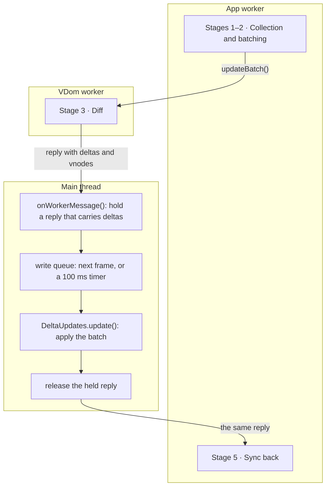

# VDOM Engine: Main Thread

The Main thread runs stage 4 of [the VDOM engine](./VdomEngine.md): it writes deltas to the DOM and decides when the
App worker hears about it. It keeps no vdom and no vnode. It finds nodes by id and executes what the deltas say
([lookup][du-lookup]). Every line reference points at `dev` commit `73e6207999`.

## Two ways in

1. A reply from the VDom worker that the Main thread did not request itself, and that carries deltas (flagged
   `updateVdom`) or a first render that mounts itself (flagged `autoMount`) ([intercept][mgr-intercept]). The Main
   thread holds the reply and forwards it after the write.
2. An `updateVdom` action from the App worker, sent by `Neo.applyDeltas()`. That is the path without a VDom worker,
   and every manual write ([action][mgr-update-action], [sender][app-apply-deltas]). The Main thread answers with a
   success reply after the write.

Both go through `handleDomUpdate()` ([handle][mgr-handle-dom-update]). With no deltas and no meta, the reply leaves at
once. Otherwise the reply is held and the operation joins the write queue ([event][main-on-update-vdom],
[queue][main-queue-write]). Deltas meant for another window are refused, never applied ([refuse][mgr-refuse]).

## When the write happens

- The queue drains in the next animation frame, or after 100 ms when no frame comes, whichever is first. A hidden
  document drains on a task ([schedule][main-schedule], [timer][main-dam]).
- A drain stops after 15 ms and continues in the next frame ([drain][main-process], [budget][main-budget]).
- Each queued operation is one `DeltaUpdates.update()` call, and its held reply is released right after it
  ([release][main-process], [resolve][mgr-resolve]).

## Applying one batch

`DeltaUpdates.update()` ([update][du-update]):

1. Fires `update` before anything is written. Listeners may edit the deltas in place, using the `meta` the App
   worker attached ([event][du-update-event], [meta][vl-meta]).
2. Applies the deltas in order. Each one dispatches by its `action`, and a delta without one is an `updateNode`
   ([dispatch][du-dispatch], [actions][grammar-actions]). Consecutive `insertNode` deltas into one parent, at
   consecutive indices, go in as one `DocumentFragment` ([batching][du-insert-batch]).
3. Moves with `moveBefore()` where the browser has it, so focus, iframes and canvases survive. A parent that received
   moves gets one layout heal per batch ([move][du-move], [heal][du-heal]).
4. Fires `updated` in the same task, before the next paint ([event][du-updated-event]).

## Failure

A delta that throws rejects the reply of its own operation, and the queue carries on ([contain][main-process]). The
App worker adopts nothing from a rejected reply ([reject][mgr-reject-reply]).

## What a change here must preserve

1. The reply leaves after the write, so the App worker's vnode never runs ahead of the DOM.
2. Every operation gets exactly one reply, success or rejection. A lost reply blocks every component of its batch.
3. One batch applies in order, in one task, with no paint in between.
4. The Main thread executes deltas. It never computes them, and it keeps no tree.

## Hot-path cost

- Every message between threads is a structured clone.
- DOM writes stay within a 15 ms slice per frame.

[du-lookup]: https://github.com/neomjs/neo/blob/73e620799910041c267820ae3122cdd0746759e3/src/main/DeltaUpdates.mjs#L911-L916
[mgr-intercept]: https://github.com/neomjs/neo/blob/73e620799910041c267820ae3122cdd0746759e3/src/worker/Manager.mjs#L548-L583
[mgr-update-action]: https://github.com/neomjs/neo/blob/73e620799910041c267820ae3122cdd0746759e3/src/worker/Manager.mjs#L537-L546
[app-apply-deltas]: https://github.com/neomjs/neo/blob/73e620799910041c267820ae3122cdd0746759e3/src/worker/App.mjs#L121-L140
[mgr-handle-dom-update]: https://github.com/neomjs/neo/blob/73e620799910041c267820ae3122cdd0746759e3/src/worker/Manager.mjs#L405-L451
[main-on-update-vdom]: https://github.com/neomjs/neo/blob/73e620799910041c267820ae3122cdd0746759e3/src/Main.mjs#L596-L602
[main-queue-write]: https://github.com/neomjs/neo/blob/73e620799910041c267820ae3122cdd0746759e3/src/Main.mjs#L656-L668
[mgr-refuse]: https://github.com/neomjs/neo/blob/73e620799910041c267820ae3122cdd0746759e3/src/worker/Manager.mjs#L683-L706
[main-schedule]: https://github.com/neomjs/neo/blob/73e620799910041c267820ae3122cdd0746759e3/src/Main.mjs#L670-L709
[main-dam]: https://github.com/neomjs/neo/blob/73e620799910041c267820ae3122cdd0746759e3/src/Main.mjs#L174-L181
[main-process]: https://github.com/neomjs/neo/blob/73e620799910041c267820ae3122cdd0746759e3/src/Main.mjs#L604-L640
[main-budget]: https://github.com/neomjs/neo/blob/73e620799910041c267820ae3122cdd0746759e3/src/Main.mjs#L196-L199
[mgr-resolve]: https://github.com/neomjs/neo/blob/73e620799910041c267820ae3122cdd0746759e3/src/worker/Manager.mjs#L776-L789
[du-update]: https://github.com/neomjs/neo/blob/73e620799910041c267820ae3122cdd0746759e3/src/main/DeltaUpdates.mjs#L1091-L1201
[du-update-event]: https://github.com/neomjs/neo/blob/73e620799910041c267820ae3122cdd0746759e3/src/main/DeltaUpdates.mjs#L1119-L1124
[vl-meta]: https://github.com/neomjs/neo/blob/73e620799910041c267820ae3122cdd0746759e3/src/mixin/VdomLifecycle.mjs#L716-L750
[du-dispatch]: https://github.com/neomjs/neo/blob/73e620799910041c267820ae3122cdd0746759e3/src/main/DeltaUpdates.mjs#L1184-L1186
[grammar-actions]: https://github.com/neomjs/neo/blob/73e620799910041c267820ae3122cdd0746759e3/src/vdom/util/DeltaGrammar.mjs#L30-L51
[du-insert-batch]: https://github.com/neomjs/neo/blob/73e620799910041c267820ae3122cdd0746759e3/src/main/DeltaUpdates.mjs#L1155-L1182
[du-move]: https://github.com/neomjs/neo/blob/73e620799910041c267820ae3122cdd0746759e3/src/main/DeltaUpdates.mjs#L561-L690
[du-heal]: https://github.com/neomjs/neo/blob/73e620799910041c267820ae3122cdd0746759e3/src/main/DeltaUpdates.mjs#L692-L772
[du-updated-event]: https://github.com/neomjs/neo/blob/73e620799910041c267820ae3122cdd0746759e3/src/main/DeltaUpdates.mjs#L1198-L1200
[mgr-reject-reply]: https://github.com/neomjs/neo/blob/73e620799910041c267820ae3122cdd0746759e3/src/worker/Manager.mjs#L429-L444
