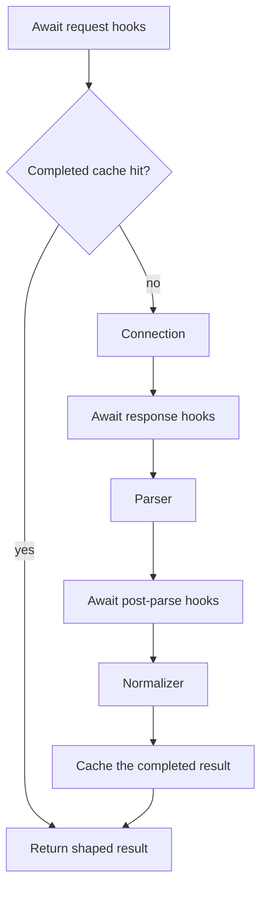

# The Unified Data Pipeline Architecture

## Introduction

Historically, frontend frameworks have handled local API requests (like fetching a JSON file) and remote procedure calls (RPC) to backend services using completely different paradigms. You might use `fetch()` or `XMLHttpRequest` for local data, and a completely separate library or abstraction for WebSockets and RPC calls.

Neo.mjs introduces the **Unified Data Pipeline Architecture**. This architecture eliminates the boundary between local fetches and remote calls. Whether you are loading a local JSON file, executing a standard REST API call, subscribing to a continuous WebSocket stream, or dispatching an RPC command to a remote service, the data flows through the exact same Pipeline mechanism.

This guide explains the four core pillars of this architecture: **Pipelines**, **Connections**, **Parsers**, and **Normalizers**, and how they enable powerful features like "Turbo Mode" and Cross-Worker execution.

## The Four Pillars

A Data Pipeline in Neo.mjs is essentially an assembly line. Raw bytes or requests enter at the start, and fully formed, predictable JavaScript objects exit at the end, ready for a `Store` to consume.

### 1. Connections (The Transport Layer)
The Connection is the gateway to the outside world. Its **only** job is transport. It handles the low-level protocols, network handshakes, and returning the raw payload.

*   `Neo.data.connection.Fetch`: Wraps the modern browser `fetch` API.
*   `Neo.data.connection.Xhr`: Wraps the legacy `XMLHttpRequest` API.
*   `Neo.data.connection.WebSocket`: Handles persistent, bidirectional socket connections.
*   `Neo.data.connection.Stream`: A specialized transport that returns a raw `ReadableStream` (byte pipe), useful for chunked data.

### 2. Parsers (The Deserializer)
Connections often return data in formats that JavaScript cannot natively digest (e.g., text, byte streams, XML, CSV, NDJSON). The Parser takes the raw output from the Connection and translates it into JavaScript objects.

*   `Neo.data.parser.Stream`: Takes a raw byte stream, chunks it by newlines, parses the NDJSON, and trickles the data forward.
*   *Note: Standard JSON responses from `Fetch` or `Xhr` often don't need a formal parser if the native `.json()` method is sufficient.*

### 3. Normalizers (The Shaper)
Even if data is valid JSON, its shape might not match what your `Store` expects. Your backend might wrap the data in metadata (`{ success: true, payload: [...] }`), or use different property names. The Normalizer bridges this gap, flattening or mapping the data into the canonical structure defined by your `Model`.

### 4. The Pipeline (The Orchestrator)
The `Neo.data.Pipeline` ties these three pieces together. It manages the flow of data from Connection -> Parser -> Normalizer.

Crucially, the Pipeline is the **Worker Execution Boundary**. You can configure a Pipeline to execute its heavy lifting in the `App` Worker or offload it entirely to the `Data` Worker to prevent UI freezing during massive data loads.

---

## 1. A Basic Fetch Pipeline

Let's start with the most common scenario: fetching a standard JSON file.

When you define a `url` on a Store, under the hood, Neo.mjs automatically creates a Pipeline using an `Xhr` or `Fetch` connection. However, explicitly defining the pipeline gives you total control.

```javascript live-preview
import Button          from '../../src/button/Base.mjs';
import Container       from '../../src/container/Base.mjs';
import ConnectionFetch from '../../src/data/connection/Fetch.mjs';
import Model           from '../../src/data/Model.mjs';
import Store           from '../../src/data/Store.mjs';
import Table           from '../../src/table/Container.mjs';

class UserModel extends Model {
    static config = {
        className: 'Docs.UserModel',
        keyProperty: 'id',
        fields: [
            {name: 'id',   type: 'Integer'},
            {name: 'name', type: 'String'},
            {name: 'role', type: 'String'}
        ]
    }
}
UserModel = Neo.setupClass(UserModel);

class UserStore extends Store {
    static config = {
        className: 'Docs.UserStore',
        model    : UserModel,
        // The unified pipeline configuration
        pipeline : {
            connection: {
                module: ConnectionFetch,
                url   : '../../resources/data/users.json'
            }
        }
    }
}
UserStore = Neo.setupClass(UserStore);

const myStore = Neo.create(UserStore);

class Example extends Container {
    static config = {
        className: 'Docs.DataPipelineExample1',
        layout: {ntype: 'vbox', align: 'stretch'},
        items : [{
            module : Button,
            flex   : 'none',
            text   : 'Load Data via Pipeline',
            handler: () => myStore.load()
        }, {
            module : Table,
            flex   : 1,
            store  : myStore,
            columns: [
                {dataField: 'id',   text: 'ID'},
                {dataField: 'name', text: 'Name'},
                {dataField: 'role', text: 'Role'}
            ]
        }]
    }
}
Example = Neo.setupClass(Example);
```

---

## 2. Offloading to the Data Worker

If your JSON file is massive (e.g., 50,000 records), processing that fetch, parsing the JSON string, and converting it into Records inside the App Worker will cause a noticeable stutter in your UI.

Because the Pipeline acts as the Execution Boundary, you can simply tell it to execute in the `Data` Worker. The App Worker Pipeline becomes a lightweight proxy. It instructs the Data Worker to establish the Connection, parse the data, and send only the finalized chunks back via fast IPC (Inter-Process Communication).

To enable this, simply add `workerExecution: 'data'` to your pipeline config:

```javascript
pipeline: {
    workerExecution: 'data',
    connection: {
        className: 'Neo.data.connection.Fetch',
        url      : '../../resources/data/massive_dataset.json'
    }
}
```
*Note: When using `workerExecution: 'data'`, you must use string-based `className` references (e.g., `'Neo.data.connection.Fetch'`) instead of `module` imports for your connection/parser/normalizer. This ensures the configs can be cleanly serialized and sent to the other thread without dragging App-specific modules across the worker boundary.*

---

## 3. The RPC/WebSocket Universe

Because RPC and local fetching now share the same architecture, integrating a WebSocket backend is identical to setting up a local Fetch.

If your project defines an RPC API (via `remotes-api.json`), you don't even need to define the connection manually. You just reference the API endpoint, and the system dynamically constructs the WebSocket pipeline for you.

```javascript readonly
import Container from '../../src/container/Base.mjs';
import Model     from '../../src/data/Model.mjs';
import Store     from '../../src/data/Store.mjs';
import Table     from '../../src/table/Container.mjs';

// Assume remotes-api.json defines a WebSocket stream:
// "services": { "Backend": { "streams": { "LiveUsers": { "type": "websocket", "url": "wss://..." } } } }

class LiveUserModel extends Model {
    static config = {
        className: 'Docs.LiveUserModel',
        keyProperty: 'id',
        fields: [
            {name: 'id',     type: 'Integer'},
            {name: 'status', type: 'String'}
        ]
    }
}
LiveUserModel = Neo.setupClass(LiveUserModel);

class LiveUserStore extends Store {
    static config = {
        className: 'Docs.LiveUserStore',
        model    : LiveUserModel,
        // Instead of 'url', we use the 'api' shortcut.
        // The Store automatically builds a Pipeline with a WebSocket connection.
        api      : 'MyApp.backend.LiveUsers'
    }
}
LiveUserStore = Neo.setupClass(LiveUserStore);

const liveStore = Neo.create(LiveUserStore);

class Example extends Container {
    static config = {
        className: 'Docs.DataPipelineExample2',
        layout: {ntype: 'vbox', align: 'stretch'},
        items : [{
            module : Table,
            flex   : 1,
            store  : liveStore,
            columns: [
                {dataField: 'id',     text: 'User ID'},
                {dataField: 'status', text: 'Status'}
            ]
        }]
    }
}
Example = Neo.setupClass(Example);
```

### Unsolicited Pushes & UI Reactivity

The true power of the Pipeline architecture shines with real-time data.

If a WebSocket Connection receives an unsolicited "push" from the server (e.g., `{ "id": 4, "status": "offline" }`), the Connection fires a `push` event.
The Pipeline catches this, passes it through the Parser and Normalizer, and forwards it to the Store.

The Store intercepts the `push` event, automatically looks up Record ID #4, and calls `record.set({ status: 'offline' })`. This triggers the surgical reactivity engine, updating **only that specific row** in the Grid, without ever reloading the collection.

By default, pushed records whose id is not already present in the Store are ignored. This keeps filtered,
remotely sorted, and paginated projections safe: a random unknown id does not prove that the record belongs
in the visible dataset.

Stores that own their local projection can opt into insert/upsert behavior:

```javascript readonly
const liveStore = Neo.create(Store, {
    api               : 'MyApp.backend.LiveUsers',
    model             : LiveUserModel,
    pushInsertStrategy: 'upsert'
});
```

The supported `pushInsertStrategy` values are:

| Value | Unknown pushed id behavior |
| --- | --- |
| `false` | Ignore the push. This is the default. |
| `'insert'` / `'upsert'` | Add the record through `Store#add()` when the Store owns a local projection. Existing ids still use `record.set()`. |
| `'reload'` | Reload the Store for every unknown pushed id. |
| `'reloadWhenUncertain'` | Insert locally when safe; reload instead for `remoteFilter`, `remoteSort`, or `pageSize > 0`. |

Local filters and sorters are applied through the normal collection path, so a filtered-out pushed record
does not become visible and a locally sorted insert lands in sorted order. For server-owned projections
(`remoteFilter`, `remoteSort`, or pagination), prefer `'reloadWhenUncertain'` or `'reload'` unless your
server payload explicitly proves visible membership and order.

#### The pushed key is canonicalized before lookup

A push carries whatever type the wire happened to use, and JSON has no way to say "this `1` is the same
record as the `1` you already hold". A Store keys its Collection by strict `Map` identity, so `"1"` and `1`
are different keys, while `Store#add()` converts every field to the type its Model declares. Left alone,
that asymmetry turns a type mismatch into a *miss* rather than a near-miss — and an `'insert'` / `'upsert'`
strategy answers a miss by adding, leaving two records under one identity that nothing later removes.

The Store therefore resolves each pushed key through `Store#getCanonicalKey()` before looking it up, and
stores that canonical key rather than the received one:

```javascript readonly
// Model declares {name: 'id', type: 'Integer'} and the Store already holds record 1.
store.pipeline.simulatePush({id: '1', status: 'offline'});
// -> updates record 1. Without canonicalization this appends a second record with id 1.
```

This is not `Integer`-only. A `String`-keyed Model receiving a numeric push is the same defect mirrored,
and takes the same path.

**Supported domain.** A key field which declares no `convert` and no `calculate`, and whose declared type
converts to a primitive. Inside it, the conversion is delegated to the same
`RecordFactory.parseRecordValue()` insertion uses, so the declared-type rules are not restated in a second
place where they could drift.

**Everything else is refused, and a refused push is dropped** rather than inserted — a wrong key is worse
than no key, because it adds a second row under an identity that already exists. A push is refused when:

| case | why a lookup cannot reproduce the stored key |
| --- | --- |
| `calculate` on the key field | the stored key is derived from a record which does not exist at lookup time |
| `convert` on the key field | insertion passes the Record to the converter; a lookup can only pass the raw value, so a converter which reads the record yields a different key on each path |
| a `Date` (or any object) key | conversion produces an equal-but-distinct object each time, and a `Map` compares keys by identity, so the lookup could never match what was stored |
| a value converting to `NaN`, e.g. an `Integer` key of `'abc'` | it would store as `NaN` behind a `'abc'` map key, leaving the record unreachable |
| `null`, `undefined`, or an absent key | not an identity at all; passing it on lets an upsert invent a row for a record the payload never named |

If your server owns keys in one of the refused shapes, push a `'reload'` strategy instead of an insert —
the Store can re-read a projection it cannot address record-by-record.

## Interceptors: share a policy without replacing the transport

An authorization header belongs on every relevant request, whether it came from a grid refresh or a
background load. Copying that preparation into each caller makes a policy change depend on finding every
call site. Replacing the connection just to add the header also mixes application policy with transport.

A Pipeline can instead compose ordinary Neo interceptor classes. It awaits each hook and passes the
result to the next handler. Global handlers run before the Pipeline's local handlers, in declaration
order. The connection, parser and normalizer keep their existing jobs.

For example, a consumer can define `apps/myapp/data/Authorization.mjs`:

```javascript readonly
import Interceptor from '../../../node_modules/neo.mjs/src/data/interceptor/Base.mjs';

class Authorization extends Interceptor {
    static config = {
        className: 'MyApp.data.Authorization',
        token    : null
    }

    async request(params) {
        const headers = new Headers(params.headers);
        headers.set('Authorization', `Bearer ${this.token}`);
        return {...params, headers: [...headers]}
    }
}

export default Neo.setupClass(Authorization);
```

The class contains the behavior; its configuration contains only data. This distinction matters when
the work runs in another worker: a callback closure cannot be serialized into that realm.

In the application's `app.mjs`, the same descriptor can configure a local Pipeline or its Data-worker
counterpart. The explicit module path lets Data load the application's class through its production
module loader:

```javascript readonly
import Authorization from './data/Authorization.mjs';
import Pipeline      from '../../node_modules/neo.mjs/src/data/Pipeline.mjs';

const policy = {
    module    : Authorization,
    modulePath: 'apps/myapp/data/Authorization.mjs',
    token     : '<application-supplied token>'
};

const pipeline = Neo.create(Pipeline, {
    workerExecution: 'data',
    connection     : {className: 'Neo.data.connection.Fetch', url: '/api/users'},
    interceptors   : [policy]
});

const users = await pipeline.read();
```

Use `await pipeline.setInterceptors([...])` to replace local policies, or an empty array to clear them.
Do not mutate the construction descriptors to change an admitted policy. The Pipeline owns fresh handler
instances; passing a borrowed instance or a callback as a data option is rejected.

### Globals belong to the realm doing the work

`await Pipeline.setGlobalInterceptors([...])` changes the current realm's global chain. A Pipeline
executing in App uses App's globals. For Data execution, register them through the Data worker:

```javascript readonly
await Neo.worker.Data.setPipelineInterceptors({
    interceptors: [{
        className : 'MyApp.data.Authorization',
        modulePath: 'apps/myapp/data/Authorization.mjs',
        token     : '<application-supplied token>'
    }]
});
```

Await registration before starting work that requires the new policy. Existing Pipelines see the new
global chain; operations already using the old one finish with their own snapshot. Retired handlers are
destroyed after their last operation releases them. Failed loading or readiness leaves the previous
admitted chain in place.

### Each hook has one place in the flow

`request` prepares parameters before transport **and before cache lookup**. `response` transforms a
successful transport result before parsing. `responseError` receives a rejected transport result: return
a replacement to recover, or throw/return `undefined` to keep it rejected. Later handlers follow the
resulting success or rejection path. No token refresh or retry is invented by the hook chain.

`postParse` transforms parsed values before normalization. Returning `undefined` from a value hook keeps
the preceding value. Hook context identifies the executing Pipeline, operation, business method and
effective request parameters; the hook can await its own application work without capturing a proxy.

For a non-streaming read with caching enabled:



Request preparation still runs on a cache hit, so changed request headers do not silently reuse another
request's result. A hit reuses the final shaped snapshot and does not replay response or post-parse
effects. Replacing a chain invalidates incompatible entries; an older operation cannot publish a reusable
entry under the newer policy. Unsupported cache-key values remain uncached.

Streams stay progressive and uncached. Their `postParse` hooks receive each row batch, not the terminal
`{success, count}` summary, and are awaited before that batch is emitted. Data-worker rows and progress
reach the App-side Pipeline's ordinary events. Unsolicited pushes have no request or HTTP response stage;
their async processing preserves arrival order. A rejected intercepted push emits an `error` receipt
with `operation: 'push'` and a message, and does not prevent the next push from being processed.

## Migration Path for Legacy Configs

If you are upgrading from an older version of Neo.mjs, your existing `url` and `api` configs on Stores are still fully supported.

*   **Legacy `url`:** If you define `url: 'data.json'`, the Store automatically creates a Pipeline using `connection-xhr` behind the scenes.
*   **Legacy `api`:** If you define `api: 'MyService'`, the Store resolves the API definition and builds the appropriate Pipeline (Fetch, Xhr, or WebSocket) dynamically.

However, to unlock advanced features like Data Worker offloading (`workerExecution: 'data'`) or custom Parsers, you must switch to explicitly defining the `pipeline` config block.
