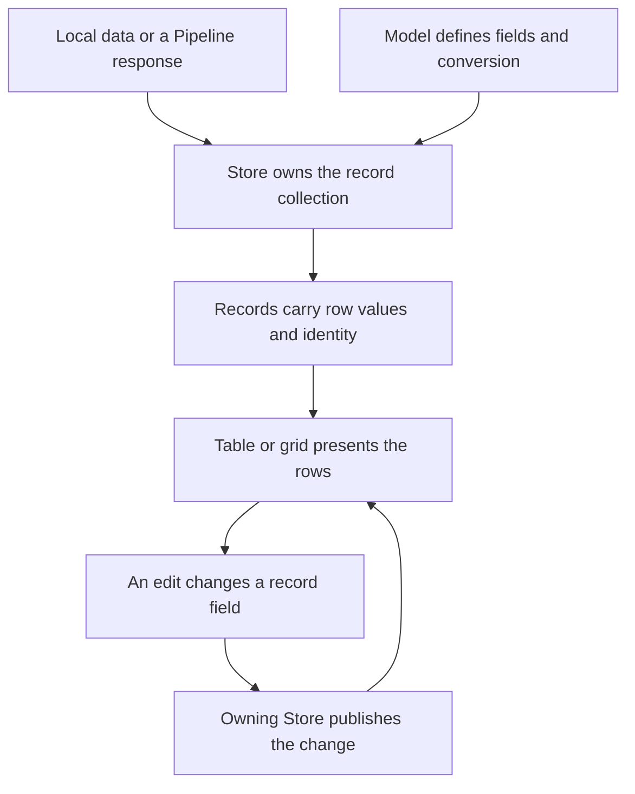

# Tables (Stores)

A task board starts with three rows. Then someone asks for an “open tasks” view, a priority order, an editor,
and a count that stays correct when a task is completed. The difficult part is no longer drawing the rows.
It is deciding which object owns the data, which objects merely present it, and what an edit should change.

`Neo.data.Store` is that data owner. It combines the ordered, keyed collection with a Model-defined record
population, change notifications, and a loading lifecycle. A table or grid displays the Store; it does not
have to become a second database. This separation lets you change the presentation while keeping the
record identities and data operations in one place.

“Tables” here means tabular application data. `Neo.table.Container` is a UI component that can display it.
A Store itself has no DOM: the same data can feed a table, a grid, a chart, or a picker.

For a complete practical workflow with a Store subclass, JSON loading and a shared Grid/ComboBox,
continue with [Using data.Store](#/learn/guides/datahandling/UsingStores).

## Give the rows a home

Three pieces cooperate. A **Model** describes the fields and their conversions. A **record** holds one
row's values using the accessors generated for that Model. A **Store** manages those records as a
collection and announces changes to its consumers. Records are lightweight objects; they are not
instances of `Neo.data.Model` or `Neo.core.Base`.

That distinction matters when a user edits a row. Replacing a plain array of display objects gives every
consumer another copy to reconcile. Editing a Store record preserves the object that the data layer
already knows, and its field setters notify the owning Store. A view can then react to the change without
being responsible for the field schema or transport.



The [Records guide](#/learn/guides/datahandling/Records) explains field conversion and calculated values.
[Collections](#/learn/guides/datahandling/Collections) explains the underlying keys, ordering, filters,
and sorters. The Store is where those capabilities meet the application's data lifecycle.

## One dataset, two questions

Consider a list containing “Write,” “Review,” and “Archive.” An editor needs all three records; a work queue
needs only the unfinished ones, ordered by priority. Copying the unfinished records into another array
would make it easy for the editor and queue to disagree about the same task.

A `sourceId` projection offers a different arrangement: it keeps its own membership and order while
sharing record objects with the source. The following example runs inside an engine module; the relative
imports assume a module under `examples/your-app/`.

```javascript readonly
import Model from '../../src/data/Model.mjs';
import Store from '../../src/data/Store.mjs';

class TaskModel extends Model {
    static config = {
        className: 'MyApp.model.Task',
        fields: [
            {name: 'id',       type: 'Integer'},
            {name: 'title',    type: 'String'},
            {name: 'done',     type: 'Boolean'},
            {name: 'priority', type: 'Integer'}
        ]
    }
}
TaskModel = Neo.setupClass(TaskModel);

const tasks = Neo.create(Store, {
    model: TaskModel,
    data: [
        {id: 1, title: 'Write',   done: false, priority: 2},
        {id: 2, title: 'Review',  done: false, priority: 1},
        {id: 3, title: 'Archive', done: true,  priority: 0}
    ]
});
await tasks.ready();

const openTasks = Neo.create(Store, {
    model   : TaskModel,
    sourceId: tasks.id,
    filters : [{property: 'done', value: false}],
    sorters : [{property: 'priority', direction: 'ASC'}]
});
await openTasks.ready();

const ids = store => store.items.map(record => record.id);

console.log(ids(tasks));                      // [1, 2, 3]
console.log(ids(openTasks));                  // [2, 1]
console.log(tasks.get(1) === openTasks.get(1)); // true
console.log(tasks.count, openTasks.count);    // 3, 2
```

The priority order belongs to `openTasks`. It has not rearranged the source. The strict equality check is
the other half of the contract: these are two ways of finding the same record, not two independently
editable copies.

Reuse the **Model class**, as above, or provide separate Model configurations. Do not pass the same Model
instance into both Stores: a Model's `storeId` identifies the Store that receives its record changes.
`sourceId` does not inherit a Model configuration for you.

## A shared value is not a broadcast

There is a subtle boundary worth seeing before building a screen around it. Change Write's priority:

```javascript readonly
tasks.get(1).set({priority: 0});

console.log(openTasks.get(1).priority); // 0: it is the same record
console.log(ids(openTasks));          // [2, 1]: the projection has not re-sorted

openTasks.filter();
console.log(ids(openTasks));          // [1, 2]

tasks.get(1).done = true;
openTasks.filter();
console.log(tasks.count, openTasks.count); // 3, 1
console.log(ids(openTasks));               // [2]
```

These results were exercised against the Store implementation: changing the shared value was immediate,
but the queue's order changed only when its projection was refreshed. `sourceId` listens to source
collection mutations. It does **not** automatically forward every `recordChange` notification to every
derived Store. In this example, `filter()` explicitly recomputes membership and applies the configured
sorters, giving the queue its new result.

That is a design choice for the consumer to make deliberately. When multiple views should present exactly
the same live collection, bind them to the **same Store instance**. When each needs independent filters or
ordering, give the projection an explicit refresh path for the edits it must observe. A projection is
also not a read-only copy: collection mutations can propagate back to its source.

Within the owning Store, filters and sorters can opt into reevaluation after record edits using
`reapplyOnRecordChange: true`. The default is false. `autoSort: true` alone does not mean that every
ordinary field edit rearranges the collection. See
[Collections](#/learn/guides/datahandling/Collections) for the underlying filtering and sorting operations.
The record-edit opt-ins still require a notification: setting them on a projection does not forward a
source record change to it.

## Put the Store behind a view

Once the data has a home, the table's job gets small. Its columns select record fields through `dataField`,
and its `store` config points to the data it should show. It can display all tasks or the open-task
projection without owning the query logic.

For a screen with several consumers, put the Store in the view-root State Provider and bind the table to
it. The [State Provider table example](https://github.com/neomjs/neo/blob/dev/examples/stateProvider/table/MainContainer.mjs) uses this shape:

```javascript readonly
bind: {
    store: 'stores.main'
}
```

Here the provider creates and owns `stores.main`; the table receives that Store. Another view can bind to the same key.
The [State Providers guide](#/learn/guides/datahandling/StateProviders) shows the complete declaration and
binding setup. A [grid](#/learn/guides/datahandling/Grids) can use the same data-management approach when
the presentation needs virtualization.

Ownership also decides cleanup. In the standalone example above, the code that created the Stores should
destroy `openTasks` and then `tasks` when it is finished. A provider owns Stores it creates from
configurations or class references; it borrows Store instances passed in already constructed. Their
original owner remains responsible for disposal. Keeping that decision explicit prevents one consumer
from unexpectedly retiring the data another consumer still uses.

## Loading changes what “all rows” means

Local data makes the first example easy to reason about: all three records are already present. A server
introduces a second question: does the Store hold the whole dataset, or only the page the server returned?
A local filter can only judge the records the application actually has.

This is why counts need names. `count` is the Store's current visible membership. When a local filter is
active, `allItems` retains the unfiltered local population. `totalCount` is transport-supplied total
metadata; it is not a second spelling of `count`. In the local example, `tasks.count` is 3 while
`tasks.totalCount` is 0. Neither number establishes how many rows exist on a remote service.

`Store.load()` obtains data through its Pipeline, API, or URL configuration. `autoLoad` defaults to false,
so an application can decide when to start that work. Pipeline loads clear the previous rows unless
appending. For a Pipeline or API continuation, use `load({append: true})`. Appending does not advance
`currentPage`: the caller still selects the next page or cursor according to its service's contract.

For server-owned queries, `remoteFilter` and `remoteSort` send the relevant query configuration through
the load path, and `pageSize` participates in the request. They do not give a client-only Store knowledge
of rows it has never received. Choose local operations for a locally owned population and remote
operations when the service owns the complete query result.

The [Data Pipelines guide](#/learn/guides/datahandling/DataPipelines) owns transport configuration, parsing,
and normalization. [Streaming](#/learn/guides/datahandling/Streaming) explains progressive arrivals.
Those are different loading strategies for the same data owner, rather than separate data models for
each view.

One event detail prevents a misleading spinner: the Store's `load` event also announces local data
changes such as sorting. It is not proof that a network request just completed. `isLoadPending` tracks
outstanding `load()` invocations; progressive data can already be visible while that signal remains true.
A screen can show request feedback without hiding the rows it has already received.

The payoff is a screen whose data responsibilities remain visible: the Model defines a row, the Store
owns the population and its lifecycle, an explicit projection answers a narrower question, and the view
presents the answer. Adding another view no longer requires inventing another owner for the same data.
