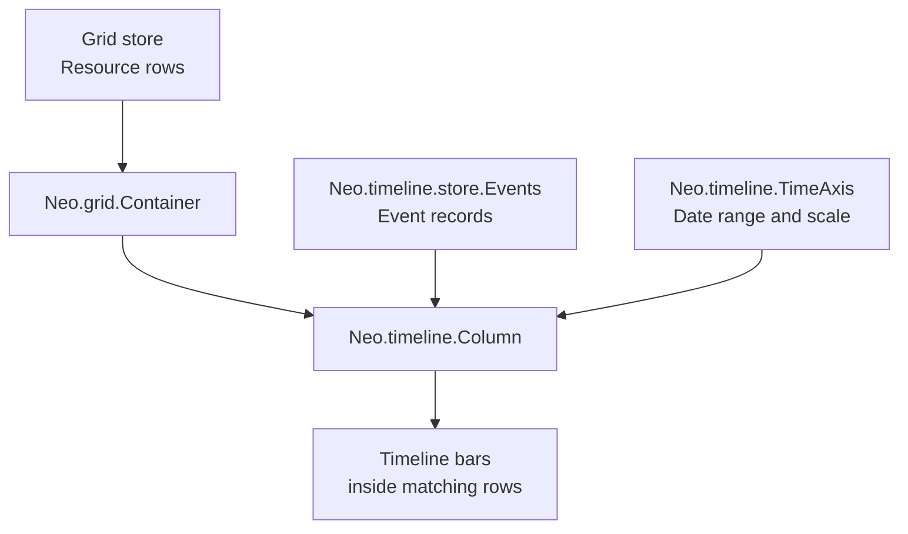

# Using a Timeline Column in a Grid

You already have a grid of resources, projects, people, or machines. Now you need to see when work happens alongside the information you already display.

A conventional grid answers *what belongs to each row*. A timeline adds another question: *when does it happen?*

You do not need to replace your grid with a scheduler to answer that question. Neo.mjs provides `Neo.timeline.Column`, a grid column that projects time-based records into horizontal bars inside the corresponding row. Your existing resource columns remain ordinary grid columns; the timeline becomes another column in the same layout.

## 1. What a Timeline Column adds

`Neo.timeline.Column` extends `Neo.grid.column.Base`. It turns a row's time-based data into bars positioned against a shared `Neo.timeline.TimeAxis`.

This is useful when a timeline is one part of a larger tabular view. For example, a project grid can keep its owner, status, and priority columns while adding a schedule next to them. A machine inventory can show machine details and operating intervals in the same row.

The relationship looks like this:



The grid owns the rows. The event store supplies the intervals, and the time axis supplies their horizontal coordinates. The column projects the relevant events into each row.

Use a Timeline Column when you want a timeline alongside the other columns in an existing grid. Start with the [Resource Schedulers guide](Scheduler.md) when the central purpose of the view is a complete resource-booking experience with dedicated booking interactions. The two approaches share the timeline primitives; they serve different starting points.

## 2. A minimal grid with a Timeline Column

A working timeline needs three things:

- A grid store containing the rows.
- A `Neo.timeline.TimeAxis` defining the visible time range and horizontal scale.
- An event store containing dated records associated with those rows.

The following is the complete `Viewport.mjs` from the runnable basic example. It creates a grid with a locked resource column and a timeline column. Its toolbar button also demonstrates changing an event through its record.

```javascript
import Button         from '../../../src/button/Base.mjs';
import GridContainer  from '../../../src/grid/Container.mjs';
import Label          from '../../../src/component/Label.mjs';
import TimeAxis       from '../../../src/timeline/TimeAxis.mjs';
import TimelineColumn from '../../../src/timeline/Column.mjs';
import EventStore     from '../../../src/timeline/store/Events.mjs';
import Toolbar        from '../../../src/toolbar/Base.mjs';
import Viewport       from '../../../src/container/Viewport.mjs';

const resources = [
    {id: 'r-1', name: 'Design Team'},
    {id: 'r-2', name: 'Core Engine'},
    {id: 'r-3', name: 'UI Components'},
    {id: 'r-4', name: 'Documentation'},
    {id: 'r-5', name: 'QA & Testing'},
    {id: 'r-6', name: 'DevOps & CI'},
    {id: 'r-7', name: 'Community'}
];

const events = [
    {id: 'ev-1',  resourceId: 'r-1', title: 'Sprint Planning',    startDate: '2026-11-16T08:00:00Z', endDate: '2026-11-16T11:00:00Z'},
    {id: 'ev-2',  resourceId: 'r-1', title: 'Design Review',      startDate: '2026-11-16T13:00:00Z', endDate: '2026-11-16T16:00:00Z'},
    {id: 'ev-3',  resourceId: 'r-2', title: 'Architecture Sync',  startDate: '2026-11-16T09:00:00Z', endDate: '2026-11-16T12:00:00Z'},
    {id: 'ev-4',  resourceId: 'r-2', title: 'VDOM Optimization', startDate: '2026-11-16T14:00:00Z', endDate: '2026-11-16T18:00:00Z'},
    {id: 'ev-5',  resourceId: 'r-3', title: 'Timeline Testing',   startDate: '2026-11-16T10:00:00Z', endDate: '2026-11-16T13:00:00Z'},
    {id: 'ev-6',  resourceId: 'r-3', title: 'Component Review',  startDate: '2026-11-16T15:00:00Z', endDate: '2026-11-16T17:30:00Z'},
    {id: 'ev-7',  resourceId: 'r-4', title: 'Guide Writing',     startDate: '2026-11-16T08:30:00Z', endDate: '2026-11-16T12:00:00Z'},
    {id: 'ev-8',  resourceId: 'r-4', title: 'API Reference',     startDate: '2026-11-16T13:30:00Z', endDate: '2026-11-16T16:30:00Z'},
    {id: 'ev-9',  resourceId: 'r-5', title: 'Integration Tests', startDate: '2026-11-16T09:00:00Z', endDate: '2026-11-16T14:00:00Z'},
    {id: 'ev-10', resourceId: 'r-6', title: 'Build Ratchet',     startDate: '2026-11-16T11:00:00Z', endDate: '2026-11-16T15:00:00Z'},
    {id: 'ev-11', resourceId: 'r-7', title: 'Issue Triage',      startDate: '2026-11-16T10:00:00Z', endDate: '2026-11-16T13:00:00Z'},
    {id: 'ev-12', resourceId: 'r-7', title: 'Release Notes',     startDate: '2026-11-16T15:00:00Z', endDate: '2026-11-16T18:00:00Z'}
];

class TimelineViewport extends Viewport {
    static config = {
        className: 'Neo.examples.timeline.basic.Viewport',
        layout   : {ntype: 'vbox', align: 'stretch'},
        items    : [{
            module: Toolbar,
            flex  : 'none',
            items : [
                {module: Label, text: 'Resource Timeline'},
                '->',
                {
                    module : Button,
                    text   : 'Shift Selected Interval (+1h)',
                    handler: 'up.onShiftInterval'
                }
            ]
        }, {
            module   : GridContainer,
            reference: 'grid',
            flex     : 1,
            rowHeight: 48,
            store    : {
                model: {fields: [{name: 'id'}, {name: 'name'}]},
                data : resources
            },
            columns: [
                {
                    dataField: 'name',
                    text     : 'Resource',
                    width    : 180,
                    locked   : 'start'
                },
                {
                    module   : TimelineColumn,
                    ntype    : 'timeline-header',
                    dataField: 'timeline',
                    text     : 'Schedule',
                    timeAxis : {
                        module     : TimeAxis,
                        start      : '2026-11-16T00:00:00Z',
                        end        : '2026-11-17T00:00:00Z',
                        timeZone   : 'UTC',
                        tickUnit   : 'hour',
                        tickStep   : 2,
                        pxPerMinute: 1,
                        snapMinutes: 30
                    },
                    eventStore: {
                        module: EventStore,
                        data  : events
                    }
                }
            ]
        }]
    }

    onShiftInterval() {
        const grid        = this.getItem('grid'),
              column      = grid.columns.get('timeline'),
              eventStore  = column?.eventStore,
              selection   = grid.view.selectionModel?.getRowRecord(grid.view.selectionModel.selectedRows[0])?.id,
              selectedRow = selection || 'r-1',
              event       = eventStore?.items.find(r => r.resourceId === selectedRow) || eventStore?.items[0];

        if (event) {
            const start = new Date(event.startDate),
                end     = new Date(event.endDate);

            start.setUTCHours(start.getUTCHours() + 1);
            end.setUTCHours(end.getUTCHours() + 1);

            event.set({
                startDate: start.toISOString(),
                endDate  : end.toISOString()
            })
        }
    }
}

export default Neo.setupClass(TimelineViewport);
```

The example's resource store defines the rows, while the event store supplies the bars. The Timeline Column is configured as a regular entry in the grid's `columns` array. Its `timeAxis` and `eventStore` configurations are converted into their corresponding Neo instances.

The `ntype: 'timeline-header'` setting connects the column to its timeline header. The grid and column then keep horizontal scrolling and the header's time ticks aligned.

## 3. Events and rows

The resource store and event store answer different questions.

The grid's `store` determines which rows exist and provides the fields shown by ordinary columns. In the example, each resource has an `id` and a `name`.

The `eventStore` contains `Neo.timeline.model.Event` records. Each event has an identifier, a title, start and end dates, and a `resourceId` identifying its owning row. The model also supports `description`, `allDay`, `cls`, and `percentDone`.

By default, the column reads the row's `id` through `resourceIdField: 'id'`. It finds events whose `resourceId` matches that value. This means the event's `resourceId` must correspond to the resource key used by the row.

If your rows use a different key, set `resourceIdField` to its field name. For example, a grid whose resource records use `machineCode` can match event records by configuring `resourceIdField: 'machineCode'` and putting the corresponding machine code in each event's `resourceId`.

Several events can belong to the same row. When their time intervals overlap, Neo packs them into separate vertical lanes inside that row. Independent, non-overlapping intervals can use the same lane. This makes simultaneous work visible without placing one bar directly over another.

There is also a second data shape: an inline row record. When no `eventStore` is configured, the column checks the row itself for `startDate` and `endDate`. It can read the title and completion percentage from that same record as well. This is useful when each row represents one task or interval rather than a resource with multiple events.

The inline field names are configurable through `startDateField`, `endDateField`, `titleField`, and `percentDoneField`. The event-store approach is the natural fit when one resource row can own multiple independently managed events.

## 4. The time axis and its header

`Neo.timeline.TimeAxis` defines the temporal range and translates dates into horizontal positions. Its `start` and `end` establish the interval represented by the column.

The scale can be controlled with `pxPerMinute`: a higher value gives each minute more horizontal space. An explicit `size` can instead provide a fixed total width for the complete range. Choose a scale that makes the intervals readable without making the grid unnecessarily wide.

The axis also controls tick generation. `tickUnit` accepts `minute`, `hour`, `day`, `week`, or `month`; `tickStep` determines how many units separate ticks. In the example, `hour` with a step of `2` produces two-hour ticks.

Snapping controls editing precision, not the display frequency of the header ticks. `snapMinutes` sets the interval to which pointer-derived dates are snapped, relative to the time axis start. It defaults to 15 minutes; the example uses 30. When an event is moved or resized, the drag zone converts the pointer position into a date and snaps it before calculating the updated interval.

Set `timeZone` deliberately when your application has a defined calendar zone. The example uses `UTC` and ISO timestamps ending in `Z`, so its event instants and axis calendar use the same reference. When no time zone is provided, the axis uses the viewer's local calendar.

The timeline header has two rows. The major row provides the broader time grouping, while the minor row displays the finer ticks. `majorTickUnit` and `majorTickStep` can override the major row's automatic unit, and `majorFormatter` and `minorFormatter` let you customize the corresponding labels. When no major unit is set, the header derives it from the axis tick unit.

For working calendars, the axis supports `nonWorkingDays` and `nonWorkingDates`. The default non-working weekdays are Sunday and Saturday; pass an empty array for `nonWorkingDays` when every weekday should count as working time. Set `showNonWorkingTime` on the Timeline Column to display the corresponding shaded ranges in its track and header.

## 5. Bars: content, styling, progress, and changes

Each event is represented by a bar positioned from its start and end dates. The default label comes from `titleField`, which uses `title` by default.

Use `barCls` to add a CSS class to the column's bars, or `cls` on an individual event to style that event differently. For more involved rendering, `barRenderer` receives a bar descriptor and a context containing the column and its virtual DOM node. It can return a replacement VDOM object or a string to use as the bar label.

When an event has a positive `percentDone` value, the column renders a progress fill inside the bar. Values are clamped to the `0..100` range for the fill width. `highlightedRecordIds` can mark selected event record IDs with the highlighted bar class.

Bar resizing is enabled by default through `resizableBars`. The column renders start and end handles, and the timeline drag zone handles moving and resizing intervals. On drop, the drag zone commits the pending dates through `owner.commitTimelineEdit()` when the owner provides it. Otherwise, it updates the event record with `record.set()` (or assigns the updated properties to a plain object) and asks the store to sort. A cancelled drag clears the pending drop, leaving the original record unchanged.

The toolbar action in the runnable example demonstrates the same data principle without a pointer gesture: it finds an event and calls `event.set()` with new `startDate` and `endDate` values. The store and the grid continue to work with the updated record rather than a separate, manually maintained drawing.

## 6. Where to go next

Run the [basic Timeline example](../../../examples/timeline/basic/index.html) and inspect its [Viewport source](../../../examples/timeline/basic/Viewport.mjs). It shows the complete Grid configuration and a record update in context.

For a complete resource-booking experience, continue with [Building Resource Schedulers](Scheduler.md). For hierarchical project plans with linked tasks, see [Gantt Charts & Linked Tasks](Gantt.md).
