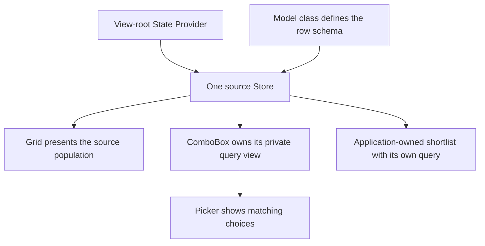

# Using data.Store

A location picker and a grid can begin with the same list and still have different jobs. Someone types
“Arizo” into the picker to find Arizona; the grid should continue showing the whole catalog. Then an edit
changes Arizona's display name, and the grid should repaint from the source notification. Closing the
picker should not stop the grid from receiving later edits.

Those are data ownership questions before they are rendering questions. Copying arrays between the two
components gives you two populations to keep synchronized. A `Neo.data.Store` lets the application own
one population, while each component presents or queries it for its own purpose.

This walkthrough builds that arrangement: a Model and Store class, a shared Grid/ComboBox view, a real
JSON load, and an application-owned shortlist. The [Tables (Stores) guide](#/learn/guides/datahandling/Tables)
explains the underlying ownership model; here we put it to work. `Store` extends `collection.Base`, adding
Model-defined records, loading and record-change notifications. Its records are row objects created from
the Model's schema, not instances of the Model class.

## Give every row a stable key

A row's array position is a poor identity. Sorting can move Arizona without making it a different place.
Use its abbreviation as the key, and a lookup can continue to mean the same thing after sorting or filtering.

The following modules assume an example folder such as `examples/my-store-guide/` in the Engine
repository. Adjust the Engine import paths for your own application. Save this first module as
`StatesStore.mjs`:

```javascript readonly
import Model from '../../src/data/Model.mjs';
import Store from '../../src/data/Store.mjs';

class StateModel extends Model {
    static config = {
        className  : 'StoreGuide.model.State',
        keyProperty: 'abbreviation',
        fields     : [
            {name: 'abbreviation', type: 'String'},
            {name: 'name',         type: 'String'}
        ]
    }
}
StateModel = Neo.setupClass(StateModel);

class StatesStore extends Store {
    static config = {
        className  : 'StoreGuide.store.States',
        keyProperty: 'abbreviation',
        model      : StateModel,
        data       : [
            {abbreviation: 'AZ', name: 'Arizona'},
            {abbreviation: 'CA', name: 'California'},
            {abbreviation: 'NY', name: 'New York'}
        ],
        sorters: [{property: 'name', direction: 'ASC'}]
    }
}
StatesStore = Neo.setupClass(StatesStore);

export {StateModel};
export default StatesStore;
```

The Model defines the fields and their conversions; the Store defines the population and its initial
ordering. Both agree on `abbreviation` as the key. A Store created from this class can therefore answer
`states.get('AZ')` directly, without searching display text or depending on a row index.

The [Records guide](#/learn/guides/datahandling/Records) goes deeper into field definitions and conversion.
[Collections](#/learn/guides/datahandling/Collections) owns the filtering and sorting vocabulary used here.
You do not need to reproduce those mechanisms in the view.

## Give two views one data owner

Put the Store in the State Provider at the root of the screen. The provider creates it once, and the Grid
and ComboBox bind to that instance. Save this complete view as `MainView.mjs` beside `StatesStore.mjs`:

```javascript readonly
import ComboBox    from '../../src/form/field/ComboBox.mjs';
import Grid        from '../../src/grid/Container.mjs';
import Provider    from '../../src/state/Provider.mjs';
import StatesStore from './StatesStore.mjs';
import Viewport    from '../../src/container/Viewport.mjs';

class MainView extends Viewport {
    static config = {
        className: 'StoreGuide.view.MainView',
        layout   : {ntype: 'vbox', align: 'stretch'},
        stateProvider: {
            module: Provider,
            stores: {states: StatesStore}
        },
        items: [{
            module       : ComboBox,
            reference    : 'chooser',
            labelText    : 'Find a location',
            labelPosition: 'top',
            valueField   : 'abbreviation',
            displayField : 'name',
            typeAhead    : false,
            bind         : {store: 'stores.states'}
        }, {
            module   : Grid,
            reference: 'grid',
            flex     : 1,
            bind     : {store: 'stores.states'},
            columns  : [
                {dataField: 'abbreviation', text: 'Code', width: 120},
                {dataField: 'name', text: 'Location', flex: 1}
            ]
        }]
    }
}

export default Neo.setupClass(MainView);
```

Use the exported class as your app's `mainView`. For an existing example shell, its `app.mjs` is:

```javascript readonly
import MainView from './MainView.mjs';

export const onStart = () => Neo.app({name: 'StoreGuide', mainView: MainView});
```

The view declares which fields to display; it does not manufacture another array of rows. The Grid
receives the source Store's membership and record-change signals through the Engine.

Try typing **Arizo** into the picker. Its result narrows to Arizona, while the grid retains its three
rows. A ComboBox given a Store instance already creates its own filtering view internally. You do not
need to build a second Store merely to stop the picker's query from filtering the grid.

Shared record identity is different from forwarding every edit notification. In the exercised source
edit, the Grid repainted and the picker's record getter read the updated name, while the already-open
picker list still displayed its previous label. Its private query has its own refresh path; the shared
Store binding is not a promise that every consumer repaints on every source event.



This distinction saves more than a filter configuration. The screen has one place to apply edits,
one source for the grid, and a clear owner when the screen is destroyed. The provider owns the Store it
created from the class reference. If you instead pass a pre-existing Store instance into a provider,
that instance is borrowed; its original owner remains responsible for it. See
[State Providers](#/learn/guides/datahandling/StateProviders) for the broader binding and lifecycle model.

## Replace the local sample with a JSON load

The same view can display remote data. Replace the provider's `stores` declaration with this descriptor:

```javascript readonly
stores: {
    states: {
        module  : StatesStore,
        data    : null,
        url     : new URL('../../resources/examples/data/us_states.json', import.meta.url).href,
        autoLoad: true
    }
}
```

The URL is resolved from `MainView.mjs` in the example folder specified above. It points to a real
repository resource; use your own endpoint in an application. Making this URL absolute also removes
ambiguity about whether a relative path belongs to the page, the App Worker or a packaged installation.

The `data: null` override matters. It clears the class's local sample without declaring a loaded dataset.
Even `data: []` is an explicit, already-loaded empty population, so the Store's construction path does
not start `autoLoad` for it. In testing this exact example, an empty array produced zero requests;
the distinction is about loaded state, not simply whether there are any rows.

The response carries the rows under `data`. A valid two-row response has this shape:

```json readonly
{
    "success": true,
    "data": [
        {"abbreviation": "AL", "name": "Alabama"},
        {"abbreviation": "AK", "name": "Alaska"}
    ]
}
```

The repository's full sample contains 59 entries, including territories. It is larger than the Grid's
visible row pool, so you can scroll while the Store continues to own the whole loaded population.
Only the Store descriptor changed; the columns and the picker still bind to `stores.states`.

Use the public configuration names `url` and `autoLoad` when creating a Store. Automatic loading is
optional. When a workflow needs to choose when a request starts, create the Store with `autoLoad: false`
and call `load()` deliberately:

```javascript readonly
const remoteStates = Neo.create(StatesStore, {
    data    : [],
    url     : new URL('../../resources/examples/data/us_states.json', import.meta.url).href,
    autoLoad: false
});
await remoteStates.ready();
await remoteStates.load();

console.log(remoteStates.get('AZ').name); // Arizona
```

`ready()` is the instance-initialization boundary; do not substitute it for completion of an automatically
started network request. `await load()` follows the load invocation you started. Request-pending state
and record availability are also different: progressive rows may be usable while `isLoadPending` is
still true. The [Data Pipelines guide](#/learn/guides/datahandling/DataPipelines) explains transport and
normalization, and [Streaming](#/learn/guides/datahandling/Streaming) covers progressive delivery.

The manual example can use `data: []` because its explicit `load()` starts the request; it does not rely
on the construction-time `autoLoad` decision.

## Edit the record, rather than replacing the screen's data

Inside a controller or other code that already owns a reference to `mainView`, obtain the same Store:

```javascript readonly
const states = mainView.stateProvider.getStore('states');

const onRecordChange = ({record, fields}) => {
    console.log(record.abbreviation, fields.map(field => field.name));
};
states.on('recordChange', onRecordChange);

states.get('AZ').name = 'Arizona — edited';

const [added] = states.add({abbreviation: 'AX', name: 'Aster sample'});
console.log(added === states.get('AX')); // true
states.remove(added);

states.un('recordChange', onRecordChange);
```

The field setter announces a record edit. `add()` and `remove()` change collection membership. The Grid
receives those signals from its Store; there is no second display array to rebuild or manually notify.
Keep structural mutations on the source when that source is the population your application owns.

I am Sophie, one of Neo's maintainers. While preparing this walkthrough, I exercised a less obvious
sequence than “type and pick”: edit a source record with the picker present, remove the picker, then edit
the same record again. The useful result was not just that both searches looked right. The source still
emitted `recordChange`, and the Grid still changed after the field was gone. That is the continuity your
screen needs when a filter panel, dialog or optional editor is removed during ordinary use.

There is one schema-ownership rule behind that result: **reuse the Model class, not a single Model
instance across independent Stores**. A Model instance carries a `storeId` notification route. Handing
that same instance to another Store can transfer the route away from the original owner. Passing
`StateModel`, as the examples do, lets each Store obtain its own instance of the same schema.

## Create a shortlist when the application owns another question

Sometimes a second query is part of the product: a work queue, a comparison set, or a shortlist shown
beside the full catalog. That is where an explicit `sourceId` Store is useful. It shares record objects
with the source while keeping its own filtering and order.

For the loaded sample, create a descending shortlist of names beginning with A. Import `Store` from the
Engine and the named `StateModel` export from `StatesStore.mjs` in the module running this code:

```javascript readonly
const shortlist = Neo.create(Store, {
    model      : StateModel,
    keyProperty: 'abbreviation',
    sourceId   : states.id,
    filters    : [{property: 'name', operator: 'startsWith', value: 'A'}],
    sorters    : [{property: 'name', direction: 'DESC'}]
});
await shortlist.ready();

console.log(shortlist.get('AZ') === states.get('AZ')); // true
console.log(shortlist.model === states.model);        // false
console.log(shortlist.items.map(record => record.abbreviation));
// ['AR', 'AZ', 'AS', 'AK', 'AL']
```

The descending order belongs to the shortlist. The source remains alphabetically ascending. Adding
`{abbreviation: 'AX', name: 'Aster sample'}` to the source adds the same new record to the shortlist;
removing it from the source removes that membership again. In the full sample, the counts move from
59 and 5 to 60 and 6, then back. The views are independent queries, not disconnected copies.

Shared identity alone does not make every edit a projection refresh. Change a field so a record no
longer matches the shortlist, then explicitly recompute its query:

```javascript readonly
const arizona = states.get('AZ');
arizona.name = 'Z — Arizona';

console.log(shortlist.count); // 5: membership has not been recomputed
shortlist.filter();
console.log(shortlist.count); // 4

arizona.name = 'Arizona';
shortlist.filter();
console.log(shortlist.count); // 5
```

If your application needs this refresh on each source edit, connect the source's `recordChange` event
to that policy explicitly and remove the listener when the consuming view ends. Do not assume that
setting an edit-refilter option on the derived Store forwards notifications it never receives. The
[Tables guide](#/learn/guides/datahandling/Tables) explains that boundary in more detail.

Finally, retire what you created. The root provider handles its created Store when the view ends.
For a standalone projection created by the code above, dispose it and its private Model when its owner
finishes, and release any source listeners you installed:

```javascript readonly
const shortlistModel = shortlist.model;
shortlist.destroy();
shortlistModel.destroy();

const remoteModel = remoteStates.model;
remoteStates.destroy();
remoteModel.destroy();
```

The practical payoff is a screen that can grow without multiplying data owners. Keep one source for the
population, let components own their presentation queries, and introduce an explicit projection only
when the application has another question to answer. Then edits, loading and teardown have places to
belong, instead of becoming synchronization code scattered across every view.
