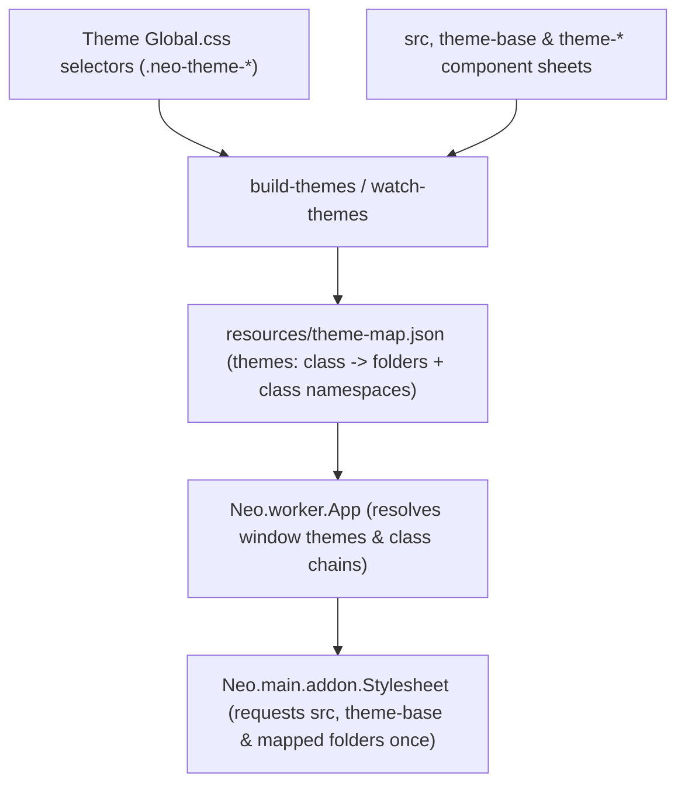

# Styling and Theming in Neo.mjs

This guide provides a comprehensive overview of how to style your Neo.mjs applications, from basic component styling to creating entirely new themes.

## The Core Concepts

Styling in Neo.mjs is a layered system designed for both performance and flexibility. It combines component-level styles, a plain-CSS theme engine, and a lazy-loading mechanism to ensure that only the necessary CSS is loaded at any given time.

Here are the key pillars of the styling system:

1.  **Component-Based Styles**: Applying styles directly to component instances.
2.  **VDOM-Based Styles**: How component styles are translated into the virtual DOM.
3.  **CSS & Theming**: The structure of the CSS source files and how themes are built.
4.  **Theme Inheritance**: How themes can extend and override base styles.
5.  **Build Process**: The scripts that copy the CSS theme sources into the build.
6.  **Lazy Loading**: How the engine efficiently loads theme styles on demand.

Let's dive into each of these areas.

## 1. Component-Based Styles

The primary way to style individual components is through configuration properties on the component itself. The `Neo.component.Base` class provides several key configs for this purpose.

### `style`

For applying inline CSS styles, use the `style` config. It accepts a standard JavaScript object. While the recommended convention is to use camelCased keys for CSS properties, you can also use quoted kebab-case keys.

```javascript readonly
// Recommended: camelCase
{
    ntype: 'button',
    text: 'Click Me',
    style: {
        backgroundColor: 'blue',
        color: 'white',
        borderRadius: '5px'
    }
}

// Also valid: quoted kebab-case
{
    ntype: 'button',
    text: 'Click Me',
    style: {
        'background-color': 'blue',
        'color': 'white',
        'border-radius': '5px'
    }
}
```

This will be rendered as `style="background-color: blue; color: white; border-radius: 5px;"` on the component's main HTML element.

### `cls`

To apply CSS classes, use the `cls` config, which accepts an array of strings.

```javascript readonly
{
    ntype: 'panel',
    cls: ['my-custom-panel', 'another-class']
}
```

Neo.mjs will automatically add its own classes for theming and functionality, so your custom classes will be merged with the engine's classes.

### `ui`

The `ui` config is a special styling hook that provides a simple way to apply a predefined set of styles to a component. It works by adding a CSS class in the format `neo-<ntype>-<ui>`.

For example, if you have a button:

```javascript readonly
{
    ntype: 'button',
    text: 'Important Button',
    ui: 'primary'
}
```

This will add the class `neo-button-primary` to the button's element, allowing you to target it with specific styles in your theme.

#### Implementing a Custom `ui` Style

To create your own `ui` variant, you simply add the corresponding CSS rule to your theme's CSS file. For example, to create a "success" button style, you would first set the config:

```javascript readonly
{
    ntype: 'button',
    text: 'Save Changes',
    ui: 'success'
}
```

Then, in your theme's CSS file (e.g., `resources/css/theme-my-theme/button/Base.css`), you would add the style definition:

```css readonly
.neo-button-success {
    background-color: #28a745; /* Green for success */
    color: white;
    /* any other styles... */
}
```

### Advanced Styling: Wrappers and Root Nodes

For more advanced control, `Neo.component.Base` provides a set of five style and class-related configs. Understanding them requires understanding the difference between a component's **outermost node** and its **logical root node** (`getVdomRoot()`).

-   For many simple components, these two nodes are the same.
-   For complex components, the logical root might be a child of the outermost node. For example, a grid cell component's logical root might be a `<div>`, but its outermost node is the `<td>` that wraps it.

This distinction explains the purpose of the different configs:

-   **`style`**: An object of inline styles applied to the component's **logical root node**.
-   **`cls`**: An array of CSS classes applied to the component's **logical root node**.
-   **`wrapperStyle`**: An object of inline styles applied to the component's **outermost node**. This is only needed when the outermost node is different from the logical root.
-   **`wrapperCls`**: An array of CSS classes applied to the component's **outermost node**, for the same reason as `wrapperStyle`.
-   **`baseCls`**: An array of fundamental CSS classes applied by the component class itself for its core functionality. This is for internal engine use and is automatically merged into the final `cls` array.

### Best Practice: `cls` vs. `style`

Whenever possible, it is considered **best practice to use `cls` instead of `style`**. Defining styles in CSS classes keeps your component definitions cleaner and makes your styles more reusable and maintainable.

The `style` config should be reserved for situations where style properties are being calculated dynamically at runtime and are specific to that single component instance. A perfect example is a resizable `Dialog` component. As a user drags the corner of the dialog, the engine will dynamically update its `width` and `height` via the `style` config. These are transient, calculated values that don't belong in a reusable CSS class.

## 2. VDOM-Based Styles

All component configurations, including `style` and `cls`, are ultimately applied to the component's Virtual DOM (VDOM) tree. The engine then efficiently updates the real DOM based on changes to the VDOM.

When you change a style-related config at runtime, the component's `afterSet` hook for that config (e.g., `afterSetStyle()`) is triggered. This hook updates the VDOM, and the engine's rendering pipeline applies the changes to the live DOM. This reactive system ensures that UI updates are fast and automatic.

### Where to Apply Styles: A Critical Distinction

To avoid conflicts and ensure the reactive system works correctly, it is critical to follow this rule:

-   **For the component's root VDOM node(s):** Always use the component-level configs (`cls`, `style`, `wrapperCls`, `wrapperStyle`). Do **not** add `cls` or `style` attributes directly to the root node within the `vdom` object itself. This allows the engine to manage these styles reactively. If you set them directly on the VDOM root, your styles could be overwritten by a config change, or they could conflict with it.

-   **For all other descendant VDOM nodes:** Use the standard inline `cls` (as an array) and `style` (as an object) attributes directly inside the VDOM structure. This is the correct and intended way to style the inner parts of your component.

```javascript readonly
// GOOD EXAMPLE
{
    ntype: 'container',
    // Use component configs for the root node
    cls: ['my-container'],
    style: { border: '1px solid blue' },

    // Define VDOM with inline styles for descendants
    vdom: {
        // No cls or style here!
        cn: [{
            tag: 'h1',
            cls: ['my-title'], // Correct for a descendant
            style: { color: 'blue' }, // Correct for a descendant
            text: 'My Component'
        }, {
            // ... other descendant nodes
        }]
    }
}
```

## 3. CSS & Theming

Neo.mjs's theme sources are plain CSS, using native nesting. The source files are located in the `resources/css` directory.

The structure is typically:

-   `resources/css/src/`: Contains the base structural styles for all components. These are the un-themed, core styles.
-   `resources/css/theme-light/`: Contains the styles for the light theme.
-   `resources/css/theme-dark/`: Contains the styles for the dark theme.

Within each of these folders, the CSS files are organized to mirror the component's namespace in the `src` directory. For example, the styles for `Neo.button.Base` would be located at:

-   `resources/css/src/button/Base.css`
-   `resources/css/theme-light/button/Base.css`
-   `resources/css/theme-dark/button/Base.css`

### The Browser Reads a Build, Not Your Sources

In development Neo.mjs serves **JavaScript from source** as native ES modules, so a class change is live on reload. **CSS is different:** the browser loads the built stylesheets from `dist/development/css/`, which are only as fresh as your last theme build. Edit a sheet in `resources/css` without rebuilding and you get current JS against an older stylesheet — a render that is confidently wrong, and whose first suspect is always your component code rather than the build.

**The workflow that makes that state impossible** — two steps, and worth making a habit:

1. **On a fresh checkout — and after any `git pull` or branch switch that brings someone else's CSS changes**, build the themes:

    ```bash readonly
    npm run build-themes -- -n -e dev -t all
    ```

    Those flags are not optional decoration: without `-n` the script stops to *ask* you which themes and environment to build, and `-e dev -t all` is what produces the full set the browser and the suites expect. This is the exact string the watcher, the dev server and the e2e preflight all print when they refuse — they share one constant, so the command you are told to run is always the command documented here.

    The built CSS is gitignored, so it never travels with a pull or a branch switch. The watcher only rebuilds what it *observes changing*, which means incoming CSS changes are covered when the watcher happens to be running and missed entirely when it is not. Rebuilding after a pull costs seconds and removes the question.

2. **Before you start editing CSS**, start the watcher and leave it running:

    ```bash readonly
    npm run watch-themes
    ```

    It rebuilds each sheet you touch, so the built CSS cannot fall behind your sources while you work.

The watcher is also your safety net if you skip step 1: it **refuses to start** against an incomplete or stale build, names exactly which outputs are missing or stale, and prints the rebuild command. A watcher that started anyway would silently paper over the problem, so a startup failure here is the feature.

Two things worth knowing about the failure mode itself:

- `npm run server-start` warns when served CSS trails your sources, but **that warning is a dev-server feature.** Serve the same app from anything else — an IDE's built-in web server, `python -m http.server`, nginx — and there is no signal at all.
- The browser-based suites never run against a stale build, by two different mechanisms: the **e2e and component** suites *materialize* fresh assets in their shared `globalSetup`, while the **visual** suite *refuses to run* and points you at the rebuild. Either way a green suite is **not** evidence that what you are looking at in your own browser is current — the suites fixed their own inputs, not yours.

## 4. CSS File & Namespace Mapping

For the automatic lazy-loading of theme files to work, it is **critical** that the path of a CSS file mirrors the namespace of the JavaScript class it styles. The build process uses this convention — together with the theme class selectors declared in each theme folder's `Global.css` — to generate `resources/theme-map.json`.



### Engine Components

For standard engine components, the mapping is direct. The path within `resources/css/src` (or a theme folder) matches the class path after `Neo.`.

-   **JS Class:** `src/button/Base.mjs` (which defines `Neo.button.Base`)
-   **Maps to CSS:** `resources/css/src/button/Base.css`

### Application Components (The `view` rule)

Applications follow a similar rule, but with one important exception: the `view` folder in the JavaScript path is **omitted** from the CSS path. It is a mandatory convention that only components inside an application's `view` folder should have associated CSS files.

-   **JS Class:** `apps/portal/view/Viewport.mjs` (defines `Portal.view.Viewport`)
-   **Maps to CSS:** `resources/css/src/apps/portal/Viewport.css`

Notice how `view/` is not present in the CSS path. The engine's build tools and runtime loader are specifically coded to handle this convention. Adhering to it is essential for your application's styles to be loaded correctly.

## 5. Theme Inheritance

The theming engine uses a powerful and automatic inheritance model. You **do not** need to manually `@import` base styles into your theme's CSS files. The engine handles this for you at runtime.

Here's how it works: When a component is created, the `insertThemeFiles()` method (in `src/worker/App.mjs`) inspects the component's entire JavaScript prototype chain. It walks **up** the chain from the component's class (e.g., `MyApp.view.CustomButton`) through its parents (like `Neo.button.Base`, `Neo.component.Base`, etc.) and loads the corresponding CSS file for each class that has one.

This means that the styles from `src` are always loaded as the base, and your theme's styles are automatically applied on top of them as overrides.

This approach has two major benefits:
1.  **Simplicity:** Your theme files only need to contain the specific styles you want to change. You don't need to worry about managing complex CSS imports.
2.  **Accuracy:** The CSS inheritance perfectly mirrors the JavaScript class inheritance.

A theme file can therefore be very clean and focused:

```css readonly
/* resources/css/theme-dark/button/Base.css */

/* No @import needed! */

:root .neo-theme-dark {
    --button-background-color: #3c3f41;
    --button-text-color: #bbb;
}
```

This inheritance follows **JavaScript classes**, not a relationship between theme names. Each configured theme loads its own value sheets, whose selectors must match that theme's class. To start a custom theme from an existing skin, generate an editable snapshot as described below; listing both names in `themes` does not retarget the base skin's selectors to the new theme.

## 6. Architecting Nestable Themes

A key feature of the Neo.mjs theming architecture is the ability to nest components with different themes inside each other. For example, you could have a dark-themed grid inside a light-themed panel. To make this work reliably, themes must follow a strict separation of concerns.

**The Golden Rule:**
-   **`resources/css/src/` defines structure:** The CSS files in the `src` directory should define all the CSS selectors and structural properties (like `display`, `position`, `overflow`, etc.). They use CSS variables (`var()`) for all cosmetic properties (like `color`, `background-color`, `border`, etc.).
-   **`resources/css/theme-*/` defines the skin:** Theme files should, ideally, **only** contain definitions for CSS variables. They should not introduce new selectors or override structural properties.

### A Practical Example: `list/Base.css`

This principle is clearly demonstrated in the styling for `Neo.list.Base`.

**Structure (`src/list/Base.css`):**
```css readonly
.neo-list-wrapper {
    background-color: var(--list-container-background-color);
    border          : var(--list-container-border);
    overflow        : hidden;
    position        : relative;
}

.neo-list-item {
    background-color: var(--list-item-background-color);
    padding         : var(--list-item-padding);
    /* ... more structural styles */
}
```
This file sets up the rules. It says that a `.neo-list-wrapper` *can* have a `border`, and its value is determined by the `--list-container-border` variable.

**Skin (`theme-dark/list/Base.css`):**
```css readonly
:root .neo-theme-dark {
    --list-container-border: 1px solid #282829;
    /* ... other dark theme variables */
}
```
The dark theme provides a value for the border variable.

**Skin & Nullification (`theme-light/list/Base.css`):**
```css readonly
:root .neo-theme-light {
    --list-container-border: 0;
    /* ... other light theme variables */
}
```
The light theme explicitly sets the border variable to `0`. This is called **nullification**. It's critical for nesting. If a light-themed list is placed inside a dark-themed component, this rule ensures the list does not incorrectly inherit the dark theme's 1px border. It actively resets the property defined in the `src` structure.

### Engine Value Sheets Declare at `:where()` Weight

An application projects its own palette into an engine token family at theme-root — `:root .neo-theme-neo-dark { --tooltip-bg: var(--my-panel) }` — and expects to win. Whether it does is a specificity contest, not a load-order one, only if the engine's own value sheet weighs less than the projection. A value sheet that declares at `:root .neo-theme-neo-dark` has the same weight as the projection, (0,2,0), and the tie goes to whichever sheet the browser saw last; the engine appends its per-class theme sheets as components mount, after the application's own, so the engine wins and the projection appears to do nothing.

The engine's value sheets therefore declare at `:where(.neo-theme-neo-dark)` weight — zero specificity — so a projection at theme-root outranks them wherever both match. A component that carries its own theme class (the shared tooltip stamps the hovered target's theme onto itself) is matched by both the engine sheet and the projection, so the contest is decided on that element as well, not left to inheritance.

```css readonly
/* engine: resources/css/theme-neo-dark/tooltip/Base.css */
:where(.neo-theme-neo-dark) {
    --tooltip-bg: var(--sem-color-surface-primary-default);
}

/* application: theme-neo-dark/apps/myapp/Viewport.css */
:root .neo-theme-neo-dark {
    --tooltip-bg: var(--myapp-panel-2);
}
```

Every neo value sheet declares at this weight, with one deliberate exception: `dialog/Base.css` nests a structural rule that must keep outranking the equal-weight button rules in `src/`, and says so in the file. Project into the dialog family with more specificity than the engine sheet — an element-scoped rule such as `body:has(.myapp-viewport) .neo-dialog` — rather than relying on load order; everywhere else, theme-root weight is enough.

Which families have moved is a property of the tree, not of this sentence: `grep -rl ':where(.neo-theme-neo-dark)' resources/css/theme-neo-dark` answers it, and stays right without an edit here.

### Bad Practice & The Right Way Forward

While you technically *can* add new selectors or structural overrides inside a theme file, it is considered **bad practice** if you want your theme to be nestable and composable with other themes. Doing so can lead to unpredictable side effects when themes are mixed and matched.

**What if a needed selector doesn't exist in `src`?**

There might be cases where your custom design requires styling a part of a component that doesn't have a dedicated CSS class or selector in the base `src` files. Here is the recommended workflow:

1.  **Temporarily add the selector to your theme:** To keep your project moving, it is acceptable to add the new structural selector directly into your theme's CSS file as a temporary measure.
2.  **Open a feature request:** Immediately after, you should open a feature request ticket in the [Neo.mjs GitHub repository](https://github.com/neomjs/neo/issues). The ticket should describe the component you are styling and the new selector(s) you need.

This process allows you to continue your work without being blocked, while also contributing back to the engine. Once the new selectors are added to the `src` files in a future Neo.mjs update, you can refactor your theme to remove the temporary structural code and use the new, official CSS variables instead. This keeps themes clean and aligned with the engine's architecture for the long term.

If you are creating a one-off, custom theme that will never be nested, this rule is less critical. However, for creating robust, reusable themes, sticking to the "structure vs. skin" separation is essential.

## 7. Creating a New Theme

Start from an existing theme with the theme generator. It gives you the base's value sheets under a new theme name, so you can change the palette without reconstructing every component's variables or editing the installed engine.

1.  **Choose a Base Theme and Generate Your Source:**
    From your application workspace, choose a base such as `theme-neo-light`, `theme-neo-dark`, `theme-light`, or `theme-dark`:

    ```bash readonly
    node node_modules/neo.mjs/buildScripts/create/theme.mjs --name theme-my-awesome-theme --base theme-neo-light --noquestions
    ```

    Inside the Engine checkout, use `npm run create-theme` instead; omitting the flags opens the name and base-theme prompts. The generator creates `resources/css/theme-my-awesome-theme`, keeps the base's folder structure, and changes its exact theme selector to `.neo-theme-my-awesome-theme`. Selector weight is preserved, including the neo skins' `:where()` roots. Values every theme shares, such as the motion vocabulary, come from the Engine's `src/Global.css` for any `neo-theme-*` root, so the snapshot does not copy them.

    When the selected base has component-package or workspace overrides, the generated snapshot includes those effective files in the same precedence as the theme build. Existing destinations are refused. [Build-script usage](https://github.com/neomjs/neo/blob/dev/buildScripts/README.md#npm-run-create-theme) documents the command options and workspace invocation.

2.  **Customize Your Theme's Variables:**
    Now you can go through the `.css` files in your new `theme-my-awesome-theme` folder and adjust the CSS variable values to match your design requirements.

    The generated value sheets are yours to edit. Later changes to the base theme are not copied automatically; shared values such as the motion vocabulary still come from `src/Global.css`.

3.  **Configure Your Application:**
    In your `neo-config.json`, add your new theme class (the `.neo-theme-*` selector declared in its `Global.css`) to the `themes` array. The first theme in the array becomes the default theme for the application.

    ```json readonly
    {
        "themes": ["neo-theme-my-awesome-theme"]
    }
    ```
    **Note:** Theme classes are resolved to folders through the `themes` map in `resources/theme-map.json`, derived directly from the selectors declared in each folder's `Global.css` rather than by stripping prefixes from the class name. A single folder whose `Global.css` declares both a light and a dark theme class serves both classes and is requested once.

4.  **Build Your New Theme:**
    Run the full theme build process to copy your new theme's sheets into `dist` and, critically, to update the `theme-map.json` file to include it.

    ```bash readonly
    node node_modules/neo.mjs/buildScripts/build/themes.mjs -n -e dev -t theme-my-awesome-theme
    ```

    Inside the Engine checkout, use `npm run build-themes -- -n -e dev -t theme-my-awesome-theme`. Rebuild after editing its CSS, or use the watcher described above.

## 8. Theming in a Workspace

While the concepts above apply everywhere, it's important to understand *where* you should place your custom theme files when developing your own application. For this, Neo.mjs uses a **workspace** structure, typically created with `npx neo-app`.

A workspace mirrors the main `neo.mjs` repository structure, including its own `resources/css` directory. This allows you to add themes and styles for your custom applications without modifying the engine's source code (which is included as an npm dependency in `node_modules`).

### The CSS Merge Mechanism

When you run `npm run build-themes` from your workspace, the script discovers CSS files from the installed Engine, declared component packages, and the workspace's own `resources/css` directory. A later file at the same relative path replaces the earlier file's built output; it does not merge individual declarations into that file.

The workspace's files act as an overlay, giving you fine-grained control.

This enables several powerful workflows:

1.  **Override an Existing Theme File:** A workspace file such as `my-workspace/resources/css/theme-dark/button/Base.css` replaces the Engine file at that path. Preserve the complete value family when doing this. For a few variable changes, an application theme-root projection, as described in section 6, avoids replacing the component's whole value sheet.

2.  **Create an Entirely New Theme:** You can create a brand new theme folder (e.g., `my-workspace/resources/css/theme-corporate`) inside your workspace. By creating CSS files that match the paths of the engine components, you can provide a complete set of CSS variable definitions for your theme. The build script will discover and copy your new theme, allowing you to build a unique look and feel from the ground up without ever touching the engine's source code.

3.  **Style App-Specific Components:** If you create a component that is only used within a single application (e.g., `my-workspace/apps/my-app/view/MyComponent.mjs`), you can create its structural styles in your workspace at `my-workspace/resources/css/src/apps/my-app/MyComponent.css`. The build script will pick it up and process it just like a core component.

4.  **Style Workspace-Shared Components:** For components intended to be shared across multiple apps in your workspace, you can create them in the workspace's main `src` folder. These components must use the `Neo` namespace (e.g., `my-workspace/src/component/MyWorkspaceWidget.mjs` defining `Neo.component.MyWorkspaceWidget`). You can then provide their structural styles in the corresponding path within your workspace's `resources/css/src` folder (e.g., `my-workspace/resources/css/src/component/MyWorkspaceWidget.css`).

5.  **Consume Styles from Installed Packages:** An external component package installed in `node_modules/<pkg>` can ship its own CSS tree by declaring `"neo": {"css": "resources/css"}` in its `package.json`. When `npm run build-themes` runs in a workspace, every direct dependency (`dependencies` and `devDependencies`) that declares `neo.css` joins the build as a CSS root between the engine (`node_modules/neo.mjs/resources/css`) and the workspace (`resources/css`). Package classes outside `Neo.` resolve their theme paths under `apps.<lowercased namespace root>` (for example, `resources/css/src/apps/<root>/...`), and a same-path file in the workspace still overlays the package's file.

This overlay approach is extremely powerful. It lets you maintain a clean separation between your application code and the engine, making engine upgrades significantly easier.

## 9. The Build Process

To turn the CSS sources into the stylesheets the browser loads, Neo.mjs provides two main build scripts.

### `build-themes`

The `npm run build-themes` command is the main script for a full theme build. It:
1.  Copies every `.css` source in `resources/css`, plus the root each declared package names in `"neo": {"css": "<dir>"}`. There is no compile step: the sources are already plain CSS with native nesting.
2.  Passes each sheet through `postcss` on the way: `autoprefixer` adds vendor prefixes, and `cssnano` minifies the CSS for the esm and production builds.
3.  Places the output into the `dist/<environment>/css/` directory.
4.  Generates a critical file: `resources/theme-map.json`.

The `theme-map.json` file records two things in one artifact:
- **`themes` (`class → folders`):** Maps every `.neo-theme-*` class selector declared in a folder's `Global.css` to the folder(s) that serve it. A theme class with no entry in `themes` loads no theme sheets and logs a single warning.
- **Class namespaces (`Neo.*`, `apps.*`):** Lists which folders (`src`, `theme-base`, and theme folders) provide a sheet for each component or view class.

A full build **regenerates** the map from the effective CSS tree on every run — it does not merge the previous map, so deleting or renaming a CSS file removes its key on the next build. The one merge that remains is the workspace overlay (§8): a workspace build seeds from the *engine's* map so engine components stay resolvable, then overlays the workspace's own scan.

### `watch-themes`

For development, you can use `npm run watch-themes`. Content changes to existing sheets stay on the fast path: the watcher rebuilds only the file whose content changed.

Run `npm run build-themes -- -n -e dev -t all` once before starting the watcher. The watcher refuses to start when the development CSS or generated map is missing, stale, incomplete, or borrowed through a symbolic link.

Structural events use a wider source-census reconciliation. Adding or renaming an entry builds every newly discovered or stale output; deleting or renaming an entry removes retired CSS and source maps; and each structural pass replaces both development copies of `theme-map.json` from the effective engine-plus-workspace CSS tree. A sheet the build cannot parse fails loudly instead of silently retaining stale CSS.

## 10. Lazy Loading in Action

You do not need to manually include any theme CSS files in your application's `index.html`. The engine handles it automatically.

Here's how it works:

1.  When the application starts, `worker.App` loads `resources/theme-map.json`, syncs the `themes` (`class → folders`) table to `main.addon.Stylesheet`, and queues `Neo.Global` ahead of component stylesheets.
2.  When a component is created, `worker.App` walks its prototype chain against `theme-map.json` and sends the available folders to `main.addon.Stylesheet#addThemeFiles`.
3.  `Stylesheet` admits `src` and `theme-base` unconditionally and resolves the application's configured `themes` classes through the `themes` map, requesting each folder's `Global.css` and per-component sheet once. `Neo.setCssVariable` resolves target sheets through the same map, walks into `@layer` blocks, and skips inline `<style>` elements.
4.  The browser then loads the CSS file.

This process ensures that you only ever load the CSS that is actually needed for the components currently in your application, which can significantly improve initial load times.

### VDOM Updates and Style Loading

The lazy loading of styles is tightly integrated with the rendering engine to prevent a "flash of unstyled content" (FOUC) and unnecessary layout recalculations.

Imagine you are showing a complex component, like a grid, for the first time. The engine will trigger the lazy loading of the grid's theme CSS. If a VDOM update for the grid were to proceed immediately, the browser might render the grid's DOM structure *before* its styles have arrived, causing a flicker or a jarring layout shift once the styles are applied.

To prevent this, the `updateVdom()` method in `src/mixin/VdomLifecycle.mjs` contains a crucial check. It looks at the `Neo.worker.App` instance to see if any theme files are currently being loaded (`countLoadingThemeFiles > 0`). If they are, it will pause the VDOM update for the component and listen for a `themeFilesLoaded` event. Once all pending CSS files have been loaded, the VDOM update is automatically resumed.

This elegant mechanism ensures that a component's DOM is only mounted or updated after its required styles are in place, leading to a smoother and more professional user experience.

## 11. Verifying Paint Parity Across Theme Changes

When refactoring token layers, renaming custom properties, or moving shared rules across theme folders, visual inspection alone misses subtle one-step colour shifts and hidden interaction states (`hover`, `active`, `focus`, `selected`, `pressed`, `disabled`, `invalid`, `readonly`). `npm run theme-equality` accepts either a **checkout or worktree root** (resolving `<root>/dist/<env>/css` and `<root>/resources/theme-map.json`) or a **portable built-CSS directory** (`<snapshot>/css` with `theme-map.json` copied beside it at `<snapshot>/theme-map.json` or `<snapshot>/css/theme-map.json` so mapped theme folders resolve identically):

```bash
# Compare two worktrees directly
npm run theme-equality -- --base ../neo-base --head .

# Or snapshot dist/development/css + resources/theme-map.json before editing, rebuild, and compare
npm run theme-equality -- --base /tmp/neo-css-base/css --head . --expected expected-diffs.json
```

The runner fails fast if `src/Global.css` or any requested theme folder is missing, mounts the engine's component matrix across all five shipped themes in both `inherited` (`body`/viewport) and `scoped` (`component.Base#afterSetTheme` on each component's own root) passes, samples resolved `getComputedStyle` values across declared element and `::before`/`::after` pseudo-element parts, and exits non-zero on any undeclared difference or unmet expected rule (`{component, theme?, scope?, state?, part?, property?, base?, head?, reason?}`).
