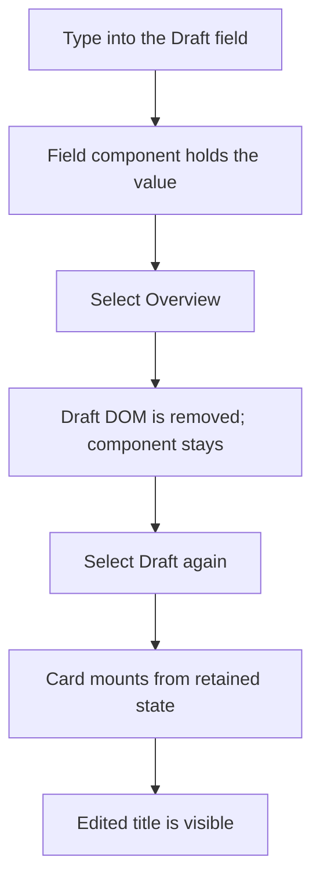

# Tab Containers: Keep the Work, Change the View

You are halfway through a draft when you need to check another panel. Switching tabs should not feel like
leaving the application: the title you just typed should still be there when you return. At the same time,
keeping every panel's DOM attached can make a large screen expensive even though the reader sees only one
panel at a time.

`Neo.tab.Container` separates those concerns. A tab selects a **card component**. The Card layout decides
which card is visible and whether inactive DOM remains attached. The component instance and its reactive
configs can survive either choice. Selection, mounting, and destruction are different transitions, and
understanding that distinction is more useful than memorizing another set of layout options.

## Try the return trip

Run the preview, replace **A note worth keeping** with your own draft title, select **Overview**, and return
to **Draft**. The field's value belongs to its component, so it survives the switch. This example keeps
the default `removeInactiveCards: true`: state retention does not require every card to keep its DOM.

```javascript live-preview
import Component    from '../component/Base.mjs';
import Container    from '../container/Base.mjs';
import TabContainer from '../tab/Container.mjs';
import TextField    from '../form/field/Text.mjs';

class MainView extends TabContainer {
    static config = {
        className: 'Guides.TabContainers.MainView',
        height   : 280,

        items: [{
            module: Container,
            header: {text: 'Draft'},
            layout: {ntype: 'vbox', align: 'stretch'},
            items : [{
                module   : TextField,
                labelText: 'Draft title',
                value    : 'A note worth keeping'
            }]
        }, {
            module: Component,
            header: {text: 'Overview'},
            text  : 'Return to Draft: the field still owns your edited title.'
        }]
    }
}
MainView = Neo.setupClass(MainView);
```

The `items` are the content cards. Each item's `header` describes its corresponding tab button; it is not
another panel to render inside the card. The TabContainer builds the header toolbar and content body
together, keeping those two views of the same membership aligned.

The first tab is active because `activeIndex` defaults to `0`. You can choose another existing index in
the initial configuration. An initial `activeIndex: null` leaves the cards inactive; it is not a general
runtime command for hiding whichever card is already active.

## The DOM can leave while the draft stays

A browser element is one representation of the field, not the field's entire lifetime. When the user
types, `TextField` transfers that input into its `value` config. With the default Card behavior, selecting
Overview removes Draft's inactive DOM while retaining its component instance and VDOM. Returning to Draft
mounts the card again from that retained state.



This gives a screen somewhere to keep unfinished work without requiring the browser to keep every
inactive element attached. It also makes the boundary explicit: a config-backed field value is retained;
arbitrary state stored only in a DOM element, native selection, or browser focus is not covered by that
promise. Integrations that keep important state outside Neo's component model need to manage that state
at their own lifecycle boundary.

Setting `removeInactiveCards: false` in the TabContainer's initial configuration keeps inactive card DOM
attached and hides it with CSS instead. That can be useful for a DOM-based integration that cannot be
unmounted between visits, but it retains those elements. The
[Card layout explanation](#/learn/guides/uibuildingblocks/Layouts) covers the underlying layout mechanics.

## Select the card, then react to the selection

Application code can select a card by assigning `activeIndex`. Listen for `activeIndexChange` when another
part of the screen needs to respond to the selected component:

```javascript readonly
tabs.on('activeIndexChange', ({item, oldValue, value}) => {
    console.log('Selected card:', item?.id ?? null, 'from', oldValue, 'to', value);
});

tabs.activeIndex = 1;
```

Here `tabs` is your TabContainer instance. `value` and `oldValue` are indexes; `item` is the active card.
For the preview's two cards, moving to Overview and back produces the index transitions `0 → 1` and
`1 → 0`. `getActiveCard()` retrieves the selected card, while `getCard(index)` addresses a particular card.

The event follows the card-layout selection work, including lazy construction when needed. It does not
certify that the browser has finished mounting or painting the new DOM. Code that needs a DOM-dependent
measurement should use the relevant component mounting/update lifecycle rather than treating a selection
event as a paint receipt.

Indexes describe the current order. If your application lets users reorder tabs, do not treat an index as
a permanent identity. Keep a component reference or an application-owned key for the content and resolve
its current position when selecting it. Likewise, use `getCardContainer()` and `getTabButtons()` to inspect
the semantic parts, rather than relying on the TabContainer's private child-array positions.

## Keyboard focus and selection are separate

The headers are native buttons, exposed as tabs within a tablist. Each states its selection, and loaded
cards are associated with their headers. Cards without their own role receive `tabpanel` semantics;
an existing role is preserved. By default, normal Tab focus and Enter/Space activation work through
those buttons.

If your application wants arrow-key navigation among the headers, opt in when constructing the container:

```javascript readonly
headerToolbar: {
    keyboardNavigation: true
}
```

That toolbar mode gives the button group a moving Tab stop. Arrow keys follow the toolbar's layout
direction, and Home/End move to its ends. They move **focus**; they do not automatically activate the
focused tab. Enter or Space activates it. Disabled header buttons are skipped by this navigation.

To prevent a user from activating a particular header, configure `header: {disabled: true}` on that card.
This is a user-interaction constraint, not a permission check: application code can still assign its
index to `activeIndex`. Put any application authorization rule at the action that requires it.

## Removing a tab is a lifetime decision

Switching away keeps a card. Removing it changes the membership of the tabbed view and, by default,
destroys the removed component. Use the TabContainer's `add`, `insert`, `remove`, or `removeAt` methods so
the card and its header remain a pair; editing only the body or only the toolbar creates two different
answers to how many tabs the screen has.

```javascript readonly
const card = tabs.getCard(1);
tabs.remove(card); // Removes its header and destroys the card.
```

When the application intends to reuse a card, it can explicitly retain the instance:

```javascript readonly
const retainedCard = tabs.removeAt(1, false);
// The caller now owns reuse or eventual retainedCard.destroy().
```

Ordinary retained removal still unmounts the card; keeping an instance is not keeping its old DOM in place.
Its old tab header is removed, and the caller must choose the next owner or destroy the retained card.
Removing the active card selects its previous neighbour. If the first card was active, the first remaining
card takes its place; removing the last card leaves `activeIndex: null` and `getActiveCard()` returns `null`.
Removing an inactive card preserves the selected card. An ordinary active-card removal emits
`activeIndexChange` even when the selected index stays `0`, because a different card now occupies that slot.

## Let the reader close work deliberately

A close control ends a card's lifetime, so it is an explicit choice on each header. Tabs remain
non-closable by default. A screen can keep an Overview permanent while allowing temporary work to close:

```javascript readonly
items: [{
    module: OverviewPanel,
    header: {text: 'Overview'}
}, {
    module: DraftPanel,
    header: {text: 'Draft', closable: true}
}]
```

The close mark and Delete on the focused tab request the same action. Clicking the title or its ordinary
icon still selects the tab. Classic and effect-based headers expose the same interaction, including the
Delete shortcut, without nesting another button inside the native tab button.

Application code can request the same close through `tabs.closeTab(index)`. It respects the header's
closability and disabled state, then emits `beforeTabClose` before removing either half of the card/header
pair. A synchronous listener can set the request's `abort` to `true` when application policy requires the
card to stay. A veto preserves membership, selection and focus; the application can explain or resolve its
unsaved-work decision before requesting close again. This is separate from the structural `removeAt` API,
which remains available when the application owns removal directly.

After a successful close, `tabClose` supplies the captured `cardId`, `headerId` and `text`. Those values are
useful for a history or status message: the component references may already be destroyed. A lazy card can
close without loading merely to participate in that notification.

Closing a tab whose header or panel contains focus moves focus to the following tab, or the preceding tab
when the last one closes.
Focus and selection remain separate: the active-card removal policy above still chooses the previous
neighbour. If no tab remains, the TabContainer itself receives programmatic focus so the reader can
continue with Tab. A programmatic close while focus is outside the TabContainer leaves that focus alone.
A host that manages its own focus destination can set
`restoreFocus: false` on the `beforeTabClose` request.

## Delay construction when the panel is expensive

Retaining an inactive component and deferring its creation solve different problems. Ordinary imported
card modules can already have component instances before their first visible visit. A lazy module
descriptor postpones loading and construction until that card is activated:

```javascript readonly
items: [{
    module: SummaryPanel,
    header: {text: 'Summary'}
}, {
    module: () => import('./HistoryPanel.mjs'),
    header: {text: 'History'}
}]
```

Before that activation, a card lookup may return its configuration rather than a constructed component.
Do not call component methods on it merely because a tab button already exists. This is the same
[lazy Card mechanism](#/learn/guides/uibuildingblocks/Layouts) used beneath the TabContainer; the header
does not need to eagerly import the content just to name it.

For a fixed screen with several views, this small composition is enough: cards own their state, headers
select them, and the layout controls their DOM presence. If the workflow instead needs users to split,
dock, or move panes between windows, continue with
[Dock Layouts](#/learn/guides/uibuildingblocks/DockLayouts), whose ownership and movement rules build on
these component-lifetime boundaries.
