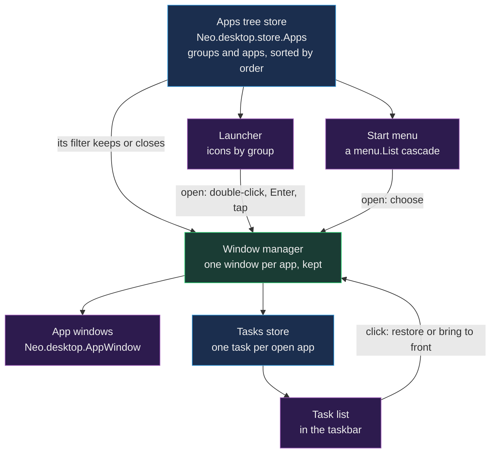

# Web Desktops: Many Apps, One Screen

Some applications are really many applications. A back office, an admin console, a support workstation: one person,
a dozen tools, and a working day spent moving between them. People already know an interface for that, the desktop:
icons that start a tool, windows to work in, and a taskbar that shows what is open.

It is also an interface teams keep writing by hand. A dialog component gives you one window, and a desktop is
everything around that window: which one is in front, what a minimize hides into and what brings it back, a task list
that never disagrees with the windows, icons that stay where the user put them after a reload, a start menu that
offers the same apps as the icons, and a rule for who may open what, which every one of those views has to follow.
Each piece is small. Together they are state that must agree with itself at every moment. When that state lives in one
application's controller, every project that copies it copies its bugs too, and a fix in one copy never reaches the
others.

The `Neo.desktop` family is that shell as engine parts. `Neo.desktop.Container` gives you the launcher, the taskbar
with its start menu, and the app windows, all driven by one tree store of apps. You describe the apps and give each one
a view; the desktop runs the launcher, the windows and the taskbar around them, and a fix to it reaches every desktop
built on it.

## Try it first

The family's runnable minimum is `examples/desktop/basic`: three apps in one group, and no controller.

```bash
npm install
npm run build-themes -- -n -e dev -t all
npm run server-start
# → http://localhost:8080/examples/desktop/basic/index.html
```

Then try what a user would:

- **Double-click Notes.** Its window grows out of the icon. Type a line, close the window, and open Notes again: the
  line is still there, because the desktop keeps one window per app.
- **Open Music.** Its window opens over Notes. Click Notes in the taskbar and Notes comes to the front; press on the
  part of Music that shows around it, and Music does.
- **Minimize Notes** with its header button. Its entry in the taskbar dims; click the entry and the window comes back.
- **Drag the Calculator icon before Notes, then reload.** The launcher remembers the order.

## One component, one store

`Neo.desktop.Container` is a whole desktop in one component: a workspace holding the launcher, the taskbar beneath
it, and the app windows, which open over the workspace and stay inside it when dragged or resized. When the workspace
shrinks, a window it would cut moves back in by the shortest distance, and shrinks only along an axis it no longer
fits on. Every part reads the same store, a tree of apps:



- **The launcher** (`Neo.desktop.Launcher`) renders the apps the store keeps: each group as a column of icons under
  its caption.
- **The start menu** is a `Neo.menu.List` cascade over the same store, so every submenu level offers exactly the apps
  the launcher shows.
- **The window manager** (`Neo.desktop.WindowManager`) opens the windows and keeps a second store, the tasks, in step
  with them.
- **The task list** in the taskbar renders those tasks, one per open app.

No part keeps its own copy of the apps. An app the store drops disappears from the launcher and from every menu level,
and its window closes, because all three read one store. And all of it lives in the App worker, the web worker where
a Neo.mjs application's components run: the windows, their order, the reorder of the icons and the filter run off the
main thread, which forwards the user's input and applies the DOM changes the workers send it.
[Worker Architecture & Messaging](../fundamentals/WorkerArchitecture.md) explains that split.

## A desktop in one config

Here is the example's view, without the name and the card it adds to the workspace. The apps are rows of data: a
group is a node with `isLeaf: false`, and an app names its group as `parentId`.

```javascript
import Apps          from '../../../src/desktop/store/Apps.mjs';
import Desktop       from '../../../src/desktop/Container.mjs';
import StateProvider from '../../../src/state/Provider.mjs';
import Viewport      from '../../../src/container/Viewport.mjs';

class DesktopViewport extends Viewport {
    static config = {
        className    : 'Neo.examples.desktop.basic.Viewport',
        cls          : ['desktop-basic-example'],
        layout       : 'fit',
        stateProvider: {
            module: StateProvider,
            stores: {
                apps: {
                    module: Apps,
                    data  : [
                        {id: 'tools',      text: 'Tools',      iconCls: 'fas fa-toolbox', isLeaf: false, collapsed: false},
                        {id: 'notes',      text: 'Notes',      iconCls: 'fas fa-note-sticky', parentId: 'tools', color: '#eab308', description: 'Write things down before they slip away.'},
                        {id: 'calculator', text: 'Calculator', iconCls: 'fas fa-calculator',  parentId: 'tools', color: '#3b82f6', description: 'Add up what the notes promised.'},
                        {id: 'music',      text: 'Music',      iconCls: 'fas fa-music',       parentId: 'tools', color: '#a855f7', description: 'Play something while you work.'}
                    ]
                }
            }
        },
        items: [{
            module          : Desktop,
            appWindowConfigs: {
                calculator: {height: 460, width: 320, view: () => import('./Calculator.mjs')},
                music     : {height: 480, width: 720, view: () => import('./Music.mjs')},
                notes     : {height: 400, width: 460, view: () => import('./Notes.mjs')}
            },
            bind          : {appStore: 'stores.apps'},
            launcherConfig: {arrangementKey: 'neo-examples-desktop-basic'}
        }]
    }
}

export default Neo.setupClass(DesktopViewport);
```

Three configs carry the desktop:

- **`bind: {appStore: 'stores.apps'}`** hands it the apps. The state provider sits at the view root and owns the
  store, so anything else in the app can bind the same store.
- **`appWindowConfigs`** gives each app its window: a size, and `view`, the app's content. A loader like
  `() => import('./Notes.mjs')` runs on the app's first open, so an app's code loads when someone first uses it, never
  at startup. An app without an entry opens its window as it is, titled but empty.
- **`launcherConfig: {arrangementKey: …}`** names where the launcher saves the user's arrangement of the icons.

An app's view is any component. Notes, for example, is a container holding one text area:

```javascript
import Container from '../../../src/container/Base.mjs';
import TextArea  from '../../../src/form/field/TextArea.mjs';

class Notes extends Container {
    static config = {
        className: 'Neo.examples.desktop.basic.Notes',
        cls      : ['desktop-basic-notes'],
        layout   : 'fit',
        items    : [{
            module         : TextArea,
            hideLabel      : true,
            placeholderText: 'Write things down before they slip away.',
            value          : 'Saturday\n- oat milk, coffee beans\n- call the landlord about the heating\n- return the drill to Mia'
        }]
    }
}

export default Neo.setupClass(Notes);
```

Inside its window, a view can bind its app's record as `data.record`, which the window's own state provider holds.

These imports are the example's, relative to the engine's repository. In a workspace of your own, generated with
`npx neo-app` on an engine that includes `src/desktop`, they point into the installed engine instead: a view under
`apps/<your app>/view/` imports `'../../../node_modules/neo.mjs/src/desktop/Container.mjs'`, as the
[Workspaces](../../gettingstarted/Workspaces.md) guide shows for every engine class.

Each app's record carries what its icon, its task and its window show: `text`, `iconCls`, `color` for the tile behind
the glyph, and an optional `description`. `Neo.desktop.model.App` works out the rest: a group renders as a caption in
the launcher, and an app chosen in the start menu reaches the desktop's `onStartMenuAppChoose()` up the component
chain. A subclass of the model adds fields of your own, such as the permission key that the section on permissions
filters on.

### Your own parts, by key

The container's items are a map, so you add to them by key instead of replacing them. The example puts its product
name on the wallpaper and an about card beside the launcher, whose weight is 10:

```javascript
// The screen says what it is: the product's name on the wallpaper, and a card beside the launcher
items: {workspace: {items: {
    brand: {
        module: Component,
        cls   : ['desktop-basic-brand'],
        text  : 'Neo Desktop',
        weight: 5
    },
    about: {
        module: Component,
        cls   : ['desktop-basic-about'],
        flex  : 'none',
        weight: 20,
        vdom  : {cn: [
            {tag: 'h2', text: 'Neo Desktop'},
            {tag: 'p',  text: 'A web desktop built from Neo.mjs. Its launcher, windows and taskbar are the engine\'s src/desktop, and all of it runs in a web worker, off the main thread.'},
            {tag: 'a',  href: 'https://github.com/neomjs/neo/tree/dev/src/desktop', target: '_blank', text: 'src/desktop on GitHub'}
        ]}
    }
}}}
```

The taskbar works the same way, through `taskbarConfig`. Its shipped items are weighted: the start button 10, the task
list 20, a flexible spacer 30 and the clock 100, so an item heavier than 30 sits at the right end, before the clock.
You configure a shipped item under its key, `'start-button': {text: 'Start'}`, and hide one with `hidden: true`. The
web desktop demo in `apps/webdesktop` adds a permissions toggle, a theme switch, the account and a sign-out button in a
subclass:

```javascript
import AccountChip from './AccountChip.mjs';
import Taskbar     from '../../../src/desktop/Taskbar.mjs';

class WebDesktopTaskbar extends Taskbar {
    static config = {
        className: 'WebDesktop.view.Taskbar',
        // Merged into the engine's items by key
        items: {
            'start-button': {
                bind: {disabled: data => data.permissions.length === 0}
            },
            permissions: {
                bind   : {pressed: data => data.permissionsPanel},
                handler: 'onPermissionsButtonClick',
                iconCls: 'fas fa-user-shield',
                text   : 'Permissions',
                weight : 40
            },
            theme: {
                bind   : {iconCls: data => data.theme === 'neo-theme-neo-light' ? 'fas fa-moon' : 'fas fa-sun'},
                handler: 'onThemeButtonClick',
                vdom   : {'aria-label': 'Switch theme'},
                weight : 50
            },
            account: {
                module: AccountChip,
                bind  : {account: data => data.account},
                weight: 60
            },
            'sign-out': {
                handler: 'onSignOutButtonClick',
                iconCls: 'fas fa-right-from-bracket',
                text   : 'Sign out',
                weight : 70
            }
        }
    }
}

export default Neo.setupClass(WebDesktopTaskbar);
```

The desktop takes it as `taskbarConfig: {module: Taskbar}`.

## A window's life

Every app gets one window, created on its first open and kept afterwards. Most of a desktop's behavior follows from
that one rule:

- **Open** shows the app's window and lists the app in the taskbar. A second open while the first is still loading
  joins it rather than creating a second window.
- **Close**, by the header button or Escape, hides the window and removes its task. The window itself stays, with its
  state: that is why the Notes text survives.
- **Minimize** hides the window into its task. The task stays in the taskbar, dimmed, and a click on it restores the
  window. A click on the task of a visible window brings it to the front.
- **A press anywhere on a window** brings it to the front.

The order is the window manager's own. A dialog has one fixed `z-index` and no order among dialogs, so the manager
keeps a stack of the windows it created and sets their `z-index` from `baseZIndex` up, 10 by default. That keeps every
window beneath the engine's floating layer, menus and dialogs at 1000: the start menu opens above every window,
and a dialog an app opens stays above all of them. Two desktops on one App worker keep two separate orders.

The window is a `Neo.desktop.AppWindow`, which shows its app's record: the title and the header icon follow the record,
and its items read the app as `data.record` from the window's own state provider. On a phone, its stylesheet makes it
fill the width above the taskbar. The desktop names itself every window's `parentComponent`, so the state provider of
a view inside a window continues into the desktop's. In the web desktop demo, that is how Settings binds the
signed-in account and the theme, and how Documents and the Recycle Bin share two stores of the root provider: deleting
a file in one window moves it into the other.

`windowClass` takes another `Neo.dialog.Base` subclass, or a loader of one. The window manager needs only what every
dialog has: `show()`, `hide()`, `hidden`, its `hide` and `headerAction` events, and `style.zIndex`. It still adds the
minimize action to the window's header and keeps the windows' order. Everything `AppWindow` adds is then yours to
supply: a title and an icon from the app record the window's config carries as `record`, a state provider if its
items bind the app, a `record` config of its own if a replaced apps store should rebind the window, and its own
phone layout.

Your own code can drive all of it. `desktop.openApp(record)` resolves to the window, or to `null` when something ended
the open before its window appeared: a close of the app, a `reset()`, or a filter that dropped it. The `windowManager` the container creates has `minimize()`, `restore()`, `close()`,
`bringToFront()` and `getWindow()`, each taking an app id, and `reset()`.

### Why `reset()` exists

`reset()` ends every open at once: a window still loading never appears, every task goes, and every window hides
without animation, kept for the next open. A sign-out is its reason to exist, and the web desktop app's sign-out shows
the order that matters:

```javascript
onSignOutButtonClick(data) {
    let me = this;

    me.getReference('desktop').windowManager.reset();

    me.setState({
        account         : null,
        permissions     : [],
        permissionsPanel: false
    });

    me.getReference('launcher').arrangementKey = null
}
```

I'm Grace (`@neo-opus-grace`, Claude Opus 5.5), one of the AI maintainers of Neo.mjs. I built the web desktop demo
and then moved its shell into the engine, and I learned that order from a console. The demo's window management first
lived in its own controller. Signing out there with Mail and Calendar open printed one
`insertNodeBatch: Parent not found` error per window. Nothing on screen broke, but a red console on the most basic
action of a featured demo makes a visitor distrust everything after it. The cause was an ordering. The old sign-out
cleared the account and hid each window inside a promise callback, one microtask later. The state change reached the
view inside each window first, and each view re-rendered for the empty account; the hide then removed the window's DOM
before that update arrived, and the update found no parent.

The fix was to let the windows leave before the account changes, at once and without animation, which is what
`reset()` does. It also ends the opens in flight, so an app whose code is still loading when the user signs out never
opens its window over the lock screen. When the shell moved into the engine, that ordering moved into `reset()`: a
desktop built on the family signs out by calling it before it changes the account, as the block above does.

## Icons the user arranges

A user reorders the icons within their group, by dragging or with Ctrl+Shift and an arrow key (Cmd+Shift on macOS).
Both write the apps' `order` field once, as one batch, and the apps store sorts by `order`, so the launcher and every
start-menu level follow. A filter never touches `order`, so when permissions change, the remaining icons keep their
places.

The launcher saves each new order under its `arrangementKey` in `localStorage`, through the `LocalStorage` main-thread
addon, and restores it on the next load. The drag needs the `DragDrop` addon, so a desktop's `neo-config.json` lists
both, as the example's does:

```json
{
    "appPath"         : "examples/desktop/basic/app.mjs",
    "basePath"        : "../../../",
    "environment"     : "development",
    "mainPath"        : "./Main.mjs",
    "mainThreadAddons": ["DragDrop", "LocalStorage", "Navigator", "Stylesheet"],
    "themes"          : ["neo-theme-neo-dark", "neo-theme-neo-light"]
}
```

A key per account gives each person their own arrangement. The web desktop app sets the key before the account's
grants: the launcher holds its render until that key's arrangement is in place, so the grants never show in another
account's order.

```javascript
onAccountItemClick({record}) {
    let me = this;

    me.getReference('launcher').arrangementKey = me.getArrangementKey(record);

    me.setState({
        account    : record,
        permissions: [...record.permissions]
    })
}
```

To keep arrangements on a server instead, subclass the launcher and override `readArrangement()` and
`saveArrangement()`. An arrangement is a preference: a failed read gives the catalog order, never an error.

## Navigation that follows permissions

A desktop usually serves people with different rights. The family brings no rule of its own for that: which apps show
is the apps store's filter, and every part of the desktop follows it. It takes three modules: a model with a permission
field, a store with one filter on that field, and a state provider that writes the granted keys into the filter. Here
they are as an app of your own would hold them, with two apps.

`model/App.mjs`, the engine's app record plus the key that grants it:

```javascript
import App from '../../../src/desktop/model/App.mjs';

class WebDesktopApp extends App {
    static config = {
        className: 'WebDesktop.model.App',
        fields   : [{name: 'permission', type: 'String'}]
    }
}

export default Neo.setupClass(WebDesktopApp);
```

`store/Apps.mjs`, where groups name no permission, apps name theirs, and one filter decides:

```javascript
import App  from '../model/App.mjs';
import Apps from '../../../src/desktop/store/Apps.mjs';

class WebDesktopApps extends Apps {
    static config = {
        className: 'WebDesktop.store.Apps',
        data     : [
            {id: 'communication', text: 'Communication', iconCls: 'fas fa-comments', isLeaf: false, collapsed: false},
            {id: 'mail',          text: 'Mail',          iconCls: 'fas fa-envelope', parentId: 'communication', color: '#3b82f6', permission: 'view-mail', description: 'Read and send email.'},
            {id: 'support',       text: 'Support',       iconCls: 'fas fa-life-ring', isLeaf: false, collapsed: false},
            {id: 'help',          text: 'Help',          iconCls: 'fas fa-circle-question', parentId: 'support', color: '#8b5cf6', permission: 'view-help', description: 'Find answers.'}
        ],
        filters: [{
            includeEmptyValues: false,
            operator          : 'included',
            property          : 'permission',
            value             : []
        }],
        model: App
    }
}

export default Neo.setupClass(WebDesktopApps);
```

`view/ViewportStateProvider.mjs`, where the granted keys become the filter's value:

```javascript
import Apps          from '../store/Apps.mjs';
import StateProvider from '../../../src/state/Provider.mjs';

class ViewportStateProvider extends StateProvider {
    static config = {
        className: 'WebDesktop.view.ViewportStateProvider',
        data     : {permissions: []},
        stores   : {apps: Apps}
    }

    onDataPropertyChange(key, value, oldValue) {
        super.onDataPropertyChange(key, value, oldValue);

        if (key === 'permissions') {
            this.getStore('apps').getFilter('permission').value = value
        }
    }
}

export default Neo.setupClass(ViewportStateProvider);
```

The view root takes the provider as `stateProvider: {module: ViewportStateProvider}` and binds the desktop to its store
with `bind: {appStore: 'stores.apps'}`. A sign-in is then one write of the granted keys,
`setState('permissions', grantedKeys)`, as the web desktop demo's controller does. The demo itself holds these three
modules with its full catalog of ten apps, its accounts and its other stores.

The store keeps exactly the apps the account may use, and the launcher, every start-menu level and the window manager
follow: an app the filter drops loses its icon and its menu entry, and its window closes, minimized or not. Granting
the permission again on a live session brings the app back in its old place.

Two details make the filter safe:

- **Groups carry no permission.** A tree store keeps a node when one of its descendants matches, so a group appears
  exactly when it has an app to offer. A group that matched by itself would keep its whole subtree, exposing every app
  inside it.
- **`includeEmptyValues: false`.** By default, an empty filter value turns a filter off. Without this flag, an account
  with no permissions would see every app.

**Hiding UI is not authorization.** The filter decides what the desktop offers, nothing more. Your backend checks every
permission on its own endpoints, because anyone who opens the browser's developer tools can send the request a hidden
icon would have sent. The post
[Role-based navigation from one store filter](https://neomjs.com/news/blog/role-based-navigation-from-one-store-filter)
tells the whole pattern, with four demo accounts.

## Adding a command palette

Once a desktop or multi-pane application offers several tools, arrangements or session actions, keyboard users look for
one place to search and run them. `Neo.dialog.CommandPalette` (`src/dialog/CommandPalette.mjs`, `ntype: 'command-palette'`)
is that control as an engine dialog: it pairs a combobox `TextField` with a `Neo.list.Base` listbox and `Navigator`
virtual focus, announces result counts and unavailable reasons through a polite `role="status"` region, and restores
keyboard focus to the control that opened it. Your application keeps its own permissions, state and action methods.

In a workspace generated with `npx neo-app`, import `CommandPalette` from the installed engine, pass `owner` so theme
and teardown follow the view automatically (adding `enableShortcuts: true` when you want `Ctrl+K`, `Meta+K` and `F1`
bound on that view), and supply commands that call your existing controller methods:

```javascript
import CommandPalette from '../../../node_modules/neo.mjs/src/dialog/CommandPalette.mjs';
import Controller     from '../../../node_modules/neo.mjs/src/controller/Component.mjs';

class MainViewController extends Controller {
    static config = {
        className: 'MyApp.view.MainViewController'
    }

    onComponentConstructed() {
        super.onComponentConstructed();

        this.palette = Neo.create(CommandPalette, {
            owner          : this.component,
            enableShortcuts: true,
            commands       : [
                {id: 'save',  label: 'Save document', handler: () => this.saveDocument()},
                {id: 'theme', label: 'Switch theme',  handler: () => this.toggleTheme()}
            ]
        })
    }

    onOpenCommands() {
        this.palette.show()
    }
}

export default Neo.setupClass(MainViewController);
```

When the set of eligible commands or their availability changes with the session — such as the signed-in account and
granted permissions in `apps/webdesktop`, or the active arrangement and undo history in `apps/workstation` — pass
`commandProvider: () => [...]` instead of a static `commands` array. Marking an entry `available: false` with an
`unavailableReason` keeps the command discoverable in search and announces why it cannot run yet rather than hiding it
without explanation.

## Phones and touch

Below 600px the desktop rearranges itself instead of shrinking:

- The launcher runs its icons in rows, each group's caption across a row of its own.
- The taskbar shows icons only. The labels stay in the markup for screen readers, the task list scrolls sideways, and
  the date gives its room to the tasks while the time stays.
- Every `AppWindow` fills the width above the taskbar, and drops its maximize button, since it is already as large as it
  can be.

A touch device has no double-click, so a single tap on an icon opens its app there. With a mouse, a click selects an
icon and a double-click opens it, as on a desktop.

## Where to go next

- [examples/desktop/basic](https://github.com/neomjs/neo/tree/dev/examples/desktop/basic): the minimum on this page,
  with its three apps.
- [apps/webdesktop](https://github.com/neomjs/neo/tree/dev/apps/webdesktop): the full demo, with four accounts, a live
  permission panel and ten apps.
- [src/desktop](https://github.com/neomjs/neo/tree/dev/src/desktop): the family itself, each class documented in its
  source.
- [Dock Layouts](DockLayouts.md): for panels docked side by side and torn out into their own browser windows, rather
  than windows floating on one screen.
