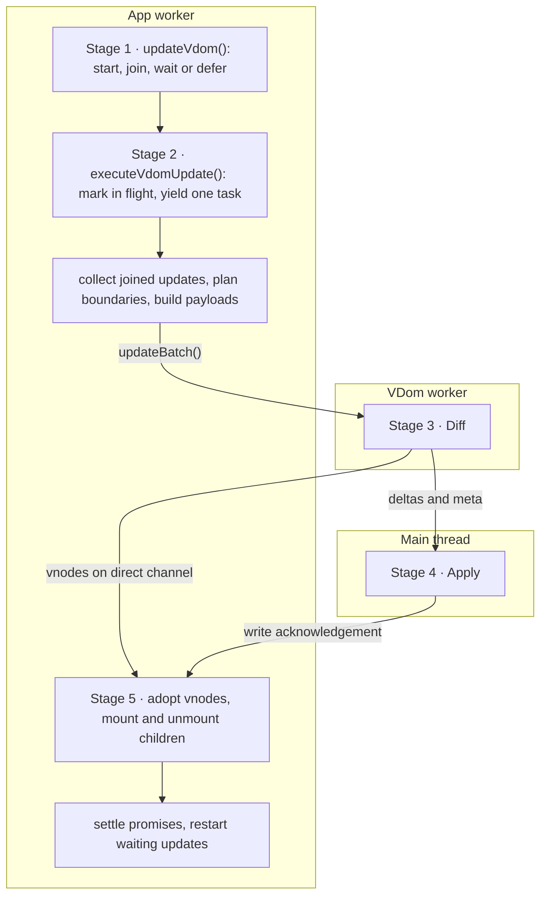

# VDOM Engine: App Worker

The App worker runs stages 1, 2 and 5 of [the VDOM engine](./Overview.md). It owns every component's two trees:
`vdom`, what the component should render, and `vnode`, what the DOM holds as of the last confirmed write. Every line
reference points at `dev` commit `73e6207999`.

## What a component's trees hold

A component's `vnode` holds its own DOM nodes. A child component appears inside it as a reference,
`{componentId, id}` ([references][cm-refs]), and its `vdom` holds the child the same way
([`createVdomReference()`][vl-ref]).

`updateDepth` sets how many component levels a payload expands: `1` is the component's own nodes, `2` adds its
direct children, and `-1` the whole subtree ([config][vl-depth-config]). `TreeBuilder` expands references down to that
depth and leaves the rest as `neoIgnore` placeholders, which the diff skips ([prune][tb-prune]). A child without a
vnode is always expanded, because it is new ([expand][tb-expand]).

Counted in component levels, an update of depth `d` covers the descendants at a distance below `d`, and `-1` covers
all of them. A direct child is at distance 1 ([collision rule][vl-collision]).

## Stage 1 · Collection

A change reaches the engine through `update()`, usually from a config setter ([update][vl-update]), or through
`promiseUpdate()` ([promise][vl-promise]). `set()` applies all its configs silently, then calls `promiseUpdate()`
once if any of them changed the vdom ([set][abstract-set]).

`updateVdom()` decides what the change does, in this order ([updateVdom][vl-update-vdom]):

1. **Its own update is in flight:** mark `needsVdomUpdate`. The component runs again when that flight lands
   ([in flight][vl-uv-inflight], [rerun][vl-rerun]).
2. **An ancestor in the same window has a pending update** (`needsVdomUpdate`, or inside its collection yield): join
   it ([join][vl-uv-merge]). The walk checks every ancestor, not only the parent, and joins the nearest pending one
   ([`mergeIntoParentUpdate()`][vl-merge]).
3. **Not rendered yet, or inside `setSilent()`:** mark `needsVdomUpdate` and stop ([defer][vl-uv-silent]).
4. **Not mounted:** wait for the mount, then update ([mount][vl-uv-mount]).
5. **An overlapping update is in flight:** queue behind it ([wait][vl-uv-wait]). An ancestor's flight overlaps when
   its depth reaches this component, `depth === -1 || distance < depth` ([collision rule][vl-collision],
   [ancestors][vl-parent-updating]). Upwards the rule is stricter: an ancestor waits for any descendant in flight,
   whatever their depths ([descendants][vl-child-updating]).
6. **Otherwise:** start a flight, once pending theme CSS has loaded ([start][vl-uv-start]).

A queued update restarts when its blocker settles ([queue][vdu-post-update], [restart][vdu-trigger-post]). A flight
registers with every ancestor, and leaving the registry clears it from every ancestor that holds it, so a component
that moved while in flight releases its former ancestors too ([register][vdu-register], [unregister][vdu-unregister]).
A flight older than five seconds is reported as wedged, because a lost reply would freeze its subtree
([watchdog][vdu-watchdog]).

A silent change joins only an ancestor that is already pending. In a transaction, change the ancestor first: a child
changed before its ancestor became pending keeps its own `needsVdomUpdate`, and a depth-1 ancestor payload does not
carry it.

## Stage 2 · Batching

One flight is one call of `executeVdomUpdate()` ([flight][vl-exec]):

1. It marks itself in flight ([mark][vl-exec-mark]), then yields one task ([yield][vl-exec-yield]). A structural change
   made in the same tick, such as a `remove()` right after a config change, lands in the snapshot. Descendants that
   update during the yield join it.
2. After the yield it checks again. If it can now join a pending ancestor, or an ancestor's overlapping flight has
   started, it steps back and stays pending ([step back][vl-exec-stepback]).
3. It collects its own scope and every joined update, recursively ([collect][vl-collect]). It skips components without
   a vnode, which the payload that mounts them expands, and components of another window ([skip][vl-collect-skip]).
4. It plans boundaries from the top of the tree down ([plan][vl-plan]). A joined root is absorbed when the payload of
   its nearest emitted ancestor already carries its whole scope ([`carriesScope()`][vl-carries]); otherwise it gets a
   payload of its own. Each payload stops at the other emitted roots and leaves them as placeholders
   ([payloads][vl-payloads], [boundary][tb-boundary]), so every node is diffed by exactly one payload.
5. Building a payload clears `needsVdomUpdate` on everything it covers, down to its depth ([clear][vl-payload-clear],
   [cascade][ct-cascade]), and resets `updateDepth` to the class default ([reset][vl-payload-reset]).
6. It marks every emitted root as in flight, and every absorbed root that its carrier's depth does not cover
   ([protect][vl-protect]). Then it sends all payloads in one `updateBatch()` call ([send][vl-send]).

Depth only grows until the next payload resets it ([grow][cmp-depth]). If it grows while the component is in flight,
the registered depth grows too, so later collision checks see the real scope ([escalate][vl-escalate],
[registry][vdu-escalate]). The common writers:

- Moving an item between containers flushes at the lowest common ancestor of both parents with depth `-1`, so the
  move is one diff ([detach][ct-insert-move], [flush][ct-insert-flush]).
- Removing or swapping items sets `2` ([remove][ct-remove], [swap][ct-switch]).
- `hide()` sets `2` on the parent and makes its payload dense ([hide][cmp-hide]); `show()` sets `-1` on the parent
  ([show][cmp-show]).
- The first render expands the full tree without resetting the depth ([first render][vl-init-tree]), so the first
  update after it ships at the depth set before it. A container's `createItems()` leaves `-1` ([items][ct-create-items]).

Above depth 1, a payload expands only its joined children and the components on the path to them, unless
`denseUpdate` is set ([sparse][vl-sparse], [path][vdu-merged-ids]).

## Stage 5 · Sync back

When the reply lands ([landing][vl-land]):

1. A destroyed initiator drops it, and a reply that misses an emitted root fails the batch ([checks][vl-land-checks]).
2. Without the VDom worker, the deltas go to the Main thread now, and the flight waits for the write
   ([write][vl-two-thread]). With it, the flight waits for both the direct vnode reply and any required Main write
   acknowledgement; a no-op needs only the vnode reply.
3. Every root adopts its new vnode without firing `afterSetVnode()`, and hands each child component inside it its
   slice. Children found in the tree are mounted when the root is; children that left it are unmounted
   ([adopt][vl-adopt], [`syncVnodeTree()`][vl-sync]).
4. Each root settles. It leaves the in-flight registry, resolves the promises its payload carried, restarts the
   updates that waited on it, and runs again if a change arrived while it flew ([settle][vl-settle],
   [`resolveVdomUpdate()`][vl-resolve]).

A failure, a rejected reply or a destroyed root, settles every root of the batch. Each leaves the registry, its
promises reject, its waiters restart, and none adopts a vnode ([failure][vl-catch]).

`promiseUpdate()` settles with the flight that carried the caller's change ([contract][vl-promise]). A flight claims
the promises parked on a component when it collects that component ([claim][vl-claim], [record][vdu-claim],
[settle][vdu-detach]). A promise made after that waits for the next flight.

## Writing the DOM directly

`Neo.applyDeltas(windowId, deltas)` sends deltas straight to stage 4 ([applyDeltas][app-apply-deltas]). The component's
vnode does not learn about them. Use it only for DOM the vdom does not describe, or mirror the change in the vdom:
`unmount()` sets `vdom.removeDom` before it removes the node ([unmount][cmp-unmount]).
[Working with VDom](../uibuildingblocks/WorkingWithVDom.md) covers the trade-off.

## What a change here must preserve

1. Two updates in flight never share a node, and no node is in two payloads of one batch.
2. A change made after collection is never acknowledged by the flight already in the air.
3. A vnode is adopted only from a successful reply.
4. A batch carries the components of one window only.
5. Every flight leaves the registry on every path: success, failure and destruction. A flight that stays blocks its
   subtree.
6. A component is mounted only once its vnode is on the DOM ([ADR 0043](../../agentos/decisions/0043-vdom-diff-placement.md) I5).

## Hot-path cost

- `TreeBuilder` copies every node a payload covers ([build][tb-build]).
- Joining and collision checks walk the ancestor chain, so they cost the component's depth in the tree
  ([join][vl-merge], [ancestors][vl-parent-updating]).
- With the VDom worker, the batch is copied on its way to the diff and the new vnodes return directly to the App worker.

[cm-refs]: https://github.com/neomjs/neo/blob/73e620799910041c267820ae3122cdd0746759e3/src/manager/Component.mjs#L84-L130
[vl-ref]: https://github.com/neomjs/neo/blob/73e620799910041c267820ae3122cdd0746759e3/src/mixin/VdomLifecycle.mjs#L226-L236
[vl-depth-config]: https://github.com/neomjs/neo/blob/73e620799910041c267820ae3122cdd0746759e3/src/mixin/VdomLifecycle.mjs#L85-L94
[tb-prune]: https://github.com/neomjs/neo/blob/73e620799910041c267820ae3122cdd0746759e3/src/util/vdom/TreeBuilder.mjs#L74-L86
[tb-expand]: https://github.com/neomjs/neo/blob/73e620799910041c267820ae3122cdd0746759e3/src/util/vdom/TreeBuilder.mjs#L88-L95
[tb-boundary]: https://github.com/neomjs/neo/blob/73e620799910041c267820ae3122cdd0746759e3/src/util/vdom/TreeBuilder.mjs#L68-L72
[tb-build]: https://github.com/neomjs/neo/blob/73e620799910041c267820ae3122cdd0746759e3/src/util/vdom/TreeBuilder.mjs#L36-L109
[vl-collision]: https://github.com/neomjs/neo/blob/73e620799910041c267820ae3122cdd0746759e3/src/mixin/VdomLifecycle.mjs#L864-L885
[vl-update]: https://github.com/neomjs/neo/blob/73e620799910041c267820ae3122cdd0746759e3/src/mixin/VdomLifecycle.mjs#L1488-L1490
[vl-promise]: https://github.com/neomjs/neo/blob/73e620799910041c267820ae3122cdd0746759e3/src/mixin/VdomLifecycle.mjs#L1179-L1205
[abstract-set]: https://github.com/neomjs/neo/blob/73e620799910041c267820ae3122cdd0746759e3/src/component/Abstract.mjs#L538-L572
[vl-update-vdom]: https://github.com/neomjs/neo/blob/73e620799910041c267820ae3122cdd0746759e3/src/mixin/VdomLifecycle.mjs#L1492-L1595
[vl-uv-inflight]: https://github.com/neomjs/neo/blob/73e620799910041c267820ae3122cdd0746759e3/src/mixin/VdomLifecycle.mjs#L1529-L1533
[vl-rerun]: https://github.com/neomjs/neo/blob/73e620799910041c267820ae3122cdd0746759e3/src/mixin/VdomLifecycle.mjs#L1268-L1270
[vl-uv-merge]: https://github.com/neomjs/neo/blob/73e620799910041c267820ae3122cdd0746759e3/src/mixin/VdomLifecycle.mjs#L1535-L1540
[vl-merge]: https://github.com/neomjs/neo/blob/73e620799910041c267820ae3122cdd0746759e3/src/mixin/VdomLifecycle.mjs#L1084-L1129
[vl-uv-silent]: https://github.com/neomjs/neo/blob/73e620799910041c267820ae3122cdd0746759e3/src/mixin/VdomLifecycle.mjs#L1542-L1543
[vl-uv-mount]: https://github.com/neomjs/neo/blob/73e620799910041c267820ae3122cdd0746759e3/src/mixin/VdomLifecycle.mjs#L1545-L1557
[vl-uv-wait]: https://github.com/neomjs/neo/blob/73e620799910041c267820ae3122cdd0746759e3/src/mixin/VdomLifecycle.mjs#L1566-L1568
[vl-parent-updating]: https://github.com/neomjs/neo/blob/73e620799910041c267820ae3122cdd0746759e3/src/mixin/VdomLifecycle.mjs#L1048-L1082
[vl-child-updating]: https://github.com/neomjs/neo/blob/73e620799910041c267820ae3122cdd0746759e3/src/mixin/VdomLifecycle.mjs#L1019-L1046
[vl-uv-start]: https://github.com/neomjs/neo/blob/73e620799910041c267820ae3122cdd0746759e3/src/mixin/VdomLifecycle.mjs#L1569-L1592
[vdu-post-update]: https://github.com/neomjs/neo/blob/73e620799910041c267820ae3122cdd0746759e3/src/manager/VDomUpdate.mjs#L666-L682
[vdu-trigger-post]: https://github.com/neomjs/neo/blob/73e620799910041c267820ae3122cdd0746759e3/src/manager/VDomUpdate.mjs#L694-L731
[vdu-register]: https://github.com/neomjs/neo/blob/73e620799910041c267820ae3122cdd0746759e3/src/manager/VDomUpdate.mjs#L567-L597
[vdu-unregister]: https://github.com/neomjs/neo/blob/73e620799910041c267820ae3122cdd0746759e3/src/manager/VDomUpdate.mjs#L733-L758
[vdu-watchdog]: https://github.com/neomjs/neo/blob/73e620799910041c267820ae3122cdd0746759e3/src/manager/VDomUpdate.mjs#L599-L618
[vl-exec]: https://github.com/neomjs/neo/blob/73e620799910041c267820ae3122cdd0746759e3/src/mixin/VdomLifecycle.mjs#L259-L677
[vl-exec-mark]: https://github.com/neomjs/neo/blob/73e620799910041c267820ae3122cdd0746759e3/src/mixin/VdomLifecycle.mjs#L305-L309
[vl-exec-yield]: https://github.com/neomjs/neo/blob/73e620799910041c267820ae3122cdd0746759e3/src/mixin/VdomLifecycle.mjs#L311-L318
[vl-exec-stepback]: https://github.com/neomjs/neo/blob/73e620799910041c267820ae3122cdd0746759e3/src/mixin/VdomLifecycle.mjs#L320-L374
[vl-collect]: https://github.com/neomjs/neo/blob/73e620799910041c267820ae3122cdd0746759e3/src/mixin/VdomLifecycle.mjs#L384-L467
[vl-collect-skip]: https://github.com/neomjs/neo/blob/73e620799910041c267820ae3122cdd0746759e3/src/mixin/VdomLifecycle.mjs#L391-L417
[vl-plan]: https://github.com/neomjs/neo/blob/73e620799910041c267820ae3122cdd0746759e3/src/mixin/VdomLifecycle.mjs#L469-L494
[vl-carries]: https://github.com/neomjs/neo/blob/73e620799910041c267820ae3122cdd0746759e3/src/mixin/VdomLifecycle.mjs#L841-L862
[vl-payloads]: https://github.com/neomjs/neo/blob/73e620799910041c267820ae3122cdd0746759e3/src/mixin/VdomLifecycle.mjs#L496-L507
[vl-payload-clear]: https://github.com/neomjs/neo/blob/73e620799910041c267820ae3122cdd0746759e3/src/mixin/VdomLifecycle.mjs#L752-L765
[ct-cascade]: https://github.com/neomjs/neo/blob/73e620799910041c267820ae3122cdd0746759e3/src/container/Base.mjs#L215-L236
[vl-payload-reset]: https://github.com/neomjs/neo/blob/73e620799910041c267820ae3122cdd0746759e3/src/mixin/VdomLifecycle.mjs#L767-L769
[vl-protect]: https://github.com/neomjs/neo/blob/73e620799910041c267820ae3122cdd0746759e3/src/mixin/VdomLifecycle.mjs#L509-L522
[vl-send]: https://github.com/neomjs/neo/blob/73e620799910041c267820ae3122cdd0746759e3/src/mixin/VdomLifecycle.mjs#L570
[cmp-depth]: https://github.com/neomjs/neo/blob/73e620799910041c267820ae3122cdd0746759e3/src/component/Base.mjs#L1349-L1362
[vl-escalate]: https://github.com/neomjs/neo/blob/73e620799910041c267820ae3122cdd0746759e3/src/mixin/VdomLifecycle.mjs#L802-L823
[vdu-escalate]: https://github.com/neomjs/neo/blob/73e620799910041c267820ae3122cdd0746759e3/src/manager/VDomUpdate.mjs#L529-L565
[ct-insert-move]: https://github.com/neomjs/neo/blob/73e620799910041c267820ae3122cdd0746759e3/src/container/Base.mjs#L704-L721
[ct-insert-flush]: https://github.com/neomjs/neo/blob/73e620799910041c267820ae3122cdd0746759e3/src/container/Base.mjs#L771-L776
[ct-remove]: https://github.com/neomjs/neo/blob/73e620799910041c267820ae3122cdd0746759e3/src/container/Base.mjs#L977-L980
[ct-switch]: https://github.com/neomjs/neo/blob/73e620799910041c267820ae3122cdd0746759e3/src/container/Base.mjs#L1044-L1047
[cmp-hide]: https://github.com/neomjs/neo/blob/73e620799910041c267820ae3122cdd0746759e3/src/component/Base.mjs#L1712-L1727
[cmp-show]: https://github.com/neomjs/neo/blob/73e620799910041c267820ae3122cdd0746759e3/src/component/Base.mjs#L2007-L2033
[vl-init-tree]: https://github.com/neomjs/neo/blob/73e620799910041c267820ae3122cdd0746759e3/src/mixin/VdomLifecycle.mjs#L952-L958
[ct-create-items]: https://github.com/neomjs/neo/blob/73e620799910041c267820ae3122cdd0746759e3/src/container/Base.mjs#L539-L541
[vl-sparse]: https://github.com/neomjs/neo/blob/73e620799910041c267820ae3122cdd0746759e3/src/mixin/VdomLifecycle.mjs#L444-L456
[vdu-merged-ids]: https://github.com/neomjs/neo/blob/73e620799910041c267820ae3122cdd0746759e3/src/manager/VDomUpdate.mjs#L486-L527
[vl-land]: https://github.com/neomjs/neo/blob/73e620799910041c267820ae3122cdd0746759e3/src/mixin/VdomLifecycle.mjs#L570-L644
[vl-land-checks]: https://github.com/neomjs/neo/blob/73e620799910041c267820ae3122cdd0746759e3/src/mixin/VdomLifecycle.mjs#L572-L580
[vl-two-thread]: https://github.com/neomjs/neo/blob/73e620799910041c267820ae3122cdd0746759e3/src/mixin/VdomLifecycle.mjs#L584-L590
[vl-adopt]: https://github.com/neomjs/neo/blob/73e620799910041c267820ae3122cdd0746759e3/src/mixin/VdomLifecycle.mjs#L605-L624
[vl-sync]: https://github.com/neomjs/neo/blob/73e620799910041c267820ae3122cdd0746759e3/src/mixin/VdomLifecycle.mjs#L1283-L1438
[vl-settle]: https://github.com/neomjs/neo/blob/73e620799910041c267820ae3122cdd0746759e3/src/mixin/VdomLifecycle.mjs#L626-L643
[vl-resolve]: https://github.com/neomjs/neo/blob/73e620799910041c267820ae3122cdd0746759e3/src/mixin/VdomLifecycle.mjs#L1207-L1271
[vl-catch]: https://github.com/neomjs/neo/blob/73e620799910041c267820ae3122cdd0746759e3/src/mixin/VdomLifecycle.mjs#L645-L676
[vl-claim]: https://github.com/neomjs/neo/blob/73e620799910041c267820ae3122cdd0746759e3/src/mixin/VdomLifecycle.mjs#L425-L442
[vdu-claim]: https://github.com/neomjs/neo/blob/73e620799910041c267820ae3122cdd0746759e3/src/manager/VDomUpdate.mjs#L193-L204
[vdu-detach]: https://github.com/neomjs/neo/blob/73e620799910041c267820ae3122cdd0746759e3/src/manager/VDomUpdate.mjs#L263-L304
[app-apply-deltas]: https://github.com/neomjs/neo/blob/73e620799910041c267820ae3122cdd0746759e3/src/worker/App.mjs#L121-L140
[cmp-unmount]: https://github.com/neomjs/neo/blob/73e620799910041c267820ae3122cdd0746759e3/src/component/Base.mjs#L2062-L2075
