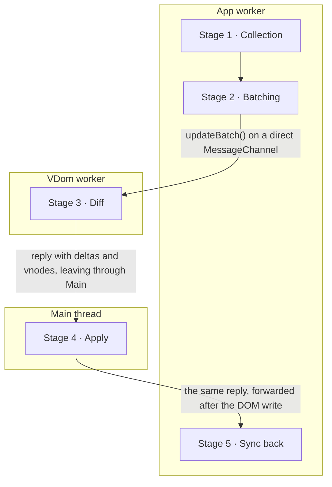

# The VDOM Engine

Every visible change in a Neo application takes one path. A component edits its `vdom` in the App worker. The engine
computes the smallest set of DOM operations, the deltas, that turns the current DOM into the new one. The Main thread
writes them.

This page maps that path. Three pages describe each thread's part closely enough to change it safely. Every line
reference in this set points at `dev` commit `73e6207999`.

## Five stages

| Stage | What happens | Runs in today |
|---|---|---|
| 1. Collection | A change becomes a pending update, joins an ancestor's pending update, or waits behind an overlapping one | App worker |
| 2. Batching | One update snapshots its own scope and every update that joined it, as payloads that share no node | App worker |
| 3. Diff | Each payload's `vdom` is compared with its `vnode`, producing deltas and a new `vnode` | App worker |
| 4. Apply | The deltas are written to the DOM in the next frame | Main thread |
| 5. Sync back | The new vnodes are adopted, promises settle, and the updates that waited start | App worker |

The stages are the design; the threads are placement. Stage 3 reads nothing but its payload and the configured
renderer, because the diff keeps no tree state between calls ([`Helper#update`][helper-update]). By default
(`useVdomWorker: false`), it runs inside the App worker ([default][config-vdom-worker], [import][app-import-helper]);
setting `useVdomWorker: true` places the same diff in a dedicated VDom worker. The stages, payloads and deltas stay the
same, and only the transport changes.

## The triangle

1. The App worker calls `Neo.vdom.Helper.updateBatch()`, a remote method of the VDom worker ([call][vl-send],
   [remote][helper-remote]). The call travels on a `MessageChannel` that the VDom worker opened to the App worker at
   startup ([open][vdom-channel], [keep][app-register-port]), so the Main thread never sees it.
2. The reply is addressed to the App worker. The VDom worker holds no channel back to it, so the reply leaves through
   its default port, which is the Main thread ([reply][rma-send-reply], [route][base-send]).
3. The Main thread recognizes a reply that carries deltas it did not request itself. It holds the reply, writes the
   deltas in the next frame, and only then forwards the reply to the App worker ([intercept][mgr-intercept],
   [hold][mgr-handle-dom-update]). A failed write turns into a rejected reply ([reject][mgr-reject-reply]).

The deltas reach the DOM one hop earlier than a round trip through the App worker would allow, and the App worker
never adopts a vnode for DOM that was not written.

Without the VDom worker (the default), the triangle becomes a line. The App worker diffs locally, sends only the deltas
to the Main thread with `Neo.applyDeltas()`, and the Main thread acknowledges the write ([send][vl-two-thread],
[framing][app-apply-deltas], [receive][mgr-update-action]). The vnodes never leave the App worker.

With `useVdomWorker: true`, normal updates take the triangle above rather than the App worker → Main thread deltas edge;
deltas sent from the App worker straight to the Main thread are manual `Neo.applyDeltas()` calls, which skip stages 1–3
and 5. The [App worker](./AppWorker.md) page covers manual `Neo.applyDeltas()` calls under *Writing the DOM directly*.

## Read next

- [App worker](./AppWorker.md): stages 1, 2 and 5. When an update starts, waits or joins another, what one update
  carries, and how its result comes back.
- [VDom worker](./VdomWorker.md): stage 3. How a payload becomes deltas.
- [Main thread](./MainThread.md): stage 4. How deltas reach the DOM, and when the reply may leave.

Using the engine rather than changing it: [Asymmetric VDOM Updates](../fundamentals/AsymmetricUpdates.md),
[Working with VDom](../uibuildingblocks/WorkingWithVDom.md) and [Worker Architecture](../fundamentals/WorkerArchitecture.md).

## Three rules hold every stage together

1. **The App worker owns the trees.** Every component's `vdom` and `vnode` live there. The other threads receive
   copies and keep nothing.
2. **One payload per DOM node.** No node is diffed by two payloads of one batch, or by two updates in flight at once.
   Stages 1 and 2 exist to guarantee this.
3. **The vnode never runs ahead of the DOM.** A component adopts a new vnode only after the deltas that produce it were
   written. A failed write leaves the old vnode in place.

[helper-update]: https://github.com/neomjs/neo/blob/73e620799910041c267820ae3122cdd0746759e3/src/vdom/Helper.mjs#L843-L866
[helper-remote]: https://github.com/neomjs/neo/blob/73e620799910041c267820ae3122cdd0746759e3/src/vdom/Helper.mjs#L28-L34
[app-import-helper]: https://github.com/neomjs/neo/blob/73e620799910041c267820ae3122cdd0746759e3/src/worker/App.mjs#L828
[config-vdom-worker]: https://github.com/neomjs/neo/blob/73e620799910041c267820ae3122cdd0746759e3/src/DefaultConfig.mjs#L416-L419
[vl-send]: https://github.com/neomjs/neo/blob/73e620799910041c267820ae3122cdd0746759e3/src/mixin/VdomLifecycle.mjs#L570
[vdom-channel]: https://github.com/neomjs/neo/blob/73e620799910041c267820ae3122cdd0746759e3/src/worker/VDom.mjs#L34-L42
[app-register-port]: https://github.com/neomjs/neo/blob/73e620799910041c267820ae3122cdd0746759e3/src/worker/App.mjs#L852-L866
[rma-send-reply]: https://github.com/neomjs/neo/blob/73e620799910041c267820ae3122cdd0746759e3/src/worker/mixin/RemoteMethodAccess.mjs#L378-L382
[base-send]: https://github.com/neomjs/neo/blob/73e620799910041c267820ae3122cdd0746759e3/src/worker/Base.mjs#L774-L777
[mgr-intercept]: https://github.com/neomjs/neo/blob/73e620799910041c267820ae3122cdd0746759e3/src/worker/Manager.mjs#L548-L583
[mgr-handle-dom-update]: https://github.com/neomjs/neo/blob/73e620799910041c267820ae3122cdd0746759e3/src/worker/Manager.mjs#L423-L451
[mgr-reject-reply]: https://github.com/neomjs/neo/blob/73e620799910041c267820ae3122cdd0746759e3/src/worker/Manager.mjs#L429-L444
[vl-two-thread]: https://github.com/neomjs/neo/blob/73e620799910041c267820ae3122cdd0746759e3/src/mixin/VdomLifecycle.mjs#L584-L590
[app-apply-deltas]: https://github.com/neomjs/neo/blob/73e620799910041c267820ae3122cdd0746759e3/src/worker/App.mjs#L128-L140
[mgr-update-action]: https://github.com/neomjs/neo/blob/73e620799910041c267820ae3122cdd0746759e3/src/worker/Manager.mjs#L537-L546
