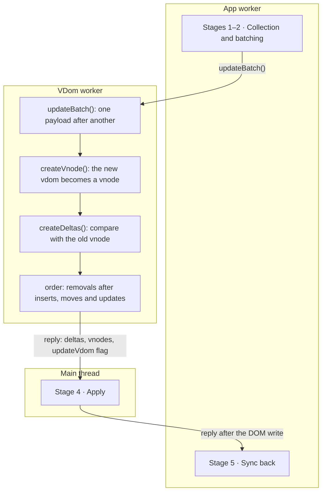

# VDOM Engine: VDom Worker

Stage 3 of [the VDOM engine](./Overview.md) is the diff: each payload becomes deltas and a new vnode. By default
(`useVdomWorker: false`), the diff runs inside the App worker; setting `useVdomWorker: true` runs this same module in
the VDom worker ([default][config-vdom-worker], [App worker][app-import-helper], [VDom worker][vdom-import]). Nothing
on this page depends on that placement: the diff reads only its payload and keeps no tree state between calls. Every
line reference points at `dev` commit `73e6207999`.

## Input and output

`updateBatch()` takes `{updates: {componentId: {vdom, vnode, meta}}}`, plus the meta of absorbed roots and, with
SharedWorkers, the window that asked ([batch][helper-batch], [payload][vl-batch-data]). It diffs the payloads one after
another and concatenates their deltas in that order. It returns `{deltas, vnodes, meta, updateVdom: true}`, and the
`updateVdom` flag is how the Main thread recognizes a reply it must write ([flag][mgr-intercept]).

## One payload

`update()` runs two steps ([update][helper-update]):

1. `createVnode()` turns the new vdom into a vnode. `tag` becomes `nodeName`, `cls` becomes `className`, `html` and
   `text` become `innerHTML` and `textContent`, and `data` becomes `data-*` attributes. `width`, `height` and their
   limits become styles, or attributes on tags that take raw dimensions. A node with `removeDom: true` is dropped, and
   a component reference stays a reference ([createVnode][helper-create-vnode]).
2. `createDeltas()` compares that vnode with the old one, which the App worker sent along
   ([createDeltas][helper-create-deltas]). Both roots must be the same node ([same node][helper-same-node]).
    - A node whose attributes, classes, styles, text or markup changed yields one delta without an `action`, which the
      Main thread applies as `updateNode`. A changed text vnode yields `updateVtext` ([compare][helper-compare]).
    - Children match by `id`, or by `componentId` for references ([match][helper-match]). A placeholder marked
      `neoIgnore` is skipped, because another payload of the batch owns it or it lies beyond the payload's depth
      ([matched][helper-match], [new][helper-skip-new]).
    - An old child missing from the new tree yields `removeNode`. A child that exists elsewhere in the old tree yields
      `moveNode`. A new child yields `insertNode` with its whole markup, or with its vnode for the DOM API renderer
      ([children][helper-children], [insert][helper-insert], [move][helper-move], [remove][helper-remove]).

The delta vocabulary is closed: every action the diff or a manual write may use is listed in one place
([actions][grammar-actions]).

## Order is part of the output

- Removals go last ([order][helper-order]). A node moved out of a removed parent must still exist when its move runs.
- New markup that replaces a node's children waits behind the moves too, when one of those children moves elsewhere
  ([markup][helper-markup-order]).
- Indices are DOM indices, not vnode indices. A text vnode spans three DOM nodes, and a fragment spans its children
  plus two anchors ([index][helper-physical]).

## The first render

`create()` builds the vnode and, for the string renderer, its markup ([create][helper-create]). When the component
mounts itself, the Main thread turns that reply into one `insertNode` ([auto-mount][mgr-automount]).

## What a change here must preserve

1. Deltas depend on the payload alone. State kept between calls would make the diff behave differently in the App
   worker.
2. No delta for a `neoIgnore` subtree: another payload owns it, or none does.
3. Removals come after inserts and moves.
4. Every payload gets a vnode back. The App worker fails the whole batch otherwise ([check][vl-land-checks]).
5. Every action belongs to the delta vocabulary, which the Main thread can apply ([actions][grammar-actions]).

## Hot-path cost

- `createVnode()`, two node maps and one comparison pass: linear in the payload's nodes.
- With the string renderer, `insertNode` serializes whole subtrees to markup ([insert][helper-insert]).
- With the VDom worker, the payload is copied in once, and the deltas and vnodes are copied out twice: to the Main
  thread, then on to the App worker.

[config-vdom-worker]: https://github.com/neomjs/neo/blob/73e620799910041c267820ae3122cdd0746759e3/src/DefaultConfig.mjs#L416-L419
[vdom-import]: https://github.com/neomjs/neo/blob/73e620799910041c267820ae3122cdd0746759e3/src/worker/VDom.mjs#L44-L57
[app-import-helper]: https://github.com/neomjs/neo/blob/73e620799910041c267820ae3122cdd0746759e3/src/worker/App.mjs#L828
[helper-batch]: https://github.com/neomjs/neo/blob/73e620799910041c267820ae3122cdd0746759e3/src/vdom/Helper.mjs#L868-L920
[vl-batch-data]: https://github.com/neomjs/neo/blob/73e620799910041c267820ae3122cdd0746759e3/src/mixin/VdomLifecycle.mjs#L544-L559
[mgr-intercept]: https://github.com/neomjs/neo/blob/73e620799910041c267820ae3122cdd0746759e3/src/worker/Manager.mjs#L548-L583
[helper-update]: https://github.com/neomjs/neo/blob/73e620799910041c267820ae3122cdd0746759e3/src/vdom/Helper.mjs#L835-L866
[helper-create-vnode]: https://github.com/neomjs/neo/blob/73e620799910041c267820ae3122cdd0746759e3/src/vdom/Helper.mjs#L372-L495
[helper-create-deltas]: https://github.com/neomjs/neo/blob/73e620799910041c267820ae3122cdd0746759e3/src/vdom/Helper.mjs#L252-L370
[helper-same-node]: https://github.com/neomjs/neo/blob/73e620799910041c267820ae3122cdd0746759e3/src/vdom/Helper.mjs#L276-L280
[helper-compare]: https://github.com/neomjs/neo/blob/73e620799910041c267820ae3122cdd0746759e3/src/vdom/Helper.mjs#L42-L211
[helper-match]: https://github.com/neomjs/neo/blob/73e620799910041c267820ae3122cdd0746759e3/src/vdom/Helper.mjs#L313-L329
[helper-skip-new]: https://github.com/neomjs/neo/blob/73e620799910041c267820ae3122cdd0746759e3/src/vdom/Helper.mjs#L351-L358
[helper-children]: https://github.com/neomjs/neo/blob/73e620799910041c267820ae3122cdd0746759e3/src/vdom/Helper.mjs#L331-L366
[helper-insert]: https://github.com/neomjs/neo/blob/73e620799910041c267820ae3122cdd0746759e3/src/vdom/Helper.mjs#L679-L727
[helper-move]: https://github.com/neomjs/neo/blob/73e620799910041c267820ae3122cdd0746759e3/src/vdom/Helper.mjs#L745-L793
[helper-remove]: https://github.com/neomjs/neo/blob/73e620799910041c267820ae3122cdd0746759e3/src/vdom/Helper.mjs#L807-L833
[grammar-actions]: https://github.com/neomjs/neo/blob/73e620799910041c267820ae3122cdd0746759e3/src/vdom/util/DeltaGrammar.mjs#L30-L51
[helper-order]: https://github.com/neomjs/neo/blob/73e620799910041c267820ae3122cdd0746759e3/src/vdom/Helper.mjs#L861-L863
[helper-markup-order]: https://github.com/neomjs/neo/blob/73e620799910041c267820ae3122cdd0746759e3/src/vdom/Helper.mjs#L200-L207
[helper-physical]: https://github.com/neomjs/neo/blob/73e620799910041c267820ae3122cdd0746759e3/src/vdom/Helper.mjs#L560-L626
[helper-create]: https://github.com/neomjs/neo/blob/73e620799910041c267820ae3122cdd0746759e3/src/vdom/Helper.mjs#L213-L250
[mgr-automount]: https://github.com/neomjs/neo/blob/73e620799910041c267820ae3122cdd0746759e3/src/worker/Manager.mjs#L563-L577
[vl-land-checks]: https://github.com/neomjs/neo/blob/73e620799910041c267820ae3122cdd0746759e3/src/mixin/VdomLifecycle.mjs#L572-L580
