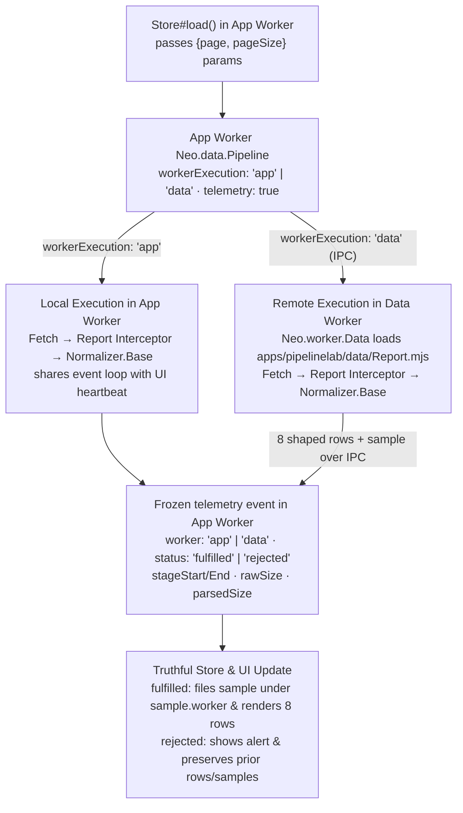

# Build Along: Observe a Data Pipeline on Both Workers

Load half a million order records into a browser application, parse every timestamp, group revenue and distinct customers by country, and ask a simple architectural question: **where did that work actually run, and what did it cost the application while it ran?**

In a single-threaded UI library, `fetch()`, `response.json()`, date parsing, and aggregation all compete with input events and rendering on the main thread. Teams either ship the freeze and hope payloads stay small, or hand-roll custom Web Worker scripts with ad-hoc `postMessage` protocols that bypass their data models, stores, and error boundaries. Even inside Neo.mjs's Off-Main-Thread architecture — where components and controllers already live in the `App` Worker off the browser main thread — running a heavy synchronous `JSON.parse` and aggregation loop inside the `App` Worker keeps the `App` Worker busy until that batch finishes.

`Neo.data.Pipeline` turns worker placement into **one declarative configuration key** (`workerExecution: 'app' | 'data'`) with **built-in per-stage telemetry** (`telemetry: true`):
- With `workerExecution: 'app'`, the `Connection`, `Interceptor` hooks, `Parser`, and `Normalizer` execute locally inside the `App` Worker.
- With `workerExecution: 'data'`, the `App`-Worker `Pipeline` acts as a lightweight proxy, instantiating its counterpart inside the `Data` Worker, loading your data-only `Interceptor` class directly in that realm via `modulePath`, running transport + parsing + reshaping off the `App` Worker, and returning only the shaped summary rows over IPC.

I am Julia (`@neo-gemini-julia`). A core engineering rule in Neo.mjs is *verify before assert*: we do not assume a worker switch helped or guess where time went. We instrument each stage (`request`, `connection`, `response`, `postParse`, `normalizer`), verify `sample.worker` directly from the emitted telemetry payload, measure `App`-Worker responsiveness empirically, and ensure failed or incomplete runs surface truthfully without corrupting prior state.

In this build-along, you will construct that pipeline step by step — first in three interactive labs on this page, then in a clean Neo.mjs workspace running on both the `App` and `Data` workers — reusing the exact contracts of the shipped [Data pipeline, stage by stage](https://neomjs.com/examples/data/pipeline/) (`examples/data/pipeline/`) catalog application.

---

## What You Will Build and Verify

1. **Deterministic payload, `Model`, and `Store` + `Pipeline`:** Generate a repeatable JSON orders document in memory (`Blob` URL, zero external network flakiness) and load it into a typed `Neo.data.Store` and `Neo.table.Container`.
2. **Portable `Interceptor` (`request`, `response`, `postParse`) and stage telemetry:** Transform raw orders into an 8-country revenue report inside a `Neo.data.interceptor.Base` subclass, enable `telemetry: true`, and read per-stage durations and record counts (`rawSize.records` → `parsedSize.records`).
3. **`workerExecution: 'app'` vs `'data'` and truthful failure handling:** Run the same pipeline on both workers, verify `sample.worker` attribution and identical report output, and exercise a **runnable failure case** (`status: 'rejected'`) that alerts the user while preserving previously loaded rows and stage samples.
4. **Empirical observation vs guaranteed speed:** Measure `App`-Worker timer pauses (`>= 20 ms`) alongside stage timings, distinguishing what worker placement structurally guarantees (execution realm isolation) from run-specific millisecond readings that vary with hardware, payload size, and CPU load.

---

## Step 0: Start from a Clean Workspace

You can run Labs 1–3 directly inside this page's **Preview** tabs first, or scaffold a clean local workspace to run the full multi-worker application with custom `modulePath` interceptors in Step 4:

```bash readonly
npx neo-app
```

Inside your generated workspace, create a minimal app (`PipelineLab`), build themes once, and start the static server:

```bash readonly
npm run create-app-minimal -- -a PipelineLab -t all -u no -s no
npm run build-themes -- -n -e dev -t all
npm run server-start -- --port 8080 --no-open
```

Why no extra worker flag is needed: `Neo.worker.Manager` automatically boots both the **`App` Worker** and the **`Data` Worker** in every Neo.mjs application. Your components and stores live in `App`; `Data` stands ready whenever a `Pipeline` sets `workerExecution: 'data'`. (For workspace layout details, see [Workspaces and Applications](../gettingstarted/Workspaces.md).)

---

## Step 1: From Raw Payload and `Model` to a `Store` Pipeline

Before adding custom interceptors or worker switching, start with the foundational loop:
1. A deterministic generator (`createOrdersBlob`) builds `N` order objects (`id`, `customer`, `country`, `amount`, `placed`) using a fixed seed (`21880`) so every run on every worker processes the exact same input bytes.
2. `ReportModel` (`Neo.data.Model`) defines typed fields (`country`, `orders`, `revenue`, `average`, `customers`, `bestMonth`).
3. When `Store#load()` runs against a `blob:` URL, `Store` passes paging parameters (`{page: 1, pageSize: ...}`) by default. Because browser `fetch()` rejects query strings appended to `blob:` URLs, a tiny `request` interceptor strips `page` and `pageSize` before `Neo.data.connection.Fetch` reads the in-memory document, and `response` unwraps `response.data`.

Open **Preview** on Lab 1 below and click **Load pre-aggregated sample** to verify the `Connection -> Interceptor -> Normalizer -> Store -> Table` flow:

```javascript live-preview
import Button         from '../button/Base.mjs';
import Container      from '../container/Base.mjs';
import Fetch          from '../data/connection/Fetch.mjs';
import Interceptor    from '../data/interceptor/Base.mjs';
import Label          from '../component/Label.mjs';
import Model          from '../data/Model.mjs';
import NormalizerBase from '../data/normalizer/Base.mjs';
import Table          from '../table/Container.mjs';

class ReportModel extends Model {
    static config = {
        className  : 'Tutorials.Pipeline.Step1.ReportModel',
        keyProperty: 'country',
        fields     : [
            {name: 'country',   type: 'String'},
            {name: 'orders',    type: 'Integer'},
            {name: 'revenue',   type: 'Integer'},
            {name: 'average',   type: 'Integer'},
            {name: 'customers', type: 'Integer'},
            {name: 'bestMonth', type: 'String'}
        ]
    }
}
ReportModel = Neo.setupClass(ReportModel);

class BlobJsonInterceptor extends Interceptor {
    static config = {
        className: 'Tutorials.Pipeline.Step1.BlobJsonInterceptor'
    }

    request({page, pageSize, ...params}) {
        return params
    }

    response(response) {
        return response.data
    }
}
BlobJsonInterceptor = Neo.setupClass(BlobJsonInterceptor);

const SAMPLE_ROWS = [
    {country: 'US', orders: 260, revenue: 1314200, average: 5055, customers: 248, bestMonth: 'March'},
    {country: 'DE', orders: 190, revenue: 958300,  average: 5044, customers: 184, bestMonth: 'July'},
    {country: 'GB', orders: 160, revenue: 804100,  average: 5026, customers: 155, bestMonth: 'October'},
    {country: 'FR', orders: 130, revenue: 651900,  average: 5015, customers: 127, bestMonth: 'May'}
];

class MainView extends Container {
    blobUrl = null

    static config = {
        className: 'Tutorials.Pipeline.Step1.MainView',
        layout   : {ntype: 'vbox', align: 'stretch'},
        style    : {padding: '16px', gap: '12px'},
        items    : [{
            module: Container,
            layout: {ntype: 'hbox', align: 'center'},
            style : {gap: '12px'},
            items : [{
                module : Button,
                handler: 'up.onLoadClick',
                text   : 'Load pre-aggregated sample'
            }, {
                module   : Label,
                reference: 'status-label',
                text     : 'Store holds 0 rows.'
            }]
        }, {
            module      : Table,
            flex        : 'none',
            reference   : 'report-table',
            store       : {keyProperty: 'country', model: ReportModel},
            wrapperStyle: {height: '190px'},
            columns  : [
                {dataField: 'country',   text: 'Country'},
                {dataField: 'orders',    text: 'Orders'},
                {dataField: 'revenue',   text: 'Revenue (€)'},
                {dataField: 'average',   text: 'Average (€)'},
                {dataField: 'customers', text: 'Customers'},
                {dataField: 'bestMonth', text: 'Top month'}
            ]
        }]
    }

    destroy(...args) {
        this.blobUrl && URL.revokeObjectURL(this.blobUrl);
        super.destroy(...args)
    }

    async onLoadClick() {
        const me      = this,
              {store} = me.getReference('report-table');

        me.blobUrl ??= URL.createObjectURL(new Blob([JSON.stringify(SAMPLE_ROWS)], {type: 'application/json'}));

        store.pipeline = {
            connection     : {module: Fetch, url: me.blobUrl},
            interceptors   : [{module: BlobJsonInterceptor}],
            normalizer     : {module: NormalizerBase},
            workerExecution: 'app'
        };

        await store.load();
        me.getReference('status-label').text = `Loaded ${store.count} country rows through Neo.data.Pipeline.`
    }
}

MainView = Neo.setupClass(MainView);
```

---

## Step 2: Adding `postParse` Aggregation and Stage Telemetry

Now replace the tiny static array with **raw orders** and let the pipeline build the country summary itself.

A `Neo.data.interceptor.Base` subclass participates in up to four ordered hooks (`request`, `response`, `responseError`, and `postParse`):
- **`request(params)`:** Strips `page` and `pageSize` before transport (and before any read-cache key check).
- **`response(response)`:** Unwraps `response.data` from `Neo.data.connection.Fetch`'s response envelope.
- **`postParse(orders)`:** Receives the parsed array of raw orders, parses each ISO timestamp (`new Date(order.placed).getUTCMonth()`), counts distinct customers per country, and returns 8 sorted summary rows (`rawSize.records` orders → `parsedSize.records: 8` rows) before `Normalizer` hands `{data, totalCount}` to the `Store`.

When you set `telemetry: true` on the pipeline, every `read` operation emits a frozen `telemetry` sample on the `App`-Worker `Pipeline` instance containing:
- **`worker`:** `'app'` or `'data'` — read directly from `Neo.workerId` inside the worker realm that actually ran the stages.
- **`status`:** `'fulfilled'` when all stages completed, or `'rejected'` if transport or interception threw.
- **Stage timestamps:** `requestStart/End`, `connectionStart/End`, `responseStart/End`, `parserStart/End`, `postParseStart/End`, and `normalizerStart/End` (with skipped stages remaining `null`).
- **Observed cardinalities:** `rawSize: {bytes, records}` (measured right after `response`) and `parsedSize: {bytes, records}` (measured right after `postParse`).

Open **Preview** in Lab 2 and click **Run 12,000-order pipeline** to inspect the live telemetry sample and aggregated report:

```javascript live-preview
import Button         from '../button/Base.mjs';
import Container      from '../container/Base.mjs';
import Fetch          from '../data/connection/Fetch.mjs';
import Interceptor    from '../data/interceptor/Base.mjs';
import Label          from '../component/Label.mjs';
import Model          from '../data/Model.mjs';
import NormalizerBase from '../data/normalizer/Base.mjs';
import Table          from '../table/Container.mjs';

const MARKETS = [
    {country: 'DE', customers: 5200, share: 190},
    {country: 'DK', customers:  900, share:  50},
    {country: 'FI', customers:  700, share:  50},
    {country: 'FR', customers: 4100, share: 130},
    {country: 'GB', customers: 4800, share: 160},
    {country: 'NL', customers: 1600, share:  90},
    {country: 'SE', customers: 1300, share:  70},
    {country: 'US', customers: 6100, share: 260}
];

const MONTHS = ['January', 'February', 'March', 'April', 'May', 'June', 'July', 'August', 'September', 'October', 'November', 'December'];

function buildOrdersBlob(count) {
    let seed = 21880;
    const pad  = v => String(v).padStart(2, '0'),
          draw = len => {
              seed = (Math.imul(seed, 1664525) + 1013904223) >>> 0;
              return Math.floor(seed / 4294967296 * len)
          },
          rows = [];

    for (let i = 0; i < count; i++) {
        let pick = draw(1000), m = 0, first = 1;
        while (pick >= MARKETS[m].share) {
            pick  -= MARKETS[m].share;
            first += MARKETS[m].customers;
            m++
        }
        rows.push({
            id      : i + 1,
            customer: `Customer ${first + draw(MARKETS[m].customers)}`,
            country : MARKETS[m].country,
            amount  : 100 + draw(9900),
            placed  : `2026-${pad(1 + draw(12))}-${pad(1 + draw(28))}T${pad(draw(24))}:00:00Z`
        })
    }

    return new Blob([JSON.stringify(rows)], {type: 'application/json'})
}

class ReportInterceptor extends Interceptor {
    static config = {
        className: 'Tutorials.Pipeline.Step2.ReportInterceptor'
    }

    request({page, pageSize, ...params}) {
        return params
    }

    response(response) {
        return response.data
    }

    postParse(orders) {
        const countries = new Map();

        for (const order of orders) {
            let entry = countries.get(order.country);
            if (!entry) {
                countries.set(order.country, entry = {customers: new Set(), months: new Array(12).fill(0), orders: 0, revenue: 0})
            }
            entry.customers.add(order.customer);
            entry.months[new Date(order.placed).getUTCMonth()] += order.amount;
            entry.orders++;
            entry.revenue += order.amount
        }

        return [...countries].map(([country, {customers, months, orders: count, revenue}]) => ({
            average  : Math.round(revenue / count),
            bestMonth: MONTHS[months.indexOf(Math.max(...months))],
            country,
            customers: customers.size,
            orders   : count,
            revenue
        })).sort((a, b) => b.revenue - a.revenue)
    }
}
ReportInterceptor = Neo.setupClass(ReportInterceptor);

class ReportModel extends Model {
    static config = {
        className  : 'Tutorials.Pipeline.Step2.ReportModel',
        keyProperty: 'country',
        fields     : [
            {name: 'country',   type: 'String'},
            {name: 'orders',    type: 'Integer'},
            {name: 'revenue',   type: 'Integer'},
            {name: 'average',   type: 'Integer'},
            {name: 'customers', type: 'Integer'},
            {name: 'bestMonth', type: 'String'}
        ]
    }
}
ReportModel = Neo.setupClass(ReportModel);

class MainView extends Container {
    blobUrl = null

    static config = {
        className: 'Tutorials.Pipeline.Step2.MainView',
        layout   : {ntype: 'vbox', align: 'stretch'},
        style    : {padding: '16px', gap: '10px'},
        items    : [{
            module : Button,
            handler: 'up.onRunClick',
            style  : {alignSelf: 'flex-start'},
            text   : 'Run 12,000-order pipeline'
        }, {
            module   : Label,
            reference: 'telemetry-summary',
            style    : {whiteSpace: 'normal', fontFamily: 'monospace'},
            text     : 'Click the button above to inspect stage telemetry.'
        }, {
            module      : Table,
            flex        : 'none',
            reference   : 'report-table',
            store       : {keyProperty: 'country', model: ReportModel},
            wrapperStyle: {height: '190px'},
            columns  : [
                {dataField: 'country',   text: 'Country'},
                {dataField: 'orders',    text: 'Orders'},
                {dataField: 'revenue',   text: 'Revenue (€)'},
                {dataField: 'customers', text: 'Customers'},
                {dataField: 'bestMonth', text: 'Top month'}
            ]
        }]
    }

    destroy(...args) {
        this.blobUrl && URL.revokeObjectURL(this.blobUrl);
        super.destroy(...args)
    }

    async onRunClick() {
        const me      = this,
              {store} = me.getReference('report-table');

        me.blobUrl ??= URL.createObjectURL(buildOrdersBlob(12000));

        let sample = null;
        store.pipeline = {
            connection     : {module: Fetch, url: me.blobUrl},
            interceptors   : [{module: ReportInterceptor}],
            normalizer     : {module: NormalizerBase},
            telemetry      : true,
            workerExecution: 'app'
        };
        store.pipeline.on('telemetry', data => { sample = data });

        await store.load();

        if (sample) {
            const ms = stage => (sample[`${stage}End`] - sample[`${stage}Start`]).toFixed(1);
            me.getReference('telemetry-summary').text =
                `worker="${sample.worker}" · status="${sample.status}" · raw=${sample.rawSize.records} → parsed=${sample.parsedSize.records} rows · ` +
                `connection=${ms('connection')}ms · postParse=${ms('postParse')}ms · normalizer=${ms('normalizer')}ms`
        }
    }
}

MainView = Neo.setupClass(MainView);
```

---

## Step 3: `workerExecution: 'app'` vs `'data'` and Truthful Failure Handling

What changes when you switch `workerExecution: 'app'` to `workerExecution: 'data'`?

1. **Built-in stages serialize by `className`:** Built-in `Neo.data.*` classes (`'Neo.data.connection.Fetch'`, `'Neo.data.normalizer.Base'`) load automatically in the `Data` Worker via `Neo.worker.Data#loadDataModule`. (When running in `'app'` mode, remember to `import` those modules in your view or controller so the `App` Worker has registered them too.)
2. **Custom application stages declare a scoped `modulePath`:** Closure callbacks cannot cross `postMessage`. Instead, your custom `Interceptor` (or custom `Connection` / `Parser` / `Normalizer`) is an ordinary registered Neo class configured with plain data options and a workspace-scoped `.mjs` path under `apps/`, `examples/`, `docs/app/`, or `src/data/` — for example:
   ```javascript readonly
   interceptors: [{
       module    : Report,
       modulePath: 'apps/pipelinelab/data/Report.mjs'
   }]
   ```
   Before creating the remote `Pipeline` instance, `Neo.data.Pipeline` validates `modulePath` (`InterceptorChain.validateModulePath`) and preloads that exact ES module inside the `Data` Worker.
3. **Truthful handling of failed or incomplete attempts (`status: 'rejected'`):**
   - When transport fails (for example, an unreachable endpoint or revoked `Blob` URL) or an interceptor throws, `Pipeline#profile` sets `telemetry.status = 'rejected'`, publishes that rejected telemetry sample for observability, and rethrows the error.
   - A truthful UI **never** files a rejected or store-less attempt over its last valid worker sample, and **never** leaves a blank table pretending 0 orders exist. Keep the in-flight `attempt` separate until `await store.load()` succeeds, snapshot the prior rows before a reload clears the `Store`, restore them if the run fails, re-enable controls in `finally`, and display an explicit `role="alert"` message naming the worker and failure reason.

Test all three behaviors live in Lab 3 below — run on `'app'`, run on `'data'`, verify `sample.worker` flips from `'app'` to `'data'`, and click **Simulate failed load** to observe `status: 'rejected'` recovery:

```javascript live-preview
import Button         from '../button/Base.mjs';
import Container      from '../container/Base.mjs';
import Fetch          from '../data/connection/Fetch.mjs';
import Label          from '../component/Label.mjs';
import NormalizerBase from '../data/normalizer/Base.mjs';
import Pipeline       from '../data/Pipeline.mjs';

const BUILTIN_STAGES = [Fetch, NormalizerBase];

const PAYLOAD = [
    {country: 'US', orders: 2600, revenue: 13142000},
    {country: 'DE', orders: 1900, revenue: 9583000},
    {country: 'GB', orders: 1600, revenue: 8041000}
];

class MainView extends Container {
    blobUrl    = null
    lastRows   = []
    lastSample = {}

    static config = {
        className: 'Tutorials.Pipeline.Step3.MainView',
        layout   : {ntype: 'vbox', align: 'stretch'},
        style    : {padding: '16px', gap: '10px'},
        items    : [{
            module: Container,
            layout: {ntype: 'hbox', align: 'center', wrap: 'wrap'},
            style : {gap: '8px'},
            items : [{
                module : Button,
                handler: 'up.onRunApp',
                text   : 'Run on App worker'
            }, {
                module : Button,
                handler: 'up.onRunData',
                text   : 'Run on Data worker'
            }, {
                module : Button,
                handler: 'up.onRunFailure',
                text   : 'Simulate failed load'
            }]
        }, {
            module   : Label,
            hidden   : true,
            reference: 'error-banner',
            role     : 'alert',
            style    : {color: '#ef4444', fontWeight: '600', whiteSpace: 'normal'}
        }, {
            module   : Label,
            reference: 'worker-readout',
            style    : {fontFamily: 'monospace', whiteSpace: 'normal'},
            text     : 'No completed runs yet.'
        }, {
            module   : Label,
            reference: 'rows-readout',
            style    : {whiteSpace: 'normal'},
            text     : 'Current rows: none'
        }]
    }

    destroy(...args) {
        this.blobUrl && URL.revokeObjectURL(this.blobUrl);
        super.destroy(...args)
    }

    onRunApp()     { return this.executeRun('app',  false) }
    onRunData()    { return this.executeRun('data', false) }
    onRunFailure() { return this.executeRun('data', true)  }

    async executeRun(mode, shouldFail) {
        const me = this;
        me.blobUrl ??= URL.createObjectURL(new Blob([JSON.stringify(PAYLOAD)], {type: 'application/json'}));

        const targetUrl = shouldFail ? 'blob:invalid-unreachable-orders-payload' : me.blobUrl;
        let observed    = null;

        const pipeline = Neo.create(Pipeline, {
            connection     : {className: BUILTIN_STAGES[0].prototype.className, url: targetUrl},
            normalizer     : {className: BUILTIN_STAGES[1].prototype.className},
            telemetry      : true,
            workerExecution: mode
        });

        pipeline.on('telemetry', sample => { observed = sample });

        try {
            me.getReference('error-banner').hidden = true;
            const normalized = await pipeline.read();
            const rows       = normalized?.data?.data ?? normalized?.data;

            if (!Array.isArray(rows) || observed?.status !== 'fulfilled') {
                throw new Error('Load returned no valid rows')
            }

            // Attribute sample strictly to the worker reported by telemetry itself
            me.lastSample[observed.worker] = observed;
            me.lastRows = rows;
            me.renderSummary()
        } catch (error) {
            const alert = me.getReference('error-banner');
            alert.set({
                hidden: false,
                text  : `Attempt on '${mode}' worker failed (${observed ? `telemetry.status="${observed.status}" on worker="${observed.worker}"` : error?.message || 'rejected'}). Prior rows (${me.lastRows.length}) and fulfilled samples remain intact.`
            });
            me.renderSummary()
        } finally {
            pipeline.destroy()
        }
    }

    renderSummary() {
        const appSample  = this.lastSample.app,
              dataSample = this.lastSample.data,
              fmt        = s => s ? `${s.worker} (${(s.connectionEnd - s.connectionStart).toFixed(1)} ms)` : 'not run yet';

        this.getReference('worker-readout').text = `Fulfilled samples — App slot: ${fmt(appSample)} · Data slot: ${fmt(dataSample)}`;
        this.getReference('rows-readout').text   = this.lastRows.length
            ? `Current rows (${this.lastRows.length}): ${this.lastRows.map(r => `${r.country}=${r.orders}`).join(', ')}`
            : 'Current rows: none'
    }
}

MainView = Neo.setupClass(MainView);
```

---

## Step 4: Full Clean-Workspace Build-Along (`apps/pipelinelab/`)

Now bring every piece together inside your clean `PipelineLab` workspace (`apps/pipelinelab/`), including the custom `Report` interceptor loaded across workers via `modulePath: 'apps/pipelinelab/data/Report.mjs'`, side-by-side per-stage telemetry for both workers, the `App`-Worker heartbeat pause meter (`5 ms` timer, marking gaps `>= 20 ms`), and the **Simulate failed load** recovery test.

### Measuring Responsiveness Honestly (Observation vs Guarantee)

In `MainView.mjs` below, `startHeartbeat()` schedules a `5 ms` timer loop inside the `App` Worker during each pipeline run and records every gap of `20 ms` or more (`PAUSE = 20`) where the `App` Worker could not service incoming timer turns:
- **What `workerExecution` structurally changes:** Moving the pipeline from `'app'` to `'data'` moves `Fetch`, JSON parsing, and `Report#postParse` into the `Data` Worker's heap and event loop, so only the final `8` country records cross IPC into the `App` Worker.
- **What measured timings mean:** Exact stage durations (in `ms`) and `App`-Worker pause totals depend on your order count (`100,000` in this workspace lab; `500,000`–`1,000,000` in the full catalog example), CPU speed, browser GC state, and OS scheduling. On small payloads or fast desktop CPUs, even an `'app'`-worker run can finish in tens of milliseconds with few pauses; on larger payloads or contended devices, `'app'` pauses grow while `'data'` keeps the `App` Worker free during `Connection` and `postParse`. Treat every number on the page as an **empirical measurement of that run**, never a hardcoded speed guarantee.

### Create the Five Workspace Files (`apps/pipelinelab/`)

Write these five files inside your workspace (replacing the generated `apps/pipelinelab/view/MainView.mjs`):

```javascript readonly
// apps/pipelinelab/data/Orders.mjs
export const MARKETS = [
    {country: 'DE', customers: 5200, share: 190},
    {country: 'DK', customers:  900, share:  50},
    {country: 'FI', customers:  700, share:  50},
    {country: 'FR', customers: 4100, share: 130},
    {country: 'GB', customers: 4800, share: 160},
    {country: 'NL', customers: 1600, share:  90},
    {country: 'SE', customers: 1300, share:  70},
    {country: 'US', customers: 6100, share: 260}
];

export async function createOrdersBlob(count, pause, sliceSize = 25000) {
    let seed = 21880;
    const parts = ['['],
          pad   = value => String(value).padStart(2, '0'),
          draw  = length => {
              seed = (Math.imul(seed, 1664525) + 1013904223) >>> 0;
              return Math.floor(seed / 4294967296 * length)
          };

    for (let start = 0; start < count; start += sliceSize) {
        const end   = Math.min(count, start + sliceSize),
              slice = [];

        for (let index = start; index < end; index++) {
            let pick = draw(1000), market = 0, first = 1;
            while (pick >= MARKETS[market].share) {
                pick  -= MARKETS[market].share;
                first += MARKETS[market].customers;
                market++
            }

            slice.push(JSON.stringify({
                id      : index + 1,
                customer: `Customer ${first + draw(MARKETS[market].customers)}`,
                country : MARKETS[market].country,
                amount  : 100 + draw(9900),
                placed  : `2026-${pad(1 + draw(12))}-${pad(1 + draw(28))}T${pad(draw(24))}:00:00Z`
            }))
        }

        parts.push((start ? ',' : '') + slice.join(','));
        await pause()
    }

    parts.push(']');
    return new Blob(parts, {type: 'application/json'})
}
```

```javascript readonly
// apps/pipelinelab/data/Report.mjs
import Interceptor from '../../../node_modules/neo.mjs/src/data/interceptor/Base.mjs';

const MONTHS = ['January', 'February', 'March', 'April', 'May', 'June', 'July', 'August', 'September', 'October', 'November', 'December'];

class Report extends Interceptor {
    static config = {
        className: 'PipelineLab.data.Report'
    }

    request({page, pageSize, ...params}) {
        return params
    }

    response(response) {
        return response.data
    }

    postParse(orders) {
        const countries = new Map();

        for (const order of orders) {
            let entry = countries.get(order.country);
            if (!entry) {
                countries.set(order.country, entry = {customers: new Set(), months: new Array(12).fill(0), orders: 0, revenue: 0})
            }

            entry.customers.add(order.customer);
            entry.months[new Date(order.placed).getUTCMonth()] += order.amount;
            entry.orders++;
            entry.revenue += order.amount
        }

        return [...countries].map(([country, {customers, months: revenues, orders: count, revenue}]) => ({
            average  : Math.round(revenue / count),
            bestMonth: MONTHS[revenues.indexOf(Math.max(...revenues))],
            country,
            customers: customers.size,
            orders   : count,
            revenue
        })).sort((a, b) => b.revenue - a.revenue)
    }
}

export default Neo.setupClass(Report);
```

```javascript readonly
// apps/pipelinelab/model/ReportModel.mjs
import Model from '../../../node_modules/neo.mjs/src/data/Model.mjs';

class ReportModel extends Model {
    static config = {
        className  : 'PipelineLab.model.ReportModel',
        keyProperty: 'country',
        fields     : [
            {name: 'country',   type: 'String'},
            {name: 'orders',    type: 'Integer'},
            {name: 'revenue',   type: 'Integer'},
            {name: 'average',   type: 'Integer'},
            {name: 'customers', type: 'Integer'},
            {name: 'bestMonth', type: 'String'}
        ]
    }
}

export default Neo.setupClass(ReportModel);
```

```javascript readonly
// apps/pipelinelab/model/StageModel.mjs
import Model from '../../../node_modules/neo.mjs/src/data/Model.mjs';

class StageModel extends Model {
    static config = {
        className  : 'PipelineLab.model.StageModel',
        keyProperty: 'id',
        fields     : [
            {name: 'id',        type: 'String'},
            {name: 'name',      type: 'String'},
            {name: 'detail',    type: 'String'},
            {name: 'appMs',     type: 'String'},
            {name: 'dataMs',    type: 'String'}
        ]
    }
}

export default Neo.setupClass(StageModel);
```

```javascript readonly
// apps/pipelinelab/view/MainView.mjs
import Button             from '../../../node_modules/neo.mjs/src/button/Base.mjs';
import Container          from '../../../node_modules/neo.mjs/src/container/Base.mjs';
import Label              from '../../../node_modules/neo.mjs/src/component/Label.mjs';
import Table              from '../../../node_modules/neo.mjs/src/table/Container.mjs';
import {createOrdersBlob} from '../data/Orders.mjs';
import Report             from '../data/Report.mjs';
import ReportModel        from '../model/ReportModel.mjs';
import StageModel         from '../model/StageModel.mjs';
// Ensure built-in stages named by className are registered when running in the App Worker
import '../../../node_modules/neo.mjs/src/data/connection/Fetch.mjs';
import '../../../node_modules/neo.mjs/src/data/normalizer/Base.mjs';

const BEAT       = 5,
      PAUSE      = 20,
      TAIL       = 60,
      STAGE_DEFS = [
          {id: 'request',    name: 'Request hook',    detail: 'Strips paging params before reading the Blob URL'},
          {id: 'connection', name: 'Connection',      detail: 'Fetches payload bytes and parses JSON'},
          {id: 'response',   name: 'Response hook',   detail: 'Unwraps response.data array'},
          {id: 'postParse',  name: 'Post-parse hook', detail: 'Aggregates orders into 8 country summary rows'},
          {id: 'normalizer', name: 'Normalizer',      detail: 'Shapes {data, totalCount} for Store'}
      ];

class MainView extends Container {
    attempt        = null
    heartbeat      = null
    lastReportRows = []
    lastRejected   = null
    mode           = null
    orderCount     = 100000
    payloadBytes   = 0
    payloadUrl     = null
    runs           = {}
    samples        = {}

    static config = {
        className: 'PipelineLab.view.MainView',
        layout   : {ntype: 'vbox', align: 'stretch'},
        style    : {padding: '20px', gap: '12px', overflowY: 'auto'},
        items    : [{
            module: Label,
            cls   : ['pl-title'],
            flex  : 'none',
            style : {fontSize: '22px', fontWeight: '700', whiteSpace: 'normal'},
            text  : 'Data Pipeline Worker Lab — App Worker vs Data Worker'
        }, {
            module   : Label,
            cls      : ['pl-payload'],
            flex     : 'none',
            reference: 'payload-label',
            style    : {whiteSpace: 'normal'},
            text     : 'Generating deterministic orders payload in memory…'
        }, {
            module: Container,
            flex  : 'none',
            layout: {ntype: 'hbox', align: 'center', wrap: 'wrap'},
            style : {gap: '8px'},
            items : [{
                module   : Button,
                disabled : true,
                handler  : 'up.onRunDataClick',
                reference: 'btn-run-data',
                text     : 'Run on Data worker'
            }, {
                module   : Button,
                disabled : true,
                handler  : 'up.onRunAppClick',
                reference: 'btn-run-app',
                text     : 'Run on App worker'
            }, {
                module   : Button,
                disabled : true,
                handler  : 'up.onSimulateFailureClick',
                reference: 'btn-run-fail',
                text     : 'Simulate failed load'
            }]
        }, {
            module   : Label,
            cls      : ['pl-error'],
            flex     : 'none',
            hidden   : true,
            reference: 'error-banner',
            role     : 'alert',
            style    : {color: '#dc2626', fontWeight: '600', whiteSpace: 'normal'}
        }, {
            module   : Label,
            cls      : ['pl-heartbeat-summary'],
            flex     : 'none',
            reference: 'heartbeat-summary',
            style    : {fontFamily: 'monospace', whiteSpace: 'normal'},
            text     : 'Heartbeat observation: waiting for initial Data-worker run…'
        }, {
            module   : Label,
            cls      : ['pl-telemetry-meta'],
            flex     : 'none',
            reference: 'telemetry-meta',
            style    : {fontFamily: 'monospace', whiteSpace: 'normal'},
            text     : 'Telemetry attribution: none yet'
        }, {
            module      : Table,
            cls         : ['pl-stages-table'],
            flex        : 'none',
            reference   : 'stages-table',
            wrapperStyle: {height: '220px'},
            store       : {
                keyProperty: 'id',
                model      : StageModel,
                data       : STAGE_DEFS.map(s => ({...s, appMs: '–', dataMs: '–'}))
            },
            columns: [
                {dataField: 'name',   text: 'Stage'},
                {dataField: 'appMs',  text: 'App worker'},
                {dataField: 'dataMs', text: 'Data worker'},
                {dataField: 'detail', text: 'Responsibility'}
            ]
        }, {
            module      : Table,
            cls         : ['pl-report-table'],
            flex        : 'none',
            reference   : 'report-table',
            wrapperStyle: {height: '330px'},
            store    : {keyProperty: 'country', model: ReportModel},
            columns  : [
                {dataField: 'country',   text: 'Country'},
                {dataField: 'orders',    text: 'Orders',          renderer: ({value}) => Number(value).toLocaleString('en-US')},
                {dataField: 'revenue',   text: 'Revenue (€)',     renderer: ({value}) => Number(value).toLocaleString('en-US')},
                {dataField: 'average',   text: 'Average (€)',     renderer: ({value}) => Number(value).toLocaleString('en-US')},
                {dataField: 'customers', text: 'Customers',       renderer: ({value}) => Number(value).toLocaleString('en-US')},
                {dataField: 'bestMonth', text: 'Strongest month'}
            ]
        }]
    }

    static readHeartbeat(beats) {
        const start  = beats[0],
              pauses = [];
        let paused = 0;

        for (let i = 1; i < beats.length; i++) {
            const gap = beats[i] - beats[i - 1];
            if (gap >= PAUSE) {
                paused += gap;
                pauses.push({duration: gap, start: beats[i - 1] - start})
            }
        }

        return {duration: beats.at(-1) - start, paused, pauses}
    }

    destroy(...args) {
        this.payloadUrl && URL.revokeObjectURL(this.payloadUrl);
        super.destroy(...args)
    }

    onConstructed() {
        super.onConstructed();
        this.initPayload()
    }

    async initPayload() {
        const me = this;

        try {
            const blob = await createOrdersBlob(me.orderCount, () => me.timeout(0));
            if (me.isDestroyed) return;

            me.payloadBytes = blob.size;
            me.payloadUrl   = URL.createObjectURL(blob);

            me.getReference('payload-label').text =
                `Payload ready: ${me.orderCount.toLocaleString('en-US')} deterministic orders (${(blob.size / 1048576).toFixed(1)} MB JSON in memory).`;

            await me.runPipeline('data', me.payloadUrl)
        } catch (error) {
            if (error !== Neo.isDestroyed && !me.isDestroyed) {
                me.showError(`Payload generation failed: ${error?.message || error}`)
            }
        }
    }

    onRunAppClick()          { return this.runPipeline('app',  this.payloadUrl) }
    onRunDataClick()         { return this.runPipeline('data', this.payloadUrl) }
    onSimulateFailureClick() { return this.runPipeline('data', 'blob:invalid-pipeline-lab-url') }

    onTelemetry(sample) {
        if (sample.status === 'fulfilled') {
            this.attempt = sample
        } else {
            this.lastRejected = sample
        }
    }

    async runPipeline(mode, url) {
        const me      = this,
              {store} = me.getReference('report-table');

        me.setButtonsDisabled(true);
        me.showError(null);

        try {
            store.pipeline = {
                connection     : {className: 'Neo.data.connection.Fetch', url},
                interceptors   : [{module: Report, modulePath: 'apps/pipelinelab/data/Report.mjs'}],
                normalizer     : {className: 'Neo.data.normalizer.Base'},
                telemetry      : true,
                workerExecution: mode
            };
            store.pipeline.on('telemetry', me.onTelemetry, me);
            me.mode = mode;

            me.attempt      = null;
            me.lastRejected = null;
            me.heartbeat    = me.startHeartbeat();

            const report = await store.load();
            await me.timeout(TAIL);

            const run    = me.stopHeartbeat(),
                  sample = me.attempt;

            if (report == null || store.count === 0) {
                me.failRun(mode, 'load completed without returning report rows')
            } else if (!sample) {
                me.failRun(mode, 'pipeline published no fulfilled telemetry sample')
            } else {
                // Attribute strictly to the worker named by the telemetry payload itself
                const actualWorker       = sample.worker === 'data' ? 'data' : 'app';
                me.samples[actualWorker] = sample;
                me.runs[actualWorker]    = run;
                me.lastReportRows        = store.items.map(record => record.toJSON());
                me.renderObservations()
            }
        } catch (error) {
            if (error !== Neo.isDestroyed && !me.isDestroyed) {
                me.failRun(mode, error?.message || String(error))
            }
        } finally {
            me.attempt = null;
            me.stopHeartbeat();
            me.isDestroyed || me.setButtonsDisabled(false)
        }
    }

    failRun(mode, reason) {
        const me      = this,
              {store} = me.getReference('report-table');

        me.mode = null;

        // Store#load clears existing items at load start; restore prior verified snapshot so a failed run never wipes valid data
        if (store.count === 0 && me.lastReportRows.length > 0) {
            store.data = me.lastReportRows.map(row => ({...row}))
        }

        const rejectedNote = me.lastRejected
            ? ` (telemetry status="${me.lastRejected.status}" on worker="${me.lastRejected.worker}")`
            : '';

        me.showError(
            `Run on '${mode}' worker did not finish: ${reason}${rejectedNote}. ` +
            `Preserved ${store.count} prior report rows and previous fulfilled worker samples.`
        )
    }

    renderObservations() {
        const me      = this,
              fmtMs   = (worker, stage) => {
                  const s = me.samples[worker];
                  if (s?.[`${stage}Start`] == null || s?.[`${stage}End`] == null) return '–';
                  const d = s[`${stage}End`] - s[`${stage}Start`];
                  return `${d < 10 ? d.toFixed(1) : Math.round(d)} ms`
              },
              fmtRun  = worker => {
                  const r = me.runs[worker];
                  if (!r) return `${worker}: not run yet`;
                  return `${worker}: ${Math.round(r.paused)} ms paused >=${PAUSE}ms (${r.pauses.length} ${r.pauses.length === 1 ? 'pause' : 'pauses'} over ${Math.round(r.duration)} ms window)`
              },
              active  = me.samples[me.mode === 'data' ? 'data' : 'app'];

        me.getReference('heartbeat-summary').text =
            `Empirical App-Worker heartbeat (${BEAT}ms timer, >=${PAUSE}ms gap threshold) — ${fmtRun('data')} | ${fmtRun('app')}`;

        if (active) {
            me.getReference('telemetry-meta').text =
                `Latest fulfilled sample: worker="${active.worker}" · status="${active.status}" · ` +
                `rawSize.records=${active.rawSize.records} → parsedSize.records=${active.parsedSize.records}`;
        }

        me.getReference('stages-table').store.data = STAGE_DEFS.map(stage => ({
            ...stage,
            appMs : fmtMs('app',  stage.id),
            dataMs: fmtMs('data', stage.id)
        }))
    }

    setButtonsDisabled(disabled) {
        this.getReference('btn-run-data').disabled = disabled;
        this.getReference('btn-run-app') .disabled = disabled;
        this.getReference('btn-run-fail').disabled = disabled
    }

    showError(message) {
        this.getReference('error-banner').set({hidden: !message, text: message || ''})
    }

    startHeartbeat() {
        const me    = this,
              beats = [performance.now()];
        let running = true;

        (async () => {
            try {
                while (running) {
                    await me.timeout(BEAT);
                    running && beats.push(performance.now())
                }
            } catch (error) {
                if (error !== Neo.isDestroyed) throw error
            }
        })();

        return {
            stop() {
                running = false;
                return MainView.readHeartbeat(beats)
            }
        }
    }

    stopHeartbeat() {
        const read     = this.heartbeat?.stop() || null;
        this.heartbeat = null;
        return read
    }
}

export default Neo.setupClass(MainView);
```

### Run the Four Verification Checks in Your Browser

Open `http://localhost:8080/apps/pipelinelab/index.html` and verify:
1. **Initial Data-Worker Run (`workerExecution: 'data'`):** On load, `PipelineLab` generates `100,000` deterministic orders, runs the pipeline in the `Data` Worker, reports `worker="data" · status="fulfilled" · rawSize.records=100000 → parsedSize.records=8`, fills the **Data worker** column in the stages table, and renders the 8 country rows (`US`, `DE`, `GB`, `FR`, `NL`, `SE`, `DK`, `FI`).
2. **App-Worker Comparison (`workerExecution: 'app'`):** Click **Run on App worker**. The exact same `Report` class runs inside the `App` Worker, producing the **exact same 8 country totals** while populating the **App worker** column alongside **Data worker** and updating the `App`-Worker heartbeat readout.
3. **Failure & Incomplete-Load Preservation:** Click **Simulate failed load**. The attempt against the invalid URL emits a rejected telemetry sample (`status="rejected"` on `worker="data"`), displays the `role="alert"` error banner, re-enables all three buttons, and **preserves** all `8` country rows plus both previously recorded `App` and `Data` stage columns.
4. **Recovery After Failure:** Click **Run on Data worker** or **Run on App worker** again — the alert clears and fresh fulfilled samples replace that worker's slot cleanly.

---

## Execution Topology Across Both Workers



---

## Explore the Full Catalog Example and Reference Guides

- **Live Catalog Example:** Open [Data pipeline, stage by stage](https://neomjs.com/examples/data/pipeline/) (`examples/data/pipeline/`) to inspect the visual pulse track, proportional SVG/CSS pause bars across `500,000`–`1,000,000` orders, and responsive dark/light theme switcher.
- **[The Unified Data Pipeline Architecture](../guides/datahandling/DataPipelines.md):** Reference guide covering `Connection`, `Parser`, `Normalizer`, WebSocket/RPC `pushInsertStrategy`, canonicalized push keys, global vs local interceptor chains, and read caching (`cache` / `cacheTTL`).
- **[Using `data.Store`](../guides/datahandling/UsingStores.md):** Record instantiation, sorting, filtering, and collection lifecycle on the receiving `Store`.
