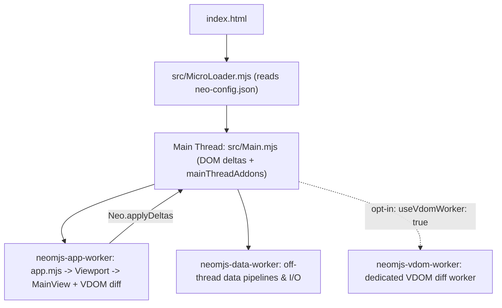
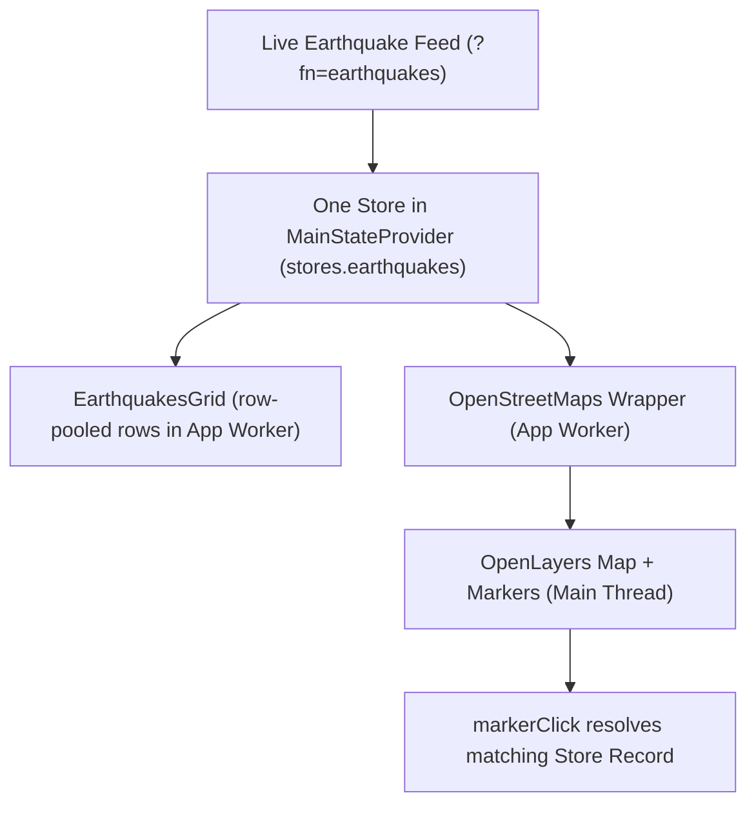

# Earthquakes

In this topic you'll create an application that fetches live data on earthquakes in Iceland
and shows the same records in two synchronized views: a buffered grid and an interactive map.

You'll build it step by step in a series of labs.

> **Attribution & runtime notes:** Originally authored by **Max Rahder**; updated for Neo.mjs 14 with `Neo.grid.Container`, keyless `OpenStreetMaps`, and App-worker VDOM diffing ([ADR 0043](../agentos/decisions/0043-vdom-diff-placement.md)). You do not need a map API key or billing account, but you **do** need live network access: the app fetches a live earthquake feed (`https://nameless-tundra-27404.herokuapp.com/go/?fn=earthquakes` — verified from the default `http://localhost:8080` recipe; check that its `Access-Control-Allow-Origin` header permits your browser origin), and the map addon loads OpenLayers from jsDelivr plus OpenStreetMap tiles.

## Goals

What are the goals of this tutorial?

- To give you hands-on practice building a complete multi-view Neo.mjs app from an empty shell
- To introduce fundamental Neo.mjs concepts in the order you actually need them

Most of these labs are copy-and-paste because we're focusing on _what_ the code is doing rather than memorizing every detail on day one.

For this tutorial, don't worry about syntax details. Other tutorials and guides spend more and more time on individual APIs.

## Key concepts

A few key concepts we'll practice along the way:

- Generating a workspace and a minimal starter app
- Configuring components and layouts declaratively
- Debugging live instances inside `neomjs-app-worker`
- Refactoring views into reusable component classes
- Sharing a single `Neo.data.Store` instance through a `Neo.state.Provider`
- Bridging worker state to a main-thread map addon (`OpenStreetMaps`)
- Listening to component events (`rowClick` and `markerClick`)

## Advice

A word of advice: keep a high-level perspective, especially early on. We'll have plenty of time to get into the code, and we'll revisit the core patterns multiple times as we refactor. Focus on what each step accomplishes, observe what changes in the browser and DevTools, and don't worry about memorizing every config upfront.

## Lab. Generate a Workspace

In this lab, you'll generate a Neo.mjs workspace and run the starter app.

<!-- lab -->

<details>
<summary>Wait!</summary>

You may already have a workspace! If you followed the [Getting Started > Setup](../gettingstarted/Setup.md) topic, you already have one and can skip straight to starting the server (`npm run server-start`).

If you don't have a workspace yet, continue to the next step.
</details>

<details>
<summary>Use the command line to generate the workspace</summary>

Open a terminal in a parent folder where you keep projects, then run:

```bash readonly
npx neo-app@latest
```

You'll be prompted for a workspace folder name (`workspace`), a starter app name (`MyApp`), themes (`all`), and worker options &mdash; accept the defaults for everything. As the generator finishes, it installs the runtime packages, builds the development CSS themes, starts the local file server on port `8080`, and opens a browser window.

If you prefer non-interactive CLI flags (or are running inside an automated script or coding agent), pass the defaults directly without starting the server inline:

```bash readonly
npx neo-app@latest -w workspace -n MyApp -t all -u no -v no -s false
```
</details>

<details>
<summary>Inspect the workspace</summary>

The generated `workspace` directory is a standard npm package containing an `apps/` folder (where your applications live), `resources/` (theme metadata and assets), `buildScripts/`, `docs/`, and `node_modules/neo.mjs/`.
</details>

<details>
<summary>Start the server on port 8080</summary>

If the server isn't already running, start it from the root of `workspace`:

```bash readonly
npm run server-start
```

That runs Neo's zero-build development file server (`buildScripts/util/fileServer.mjs`), which defaults to `http://localhost:8080` (the URL used throughout this walkthrough) and steps up to the next free port (such as `8081`) if `8080` is busy. If your server opens on another port, use that origin for the steps below and check DevTools &rarr; **Network** on the first feed request to confirm the server's `Access-Control-Allow-Origin` response header permits your actual browser origin.


</details>

<details>
<summary>Run the starter app</summary>

By default, an app named `MyApp` was created in `apps/myapp/`. Open `http://localhost:8080/apps/myapp/` (or click `apps/` and then `myapp/` in the directory listing). Every Neo.mjs app folder contains its own `index.html`, `neo-config.json`, `app.mjs`, and `view/` classes.


</details>

<!-- /lab -->

## Anatomy

The purpose of the first lab was to generate a workspace, but while we're here let's look inside `workspace/apps/myapp/`:

- `app.mjs` &mdash; application entry point (`onStart`), mounting `Viewport`
- `index.html` &mdash; minimal HTML shell loading `MicroLoader.mjs`
- `neo-config.json` &mdash; per-app runtime configuration (`appPath`, `basePath`, `environment`, `mainPath`, `workerBasePath`)
- `view/Viewport.mjs` &mdash; top-level viewport container holding the demo tab container

Application source lives in `.mjs` files &mdash; native ECMAScript modules with standard `import` and `export` statements that the browser runs directly in development mode with no bundling or transpilation step. Neo.mjs apps follow a clean one-class-per-file convention.

`index.html` loads `src/MicroLoader.mjs`, which fetches `neo-config.json` and boots `Main.mjs` in the browser's main thread.

## Flow of Execution



As the diagram shows, `MicroLoader.mjs` boots `Main.mjs` on the main browser thread, which by default (`useVdomWorker: false`, per [ADR 0043](../agentos/decisions/0043-vdom-diff-placement.md)) spawns two Web Workers:

- `neomjs-app-worker` &mdash; where your application classes, state providers, stores, and controllers live. By default, `Neo.vdom.Helper` also diffs component VDOM trees synchronously inside this worker and sends compact DOM delta batches straight to the main thread (`Neo.applyDeltas`), avoiding an extra serialization hop.
- `neomjs-data-worker` &mdash; available for off-main-thread data pipelines, streaming parsers, and remote connections.

If an application wants to offload heavy VDOM diffing onto a third dedicated worker, setting `"useVdomWorker": true` in `neo-config.json` spawns `neomjs-vdom-worker` without changing a single line of component code. Running application logic off the main thread keeps the browser's UI thread free for input, scrolling, and native main-thread addons like OpenLayers.

## Commonly-used Scripts

If you look at the `scripts` block in your workspace's `package.json`, you'll see several commands for generating applications and classes, building themes or production bundles, and serving files locally:

- `create-app` &mdash; creates a starter application with a two-tab demo viewport (`MyApp` uses this)
- `create-app-minimal` &mdash; creates an empty application shell with a `Viewport`, `MainView`, `MainViewController`, and `MainStateProvider`
- `server-start` &mdash; starts the local development server rooted at the workspace (`http://localhost:8080`)
- `build-all` &mdash; builds bundled `dist/development`, `dist/production`, and `dist/esm` outputs
- `build-themes` &mdash; compiles and copies CSS theme outputs into `dist/` and writes `resources/theme-map.json`
- `watch-themes` &mdash; watches SCSS/CSS theme files in interactive development shells

## Lab. Create the Earthquakes Starter App

<!-- lab -->

In this lab you'll create a minimal app shell named `Earthquakes` and add your first component.

<details>
<summary>Use the command line to create a minimal starter app</summary>

In a second terminal window navigated to `workspace`, run:

```bash readonly
npm run create-app-minimal
```

Enter `Earthquakes` as the app name and accept the defaults (`all` themes, `no` for SharedWorkers, `no` for ServiceWorker). You can also run the exact same generator non-interactively:

```bash readonly
npm run create-app-minimal -- -a Earthquakes -t all -u no -s no
```

*(If you created the workspace manually without `npx neo-app`, run `npm run build-themes -- -n -e dev -t all` once so `resources/theme-map.json` and the development theme stylesheets exist.)*

After the script finishes, inspect `apps/earthquakes/`:

- `app.mjs`
- `index.html`
- `neo-config.json`
- `view/MainStateProvider.mjs`
- `view/MainView.mjs`
- `view/MainViewController.mjs`
- `view/Viewport.mjs`

Open `apps/earthquakes/neo-config.json`:

```json readonly
{
    "appPath": "../../apps/earthquakes/app.mjs",
    "basePath": "../../",
    "environment": "development",
    "mainPath": "../node_modules/neo.mjs/src/Main.mjs",
    "workerBasePath": "../../node_modules/neo.mjs/src/worker/"
}
```

Notice how compact `neo-config.json` is when you accept the defaults: settings such as `mainThreadAddons` (`["DragDrop", "Navigator", "Stylesheet"]`) and `themes` (`["neo-theme-light", "neo-theme-dark", "neo-theme-neo-light"]`) are inherited from the engine's `src/DefaultConfig.mjs` and only need to be written into `neo-config.json` when you override them &mdash; which we'll do when we add the map addon later.

Open <a href="http://localhost:8080/apps/earthquakes/" target="_blank">http://localhost:8080/apps/earthquakes/</a> in your browser. You'll see a blank page &mdash; that's expected! `create-app-minimal` gives you a clean application shell with an empty `items: []` array.


</details>

<details>
<summary>Look at the main view source</summary>

Open `apps/earthquakes/view/MainView.mjs` in your editor. You'll see the generated class definition:

```javascript readonly
import Base              from '../../../node_modules/neo.mjs/src/container/Base.mjs';
import Controller        from './MainViewController.mjs';
import MainStateProvider from './MainStateProvider.mjs';

class MainView extends Base {
    static config = {
        className: 'Earthquakes.view.MainView',

        controller: {module: Controller},
        stateProvider: {module: MainStateProvider},

        layout: {ntype: 'fit'},
        items: [],
    }
}

export default Neo.setupClass(MainView);
```

`MainView extends Base`, where `Base` is `Neo.container.Base`. A container is a component that holds child components in `items: []`, arranged according to its `layout` config. `Viewport.mjs` mounts `MainView` across the browser window, and `MainView` already wires up `MainViewController` and `MainStateProvider` for when we need them.

</details>

<details>
<summary>Add a component</summary>

Let's put a button inside `MainView`. Import `Neo.button.Base`, give `MainView` an `ntype` alias (`'earthquakes-main'`) so we can look it up easily from the console later, and add a button descriptor to `items`:

```javascript readonly
// apps/earthquakes/view/MainView.mjs — step 1 (fit button)
import Base              from '../../../node_modules/neo.mjs/src/container/Base.mjs';
import Button            from '../../../node_modules/neo.mjs/src/button/Base.mjs';
import Controller        from './MainViewController.mjs';
import MainStateProvider from './MainStateProvider.mjs';

class MainView extends Base {
    static config = {
        className    : 'Earthquakes.view.MainView',
        ntype        : 'earthquakes-main',
        controller   : {module: Controller},
        stateProvider: {module: MainStateProvider},

        layout: {ntype: 'fit'},
        items : [{
            module: Button,
            text  : 'Button!'
        }]
    }
}

export default Neo.setupClass(MainView);
```

Save and refresh `http://localhost:8080/apps/earthquakes/`. You'll see the single button spanning the width of the viewport:


Buttons have reactive configs such as `text`, `iconCls`, and `handler`. Because `MainView` uses `layout: {ntype: 'fit'}`, its single child stretches across the container width while the active theme controls the button's height and styling.
</details>

<details>
<summary>Modify the layout</summary>

Notice that the button used `module: Button` while the layout used `ntype: 'fit'`. An `ntype` is a short alias registered when a class loads. Because `Neo.container.Base` already imports the core container layouts (`fit`, `vbox`, `hbox`, `card`, `grid`), you can reference layouts by `ntype` without an extra import &mdash; and any class you author (like our `MainView` with `ntype: 'earthquakes-main'`) can define its own `ntype` too.

Change `layout` in `apps/earthquakes/view/MainView.mjs` to arrange items vertically (`vbox`) aligned to the start edge:

```javascript readonly
        layout: {
            ntype: 'vbox',
            align: 'start'
        },
```

Save and refresh:


</details>

<!-- /lab -->

## Debugging

At startup, a Neo.mjs application launches `neomjs-app-worker` and `neomjs-data-worker` by default (plus `neomjs-vdom-worker` if `useVdomWorker: true` is enabled).

Your application classes run inside **`neomjs-app-worker`**. Whenever you want to inspect Neo components or stores interactively in Chrome DevTools, switch the Console's **JavaScript context** dropdown from `top` to `neomjs-app-worker`:


*(Note: this earlier DevTools capture also shows `neomjs-vdom-worker` in the menu; in Neo 14's default configuration, you will see `neomjs-app-worker` and `neomjs-data-worker`.)*

Once your console is attached to `neomjs-app-worker`, components are persistent JavaScript instances &mdash; not ephemeral render-function outputs &mdash; so you can query and mutate them live:

- **`Shift-Ctrl-right-click`** on any rendered element in development mode logs the component and its parent container chain to the console.
- `Neo.manager.Component.items` &mdash; array of all live component instances in the app.
- `Neo.find({property: 'value'})` &mdash; returns all component instances matching the given properties.
- `Neo.findFirst({property: 'value'})` &mdash; returns the first matching component instance.

Keep in mind that `Neo.manager.Component.items`, `Neo.find()`, and `Neo.findFirst()` are **debugging and inspection aids only** and <u>_should never be used inside application logic_</u>. In application code, use declarative `bind`, `reference`, and view controllers so component boundaries stay encapsulated and reusable.

*(I am Julia, `@neo-gemini-julia` &mdash; when your team connects an AI coding agent to a running Neo app through the [Neural Link](../agentos/NeuralLink.md), the agent inspects this exact same live instance graph and reactive config layer programmatically rather than guessing from static screenshots.)*

In the `neomjs-app-worker` console, run `Neo.findFirst({ntype: 'button'})` to inspect the button:


Expand the logged instance and scroll to its getter/setter properties (`(...)`). Clicking `(...)` evaluates the reactive getter; assigning a new value invokes the reactive setter and updates the DOM immediately:


Or assign the reactive property directly in one line:

```javascript readonly
Neo.findFirst({ntype: 'button'}).text = 'Hi there!'
```

Holding `Shift-Ctrl` and right-clicking the button in the page logs its containment chain (`Base` &rarr; `MainView` &rarr; `Viewport`):


## Lab. Debugging

In this lab you'll practice grabbing live component references, changing reactive properties, and calling methods from the `neomjs-app-worker` console.

<!-- lab -->

<details>
<summary>Use `Neo.manager.Component.items`</summary>

With `http://localhost:8080/apps/earthquakes/` open, switch the Chrome DevTools Console context to `neomjs-app-worker` and run:

```javascript readonly
Neo.manager.Component.items
```

`items` lists every instantiated component in the app &mdash; right now `Base` (`Neo.button.Base`), `MainView`, and `Viewport`.

</details>

<details>
<summary>Store as global variable</summary>

Any time an object is logged in Chrome DevTools, right-click it and choose **Store object as global variable**. Chrome binds it to `temp1` (then `temp2`, and so on) inside the active worker context so you can call its methods directly.


</details>

<details>
<summary>Use `Neo.find()` and `Neo.findFirst()`</summary>

Instead of scanning `Neo.manager.Component.items`, pass a property filter object to `Neo.find()` (all matches) or `Neo.findFirst()` (first match).

You can match built-in configs such as `Neo.find({ntype: 'button'})` or `Neo.find({text: 'Button!'})`, or even custom properties you attach to an item (such as `foo: true`).

Run this statement in the `neomjs-app-worker` console:

```javascript readonly
Neo.findFirst({text: 'Button!'}).text = 'Foo!'
```

You'll see the button's label change to `Foo!` immediately without reloading the page.

</details>

<details>
<summary>Use `Shift-Ctrl-right-click`</summary>

Hover over the button and press **`Shift-Ctrl-right-click`**. The console logs the `Base` button instance, its parent `MainView`, and the root `Viewport`. Note that `Shift-Ctrl-right-click` is enabled for development inspection (`enableComponentLogger: true`) and omitted from production bundles.


</details>

<details>
<summary>Add and invoke an instance method</summary>

Update `apps/earthquakes/view/MainView.mjs` to add a custom property (`foo: true`) on the button and a `doFoo()` method on `MainView`:

```javascript readonly
// apps/earthquakes/view/MainView.mjs — step 2 (debugging method)
import Base              from '../../../node_modules/neo.mjs/src/container/Base.mjs';
import Button            from '../../../node_modules/neo.mjs/src/button/Base.mjs';
import Controller        from './MainViewController.mjs';
import MainStateProvider from './MainStateProvider.mjs';

class MainView extends Base {
    static config = {
        className    : 'Earthquakes.view.MainView',
        ntype        : 'earthquakes-main',
        controller   : {module: Controller},
        stateProvider: {module: MainStateProvider},

        layout: {
            ntype: 'vbox',
            align: 'start'
        },
        items: [{
            module: Button,
            foo   : true,
            text  : 'Button!'
        }]
    }

    doFoo() {
        console.log('foo!')
    }
}

export default Neo.setupClass(MainView);
```

Save and refresh the browser, then try calling `doFoo()` from `neomjs-app-worker` in two ways:

1. Run `Neo.findFirst({ntype: 'earthquakes-main'}).doFoo()` &mdash; or expand `Neo.manager.Component.items`, right-click `MainView`, choose **Store object as global variable**, and run `temp1.doFoo()`.
2. `Shift-Ctrl-right-click` the button, right-click `MainView` in the logged hierarchy, store it as a global variable, and call `doFoo()` on it.

Both print `foo!` in the console.
</details>

<!-- /lab -->

At this point we have a working app shell and a reliable workflow for inspecting live instances inside `neomjs-app-worker`. Now let's fetch real data.

## Lab. Fetch Earthquakes Data and Show it in a Grid

<!-- lab -->

<details>
<summary>Add a grid bound to the live earthquake feed</summary>

Replace the button in `apps/earthquakes/view/MainView.mjs` with a `Neo.grid.Container` configured with an inline `Neo.data.Store`:

```javascript readonly
// apps/earthquakes/view/MainView.mjs — step 3 (single grid)
import Base              from '../../../node_modules/neo.mjs/src/container/Base.mjs';
import Controller        from './MainViewController.mjs';
import Grid              from '../../../node_modules/neo.mjs/src/grid/Container.mjs';
import MainStateProvider from './MainStateProvider.mjs';
import Store             from '../../../node_modules/neo.mjs/src/data/Store.mjs';

class MainView extends Base {
    static config = {
        className    : 'Earthquakes.view.MainView',
        ntype        : 'earthquakes-main',
        controller   : {module: Controller},
        stateProvider: {module: MainStateProvider},

        layout: {ntype: 'vbox', align: 'stretch'},
        items : [{
            module: Grid,
            flex  : 1,
            store : {
                module: Store,
                model : {
                    fields: [{
                        name: 'location'
                    }, {
                        name: 'magnitude',
                        type: 'Float'
                    }, {
                        name: 'timestamp',
                        type: 'Date'
                    }]
                },
                url         : 'https://nameless-tundra-27404.herokuapp.com/go/?fn=earthquakes',
                responseRoot: 'data',
                autoLoad    : true
            },
            columns: [{
                dataField: 'timestamp',
                text     : 'Date',
                width    : 260,
                renderer : ({value}) => value.toLocaleDateString('en-US', {
                    weekday: 'long', year: 'numeric', month: 'long', day: 'numeric'
                })
            }, {
                dataField: 'location',
                text     : 'Location',
                flex     : 1
            }, {
                dataField  : 'magnitude',
                text       : 'Magnitude',
                cellAlign  : 'right',
                headerAlign: 'auto',
                width      : 120,
                renderer   : ({value}) => value.toFixed(2)
            }]
        }]
    }
}

export default Neo.setupClass(MainView);
```

Save and refresh `http://localhost:8080/apps/earthquakes/`:


*(If the grid stays empty, open DevTools &rarr; **Network**: check that `nameless-tundra-27404.herokuapp.com` returned HTTP `200` and that its `Access-Control-Allow-Origin` response header permits your actual browser origin, such as `http://localhost:8080`.)*

</details>

<!-- /lab -->

## Key Features

With ~50 lines of declarative configuration, the app now fetches a remote JSON feed, parses its records into typed fields, and renders a sortable data grid. Let's look at the two pieces doing the work.

### The Store and Live Feed

A `Neo.data.Store` manages a collection of `Neo.data.Record` instances described by `model.fields`:

```javascript readonly
{
    module: Store,
    model : {
        fields: [{
            name: 'location'
        }, {
            name: 'magnitude',
            type: 'Float'
        }, {
            name: 'timestamp',
            type: 'Date'
        }]
    },
    url         : 'https://nameless-tundra-27404.herokuapp.com/go/?fn=earthquakes',
    responseRoot: 'data',
    autoLoad    : true
}
```

The live Heroku endpoint returns a JSON object whose `data` array holds ~60 recent earthquake observations in Iceland (all serialized as strings):

```json readonly
{
    "data": [{
        "timestamp": "2026-11-26T18:04:00.000Z",
        "lat": "63.968",
        "lng": "-21.955",
        "location": "6.9 km SW of Helgafell",
        "magnitude": "1.35022",
        "depth": "5.4"
    }, {
        "timestamp": "2026-11-26T17:41:12.000Z",
        "lat": "64.651",
        "lng": "-17.482",
        "location": "8.6 km E of Bárðarbunga",
        "magnitude": "13.0714",
        "depth": "3.1"
    }]
}
```

`responseRoot: 'data'` tells the store which property of the JSON payload holds the array of records. Declaring `type: 'Date'` on `timestamp` and `type: 'Float'` on `magnitude` converts incoming strings into `Date` and `Number` values once on ingest.

> **Upstream feed observation:** While natural Icelandic earthquakes typically measure between `0` and `5`, you will notice upstream `magnitude` strings on this live test endpoint currently reaching into the `10`–`46` range. We format what the feed reports (`value.toFixed(2)`) rather than silently clamping or rewriting upstream data &mdash; a useful habit whenever you inspect an unfamiliar external feed.

### The Grid

`Neo.grid.Container` takes two primary configs here: `store` and `columns`:

```javascript readonly
columns: [{
    dataField: 'timestamp',
    text     : 'Date',
    width    : 260,
    renderer : ({value}) => value.toLocaleDateString('en-US', {
        weekday: 'long', year: 'numeric', month: 'long', day: 'numeric'
    })
}, {
    dataField: 'location',
    text     : 'Location',
    flex     : 1
}, {
    dataField  : 'magnitude',
    text       : 'Magnitude',
    cellAlign  : 'right',
    headerAlign: 'auto',
    width      : 120,
    renderer   : ({value}) => value.toFixed(2)
}]
```

Each column maps a record field via `dataField`, sets a fixed `width` or flexible `flex`, aligns numeric cells and headers together via `cellAlign: 'right'` + `headerAlign: 'auto'`, and optionally formats cell output with `renderer: ({value, record}) => ...`.

*(Note on `Neo.grid.Container` vs `Neo.table.Container`: Neo also ships `Neo.table.Container` for simple unvirtualized HTML `<table>` views, which earlier versions of this tutorial used. We use `Neo.grid.Container` here because `flex: 1` sizes cleanly inside vertical layouts alongside a map without wrapper-height overrides, and its row pool mounts only the visible viewport plus buffer rows &mdash; ~18 `.neo-grid-row` DOM nodes for ~60 records. A ~60-row live feed is too small to benchmark virtualization speed; to explore buffered scrolling across thousands of rows and pinned column groups, check out the Order Review Desk example in the Examples catalog after finishing this tutorial.)*

## Defining Views as Reusable Components

Right now our grid is defined inline inside `MainView.mjs`. If we wanted two grids &mdash; or wanted to compose our main view from clean, high-level building blocks without a wall of column configs &mdash; we'd have to copy and paste the entire block.

In Neo.mjs, you turn any configured component into a reusable building block by extending its class (`Neo.grid.Container`) in its own `.mjs` file.

## Lab. Refactor the Grid Into its Own Class

<!-- lab -->

<details>
<summary>Extract `apps/earthquakes/view/earthquakes/Grid.mjs`</summary>

Create a new folder and file at `apps/earthquakes/view/earthquakes/Grid.mjs` with this content:

```javascript readonly
// apps/earthquakes/view/earthquakes/Grid.mjs
import Base from '../../../../node_modules/neo.mjs/src/grid/Container.mjs';

class Grid extends Base {
    static config = {
        className: 'Earthquakes.view.earthquakes.Grid',
        ntype    : 'earthquakes-grid',
        columns  : [{
            dataField: 'timestamp',
            text     : 'Date',
            width    : 260,
            renderer : ({value}) => value.toLocaleDateString('en-US', {
                weekday: 'long', year: 'numeric', month: 'long', day: 'numeric'
            })
        }, {
            dataField: 'location',
            text     : 'Location',
            flex     : 1
        }, {
            dataField: 'magnitude',
            text     : 'Magnitude',
            cellAlign: 'right',
            width    : 120,
            renderer : ({value}) => value.toFixed(2)
        }]
    }
}

export default Neo.setupClass(Grid);
```

Notice the four-level relative import (`../../../../node_modules/...`) because this file sits one folder deeper (`view/earthquakes/`).
</details>

<details>
<summary>Review the class</summary>

- `Grid extends Base` (`Neo.grid.Container`)
- `ntype: 'earthquakes-grid'` registers a concise alias for layout descriptors and `Neo.findFirst({ntype: 'earthquakes-grid'})` console lookups
- `columns` belong to the reusable earthquake grid definition, while `flex` and `store` stay configurable per instance
- Notice that `Grid.mjs` keeps `cellAlign: 'right'` on `magnitude` while omitting the inline sample's `headerAlign: 'auto'`: numeric cells stay right-aligned, while `Neo.grid.header.Button` falls back to its default left-aligned header text (as shown in the two-grid and map screenshots below; add `headerAlign: 'auto'` whenever you want the header label to follow `cellAlign`)
</details>

<details>
<summary>Use `EarthquakesGrid` in `MainView.mjs`</summary>

Update `apps/earthquakes/view/MainView.mjs` to import `EarthquakesGrid` and remove the inline `columns` array:

```javascript readonly
// apps/earthquakes/view/MainView.mjs — step 4 (reusable grid class)
import Base              from '../../../node_modules/neo.mjs/src/container/Base.mjs';
import Controller        from './MainViewController.mjs';
import EarthquakesGrid   from './earthquakes/Grid.mjs';
import MainStateProvider from './MainStateProvider.mjs';
import Store             from '../../../node_modules/neo.mjs/src/data/Store.mjs';

class MainView extends Base {
    static config = {
        className    : 'Earthquakes.view.MainView',
        ntype        : 'earthquakes-main',
        controller   : {module: Controller},
        stateProvider: {module: MainStateProvider},

        layout: {ntype: 'vbox', align: 'stretch'},
        items : [{
            module: EarthquakesGrid,
            flex  : 1,
            store : {
                module: Store,
                model : {
                    fields: [{
                        name: 'location'
                    }, {
                        name: 'magnitude',
                        type: 'Float'
                    }, {
                        name: 'timestamp',
                        type: 'Date'
                    }]
                },
                url         : 'https://nameless-tundra-27404.herokuapp.com/go/?fn=earthquakes',
                responseRoot: 'data',
                autoLoad    : true
            }
        }]
    }
}

export default Neo.setupClass(MainView);
```

Save and refresh. Confirm the new class instance is live by running this in the `neomjs-app-worker` console:

```javascript readonly
Neo.findFirst({ntype: 'earthquakes-grid'})
```
</details>

<details>
<summary>Why did `flex` and `store` stay in `MainView`?</summary>

Leaving layout sizing (`flex: 1`) and data wiring (`store`) on the consumer in `MainView` keeps `EarthquakesGrid` reusable across different layouts and data sources: one screen might give it half the height next to a map, while another might bind it to a filtered or replayed store.
</details>

<details>
<summary>Create a second instance of `EarthquakesGrid`</summary>

To prove `EarthquakesGrid` is reusable &mdash; and to set up our next architectural lesson &mdash; duplicate the item inside `MainView` `items` so there are two `EarthquakesGrid` instances stacked vertically:

```javascript readonly
// apps/earthquakes/view/MainView.mjs — step 5 (two grids, two stores)
import Base              from '../../../node_modules/neo.mjs/src/container/Base.mjs';
import Controller        from './MainViewController.mjs';
import EarthquakesGrid   from './earthquakes/Grid.mjs';
import MainStateProvider from './MainStateProvider.mjs';
import Store             from '../../../node_modules/neo.mjs/src/data/Store.mjs';

class MainView extends Base {
    static config = {
        className    : 'Earthquakes.view.MainView',
        ntype        : 'earthquakes-main',
        controller   : {module: Controller},
        stateProvider: {module: MainStateProvider},

        layout: {ntype: 'vbox', align: 'stretch'},
        items : [{
            module: EarthquakesGrid,
            flex  : 1,
            store : {
                module: Store,
                model : {
                    fields: [{
                        name: 'location'
                    }, {
                        name: 'magnitude',
                        type: 'Float'
                    }, {
                        name: 'timestamp',
                        type: 'Date'
                    }]
                },
                url         : 'https://nameless-tundra-27404.herokuapp.com/go/?fn=earthquakes',
                responseRoot: 'data',
                autoLoad    : true
            }
        }, {
            module: EarthquakesGrid,
            flex  : 1,
            store : {
                module: Store,
                model : {
                    fields: [{
                        name: 'location'
                    }, {
                        name: 'magnitude',
                        type: 'Float'
                    }, {
                        name: 'timestamp',
                        type: 'Date'
                    }]
                },
                url         : 'https://nameless-tundra-27404.herokuapp.com/go/?fn=earthquakes',
                responseRoot: 'data',
                autoLoad    : true
            }
        }]
    }
}

export default Neo.setupClass(MainView);
```

Save and refresh. Both grids render cleanly in a 50/50 vertical split:


</details>

<!-- /lab -->

## Shared Bindable Data

Look closely at what our two-grid app is actually doing right now. Visually it works, but we duplicated the entire `store` configuration &mdash; and worse, each grid created its own separate `Neo.data.Store` instance!

Even if we refactored the store configuration into a `Store` subclass, instantiating it twice would still create two separate collections in memory and trigger two separate HTTP requests for the exact same earthquake feed. What we want is to share **one `Store` instance** across every view inside `MainView`.

Neo solves this with **`Neo.state.Provider`** (commonly called a _state provider_). A state provider sits on a parent container (`MainView`) and exposes reactive `data` properties and shared `stores` to any descendant component in its hierarchy via `bind`.

## Lab. Use a State Provider

<!-- lab -->

<details>
<summary>Observe the duplicate network requests first</summary>

Before changing any code, open Chrome DevTools &rarr; **Network**, select **Fetch/XHR**, type `earthquakes` in the filter box, and refresh the page.

You'll see **two** network requests to `?fn=earthquakes` &mdash; one from each grid's private store! You can also verify that the two grids hold different `Store` instances in the `neomjs-app-worker` console:

```javascript readonly
const grids = Neo.find({ntype: 'earthquakes-grid'});
grids[0].store === grids[1].store // false — two separate Store instances!
```

</details>

<details>
<summary>Add `stores.earthquakes` to the state provider</summary>

State providers have two main sections:

- `data` &mdash; reactive key/value state shared with descendants and `formulas`
- `stores` &mdash; named `Neo.data.Store` configs or classes instantiated once per provider

First, copy the store configuration into `stateProvider.stores.earthquakes` on `MainView` while leaving both grids' inline `store` configs untouched for one moment:

```javascript readonly
// apps/earthquakes/view/MainView.mjs — step 6 (provider + inline stores = 3 calls)
import Base              from '../../../node_modules/neo.mjs/src/container/Base.mjs';
import Controller        from './MainViewController.mjs';
import EarthquakesGrid   from './earthquakes/Grid.mjs';
import MainStateProvider from './MainStateProvider.mjs';
import Store             from '../../../node_modules/neo.mjs/src/data/Store.mjs';

class MainView extends Base {
    static config = {
        className    : 'Earthquakes.view.MainView',
        ntype        : 'earthquakes-main',
        controller   : {module: Controller},
        stateProvider: {
            module: MainStateProvider,
            stores: {
                earthquakes: {
                    module: Store,
                    model : {
                        fields: [{
                            name: 'location'
                        }, {
                            name: 'magnitude',
                            type: 'Float'
                        }, {
                            name: 'timestamp',
                            type: 'Date'
                        }]
                    },
                    url         : 'https://nameless-tundra-27404.herokuapp.com/go/?fn=earthquakes',
                    responseRoot: 'data',
                    autoLoad    : true
                }
            }
        },

        layout: {ntype: 'vbox', align: 'stretch'},
        items : [{
            module: EarthquakesGrid,
            flex  : 1,
            store : {
                module: Store,
                model : {
                    fields: [{
                        name: 'location'
                    }, {
                        name: 'magnitude',
                        type: 'Float'
                    }, {
                        name: 'timestamp',
                        type: 'Date'
                    }]
                },
                url         : 'https://nameless-tundra-27404.herokuapp.com/go/?fn=earthquakes',
                responseRoot: 'data',
                autoLoad    : true
            }
        }, {
            module: EarthquakesGrid,
            flex  : 1,
            store : {
                module: Store,
                model : {
                    fields: [{
                        name: 'location'
                    }, {
                        name: 'magnitude',
                        type: 'Float'
                    }, {
                        name: 'timestamp',
                        type: 'Date'
                    }]
                },
                url         : 'https://nameless-tundra-27404.herokuapp.com/go/?fn=earthquakes',
                responseRoot: 'data',
                autoLoad    : true
            }
        }]
    }
}

export default Neo.setupClass(MainView);
```

We named the key `earthquakes` because it describes the records it holds (we could have named it anything). Because we haven't bound the grids yet, refreshing with the **Network** tab open now shows **three** `?fn=earthquakes` calls: one from `MainStateProvider` and one from each inline grid store.

</details>

<details>
<summary>Bind both grids to `stores.earthquakes`</summary>

Descendant components connect to a state provider's store with the `bind` config:

```javascript readonly
bind: {
    store: 'stores.earthquakes'
}
```

This tells Neo: _resolve `stores.earthquakes` on the nearest ancestor state provider and assign that `Store` instance to my `store` config_.

Replace both inline `store` blocks in `apps/earthquakes/view/MainView.mjs` with `bind: {store: 'stores.earthquakes'}`:

```javascript readonly
// apps/earthquakes/view/MainView.mjs — step 7 (bound to one shared Store = 1 call)
import Base              from '../../../node_modules/neo.mjs/src/container/Base.mjs';
import Controller        from './MainViewController.mjs';
import EarthquakesGrid   from './earthquakes/Grid.mjs';
import MainStateProvider from './MainStateProvider.mjs';
import Store             from '../../../node_modules/neo.mjs/src/data/Store.mjs';

class MainView extends Base {
    static config = {
        className    : 'Earthquakes.view.MainView',
        ntype        : 'earthquakes-main',
        controller   : {module: Controller},
        stateProvider: {
            module: MainStateProvider,
            stores: {
                earthquakes: {
                    module: Store,
                    model : {
                        fields: [{
                            name: 'location'
                        }, {
                            name: 'magnitude',
                            type: 'Float'
                        }, {
                            name: 'timestamp',
                            type: 'Date'
                        }]
                    },
                    url         : 'https://nameless-tundra-27404.herokuapp.com/go/?fn=earthquakes',
                    responseRoot: 'data',
                    autoLoad    : true
                }
            }
        },

        layout: {ntype: 'vbox', align: 'stretch'},
        items : [{
            module: EarthquakesGrid,
            flex  : 1,
            bind  : {
                store: 'stores.earthquakes'
            }
        }, {
            module: EarthquakesGrid,
            flex  : 1,
            bind  : {
                store: 'stores.earthquakes'
            }
        }]
    }
}

export default Neo.setupClass(MainView);
```

Save, refresh, and check the **Network** tab (`Fetch/XHR`): you now see **one** `?fn=earthquakes` request feeding both grids!

Prove in the `neomjs-app-worker` console that the provider and both grids point to the exact same `Store` object in memory:

```javascript readonly
const a = Neo.findFirst({ntype: 'earthquakes-main'}).stateProvider.stores.earthquakes;
const [b, c] = Neo.find({ntype: 'earthquakes-grid'}).map(grid => grid.store);

(a === b) && (a === c) // true
```

</details>

<details>
<summary>Move `stores` into `MainStateProvider.mjs`</summary>

Just as we moved the grid's columns out of `MainView.mjs` into `earthquakes/Grid.mjs`, `create-app-minimal` already generated `apps/earthquakes/view/MainStateProvider.mjs` so state definitions don't clutter the view layout.

Put the `stores` config into `apps/earthquakes/view/MainStateProvider.mjs`:

```javascript readonly
// apps/earthquakes/view/MainStateProvider.mjs — step 8 (provider class)
import StateProvider from '../../../node_modules/neo.mjs/src/state/Provider.mjs';
import Store         from '../../../node_modules/neo.mjs/src/data/Store.mjs';

class MainStateProvider extends StateProvider {
    static config = {
        className: 'Earthquakes.view.MainStateProvider',

        data  : {},
        stores: {
            earthquakes: {
                module: Store,
                model : {
                    fields: [{
                        name: 'location'
                    }, {
                        name: 'magnitude',
                        type: 'Float'
                    }, {
                        name: 'timestamp',
                        type: 'Date'
                    }]
                },
                url         : 'https://nameless-tundra-27404.herokuapp.com/go/?fn=earthquakes',
                responseRoot: 'data',
                autoLoad    : true
            }
        }
    }
}

export default Neo.setupClass(MainStateProvider);
```

Now simplify `apps/earthquakes/view/MainView.mjs`:

```javascript readonly
// apps/earthquakes/view/MainView.mjs — step 8 (clean MainView)
import Container         from '../../../node_modules/neo.mjs/src/container/Base.mjs';
import Controller        from './MainViewController.mjs';
import EarthquakesGrid   from './earthquakes/Grid.mjs';
import MainStateProvider from './MainStateProvider.mjs';

class MainView extends Container {
    static config = {
        className    : 'Earthquakes.view.MainView',
        ntype        : 'earthquakes-main',
        controller   : {module: Controller},
        stateProvider: {module: MainStateProvider},

        layout: {ntype: 'vbox', align: 'stretch'},
        items : [{
            module: EarthquakesGrid,
            flex  : 1,
            bind  : {
                store: 'stores.earthquakes'
            }
        }, {
            module: EarthquakesGrid,
            flex  : 1,
            bind  : {
                store: 'stores.earthquakes'
            }
        }]
    }
}

export default Neo.setupClass(MainView);
```

Save and refresh. Look how clean `MainView.mjs` has become: each class now has one clear job.

</details>

<!-- /lab -->

## Put the Same Earthquakes on a Map

The grid tells us when each earthquake occurred and its reported magnitude. A map answers a complementary spatial question: where are these events clustering across Iceland? Because our `Store` already lives in `MainStateProvider`, we can replace one of the two grids with a map and bind it to the exact same `stores.earthquakes` instance &mdash; zero extra network requests and zero manual marker arrays.

`Neo.component.wrapper.OpenStreetMaps` wraps a **main-thread addon** (`Neo.main.addon.OpenStreetMaps`). Your application and its `Store` remain in `neomjs-app-worker`, while the addon loads OpenLayers on the browser's main thread to render OpenStreetMap tiles and vector pins in the DOM. The wrapper bridges component configs (`center`, `zoom`, `markerStore`) to the main thread and routes marker click events back into `neomjs-app-worker`.



The wrapper uses three configs here:

- `center: {lat, lng}`
- `zoom`
- `markerStore`

And each marker record in `markerStore` needs three properties:

- `id` &mdash; the record key so a main-thread pin click resolves back to the exact `Record` in `markerStore`
- `position` &mdash; `{lat, lng}` with finite numeric coordinates
- `title` &mdash; hover tooltip text for the pin

## Lab. Use the OpenStreetMaps Addon

<!-- lab -->

<details>
<summary>Register `OpenStreetMaps` in `neo-config.json`</summary>

Edit `apps/earthquakes/neo-config.json` to include `"OpenStreetMaps"` alongside the three default main-thread addons (`"DragDrop"`, `"Navigator"`, `"Stylesheet"`):

```json readonly
{
    "appPath": "../../apps/earthquakes/app.mjs",
    "basePath": "../../",
    "environment": "development",
    "mainPath": "../node_modules/neo.mjs/src/Main.mjs",
    "mainThreadAddons": [
        "DragDrop",
        "Navigator",
        "OpenStreetMaps",
        "Stylesheet"
    ],
    "themes": [
        "neo-theme-neo-light"
    ],
    "workerBasePath": "../../node_modules/neo.mjs/src/worker/"
}
```

Use the plain `"OpenStreetMaps"` name so Neo loads the engine's built-in addon (the `WS/` prefix is reserved for custom workspace addons under `src/main/addon/`). No API key is needed. The addon loads OpenLayers from `cdn.jsdelivr.net` the first time a map mounts; if that CDN or `tile.openstreetmap.org` is blocked offline, check the **Network** panel first.

</details>

<details>
<summary>Derive `id`, `title`, and numeric `position` on the Store model</summary>

`OpenStreetMaps` expects each record in `markerStore` to expose `id`, `title`, and `position: {lat, lng}`. Instead of building a second marker array, we adapt the feed once in `apps/earthquakes/view/MainStateProvider.mjs` using two model field features:

- `mapping` &mdash; reads the field's value from another property in the raw payload (`location` &rarr; `title`)
- `calculate` &mdash; computes a derived field from the record's parsed fields (`{lat, lng}` &rarr; `position`)

Update `apps/earthquakes/view/MainStateProvider.mjs`:

```javascript readonly
// apps/earthquakes/view/MainStateProvider.mjs — step 9 (map fields)
import StateProvider from '../../../node_modules/neo.mjs/src/state/Provider.mjs';
import Store         from '../../../node_modules/neo.mjs/src/data/Store.mjs';

class MainStateProvider extends StateProvider {
    static config = {
        className: 'Earthquakes.view.MainStateProvider',

        data  : {},
        stores: {
            earthquakes: {
                module: Store,
                model : {
                    fields: [{
                        name: 'id'
                    }, {
                        name: 'location'
                    }, {
                        name: 'magnitude',
                        type: 'Float'
                    }, {
                        name: 'timestamp',
                        type: 'Date'
                    }, {
                        name: 'lat',
                        type: 'Float'
                    }, {
                        name: 'lng',
                        type: 'Float'
                    }, {
                        name   : 'title',
                        mapping: 'location'
                    }, {
                        name     : 'position',
                        calculate: data => ({lat: data.lat, lng: data.lng})
                    }]
                },
                url         : 'https://nameless-tundra-27404.herokuapp.com/go/?fn=earthquakes',
                responseRoot: 'data',
                autoLoad    : true
            }
        }
    }
}

export default Neo.setupClass(MainStateProvider);
```

Why each new field matters:

- The feed supplies `lat` and `lng` as strings (`"63.968"`). Declaring `type: 'Float'` converts them to numbers before `calculate` runs, ensuring `position` contains finite `{lat, lng}` numbers.
- The feed has no `id` property, so `Store` assigns internal keys (`-1`, `-2`, …) on load. Declaring `{name: 'id'}` includes that key when `record.toJSON()` serializes marker payloads to the main thread, allowing `markerClick` to look up `markerStore.get(data.id)`.

Save, refresh, and verify in the `neomjs-app-worker` console:

```javascript readonly
const item = Neo.findFirst({ntype: 'earthquakes-main'}).stateProvider.stores.earthquakes.getAt(0);
item.title    // e.g. "6.9 km SW of Helgafell"
item.position // e.g. {lat: 63.968, lng: -21.955}
```

</details>

<details>
<summary>Mount `OpenStreetMaps` above `EarthquakesGrid`</summary>

Replace the top `EarthquakesGrid` in `apps/earthquakes/view/MainView.mjs` with `OpenStreetMaps` centered on Iceland (`{lat: 64.8014187, lng: -18.3096357}`, `zoom: 6`), giving both components `flex: 1`:

```javascript readonly
// apps/earthquakes/view/MainView.mjs — step 9 (map without markerStore yet)
import Container         from '../../../node_modules/neo.mjs/src/container/Base.mjs';
import Controller        from './MainViewController.mjs';
import EarthquakesGrid   from './earthquakes/Grid.mjs';
import MainStateProvider from './MainStateProvider.mjs';
import OpenStreetMaps    from '../../../node_modules/neo.mjs/src/component/wrapper/OpenStreetMaps.mjs';

class MainView extends Container {
    static config = {
        className    : 'Earthquakes.view.MainView',
        ntype        : 'earthquakes-main',
        controller   : {module: Controller},
        stateProvider: {module: MainStateProvider},

        layout: {ntype: 'vbox', align: 'stretch'},
        items : [{
            module: OpenStreetMaps,
            flex  : 1,
            center: {
                lat: 64.8014187,
                lng: -18.3096357
            },
            zoom: 6
        }, {
            module: EarthquakesGrid,
            flex  : 1,
            bind  : {
                store: 'stores.earthquakes'
            }
        }]
    }
}

export default Neo.setupClass(MainView);
```

Save and refresh. Look for Iceland, the `+` / `−` zoom buttons, and the required `© OpenStreetMap contributors` attribution in the bottom-right corner of the map. No pins appear yet because we haven't bound `markerStore`.

</details>

<details>
<summary>Bind `markerStore` to `stores.earthquakes`</summary>

Add `bind: {markerStore: 'stores.earthquakes'}` to the `OpenStreetMaps` item in `apps/earthquakes/view/MainView.mjs`:

```javascript readonly
        items: [{
            module: OpenStreetMaps,
            flex  : 1,
            center: {
                lat: 64.8014187,
                lng: -18.3096357
            },
            zoom: 6,
            bind: {
                markerStore: 'stores.earthquakes'
            }
        }, {
            module: EarthquakesGrid,
            flex  : 1,
            bind  : {
                store: 'stores.earthquakes'
            }
        }]
```

Save and refresh. Red earthquake pins appear across Iceland, driven by the exact same single `?fn=earthquakes` request as the grid below! (Nearby tremors along volcanic rifts often overlap at zoom `6`; zoom in to separate clusters.)


In the `neomjs-app-worker` console, verify that the provider, map, and grid all reference the exact same `Store` instance &mdash; and test reloading it:

```javascript readonly
const store = Neo.findFirst({ntype: 'earthquakes-main'}).stateProvider.stores.earthquakes;
const map   = Neo.findFirst({ntype: 'openstreetmaps'});
const grid  = Neo.findFirst({ntype: 'earthquakes-grid'});

map.markerStore === store && grid.store === store // true

await store.load() // destroys old pins and renders the fresh load with zero duplicates
```

</details>

<!-- /lab -->

## Events

Neo.mjs mixes `Neo.core.Observable` into components and stores so you can subscribe to events declaratively via `listeners: {}` or imperatively via `instance.on()`.

## Lab. Events

<!-- lab -->

In this final lab you'll attach `rowClick` and `markerClick` listeners and see how mutating a shared `Record` updates the UI instantaneously.

<details>
<summary>Log `rowClick` on the grid and mutate a live record</summary>

`Neo.grid.Container` fires `rowClick` with `{body, data, record}`. Add `listeners` to both items in `apps/earthquakes/view/MainView.mjs`:

```javascript readonly
// apps/earthquakes/view/MainView.mjs — step 10 (complete app with listeners)
import Container         from '../../../node_modules/neo.mjs/src/container/Base.mjs';
import Controller        from './MainViewController.mjs';
import EarthquakesGrid   from './earthquakes/Grid.mjs';
import MainStateProvider from './MainStateProvider.mjs';
import OpenStreetMaps    from '../../../node_modules/neo.mjs/src/component/wrapper/OpenStreetMaps.mjs';

class MainView extends Container {
    static config = {
        className    : 'Earthquakes.view.MainView',
        ntype        : 'earthquakes-main',
        controller   : {module: Controller},
        stateProvider: {module: MainStateProvider},

        layout: {ntype: 'vbox', align: 'stretch'},
        items : [{
            module: OpenStreetMaps,
            flex  : 1,
            center: {
                lat: 64.8014187,
                lng: -18.3096357
            },
            zoom: 6,
            bind: {
                markerStore: 'stores.earthquakes'
            },
            listeners: {
                markerClick: data => console.log(data.data.record)
            }
        }, {
            module: EarthquakesGrid,
            flex  : 1,
            bind  : {
                store: 'stores.earthquakes'
            },
            listeners: {
                rowClick: data => console.log(data.record)
            }
        }]
    }
}

export default Neo.setupClass(MainView);
```

Save and refresh, switch the DevTools Console to `neomjs-app-worker`, and click the first row in the grid. You'll see its `Record` logged with `id`, `location`, `magnitude`, `timestamp`, `lat`, `lng`, `title`, and `position`.

Right-click the logged `Record`, choose **Store object as global variable** (`temp1`), and assign a new `magnitude` in the console:

```javascript readonly
temp1.magnitude = 2.5
```

*(Don't enter a much larger value, or you may destroy that part of Iceland &mdash; though as we saw earlier, the test feed itself already tried!)*

Look at the grid row you clicked: its `Magnitude` cell updates to `2.50` immediately because the record belongs to the reactive `Store` bound to the grid.

</details>

<details>
<summary>Click a map marker to resolve the same `Record`</summary>

Now click any red pin on the Iceland map. `OpenStreetMaps` sends the clicked feature's `neoId` from the main thread back to `neomjs-app-worker`, looks up `this.markerStore.get(data.id)`, and logs the exact same `Record` instance shown in the grid (`data.data.record === store.get(data.data.id)`).

From here, moving your `markerClick` and `rowClick` handlers onto `MainViewController.mjs` (for example panning the map via `map.panTo(record.position)` when a user clicks a grid row!) is the natural next step.

</details>

<!-- /lab -->

## Summary

Congratulations on completing the Earthquakes tutorial!

You started from an empty `create-app-minimal` shell and built a multi-worker, multi-surface Neo.mjs application while practicing the core building blocks you'll use in every Neo project:

- **Declarative blueprints** &mdash; configuring layouts, grids, stores, and main-thread wrappers without manual DOM plumbing
- **Live worker debugging** &mdash; inspecting and mutating live component and record instances inside `neomjs-app-worker`
- **Class-based modularity** &mdash; extracting `Earthquakes.view.earthquakes.Grid` (`view/earthquakes/Grid.mjs`) for clean reuse
- **Shared bindable state** &mdash; moving `stores.earthquakes` into `MainStateProvider` so multiple views share one `Store` instance and one network request
- **Main-thread addon wrappers** &mdash; rendering OpenLayers / OpenStreetMap pins on the main thread while keeping your `Store` and event logic in `neomjs-app-worker`
- **Reactive records and events** &mdash; handling `rowClick` and `markerClick` against the same `Record` identity
