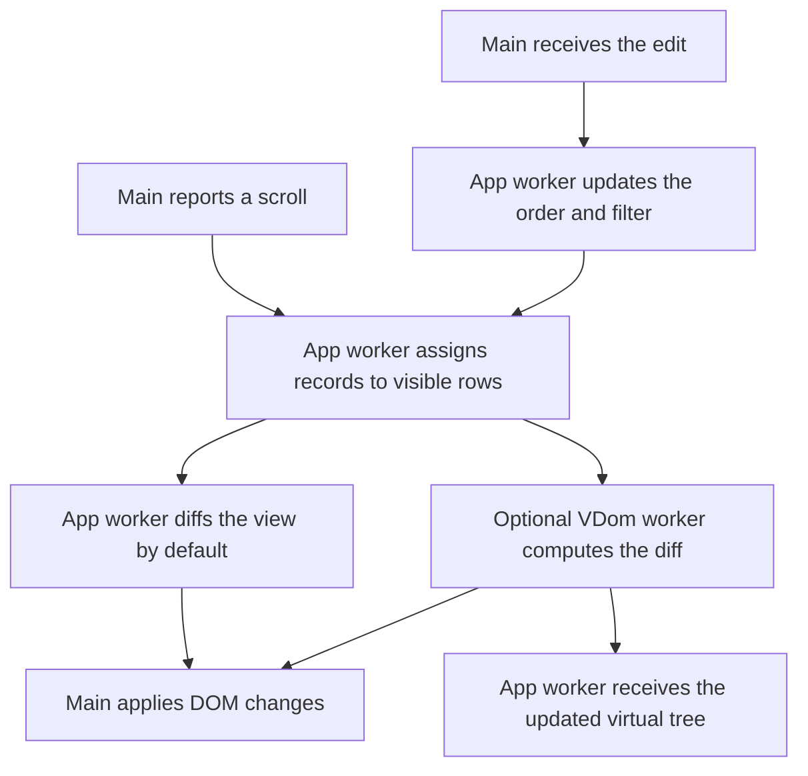

# Build an order-review desk

An order for more units than a customer can buy is easy to spot in a four-row spreadsheet.
Now put it on row 64,000. The person reviewing it still needs to see the order number, the
quantity limit and the effect of a correction, even when those columns are a screen apart.

Build that desk in two live labs. The first gives the grid more records than it could sensibly
mount at once. The second keeps the order number and settlement details in sight while you edit.
Both use the order model and deterministic data generator from the **Order Review Desk** example.
Each preview has its own in-memory Store. Re-running a snippet gives you a fresh set of orders.
You can work entirely in the page. If you have an engine checkout, the companion's
`examples/grid/orderReviewDesk/orderData.mjs` supplies the orders and their quantity limit.
`OrderModel.mjs` calculates each order's total and checks its quantity against that limit.

## Give the grid twenty orders

Open **Preview**. Find `ORD-000004` and compare its quantity with its limit. The record's
identifier belongs to the order and stays the same when you scroll. Its position on the screen
belongs to the grid.

```javascript live-preview
import Grid from '../grid/Container.mjs';
import Order from '../../examples/grid/orderReviewDesk/OrderModel.mjs';
import {generateOrders} from '../../examples/grid/orderReviewDesk/orderData.mjs';

class MainView extends Grid {
    static config = {
        className: 'Tutorials.OrderReview.Orders.MainView',
        cls      : ['order-review-sample'],
        height   : 280,
        store    : {
            model          : Order,
            keyProperty    : 'orderId',
            autoInitRecords: false,
            data           : generateOrders(20)
        },
        columns: [
            {dataField: 'orderId',     text: 'Order',    width: 130},
            {dataField: 'customer',    text: 'Customer', flex: 1},
            {dataField: 'quantity',    text: 'Quantity', width: 100},
            {dataField: 'maxOrderQty', text: 'Limit',    width: 80}
        ]
    }
}

MainView = Neo.setupClass(MainView);
```

### Predict how many rows the browser will need

In the browser's developer tools, inspect the first preview's grid. The following expression
in the page console reports the mounted rows and the order IDs at either end of that pool.
Run it once with twenty orders.

```javascript readonly
function sampleOrders() {
    const body = document.querySelector('.order-review-sample .neo-grid-body');
    const ids = [...body.querySelectorAll('.neo-grid-cell[data-field="orderId"]')]
        .map(cell => cell.textContent.trim()).sort();
    return {mounted: ids.length, lowestOrder: ids[0], highestOrder: ids.at(-1)};
}
sampleOrders()
```

Switch to **Source**, change `generateOrders(20)` to `generateOrders(100000)`, and open
**Preview** again. Before running `sampleOrders()`, predict which values will change while
you stay at the top. With the same viewport, the grid can still show the same range of IDs
using the same row pool. Now drag the **grid's vertical scrollbar** to the bottom, wait for the
rows to settle, and run it again. The highest ID should be `ORD-100000`. The mounted count stays close to what
fits in 280 pixels plus a small buffer. The exact count depends on the theme, row height and
where you stop scrolling. The cells carry the public order numbers. Sorting these zero-padded
IDs makes the sample independent of the order in which the grid recycles its DOM nodes.

Two different costs are at work. `generateOrders` creates all the raw data in the App worker.
With `autoInitRecords: false`, the Store can retain raw rows and create record instances as needed.
Separately, the grid reuses a pool of row components as its visible range moves. Making the grid
taller can grow the pool. Giving the same viewport another 99,980 orders needn't add 99,980 DOM rows.

## Keep the right order in sight during an edit

Horizontal scrolling poses a different problem. Once the customer and item columns have scrolled
away, how do you know whose quantity you're changing? Keep the order ID on the start edge and
the outcome on the end edge. Group the center columns by the question they answer.

Open the second preview. Scroll horizontally inside the grid. **Order** and **Settlement**
stay in place while **Customer** and **Line Item** move. Each `columns` entry with children
makes a header above their captions. Locking the Settlement group keeps its two columns together.

```javascript live-preview
import NumberField from '../form/field/Number.mjs';
import Grid from '../grid/Container.mjs';
import Order from '../../examples/grid/orderReviewDesk/OrderModel.mjs';
import {generateOrders} from '../../examples/grid/orderReviewDesk/orderData.mjs';

class MainView extends Grid {
    static config = {
        className  : 'Tutorials.OrderReview.Repair.MainView',
        height     : 320,
        cellEditing: true,
        store      : {
            model          : Order,
            keyProperty    : 'orderId',
            autoInitRecords: false,
            data           : generateOrders(100000)
        },
        columns: [
            {dataField: 'orderId', text: 'Order', locked: 'start', width: 114},
            {text: 'Customer', columns: [
                {dataField: 'customer', text: 'Customer', width: 200},
                {dataField: 'region',   text: 'Region',   width: 100}
            ]},
            {text: 'Line Item', columns: [
                {dataField: 'item',        text: 'Item',     width: 200},
                {dataField: 'quantity',    text: 'Quantity', width: 100, editable: true,
                    editor: {module: NumberField, clearable: false, minValue: 1, maxValue: 50}},
                {dataField: 'maxOrderQty', text: 'Limit',    width: 80},
                {dataField: 'unitPrice',   text: 'Price',    width: 90}
            ]},
            {text: 'Settlement', locked: 'end', columns: [
                {dataField: 'lineTotal',       text: 'Total',  width: 82, type: 'currency'},
                {dataField: 'exceptionReason', text: 'Status', width: 150}
            ]}
        ]
    }
}

MainView = Neo.setupClass(MainView);
```

Find `ORD-000004` again. It contains 74 units at $95 each, with a limit of 50. Predict the
total for one unit. Double-click **Quantity**, enter `1`, and press **Enter**. Settlement drops
from $7,030.00 to $95.00, the status reads **OK**, and the order ID stays in place. Try
another edit and press **Escape** to keep the previous value. The editor enforces the 1–50
range for new entries. The model also checks incoming data, which is how the original 74
appeared in the review queue.

### Turn the same grid into a repair queue

In the second preview's **Source**, insert this entry immediately before `data: generateOrders(100000)`
inside `store`. Open **Preview** again. The source change reruns the example and restores the
original quantities, including the one you just corrected.

```javascript readonly
filters: [{property: 'hasException', value: true, reapplyOnRecordChange: true}],
```

Six orders qualify. Write down the first ID. If the refreshed view has scrolled back to the
start, scroll horizontally until **Quantity** is visible again. Change its value to `1`. This time
the row disappears and five orders remain. The edit updates the record, the model recalculates
`hasException`, and the Store reapplies the filter. The grid displays the remaining records.
Remove the filter to start a fresh run, or keep it and clear all six. An empty queue is the
successful outcome.

## Follow one correction to the screen

The browser receives your keystroke on Main. The App worker owns the edit, Store and row pool.
Changing an order produces a small set of DOM updates. Scrolling starts from a different event
and uses the same rendering path.



Open the [Order Review Desk](https://neomjs.com/examples/grid/orderReviewDesk/) or run
`examples/grid/orderReviewDesk/index.html` in your engine checkout. Switch between all orders
and exceptions there to see how a single Store preserves a correction across views.
For the grid's configuration options, read [Grids](../guides/datahandling/Grids.md).
For the render path and acknowledgement, see [The VDOM engine](../guides/vdomengine/Overview.md).
