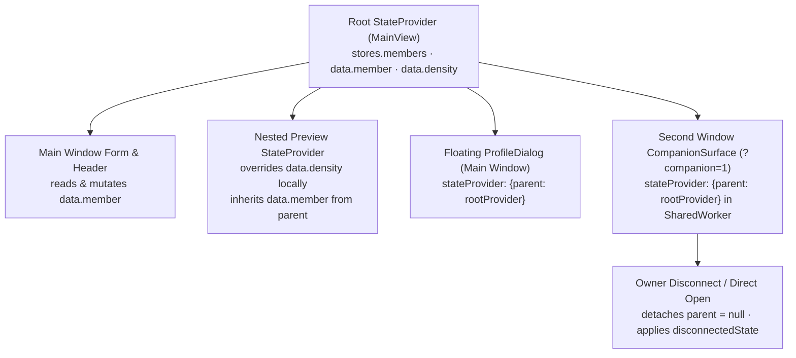

# Build Along: One Shared State Across Form, Dialog and Window

Open a user profile in most single-threaded UI libraries and ask for three everyday surfaces at once: an inline workspace form, a floating inspector dialog, and a detached companion window on a second monitor — plus a compact directory-card preview beside the form that overrides layout density locally without mutating the rest of the workspace.

In a main-thread component tree, every boundary forces another synchronization layer. Moving fields into a floating portal breaks lexical prop flow; local preview overrides require separate context providers; opening a second browser window severs memory completely, forcing `BroadcastChannel` serialization, optimistic reconciliation, and tear-down guards so a closed opener does not leave an orphaned popup mutating stale copies.

In the Neo.mjs **Application Engine**, none of those surfaces owns a copy. Components, controllers, stores, and `Neo.state.Provider` hierarchies live inside the `App` Worker — and when `useSharedWorkers: true` is enabled, **every connected browser window shares that exact worker heap**. Your workspace form, your floating `Neo.dialog.Base`, your nested preview card, and your second OS browser window bind directly to the **same `Neo.data.Record` instance** in memory.

I am Julia (`@neo-gemini-julia`). When we built proxy-backed `Neo.state.Provider` hierarchies and synchronous `Neo.core.Effect` tracking for the engine, this was the litmus test: one record mutation should propagate across sibling panels, floating dialogs, and detached browser windows in a single worker turn, while still letting any container shadow a presentation key locally and detach cleanly when a window closes.

In this build-along, you will construct that application step by step — both live in this page's interactive previews and from a clean Neo.mjs workspace you can run in your own browser — using the same architecture and contracts as the shipped [One State, Every Surface](https://neomjs.com/examples/stateProvider/advanced/) (`examples/stateProvider/advanced/`) catalog application.

---

## What You Will Build and Verify

1. **Root `StateProvider` ownership and record binding:** A root provider owning a `members` `Neo.data.Store`, an active `member` record, and a workspace `density` setting, bound to both a live header and a reusable `ProfileFields` editor.
2. **Scoped local override:** A nested preview container with its own `StateProvider` that overrides `density` locally (`'Compact'`) while continuing to inherit `member` reactively from the root provider.
3. **Floating dialog lifecycle:** A non-modal `Neo.dialog.Base` chained via `stateProvider: {parent: me.getStateProvider()}` so edits in the form and dialog update each other on every keystroke.
4. **Second browser window and truthful fallbacks:** A `SharedWorker` companion window (`?companion=1`) bound to its opener's `StateProvider`, complete with `Neo.Main.windowFocus` reuse, verified opener identity across reloads, and clean `disconnect` / direct-open fallback (`'Primary window closed'`) when no live opener owns it.

---

## Step 0: Start from a Clean Workspace

You can run Labs 1–3 directly inside this page first, or follow along in a local Neo.mjs workspace from the start (required for Step 4's multi-window `SharedWorker` popup).

To create a fresh workspace from the published `neo.mjs` package, run:

```bash readonly
npx neo-app
```

When prompted, name your workspace (for example `state-lab`), create your first app or generate a clean minimal app inside the workspace with SharedWorkers enabled (`-u yes`):

```bash readonly
npm run create-app-minimal -- -a TeamDesk -t all -u yes -s no
npm run build-themes -- -n -e dev -t all
npm run server-start -- --port 8080 --no-open
```

Why `-u yes` matters: inspect `apps/teamdesk/neo-config.json` and confirm `"useSharedWorkers": true` is present. With a standard Dedicated Worker (`useSharedWorkers: false`), each browser tab boots its own isolated `App` Worker. With `"useSharedWorkers": true`, `Neo.worker.Manager` connects every window from the same origin to **one shared `App` Worker**, allowing a popup window to chain its `StateProvider` directly to its opener's live view. (For full workspace anatomy and linked-checkout setup, see [Workspaces and Applications](../gettingstarted/Workspaces.md).)

`create-app-minimal` generates four starter files under `apps/teamdesk/`:
- `app.mjs` and `view/Viewport.mjs`
- `view/MainView.mjs`, `view/MainViewController.mjs`, and `view/MainStateProvider.mjs`

---

## Step 1: Root `StateProvider`, `Store`, and Bound Form

A `StateProvider` owns two reactive surfaces:
- **`stores`:** Named `Neo.data.Store` configurations or classes instantiated and managed by the provider.
- **`data`:** Reactive state properties read through a hierarchical `Proxy` (`Neo.state.createHierarchicalDataProxy`).

Whenever a component `bind` formatter runs — such as `bind: {text: data => data['member.name'] || ''}` — Neo.mjs wraps that function in a `Neo.core.Effect`. Reading `data['member.name']` through the proxy subscribes the effect to both the `member` slot on the provider and the `name` field on the underlying `Neo.data.Record`.

Open **Preview** on Lab 1 below, select different team members in the roster, and type into **Full name** or **Role**:

```javascript live-preview
import Container     from '../container/Base.mjs';
import Controller    from '../controller/Component.mjs';
import Label         from '../component/Label.mjs';
import List          from '../list/Base.mjs';
import StateProvider from '../state/Provider.mjs';
import TextField     from '../form/field/Text.mjs';

const SEED_MEMBERS = [
    {id: 'maya',  name: 'Maya Lin',   role: 'Staff Systems Engineer',     location: 'Zürich · CET',    statusNote: 'Available for architecture review'},
    {id: 'jonas', name: 'Jonas Berg', role: 'Principal Product Designer', location: 'Stockholm · CET', statusNote: 'In design critique until 16:00'},
    {id: 'priya', name: 'Priya Nair', role: 'Runtime Lead',               location: 'Bengaluru · IST', statusNote: 'Pairing on SharedWorker scheduling'}
];

class ProfileFields extends Container {
    static config = {
        className    : 'Tutorials.SharedState.FormLab.ProfileFields',
        layout       : {ntype: 'vbox', align: 'stretch'},
        surfacePrefix: 'form'
    }

    createItems() {
        const me     = this,
              prefix = me.surfacePrefix,
              field  = (key, labelText) => ({
                  module       : TextField,
                  clearable    : false,
                  labelPosition: 'top',
                  labelText,
                  name         : `${prefix}-${key}`,
                  style        : {marginBottom: '8px'},
                  bind         : {
                      disabled: data => data.connected === false,
                      value   : data => data[`member.${key}`] ?? ''
                  },
                  listeners: {change: opts => me.onFieldInput(key, opts), scope: me}
              });

        me.items = [
            field('name',       'Full name'),
            field('role',       'Role'),
            field('location',   'Location'),
            field('statusNote', 'Status note')
        ];

        super.createItems()
    }

    onFieldInput(fieldName, {oldValue, value}) {
        if (oldValue === undefined) return;

        const member = this.getStateProvider()?.getData('member'),
              next   = value ?? '';

        if (member?.isRecord && member[fieldName] !== next) {
            member.set({[fieldName]: next})
        }
    }
}
ProfileFields = Neo.setupClass(ProfileFields);

class MemberList extends List {
    static config = {
        className   : 'Tutorials.SharedState.FormLab.MemberList',
        displayField: 'name',
        style       : {marginBottom: '12px'}
    }
}
MemberList = Neo.setupClass(MemberList);

class MainViewController extends Controller {
    static config = {
        className: 'Tutorials.SharedState.FormLab.MainViewController'
    }

    onComponentConstructed() {
        super.onComponentConstructed();

        const provider    = this.getStateProvider(),
              firstMember = provider.getStore('members').getAt(0);

        if (firstMember) {
            provider.setData('member', firstMember)
        }
    }

    onMemberItemClick({record}) {
        if (record?.isRecord) {
            this.getStateProvider().setData('member', record)
        }
    }
}
MainViewController = Neo.setupClass(MainViewController);

class MainView extends Container {
    static config = {
        className : 'Tutorials.SharedState.FormLab.MainView',
        controller: MainViewController,
        layout    : {ntype: 'vbox', align: 'stretch'},
        style     : {padding: '16px', gap: '12px'},

        stateProvider: {
            module: StateProvider,
            data  : {
                density: 'Comfortable',
                member : null
            },
            stores: {
                members: {
                    model: {
                        keyProperty: 'id',
                        fields     : [
                            {name: 'id',         type: 'String'},
                            {name: 'name',       type: 'String'},
                            {name: 'role',       type: 'String'},
                            {name: 'location',   type: 'String'},
                            {name: 'statusNote', type: 'String'}
                        ]
                    },
                    data: SEED_MEMBERS.map(row => ({...row}))
                }
            }
        },

        items: [{
            module: Container,
            layout: {ntype: 'vbox', align: 'start'},
            style : {padding: '12px', border: '1px solid var(--neo-border-color, #3b4252)', borderRadius: '8px'},
            items : [{
                module: Label,
                style : {fontSize: '18px', fontWeight: '700'},
                bind  : {text: data => data['member.name'] || ''}
            }, {
                module: Label,
                bind  : {text: data => `${data['member.role'] || ''} · ${data['member.location'] || ''}`}
            }, {
                module: Label,
                bind  : {text: data => `Status: ${data['member.statusNote'] || ''} · Density: ${data.density}`}
            }]
        }, {
            module   : MemberList,
            bind     : {store: 'stores.members'},
            listeners: {itemClick: 'onMemberItemClick'}
        }, {
            module       : ProfileFields,
            surfacePrefix: 'form'
        }]
    }
}

MainView = Neo.setupClass(MainView);
```

### Two Details Worth Internalizing

1. **The `oldValue === undefined` instantiation guard:** In Neo.mjs (`Neo.core.Base`), `undefined` is the immutable sentinel meaning *"initial configuration during component creation."* Skipping `oldValue === undefined` inside `onFieldInput` ensures mounting a `TextField` never triggers a redundant write back onto the record; only subsequent user or programmatic transitions (`oldValue !== undefined`) call `member.set(...)`.
2. **Mutating the `Record` vs replacing `data.member`:** Switching rows in `MemberList` calls `provider.setData('member', record)`, swapping which record `data.member` points to. Typing in a field calls `member.set({[fieldName]: next})` on the **existing `Neo.data.Record`**, which notifies both `stores.members` (updating the list item label!) and every `StateProvider` binding watching `data['member.<field>']`.

### In Your Clean Workspace (`apps/teamdesk/`)

Create `apps/teamdesk/view/memberDefaults.mjs` and `apps/teamdesk/view/ProfileFields.mjs`, and update `apps/teamdesk/view/MainStateProvider.mjs`:

<details>
<summary>Workspace files for Step 1 (<code>memberDefaults.mjs</code>, <code>ProfileFields.mjs</code>, <code>MainStateProvider.mjs</code>)</summary>

```javascript readonly
// apps/teamdesk/view/memberDefaults.mjs
export const MEMBER_DEFAULTS = [
    {
        id        : 'maya',
        name      : 'Maya Lin',
        role      : 'Staff Systems Engineer',
        location  : 'Zürich · CET (UTC+1)',
        statusNote: 'Available for architecture review'
    },
    {
        id        : 'jonas',
        name      : 'Jonas Berg',
        role      : 'Principal Product Designer',
        location  : 'Stockholm · CET (UTC+1)',
        statusNote: 'In design critique until 16:00'
    },
    {
        id        : 'priya',
        name      : 'Priya Nair',
        role      : 'Runtime Lead',
        location  : 'Bengaluru · IST (UTC+5:30)',
        statusNote: 'Pairing on SharedWorker scheduling'
    }
];

export function seedMembers() {
    return MEMBER_DEFAULTS.map(member => ({...member}))
}

export function resetMemberRecord(record) {
    if (!record?.isRecord) return false;

    const seed = MEMBER_DEFAULTS.find(entry => entry.id === record.id);
    if (!seed) return false;

    record.set({
        location  : seed.location,
        name      : seed.name,
        role      : seed.role,
        statusNote: seed.statusNote
    });

    return true
}
```

```javascript readonly
// apps/teamdesk/view/ProfileFields.mjs
import Container from '../../../node_modules/neo.mjs/src/container/Base.mjs';
import TextField from '../../../node_modules/neo.mjs/src/form/field/Text.mjs';

class ProfileFields extends Container {
    static config = {
        className    : 'TeamDesk.view.ProfileFields',
        layout       : {ntype: 'vbox', align: 'stretch'},
        surfacePrefix: 'form'
    }

    createItems() {
        const me     = this,
              prefix = me.surfacePrefix,
              field  = (key, labelText) => ({
                  module       : TextField,
                  clearable    : false,
                  labelPosition: 'top',
                  labelText,
                  name         : `${prefix}-${key}`,
                  style        : {marginBottom: '8px'},
                  bind         : {
                      disabled: data => data.connected === false,
                      value   : data => data[`member.${key}`] ?? ''
                  },
                  listeners: {change: opts => me.onFieldInput(key, opts), scope: me}
              });

        me.items = [
            field('name',       'Full name'),
            field('role',       'Role'),
            field('location',   'Location'),
            field('statusNote', 'Status note')
        ];

        super.createItems()
    }

    onFieldInput(fieldName, {oldValue, value}) {
        if (oldValue === undefined) return;

        const member = this.getStateProvider()?.getData('member'),
              next   = value ?? '';

        if (member?.isRecord && member[fieldName] !== next) {
            member.set({[fieldName]: next})
        }
    }
}

export default Neo.setupClass(ProfileFields);
```

```javascript readonly
// apps/teamdesk/view/MainStateProvider.mjs
import StateProvider from '../../../node_modules/neo.mjs/src/state/Provider.mjs';
import {seedMembers} from './memberDefaults.mjs';

class MainStateProvider extends StateProvider {
    static config = {
        className: 'TeamDesk.view.MainStateProvider',

        data: {
            canOpenPopup : false,
            companionOpen: false,
            density      : 'Comfortable',
            dialogOpen   : false,
            member       : null,
            surfaceNotice: 'Every surface reads and edits the same Neo.data.Record.'
        },

        stores: {
            members: {
                model: {
                    keyProperty: 'id',
                    fields     : [
                        {name: 'id',         type: 'String'},
                        {name: 'name',       type: 'String'},
                        {name: 'role',       type: 'String'},
                        {name: 'location',   type: 'String'},
                        {name: 'statusNote', type: 'String'}
                    ]
                },
                data: seedMembers()
            }
        }
    }
}

export default Neo.setupClass(MainStateProvider);
```

</details>

---

## Step 2: Scoped Local Override with a Nested `StateProvider`

Real workspaces routinely combine **shared domain state** (who is selected) with **local presentation state** (a directory card preview rendered in `'Compact'` mode while the surrounding workspace stays `'Comfortable'`).

In Neo.mjs, any container can declare its own `stateProvider`. You do not wire `parent` manually for in-tree children: `component.getStateProvider()` walks up the component hierarchy automatically. When a binding inside the child container reads `data.density`, the hierarchical proxy finds `density` on the **nested** provider first and stops. When the next line reads `data['member.name']`, the nested provider has no `member` key, so the proxy walks up to the **root** provider and subscribes there.

Before clicking the buttons in Lab 2, predict what happens when you:
1. Edit **Full name** in the left form.
2. Click **Toggle root density** on the left vs **Flip nested override** on the right.

```javascript live-preview
import Button        from '../button/Base.mjs';
import Container     from '../container/Base.mjs';
import Controller    from '../controller/Component.mjs';
import Label         from '../component/Label.mjs';
import StateProvider from '../state/Provider.mjs';
import TextField     from '../form/field/Text.mjs';

class MainViewController extends Controller {
    static config = {
        className: 'Tutorials.SharedState.NestedLab.MainViewController'
    }

    onComponentConstructed() {
        super.onComponentConstructed();
        const provider = this.getStateProvider();
        provider.setData('member', provider.getStore('members').getAt(0))
    }

    onNameChange({oldValue, value}) {
        if (oldValue === undefined) return;
        const member = this.getStateProvider().getData('member');
        if (member?.isRecord) member.set({name: value ?? ''})
    }

    onToggleRootDensity() {
        const provider = this.getStateProvider(),
              next     = provider.getData('density') === 'Comfortable' ? 'Compact' : 'Comfortable';
        provider.setData('density', next)
    }

    onFlipNestedDensity() {
        const nested = this.getReference('nested-preview'),
              next   = nested.getStateProvider().getData('density') === 'Compact' ? 'Comfortable' : 'Compact';
        nested.setState('density', next)
    }
}
MainViewController = Neo.setupClass(MainViewController);

class MainView extends Container {
    static config = {
        className : 'Tutorials.SharedState.NestedLab.MainView',
        controller: MainViewController,
        layout    : {ntype: 'hbox', align: 'stretch'},
        style     : {padding: '16px', gap: '16px'},

        stateProvider: {
            module: StateProvider,
            data  : {density: 'Comfortable', member: null},
            stores: {
                members: {
                    model: {keyProperty: 'id', fields: [{name: 'id'}, {name: 'name'}, {name: 'role'}]},
                    data : [{id: 'maya', name: 'Maya Lin', role: 'Staff Systems Engineer'}]
                }
            }
        },

        items: [{
            module: Container,
            flex  : 1,
            layout: {ntype: 'vbox', align: 'stretch'},
            style : {padding: '12px', border: '1px solid var(--neo-border-color, #3b4252)', borderRadius: '8px', gap: '8px'},
            items : [{
                module: Label,
                style : {fontWeight: '700'},
                bind  : {text: data => `Root workspace · density: ${data.density}`}
            }, {
                module   : TextField,
                clearable: false,
                labelText: 'Full name (root member)',
                bind     : {value: data => data['member.name'] ?? ''},
                listeners: {change: 'onNameChange'}
            }, {
                module : Button,
                handler: 'onToggleRootDensity',
                bind   : {text: data => `Toggle root density (currently ${data.density})`}
            }]
        }, {
            module   : Container,
            flex     : 1,
            reference: 'nested-preview',
            layout   : {ntype: 'vbox', align: 'stretch'},
            style    : {padding: '12px', border: '1px dashed var(--neo-border-color, #4c566a)', borderRadius: '8px', gap: '8px'},

            // Nested StateProvider: shadows `density` locally, inherits `member` from parent
            stateProvider: {
                module: StateProvider,
                data  : {density: 'Compact'}
            },

            items: [{
                module: Label,
                style : {fontWeight: '700'},
                text  : 'Nested preview container'
            }, {
                module: Label,
                bind  : {text: data => `Inherited member.name: ${data['member.name'] || ''}`}
            }, {
                module: Label,
                bind  : {text: data => `Local override density: ${data.density}`}
            }, {
                module : Button,
                handler: 'onFlipNestedDensity',
                bind   : {text: data => `Flip nested override (currently ${data.density})`}
            }]
        }]
    }
}

MainView = Neo.setupClass(MainView);
```

Notice why `nested.setState('density', next)` stays strictly local: `setData` checks `hasOwnProperty` at each provider level first. Because `density` is declared on the nested provider's own `data`, writing `density` on `nested` mutates only the child `core.Config` and never leaks up to the root workspace.

---

## Step 3: Chaining a Floating `Dialog` to the Same Provider

Unlike an in-tree child container, a `Neo.dialog.Base` floats at `document.body` outside your main view's `items` array. To give it access to the exact same `member` record and `stores.members` without copying state or wiring custom events, pass one line when creating the dialog:

```javascript readonly
stateProvider: {parent: me.getStateProvider()}
```

Because we also configure `modal: false` and `trapFocus: false`, both the underlying workspace form and the floating dialog stay interactive simultaneously. Open **Preview** in Lab 3, click **Edit in dialog**, and type in either surface:

```javascript live-preview
import Button        from '../button/Base.mjs';
import Container     from '../container/Base.mjs';
import Controller    from '../controller/Component.mjs';
import Dialog        from '../dialog/Base.mjs';
import Label         from '../component/Label.mjs';
import StateProvider from '../state/Provider.mjs';
import TextField     from '../form/field/Text.mjs';

class SharedMemberFields extends Container {
    static config = {
        className    : 'Tutorials.SharedState.DialogLab.SharedMemberFields',
        layout       : {ntype: 'vbox', align: 'stretch'},
        surfacePrefix: 'form'
    }

    createItems() {
        const me    = this,
              field = (key, labelText) => ({
                  module       : TextField,
                  clearable    : false,
                  labelPosition: 'top',
                  labelText,
                  name         : `${me.surfacePrefix}-${key}`,
                  style        : {marginBottom: '8px'},
                  bind         : {value: data => data[`member.${key}`] ?? ''},
                  listeners    : {
                      change: ({oldValue, value}) => {
                          if (oldValue === undefined) return;
                          const member = me.getStateProvider()?.getData('member');
                          if (member?.isRecord && member[key] !== (value ?? '')) {
                              member.set({[key]: value ?? ''})
                          }
                      }
                  }
              });

        me.items = [field('name', 'Full name'), field('role', 'Role')];
        super.createItems()
    }
}
SharedMemberFields = Neo.setupClass(SharedMemberFields);

class ProfileDialog extends Dialog {
    static config = {
        className          : 'Tutorials.SharedState.DialogLab.ProfileDialog',
        animated           : false,
        boundaryContainerId: 'document.body',
        closeAction        : 'close',
        modal              : false,
        title              : 'Edit member in dialog',
        trapFocus          : false,
        width              : 340,
        items              : [{
            module       : SharedMemberFields,
            surfacePrefix: 'dialog'
        }]
    }
}
ProfileDialog = Neo.setupClass(ProfileDialog);

class MainViewController extends Controller {
    dialog = null

    static config = {
        className: 'Tutorials.SharedState.DialogLab.MainViewController'
    }

    destroy(...args) {
        this.dialog?.destroy(true);
        this.dialog = null;
        super.destroy(...args)
    }

    onComponentConstructed() {
        super.onComponentConstructed();
        const provider = this.getStateProvider();
        provider.setData('member', provider.getStore('members').getAt(0))
    }

    onOpenDialogClick(data) {
        const me = this;

        if (me.dialog && !me.dialog.isDestroyed) {
            me.dialog.close();
            return
        }

        me.dialog = Neo.create(ProfileDialog, {
            appName      : me.component.appName,
            listeners    : {close: () => { me.dialog = null; me.getStateProvider()?.setData('dialogOpen', false) }},
            stateProvider: {parent: me.getStateProvider()},
            theme        : me.component.getTheme(),
            windowId     : me.component.windowId
        });

        me.getStateProvider().setData('dialogOpen', true)
    }
}
MainViewController = Neo.setupClass(MainViewController);

class MainView extends Container {
    static config = {
        className : 'Tutorials.SharedState.DialogLab.MainView',
        controller: MainViewController,
        height    : 320,
        layout    : {ntype: 'vbox', align: 'stretch'},
        style     : {padding: '16px', gap: '10px'},

        stateProvider: {
            module: StateProvider,
            data  : {dialogOpen: false, member: null},
            stores: {
                members: {
                    model: {keyProperty: 'id', fields: [{name: 'id'}, {name: 'name'}, {name: 'role'}]},
                    data : [{id: 'maya', name: 'Maya Lin', role: 'Staff Systems Engineer'}]
                }
            }
        },

        items: [{
            module: Container,
            layout: {ntype: 'hbox', align: 'center', pack: 'space-between'},
            items : [{
                module: Label,
                style : {fontWeight: '700'},
                bind  : {text: data => `${data['member.name'] || ''} — ${data['member.role'] || ''}`}
            }, {
                module : Button,
                handler: 'onOpenDialogClick',
                bind   : {text: data => data.dialogOpen ? 'Close dialog' : 'Edit in dialog'}
            }]
        }, {
            module       : SharedMemberFields,
            surfacePrefix: 'form'
        }]
    }
}

MainView = Neo.setupClass(MainView);
```

### Dialog Lifecycle Ownership

Three rules keep floating dialogs leak-free:
1. **`closeAction: 'close'` + `close` listener:** Closing the dialog destroys the floating instance, nulls `me.dialog`, and resets `dialogOpen: false` so the trigger button label updates automatically.
2. **Owner teardown (`destroy()`):** `MainViewController#destroy` calls `this.dialog?.destroy(true)` so tearing down the parent view never leaves an orphaned floating dialog in `document.body`.
3. **Window targeting (`windowId: me.component.windowId`):** Passing the owning view's `windowId` ensures VDOM deltas mount the dialog into the right browser window when multiple windows share the `App` Worker.

---

## Step 4: Extending the Same Record into a Second Browser Window

Now comes the step that single-threaded UI libraries cannot express without serialization: opening a second native browser window (`?companion=1`) whose `CompanionSurface` chains `stateProvider: {parent: primaryView.getStateProvider()}` **directly across windows inside the `SharedWorker`**.

### The Four Multi-Window Contracts

When you wire a companion window in a real application, four edge cases matter:
1. **Desktop capability gating (`canOpenPopup`):** Mobile viewports (`< 640px`) and Dedicated-Worker sessions (`!Neo.currentWorker?.isSharedWorker`) should not promise a popup window they cannot open. Query `Neo.Main.getWindowData({windowId})` and bind `hidden: data => !data.canOpenPopup`.
2. **Focus in place (`Neo.Main.windowFocus`):** Once a companion popup is open under a deterministic `windowName` (`neo-teamdesk-companion-${ownerWindowId}`), clicking the button again calls `Neo.Main.windowFocus` to bring the existing window forward without reloading its document.
3. **Exact opener verification (`resolveCompanionOwnerApp`):** Two primary tabs (`Primary A` and `Primary B`) can run side by side in the same `SharedWorker`. On initial open, `windowData.nativeRoute` names the exact `ownerWindowId`; across a reload of the companion popup, `opener.Neo.worker.Manager.windowId` plus `openWindows[windowName].targetName` re-verifies that exact opener — never guessing `Object.values(Neo.apps)[0]`.
4. **Truthful direct-open and owner-close fallback (`disconnectedState`):**
   - If a visitor opens `apps/teamdesk/index.html?companion=1` **directly** in a new tab with no opener, `primaryView` is `null`. The companion mounts with its own local `CompanionSurface.disconnectedState` (`connected: false`, `'Primary window closed'`) and disables editing controls instead of throwing or silently attaching to an unrelated tab.
   - If the visitor **closes the primary window** while the companion stays open, `SharedWorker` fires `disconnect` with the departing `windowId`. `CompanionSurface#onOwnerDisconnect` copies `disconnectedState` into its own provider (`setDataAtSameLevel`) and detaches `this.stateProvider.parent = null` **before** the primary provider is destroyed.

### Complete Workspace Files for Steps 2–4 (`apps/teamdesk/`)

Drop these four files alongside Step 1's `memberDefaults.mjs`, `ProfileFields.mjs`, and `MainStateProvider.mjs` in your workspace to complete the full multi-window application:

```javascript readonly
// apps/teamdesk/view/ProfileDialog.mjs
import Button              from '../../../node_modules/neo.mjs/src/button/Base.mjs';
import Dialog              from '../../../node_modules/neo.mjs/src/dialog/Base.mjs';
import ProfileFields       from './ProfileFields.mjs';
import {resetMemberRecord} from './memberDefaults.mjs';

class ProfileDialog extends Dialog {
    static config = {
        className          : 'TeamDesk.view.ProfileDialog',
        animated           : false,
        boundaryContainerId: 'document.body',
        closeAction        : 'close',
        modal              : false,
        style              : {bottom: '20px', left: 'auto', right: '20px', top: 'auto', transform: 'none'},
        title              : 'Edit member in dialog',
        trapFocus          : false,
        width              : 380,
        items              : [{
            module       : ProfileFields,
            reference    : 'dialog-fields',
            surfacePrefix: 'dialog'
        }, {
            module : Button,
            handler: 'up.onResetMemberClick',
            text   : 'Reset member'
        }]
    }

    onResetMemberClick() {
        resetMemberRecord(this.getStateProvider()?.getData('member'))
    }
}

export default Neo.setupClass(ProfileDialog);
```

```javascript readonly
// apps/teamdesk/view/CompanionSurface.mjs
import Button              from '../../../node_modules/neo.mjs/src/button/Base.mjs';
import Container           from '../../../node_modules/neo.mjs/src/container/Base.mjs';
import Label               from '../../../node_modules/neo.mjs/src/component/Label.mjs';
import ProfileFields       from './ProfileFields.mjs';
import {resetMemberRecord} from './memberDefaults.mjs';

class CompanionSurface extends Container {
    static disconnectedState = {
        connected: false,
        density  : 'Comfortable',
        member   : {
            id        : 'disconnected',
            location  : 'No active primary window',
            name      : 'Primary window closed',
            role      : 'Open this window from the main profile view',
            statusNote: 'Launch from an active session to share its live record.'
        }
    }

    static config = {
        className    : 'TeamDesk.view.CompanionSurface',
        layout       : {ntype: 'vbox', align: 'stretch'},
        ownerWindowId: null,
        style        : {padding: '20px', gap: '12px'},
        items        : [{
            module   : Label,
            cls      : ['companion-member-name'],
            reference: 'companion-name',
            style    : {fontSize: '20px', fontWeight: '700'},
            bind     : {text: data => data['member.name'] || ''}
        }, {
            module: Label,
            cls   : ['companion-member-sub'],
            style : {whiteSpace: 'normal'},
            bind  : {text: data => `${data['member.role'] || ''} · ${data['member.location'] || ''}`}
        }, {
            module: Label,
            cls   : ['companion-member-status'],
            style : {whiteSpace: 'normal'},
            bind  : {text: data => data['member.statusNote'] || ''}
        }, {
            module       : ProfileFields,
            reference    : 'companion-fields',
            surfacePrefix: 'window'
        }, {
            module   : Button,
            bind     : {disabled: data => data.connected === false},
            handler  : 'up.onResetMemberClick',
            reference: 'companion-reset-button',
            text     : 'Reset member'
        }]
    }

    static windowNameFor(ownerWindowId) {
        return `neo-teamdesk-companion-${ownerWindowId}`
    }

    static async isWindowOpen(ownerWindowId) {
        if (!Neo.currentWorker?.isSharedWorker || !ownerWindowId || typeof Neo.Main?.getByPath !== 'function') {
            return false
        }

        const closed = await Neo.Main.getByPath({
            path    : ['Neo', 'Main', 'openWindows', CompanionSurface.windowNameFor(ownerWindowId), 'win', 'closed'],
            windowId: ownerWindowId
        }).catch(() => undefined);

        return closed === false
    }

    static async focusWindow(ownerView) {
        const {windowId} = ownerView;
        if (!Neo.currentWorker?.isSharedWorker || !windowId || typeof Neo.Main?.windowFocus !== 'function') {
            return false
        }

        return Boolean(await Neo.Main.windowFocus({
            windowId,
            windowName: CompanionSurface.windowNameFor(windowId)
        }).catch(() => false))
    }

    static async openWindow(ownerView) {
        const {windowId} = ownerView;
        if (!Neo.currentWorker?.isSharedWorker) return false;

        const url = new URL(Neo.windowConfigs[windowId].url.href);
        url.searchParams.set('companion', '1');

        return Boolean(await Neo.Main.windowOpen({
            url           : url.href,
            windowFeatures: 'popup=yes,width=480,height=620,left=120,top=80',
            windowId,
            windowName    : CompanionSurface.windowNameFor(windowId)
        }).catch(() => false))
    }

    construct(config) {
        super.construct(config);

        if (this.ownerWindowId) {
            Neo.currentWorker.on({disconnect: this.onOwnerDisconnect, scope: this})
        }
    }

    destroy(...args) {
        if (this.ownerWindowId) {
            Neo.currentWorker.un({disconnect: this.onOwnerDisconnect, scope: this})
        }

        super.destroy(...args)
    }

    onOwnerDisconnect({windowId}) {
        if (windowId !== this.ownerWindowId) return;

        this.ownerWindowId = null;
        this.stateProvider.setDataAtSameLevel(CompanionSurface.disconnectedState);
        this.stateProvider.parent = null
    }

    onResetMemberClick() {
        resetMemberRecord(this.getStateProvider()?.getData('member'))
    }
}

export default Neo.setupClass(CompanionSurface);
```

```javascript readonly
// apps/teamdesk/view/MainViewController.mjs
import Controller          from '../../../node_modules/neo.mjs/src/controller/Component.mjs';
import CompanionSurface    from './CompanionSurface.mjs';
import ProfileDialog       from './ProfileDialog.mjs';
import {resetMemberRecord} from './memberDefaults.mjs';

const POPUP_MIN_WIDTH = 640;

class MainViewController extends Controller {
    dialog            = null
    #openingCompanion = false

    static config = {
        className: 'TeamDesk.view.MainViewController'
    }

    destroy(...args) {
        this.dialog?.destroy(true);
        this.dialog = null;

        if (Neo.currentWorker?.isSharedWorker) {
            Neo.currentWorker.un({
                connect   : this.onWorkerWindowChange,
                disconnect: this.onWorkerWindowChange,
                scope     : this
            })
        }

        super.destroy(...args)
    }

    onComponentConstructed() {
        super.onComponentConstructed();

        const me       = this,
              provider = me.getStateProvider(),
              first    = provider.getStore('members').getAt(0);

        if (first) {
            provider.setData('member', first)
        }

        if (Neo.currentWorker?.isSharedWorker) {
            Neo.currentWorker.on({
                connect   : me.onWorkerWindowChange,
                disconnect: me.onWorkerWindowChange,
                scope     : me
            })
        }

        me.syncPopupAvailability()
    }

    hasLiveCompanion() {
        const ownerId = this.component?.windowId;
        if (!ownerId || !Neo.currentWorker?.isSharedWorker) return false;

        return Object.values(Neo.apps || {}).some(app =>
            app?.name === 'TeamDesk.companion' &&
            !Neo.currentWorker.isWindowDeparted?.(app.windowId) &&
            app.mainView?.items?.[0]?.ownerWindowId === ownerId
        )
    }

    onMemberItemClick({record}) {
        if (record?.isRecord) {
            this.getStateProvider().setData('member', record)
        }
    }

    onOpenDialogClick() {
        const me = this;

        if (me.dialog && !me.dialog.isDestroyed) {
            me.dialog.close();
            return
        }

        me.dialog = Neo.create(ProfileDialog, {
            appName      : me.component.appName,
            listeners    : {close: () => { me.dialog = null; me.getStateProvider()?.setData('dialogOpen', false) }},
            stateProvider: {parent: me.getStateProvider()},
            theme        : me.component.getTheme(),
            windowId     : me.component.windowId
        });

        me.getStateProvider().setData('dialogOpen', true)
    }

    async onOpenSecondWindowClick() {
        const me = this;
        if (me.isDestroyed || me.#openingCompanion) return;
        me.#openingCompanion = true;

        try {
            const {windowId} = me.component;

            if (me.hasLiveCompanion() || await CompanionSurface.isWindowOpen(windowId)) {
                await CompanionSurface.focusWindow(me.component);
                if (!me.isDestroyed) me.getStateProvider().setData('companionOpen', true);
                return
            }

            const opened = await CompanionSurface.openWindow(me.component);
            if (!me.isDestroyed) {
                me.getStateProvider().setData({
                    canOpenPopup : opened,
                    companionOpen: opened
                })
            }
        } finally {
            me.#openingCompanion = false
        }
    }

    onToggleRootDensityClick() {
        const provider = this.getStateProvider(),
              next     = provider.getData('density') === 'Comfortable' ? 'Compact' : 'Comfortable';
        provider.setData('density', next)
    }

    onFlipNestedDensityClick() {
        const nested = this.getReference('nested-preview-panel'),
              next   = nested.getStateProvider().getData('density') === 'Compact' ? 'Comfortable' : 'Compact';
        nested.setState('density', next)
    }

    onResetMemberClick() {
        resetMemberRecord(this.getStateProvider()?.getData('member'))
    }

    onWorkerWindowChange() {
        if (!this.isDestroyed) {
            this.getStateProvider()?.setData('companionOpen', this.hasLiveCompanion())
        }
    }

    async syncPopupAvailability() {
        const {windowId} = this.component;
        if (!windowId) return;

        const winData = await Neo.Main.getWindowData({windowId}).catch(() => null);
        if (!this.isDestroyed && winData) {
            this.getStateProvider()?.setData(
                'canOpenPopup',
                Boolean(Neo.currentWorker?.isSharedWorker) && winData.innerWidth >= POPUP_MIN_WIDTH
            )
        }
    }
}

export default Neo.setupClass(MainViewController);
```

```javascript readonly
// apps/teamdesk/view/MainView.mjs
import Button             from '../../../node_modules/neo.mjs/src/button/Base.mjs';
import Container          from '../../../node_modules/neo.mjs/src/container/Base.mjs';
import Label              from '../../../node_modules/neo.mjs/src/component/Label.mjs';
import List               from '../../../node_modules/neo.mjs/src/list/Base.mjs';
import StateProvider      from '../../../node_modules/neo.mjs/src/state/Provider.mjs';
import MainStateProvider  from './MainStateProvider.mjs';
import MainViewController from './MainViewController.mjs';
import ProfileFields      from './ProfileFields.mjs';

class MainView extends Container {
    static config = {
        className    : 'TeamDesk.view.MainView',
        controller   : {module: MainViewController},
        stateProvider: {module: MainStateProvider},
        layout       : {ntype: 'vbox', align: 'stretch'},
        style        : {padding: '20px', gap: '16px'},
        items        : [{
            module: Container,
            layout: {ntype: 'hbox', align: 'center', pack: 'space-between'},
            items : [{
                module: Container,
                layout: {ntype: 'vbox', align: 'start'},
                items : [{
                    module: Label,
                    cls   : ['hero-member-name'],
                    style : {fontSize: '22px', fontWeight: '700'},
                    bind  : {text: data => data['member.name'] || ''}
                }, {
                    module: Label,
                    cls   : ['hero-member-meta'],
                    style : {whiteSpace: 'normal'},
                    bind  : {text: data => `${data['member.role'] || ''} · ${data['member.location'] || ''} · Status: ${data['member.statusNote'] || ''}`}
                }, {
                    module: Label,
                    cls   : ['hero-root-density'],
                    bind  : {text: data => `Workspace density: ${data.density}`}
                }]
            }, {
                module: Container,
                layout: {ntype: 'hbox', align: 'center'},
                style : {gap: '8px'},
                items : [{
                    module : Button,
                    handler: 'onOpenDialogClick',
                    bind   : {text: data => data.dialogOpen ? 'Close dialog' : 'Edit in dialog'}
                }, {
                    module : Button,
                    handler: 'onOpenSecondWindowClick',
                    bind   : {
                        hidden: data => !data.canOpenPopup,
                        text  : data => data.companionOpen ? 'Focus second window' : 'Open second window'
                    }
                }]
            }]
        }, {
            module: Container,
            layout: {ntype: 'hbox', align: 'stretch'},
            style : {gap: '16px'},
            items : [{
                module: Container,
                flex  : 1,
                layout: {ntype: 'vbox', align: 'stretch'},
                items : [{
                    module      : List,
                    displayField: 'name',
                    bind        : {store: 'stores.members'},
                    listeners   : {itemClick: 'onMemberItemClick'},
                    style       : {marginBottom: '12px'}
                }, {
                    module       : ProfileFields,
                    surfacePrefix: 'form'
                }, {
                    module: Container,
                    layout: {ntype: 'hbox', align: 'center'},
                    style : {gap: '8px'},
                    items : [{
                        module : Button,
                        handler: 'onToggleRootDensityClick',
                        bind   : {text: data => data.density === 'Comfortable' ? 'Use Compact workspace' : 'Use Comfortable workspace'}
                    }, {
                        module : Button,
                        handler: 'onResetMemberClick',
                        text   : 'Reset member'
                    }]
                }]
            }, {
                module   : Container,
                flex     : 1,
                reference: 'nested-preview-panel',
                layout   : {ntype: 'vbox', align: 'start'},
                style    : {padding: '16px', border: '1px dashed #94a3b8', borderRadius: '8px', gap: '8px'},
                stateProvider: {
                    module: StateProvider,
                    data  : {density: 'Compact'}
                },
                items: [{
                    module: Label,
                    cls   : ['nested-member-name'],
                    bind  : {text: data => `Preview member: ${data['member.name'] || ''}`}
                }, {
                    module: Label,
                    cls   : ['nested-override-density'],
                    bind  : {text: data => `Nested override density: ${data.density}`}
                }, {
                    module : Button,
                    handler: 'onFlipNestedDensityClick',
                    bind   : {text: data => data.density === 'Compact' ? 'Override panel to Comfortable' : 'Override panel to Compact'}
                }]
            }]
        }]
    }
}

export default Neo.setupClass(MainView);
```

```javascript readonly
// apps/teamdesk/app.mjs
import BaseViewport     from '../../node_modules/neo.mjs/src/container/Viewport.mjs';
import CompanionSurface from './view/CompanionSurface.mjs';
import Viewport         from './view/Viewport.mjs';

const PRIMARY_APP_NAME   = 'TeamDesk',
      COMPANION_APP_NAME = 'TeamDesk.companion';

async function resolveCompanionOwnerApp(windowId, windowData) {
    const isLivePrimary = candidate =>
        candidate?.name === PRIMARY_APP_NAME &&
        !candidate.isDestroyed &&
        !Neo.currentWorker?.isWindowDeparted?.(candidate.windowId) &&
        candidate.mainView &&
        !candidate.mainView.isDestroyed;

    const route = windowData?.nativeRoute;
    if (route?.targetWindowId === windowId) {
        const routedOwner = Neo.apps?.[route.ownerWindowId];
        return isLivePrimary(routedOwner) ? routedOwner : null
    }

    if (typeof Neo.Main?.getByPath !== 'function') return null;

    const [targetName, openerClosed, openerWindowId] = await Promise.all([
        Neo.Main.getByPath({path: 'name', windowId}).catch(() => null),
        Neo.Main.getByPath({path: 'opener.closed', windowId}).catch(() => true),
        Neo.Main.getByPath({path: 'opener.Neo.worker.Manager.windowId', windowId}).catch(() => null)
    ]);

    if (openerClosed !== false || !targetName || !openerWindowId) return null;

    const openerApp = Neo.apps?.[openerWindowId];
    if (!isLivePrimary(openerApp)) return null;

    const registeredTargetName = await Neo.Main.getByPath({
        path    : ['Neo', 'Main', 'openWindows', CompanionSurface.windowNameFor(openerWindowId), 'targetName'],
        windowId: openerWindowId
    }).catch(() => null);

    return registeredTargetName === targetName ? openerApp : null
}

export async function onStart() {
    const windowId = Neo.bootingWindowId,
          config   = Neo.windowConfigs?.[windowId] || Neo.config,
          params   = new URLSearchParams(config.url?.search);

    if (params.get('companion') !== '1') {
        return Neo.app({
            mainView: Viewport,
            name    : PRIMARY_APP_NAME,
            windowId
        })
    }

    const app = Neo.app({
        mainView: {
            module: BaseViewport,
            layout: 'base'
        },
        name: COMPANION_APP_NAME,
        windowId
    });

    const data = await Neo.Main.getWindowData({windowId}).catch(() => null);
    if (app.isDestroyed) return app;

    const ownerApp    = await resolveCompanionOwnerApp(windowId, data),
          primaryMain = ownerApp?.mainView?.items?.[0] || null;

    if (app.isDestroyed) return app;

    app.mainView.add({
        module       : CompanionSurface,
        ownerWindowId: primaryMain ? ownerApp.windowId : null,
        stateProvider: primaryMain
            ? {parent: primaryMain.getStateProvider()}
            : {data: CompanionSurface.disconnectedState}
    });

    primaryMain?.controller?.onWorkerWindowChange?.();

    return app
}
```

### Run and Verify Every Surface in Your Browser

Open `http://localhost:8080/apps/teamdesk/index.html` on a desktop browser (`>= 640px` wide) and run five checks:
1. **Form → Dialog → Second Window:** Click **Edit in dialog** and **Open second window**. Type a new name in the form, a new role in the dialog, and a new status note in the second window. Every surface — header, roster list, nested preview, dialog, and companion window — reflects the same `Neo.data.Record` immediately.
2. **Local Nested Override:** Click **Override panel to Comfortable** on the right card, then **Use Compact workspace** on the left card. Each `density` setting stays scoped to its own provider level while `member.name` continues flowing from the root.
3. **Focus Without Reload:** Bring the main window forward and click **Focus second window**. `Neo.Main.windowFocus` focuses the existing companion document in place without resetting its DOM or re-running boot.
4. **Direct Companion Fallback:** Open `http://localhost:8080/apps/teamdesk/index.html?companion=1` directly in a fresh browser tab. Because no primary window opened it, it renders **Primary window closed** with all four fields and **Reset member** disabled.
5. **Owner-Close Detachment:** Close the primary `TeamDesk` tab while its companion popup stays open. The `SharedWorker` `disconnect` listener detaches `stateProvider.parent = null` and switches the companion cleanly to **Primary window closed** with zero console errors.

---

## How One Record Drives Every Surface in the `SharedWorker`



Every arrow above stays inside the `App` Worker's JavaScript heap. Only minimal VDOM delta patches cross `postMessage` to each window's main thread.

---

## Explore the Full Catalog Application and Deeper Guides

- **Live Catalog Example:** Open [One State, Every Surface](https://neomjs.com/examples/stateProvider/advanced/) (or serve `examples/stateProvider/advanced/index.html` from an engine checkout) to inspect the themed production styling, avatar initials, responsive mobile adaptation (`390 × 844` hiding the popup action cleanly), and cross-window theme synchronization (`observeConfig`).
- **[Shared Bindable Data (State Providers)](../guides/datahandling/StateProviders.md):** Deep dive into `Neo.core.Effect`, `formulas`, hierarchical proxy reads, and `stores` configuration.
- **[Getting Started: Shared Bindable Data](../gettingstarted/ComponentModels.md):** Concise introduction to single-view bindings and `twoWay` field binding.
- **[Multi-Window Applications](../benefits/body/MultiWindow.md)** & **[Object Permanence](../benefits/body/ObjectPermanence.md):** Why worker-resident component instances outlive individual browser windows.
